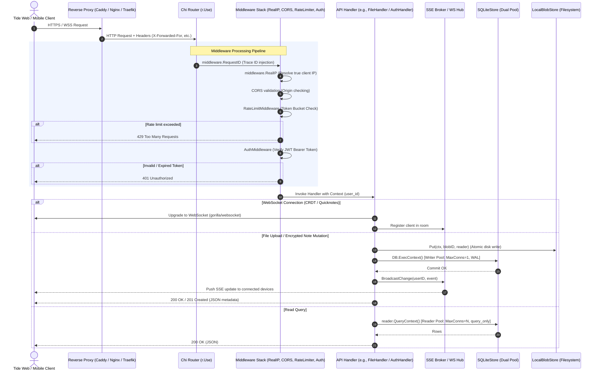

# 01. System Overview & Architecture

## System Purpose & Philosophy

Tide Cloud is the lightweight, self-hostable synchronization, metadata coordination, and collaboration backend for the Tide productivity suite. Built in Go, it is engineered to act as a **zero-knowledge sync and collaboration relay** with a **minimal metadata server** footprint.

### Core Architectural Principles

1. **Zero-Knowledge by Design (E2EE)**
   - The server never stores plaintext user documents, note contents, task payloads, or private encryption keys.
   - All document encryption is executed client-side using hybrid cryptographic protocols (AES-256-GCM, X25519, and Argon2id / PBKDF2).
   - Identifiers (such as user emails and handles) utilize salted blind indexes (`email_blind_index`, `username_blind_index`) to enable queries without exposing personally identifiable information (PII).

2. **Self-Hostable & Single-Binary Simplicity**
   - No external database daemons (like PostgreSQL or MySQL) or object stores (like AWS S3) are mandatory.
   - Built with pure Go SQLite (`modernc.org/sqlite`), eliminating CGO dependencies and cross-compilation friction.
   - Filesystem-backed binary blob storage (`LocalBlobStore`) provides immediate zero-config durability.

3. **Hybrid Real-Time Relay Engine**
   - **Server-Sent Events (SSE):** Provides lightweight, directional streaming for event fanout, presence broadcasts, and real-time state synchronization.
   - **WebSockets (`gorilla/websocket`):** Powers bidirectional CRDT document synchronization (Yjs / note collaboration) and transient interactive quicknotes.

4. **Minimal Metadata Surface**
   - The server maintains structured indices of file trees, memberships, sharing links, and encrypted key bundles, but treats user payloads as opaque blobs.

---

## Technology Stack

| Layer | Component / Library | Details & Rationale |
|---|---|---|
| **Language Runtime** | Go 1.24+ | Compiled native binary, predictable latency, low memory footprint (~20MB idle). |
| **HTTP Routing** | `github.com/go-chi/chi/v5` | Idiomatic, composable, zero-allocation HTTP router and middleware pipeline. |
| **Database Driver** | `modernc.org/sqlite` | 100% CGO-free pure Go SQLite engine; runs identically across Linux, Windows, macOS, and Alpine. |
| **WebSocket** | `github.com/gorilla/websocket` | Standard-compliant WebSocket implementation for full-duplex CRDT and quicknote streams. |
| **Realtime Push** | HTTP SSE (Server-Sent Events) | In-memory pub/sub broker (`Broker`) multiplexing real-time notifications to long-lived HTTP client connections. |
| **Authentication** | `github.com/golang-jwt/jwt/v5` & `golang.org/x/crypto` | Stateless HMAC-SHA256 JWT sessions combined with PBKDF2 / Argon2 cryptographic operations. |
| **Storage Engine** | Dual SQLite Pool + Local Filesystem Blobs | Dedicated single-writer/multi-reader WAL SQLite pools paired with path-traversal-hardened disk storage. |

---

## Directory Tree Breakdown

The `cloud/` codebase follows standard Go project conventions:

```
cloud/
├── cmd/
│   └── server/
│       └── main.go              # Application entrypoint: flags, env setup, DI wiring, HTTP listener
├── internal/
│   ├── api/                     # HTTP Handlers, WebSockets, Middleware, SSE Broker
│   │   ├── auth.go              # Registration, OTP requests, JWT issuance & verification
│   │   ├── events.go            # SSE broker pub/sub & presence reaper goroutine
│   │   ├── files.go             # Metadata CRUD, CRDT WebSocket endpoint (/api/ws/notes)
│   │   ├── middleware.go        # JWT extraction, auth validation, context injection
│   │   ├── presence.go          # User status & heartbeat handlers
│   │   ├── quicknotes.go        # Ephemeral shared quicknotes + WebSocket relay
│   │   ├── ratelimit.go         # Token-bucket IP rate limiter with automated cleaner
│   │   └── ...                  # Tasks, Todos, Links, Profiles, Extensions, External APIs
│   ├── db/
│   │   └── models.go            # Domain models, database structs, enums, blind index entities
│   ├── store/
│   │   ├── sqlite.go            # Dual-connection SQLite pool, DDL migrations, transaction wrappers
│   │   └── blob.go              # BlobStore interface & LocalBlobStore filesystem implementation
│   └── util/                    # Common cryptographic & string helpers
├── scripts/
│   ├── migrate.sh               # Database migration and verification utility scripts
│   └── seed.go                  # Development fixture seeding
├── go.mod                       # Go module dependencies
├── go.sum                       # Dependency checksums
└── .env.example                 # Template for runtime environment configuration
```

---

## End-to-End Request Lifecycle

The diagram below illustrates how an incoming client HTTP/WebSocket request navigates TLS termination, the Chi middleware chain, security gates, handler dispatch, and the dual SQLite / Blob persistence layer:



---

## Dual SQLite Connection Pool Architecture

SQLite operates in Write-Ahead Logging (WAL) mode. Because concurrent writes to SQLite can trigger database locks, Tide Cloud enforces an isolated **Dual Pool** pattern in `internal/store/sqlite.go`:

1. **Dedicated Writer Pool (`DB`):**
   - Configured with `MaxOpenConns(1)` and `MaxIdleConns(1)`.
   - All `INSERT`, `UPDATE`, `DELETE`, and DDL migrations execute exclusively through this single-threaded writer, entirely eliminating write collisions and `SQLITE_BUSY` errors.
   - Connected with PRAGMAs: `busy_timeout(5000)`, `journal_mode(WAL)`, `synchronous(NORMAL)`, `foreign_keys(ON)`.

2. **Concurrent Multi-Reader Pool (`reader`):**
   - Configured with `MaxOpenConns(N)` where $N = \max(4, \text{NumCPU} \times 2)$.
   - Connected with `query_only(true)` and WAL mode enabled.
   - Read queries execute concurrently alongside writes without blocking or stalling the writer.

3. **Filesystem Blob Storage (`LocalBlobStore`):**
   - Large encrypted payloads, attachments, and note versions are persisted as raw files under `DATA_DIR/blobs/`.
   - Enforces path sanitization (`filepath.Clean` and `filepath.Rel`) to protect against directory traversal attacks.

---

## Configuration & Environment

The server loads environment variables from `.env` in the working directory on startup (via `github.com/joho/godotenv`).

| Variable | Default Value | Description |
|---|---|---|
| `PORT` | `8080` | TCP port on which the HTTP server binds. |
| `DATA_DIR` | `./data` | Directory where `tide.db` and the `blobs/` directory reside. |
| `ENV` | `development` | Environment mode (`development` or `production`). In production, strict security checks are enforced. |
| `SERVER_MASTER_KEY` | *(Required in prod)* | 32-character encryption key used to protect server-side sensitive data (minimum 32 bytes). |
| `JWT_SECRET` | *(Required)* | High-entropy secret key used to sign and verify session tokens. Server halts if omitted. |
| `ENABLE_REGISTRATION` | `true` | Allows new users to register. Set to `false` for private, invite-only instances. |
| `APP_URL` | `""` | Primary front-end URL; automatically added to the trusted CORS origin list. |
| `ALLOWED_ORIGINS` | `""` | Comma-separated list of additional trusted CORS origins (e.g., `https://app.example.com`). |
| `APP_VERSION` | `0.2.0` | Semantic version string returned by `/api/v1/version`. |

### Built-in Rate Limit Parameters

Token-bucket rate limiters are initialized per endpoint category to prevent abuse and brute-force attacks:
- **Auth Limiter:** `0.1` tokens/sec, burst size `5` (applies to `/auth/register` and `/auth/request-otp`).
- **OTP Verification Limiter:** `0.166` tokens/sec, burst size `5` (applies to `/auth/verify-otp`).
- **Search Limiter:** `20.0 / 60.0` tokens/sec, burst size `20` (applies to `/search`).
- **Quicknote Limiter:** `5.0` tokens/sec, burst size `30` (applies to `/quicknotes`).

---

## Background Processes

Tide Cloud runs several asynchronous background goroutines to maintain performance, reclaim storage, and ensure active session hygiene:

1. **Garbage Collection Ticker (Trash Purge):**
   - **Frequency:** Every 1 hour (plus once immediately upon server startup).
   - **Action:** Executes `sqliteStore.PurgeOldTrashedFiles(ctx, blobStore)`.
   - **Policy:** Permanently deletes files marked as trashed whose `deleted_at` timestamp exceeds **7 days**. Both SQLite metadata rows and corresponding disk blobs in `LocalBlobStore` are unlinked.

2. **Presence Monitor & Reaper:**
   - **Frequency:** Continuous ticker running in `broker.reaper()`.
   - **Action:** Monitors user heartbeats and last-seen timestamps.
   - **Policy:** If a user heartbeat lapses beyond the timeout threshold, the reaper transitions the user's status to `offline` and broadcasts a `user_status_changed` SSE event to connected collaborators.

3. **Token Bucket Rate Limiter Cleanup:**
   - **Frequency:** Periodic eviction in `limiter.cleanupLoop()`.
   - **Action:** Inspects the in-memory IP map of `IPRateLimiter`.
   - **Policy:** Evicts IP entries that have been inactive for more than 10 minutes to prevent unbounded memory growth over prolonged server runtimes.
