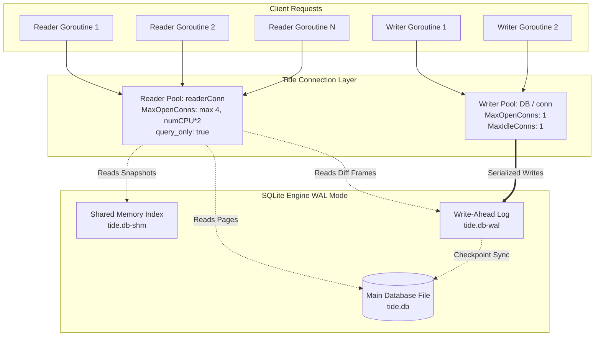
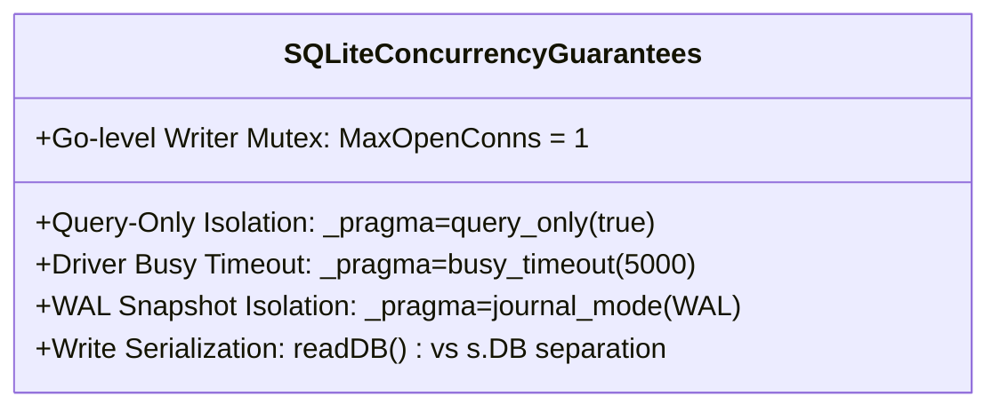

# Database Concurrency & Connection Pool Architecture

> Technical Deep-Dive into Concurrency, Connection Pools, and Transaction Safety in `cloud/internal/store/sqlite.go`.

---

## 1. Executive Summary & The SQLite Concurrency Dilemma

SQLite is an in-process, serverless relational database engine. Unlike client-server database systems (such as PostgreSQL or MySQL) that manage connection multiplexing and transaction isolation via a dedicated background daemon process, SQLite coordinates operations directly within the host process using filesystem-level locking primitives.

### The Concurrency Dilemma in Go Services

In a highly concurrent, multi-threaded Go backend service (such as Tide's REST API and Server-Sent Events engine), hundreds of goroutines execute concurrent queries and mutations against the database. Under default SQLite settings (Rollback Journal mode):
- A write transaction acquires an exclusive lock on the entire database file.
- Any concurrent read request is blocked until the write transaction commits or rolls back.
- Conversely, active read transactions block write transactions.
- Concurrent write attempts lead directly to `SQLITE_BUSY` (`database is locked`) errors if the busy timeout is exceeded.

```
Rollback Journal Mode (Legacy):
Goroutine A (Write): [==== EXCLUSIVE LOCK ====]
Goroutine B (Read) :                          [ BLOCKED ] ---> [ READ ]
Goroutine C (Write):                          [ BLOCKED ] ------------> [ SQLITE_BUSY ]
```

### Write-Ahead Logging (WAL) Mode

To resolve this bottleneck, Tide configures SQLite in **Write-Ahead Logging (WAL) mode** (`_pragma=journal_mode(WAL)`). In WAL mode:
1. **Readers Never Block Writers:** Readers query committed database pages from the main database file (`tide.db`) combined with uncommitted/committed frames from the WAL file (`tide.db-wal`) using a snapshot isolation index (`tide.db-shm`).
2. **Writers Never Block Readers:** When a write transaction begins, it appends changes to the end of the WAL file. Ongoing read operations continue referencing their historical snapshot without blocking.
3. **Single-Writer Invariant:** Even in WAL mode, **SQLite permits at most one concurrent writer**. Two connections attempting to write simultaneously will contest an exclusive write lock. If Go's `database/sql` connection pool maintains multiple open writer connections, concurrent writes will race, triggering `SQLITE_BUSY` or deadlock under load.



---

## 2. Dual Connection Pool Architecture

To eliminate write contention while maximizing multi-core read throughput, Tide implements a **Dual Connection Pool Architecture** in `cloud/internal/store/sqlite.go`.

### Architecture Overview

```go
// SQLiteStore implements the database interface using SQLite.
type SQLiteStore struct {
    DB     *sql.DB // Writer connection pool (MaxOpenConns: 1)
    reader *sql.DB // Multi-connection reader pool (MaxOpenConns: N)
}
```

The database store separates database operations into two dedicated connection handles:
1. `s.DB`: Dedicated single-connection pool reserved exclusively for write mutations, schema migrations, and write transactions.
2. `s.reader`: Multi-connection pool dynamically scaled to system CPU resources for read queries.

Routing is managed via the internal helper `readDB()`:

```go
func (s *SQLiteStore) readDB() *sql.DB {
    if s.reader != nil {
        return s.reader
    }
    return s.DB
}
```

---

### Detailed Pool Specifications

| Property | Writer Pool (`s.DB`) | Reader Pool (`s.reader`) | Rationale |
| :--- | :--- | :--- | :--- |
| **Connection DSN** | `file:tide.db?...` | `file:tide.db?...&_pragma=query_only(true)` | Prevents accidental write commands on reader connections. |
| **`MaxOpenConns`** | `1` | `max(4, runtime.NumCPU() * 2)` | Enforces single-writer serialization in Go memory; scales reads with CPU cores. |
| **`MaxIdleConns`** | `1` | `max(2, runtime.NumCPU())` | Keeps warm reader connections ready to avoid connection open overhead. |
| **`ConnMaxLifetime`**| `1 * time.Hour` | `1 * time.Hour` | Recycles long-lived file descriptors periodically. |
| **`busy_timeout`** | `5000` (5 seconds) | `5000` (5 seconds) | Allows internal retries before failing with `SQLITE_BUSY`. |
| **`journal_mode`** | `WAL` | `WAL` | Enables concurrent readers alongside active writer. |
| **`synchronous`** | `NORMAL` | `NORMAL` | Avoids fsync on every commit; guarantees consistency in WAL mode. |
| **`foreign_keys`** | `ON` | `ON` | Enforces relational constraints across all queries. |

---

### 2.1 The Writer Connection Pool (`conn`)

The writer pool is initialized as follows:

```go
dbPath := filepath.Join(dataDir, "tide.db")
dsn := fmt.Sprintf("file:%s?_pragma=busy_timeout(5000)&_pragma=journal_mode(WAL)&_pragma=synchronous(NORMAL)&_pragma=foreign_keys(ON)", dbPath)

conn, err := sql.Open("sqlite", dsn)
if err != nil {
    return nil, fmt.Errorf("failed to open db: %w", err)
}

// SQLite-specific optimizations for concurrency
conn.SetMaxOpenConns(1)
conn.SetMaxIdleConns(1)
conn.SetConnMaxLifetime(time.Hour)
```

#### Why `MaxOpenConns = 1` is Essential
In standard client-server SQL databases (PostgreSQL, MySQL), connection pools commonly allow 20–100 open connections. In SQLite, however:
- If `MaxOpenConns > 1`, two separate Go worker goroutines can obtain two distinct database connections from the pool.
- If both goroutines attempt to execute `INSERT`, `UPDATE`, or `tx.BeginTx()`, both connections attempt to obtain SQLite's internal `RESERVED` / `EXCLUSIVE` file lock.
- Even with WAL mode, one connection will immediately block or receive `SQLITE_BUSY`.
- By constraining `MaxOpenConns = 1`, Go's native `database/sql` internal mutex and queue (`sql.DB.connRequests`) serialize all write operations **inside Go memory space**. Goroutines wait cooperatively on Go channels rather than battling over OS filesystem locks.

---

### 2.2 The Reader Connection Pool (`readerConn`)

The reader pool is sized dynamically according to available hardware concurrency:

```go
numCPU := runtime.NumCPU()
maxReaders := numCPU * 2
if maxReaders < 4 {
    maxReaders = 4
}

readerDSN := fmt.Sprintf("file:%s?_pragma=busy_timeout(5000)&_pragma=journal_mode(WAL)&_pragma=synchronous(NORMAL)&_pragma=query_only(true)&_pragma=foreign_keys(ON)", dbPath)
readerConn, err := sql.Open("sqlite", readerDSN)
if err != nil {
    conn.Close()
    return nil, fmt.Errorf("failed to open reader db: %w", err)
}
readerConn.SetMaxOpenConns(maxReaders)
readerConn.SetMaxIdleConns(max(2, numCPU))
readerConn.SetConnMaxLifetime(time.Hour)
```

#### `_pragma=query_only(true)`
The reader pool enforces read-only safety at the driver level. Any accidental mutation query (`INSERT`, `UPDATE`, `DELETE`, `CREATE`) routed to `s.readDB()` is immediately rejected by SQLite with `attempt to write a readonly database`, ensuring write safety invariants cannot be bypassed.

#### Multi-Core Scaling
Because WAL mode allows unlimited concurrent readers without locking the database file, setting `MaxOpenConns = max(4, numCPU * 2)` allows read-heavy workloads (e.g. fetching note trees, verifying user tokens, searching blind indices) to execute in parallel across all CPU cores without queuing behind writes.

---

## 3. Deadlock Prevention & `database is locked` Mitigation Strategies

### Root Causes of `SQLITE_BUSY` (Code 5)

In SQLite, `database is locked` occurs under three primary scenarios:
1. **Multiple Concurrent Writers:** Two connections attempt to write to the WAL simultaneously.
2. **Lock Promotion Deadlock (Shared to Exclusive):** A transaction begins as a deferred read transaction (`BEGIN DEFERRED`), acquires a `SHARED` lock, and subsequently attempts a write query (`UPDATE` / `INSERT`). If another connection did the same, both wait for the other to release the `SHARED` lock before upgrading to `EXCLUSIVE`, creating a classic deadlock.
3. **Long-Running Transactions:** An uncommitted write transaction blocks checkpoints and subsequent write operations.

### Mitigation Matrix



1. **Go-Level Serialization via `MaxOpenConns = 1`:**
   Because only one connection exists in the writer pool, two write transactions can never execute concurrently on the SQLite layer. Go's runtime queues goroutines cleanly without consuming kernel lock handles.

2. **Strict Query Routing:**
   All mutating repository methods (`CreateUser`, `UpdateFileAccessKey`, `CreateTodo`, `AppendQuicknoteWAL`) strictly execute on `s.DB`. Read queries (`GetUser`, `GetFile`, `ListTodos`, `GetQuicknote`) route through `s.readDB()`.

3. **Driver-Level Busy Timeout (`busy_timeout(5000)`):**
   If a temporary lock is held (e.g. during a WAL index checkpoint or external backup read), SQLite will not immediately return `SQLITE_BUSY`. Instead, the `modernc.org/sqlite` engine sleeps and retries with exponential backoff for up to 5,000 milliseconds before timing out.

4. **Foreign Key Integrity:**
   Foreign keys are enabled on both DSNs (`_pragma=foreign_keys(ON)`), ensuring relational integrity across cascades (e.g. `ON DELETE CASCADE` on `quicknote_wal` and `quicknote_files`).

---

## 4. Transaction Handling & Execution Patterns

### 4.1 Deferred vs. Immediate Transactions

SQLite supports three transaction start modes:
- `BEGIN DEFERRED` (default in Go `sql.DB.Begin()`): Acquires no locks until the first query runs. A read query acquires `SHARED`; a subsequent write attempts to acquire `RESERVED`.
- `BEGIN IMMEDIATE`: Immediately acquires a `RESERVED` lock on the database. No other connection can start an immediate or write transaction, but readers can proceed.
- `BEGIN EXCLUSIVE`: Acquires an `EXCLUSIVE` lock, blocking all readers and writers.

In Tide:
- Because the writer pool enforces `MaxOpenConns = 1`, all writes routed through `s.DB` are already serialized before reaching SQLite.
- Even when using Go's standard `s.DB.BeginTx(ctx, nil)`, no competing connection can contend for `RESERVED` locks on `s.DB`.

### 4.2 Standard Transaction Idiom in Tide

Transactions in `cloud/internal/store/sqlite.go` adhere to the canonical Go defer-rollback pattern:

```go
tx, err := s.DB.BeginTx(ctx, nil)
if err != nil {
    return fmt.Errorf("failed to begin transaction: %w", err)
}
// Guaranteed cleanup on early return or panic:
defer tx.Rollback()

// Execute transactional statements
if _, err := tx.ExecContext(ctx, query1, arg1); err != nil {
    return fmt.Errorf("step 1 failed: %w", err)
}

if _, err := tx.ExecContext(ctx, query2, arg2); err != nil {
    return fmt.Errorf("step 2 failed: %w", err)
}

// Commit returns nil or error. If committed, subsequent tx.Rollback() is a no-op.
if err := tx.Commit(); err != nil {
    return fmt.Errorf("failed to commit transaction: %w", err)
}
return nil
```

#### Why `defer tx.Rollback()` is Safe
In Go's `database/sql` driver:
- Calling `tx.Rollback()` after a successful `tx.Commit()` returns `sql.ErrTxDone`, which is ignored by the driver runtime.
- If an error occurs midway (e.g., query error, context timeout, or panic), `defer tx.Rollback()` guarantees that SQLite's transaction lock is freed immediately, preventing pool exhaustion or hanging locks.

---

## 5. Schema Migration Safety with `PRAGMA user_version` & Atomic Upgrades

Tide manages database migrations without external heavy migration binaries (like Flyway or Goose) by utilizing SQLite's built-in `PRAGMA user_version`.

### 5.1 The `user_version` Register

SQLite provides a 32-bit signed integer register in the database header accessible via `PRAGMA user_version`:
- Initial fresh database: `user_version = 0`.
- Fast, atomic read: `s.DB.QueryRow("PRAGMA user_version;").Scan(&currentVersion)`.
- Fast, atomic update: `PRAGMA user_version = <version>;`.

### 5.2 Deterministic Sequential Migrations (ARC-02)

In `cloud/internal/store/sqlite.go`, migrations are modeled as an immutable array of versioned structures:

```go
type schemaMigration struct {
    version int
    name    string
    stmts   []string
}
```

The migration runner strictly guarantees atomic step execution:

```go
func (s *SQLiteStore) runDeterministicMigrations() error {
    var currentVersion int
    if err := s.DB.QueryRow("PRAGMA user_version;").Scan(&currentVersion); err != nil {
        return fmt.Errorf("failed to get current database schema user_version: %w", err)
    }

    migrations := []schemaMigration{
        {
            version: 1,
            name:    "file_visibility_and_shares_metadata",
            stmts: []string{
                "ALTER TABLE files ADD COLUMN visibility TEXT DEFAULT 'private'",
                // ...
            },
        },
        // ... additional sequential versions
    }

    for _, m := range migrations {
        if currentVersion >= m.version {
            continue
        }

        // Each migration version runs in its own atomic transaction
        tx, err := s.DB.BeginTx(context.Background(), nil)
        if err != nil {
            return fmt.Errorf("migration to version %d failed to begin transaction: %w", m.version, err)
        }

        for _, stmt := range m.stmts {
            if _, execErr := tx.Exec(stmt); execErr != nil {
                // Idempotent protection against duplicate columns
                if isDuplicateColumnError(execErr) {
                    continue
                }
                _ = tx.Rollback()
                return fmt.Errorf("migration to version %d failed: %w", m.version, execErr)
            }
        }

        // Update the user_version register inside the transaction
        if _, err := tx.Exec(fmt.Sprintf("PRAGMA user_version = %d;", m.version)); err != nil {
            _ = tx.Rollback()
            return fmt.Errorf("migration to version %d failed to update user_version: %w", m.version, err)
        }

        if err := tx.Commit(); err != nil {
            return fmt.Errorf("migration to version %d failed to commit: %w", m.version, err)
        }

        currentVersion = m.version
    }

    return nil
}
```

### 5.3 Idempotency & Error Handling

- **Duplicate Column Protection:** SQLite does not natively support `ALTER TABLE ... ADD COLUMN IF NOT EXISTS`. The helper `isDuplicateColumnError` inspects the driver error:
  ```go
  func isDuplicateColumnError(err error) bool {
      if err == nil {
          return false
      }
      msg := strings.ToLower(err.Error())
      return strings.Contains(msg, "duplicate column name")
  }
  ```
  If a column already exists (e.g. from a partial legacy script), the error is gracefully skipped without aborting migration progress.
- **Atomic Rollback on Statement Failure:** If any statement in migration `N` fails, the transaction rolls back completely. `user_version` remains at `N-1`. The application halts startup with an explicit error, preventing corrupt or half-migrated states.

### 5.4 Table Recreation Pattern for Complex Refactoring

Because SQLite has historical limitations on `ALTER TABLE` (e.g. dropping columns or modifying constraints prior to version 3.35.0), Tide uses the standard SQLite 4-step table recreation pattern inside an atomic transaction (as demonstrated in `handleUserSchemaMigration`):

```
1. ALTER TABLE users RENAME TO users_old;
2. CREATE TABLE users (... new schema ...);
3. INSERT INTO users SELECT ... FROM users_old;
4. DROP TABLE users_old;
5. tx.Commit();
```

---

## 6. Performance Metrics, WAL Checkpointing & High-Concurrency Best Practices

### 6.1 `synchronous = NORMAL` in WAL Mode

Tide configures `_pragma=synchronous(NORMAL)` for both writer and reader pools.
- Under Rollback Journal mode, `synchronous=FULL` is required to prevent database corruption during an OS crash.
- In **WAL mode**, `synchronous=NORMAL` is 100% crash-safe against application crashes and power failures. SQLite only syncs the WAL file during checkpoint operations, eliminating fsync pauses on every transaction commit.
- This results in a **10x to 50x write throughput improvement** for disk-bound I/O.

### 6.2 WAL Checkpointing Mechanics

As writes occur, `tide.db-wal` grows. SQLite automatically runs a passive checkpoint when the WAL reaches 1000 pages (approximately 4MB).
- **Passive Checkpoint (`PASSIVE`):** Copies completed frames from WAL to `tide.db` as far as possible without blocking active readers.
- If long-running read queries remain open indefinitely, checkpointing cannot truncate the WAL file, causing the WAL file to grow continuously and slowing down reader page lookups.
- **Rule:** Never keep transactions or `sql.Rows` open across network I/O or HTTP streams. Always close queries and rows immediately:
  ```go
  rows, err := s.readDB().QueryContext(ctx, query, args...)
  if err != nil {
      return nil, err
  }
  defer rows.Close() // Mandatory to release reader lock frame
  ```

### 6.3 Concurrency Best-Practice Checklist for Developers

1. **Use `s.readDB()` for Pure Reads:**
   Always invoke `s.readDB().QueryContext(...)` or `s.readDB().QueryRowContext(...)` for `SELECT` queries to leverage the multi-connection reader pool.
2. **Use `s.DB` for Mutations and Writes:**
   All `INSERT`, `UPDATE`, `DELETE`, and DDL statements must execute on `s.DB`.
3. **Always Set Contexts with Timeouts:**
   Pass `ctx` to all queries (`QueryContext`, `ExecContext`). If a client disconnects, Go cancels the context and halts the database operation promptly.
4. **Keep Transactions Short:**
   Never perform hashing (e.g. Argon2), encryption, disk blob storage operations (`blobStore.WriteBlob`), or outbound network calls inside an active SQL transaction. Calculate payloads before opening the transaction.
5. **Close `sql.Rows` Explicitly:**
   Ensure `defer rows.Close()` is called immediately following error checking. An unclosed `sql.Rows` retains a connection from the reader pool, causing pool starvation.

---

## 7. Architectural Summary

| Dimension | Implementation | Guarantee |
| :--- | :--- | :--- |
| **Concurrency Model** | Dual Pool (1 Writer, N Readers) in WAL Mode | Non-blocking reads during active writes; zero write contention. |
| **Deadlock Prevention** | In-memory serialization via `MaxOpenConns = 1` | Eliminates SQLite `SQLITE_BUSY` contention among Go goroutines. |
| **Read Scalability** | `MaxOpenConns = max(4, numCPU * 2)` with `query_only(true)` | Parallel multi-core snapshot reads with hardware-scaled concurrency. |
| **Durability & Speed** | `journal_mode(WAL)` + `synchronous(NORMAL)` | High TPS write speed with crash-resilient ACID transactions. |
| **Migration Safety** | `PRAGMA user_version` + Atomic Transactions | Deterministic, sequential, recoverable schema upgrades. |
