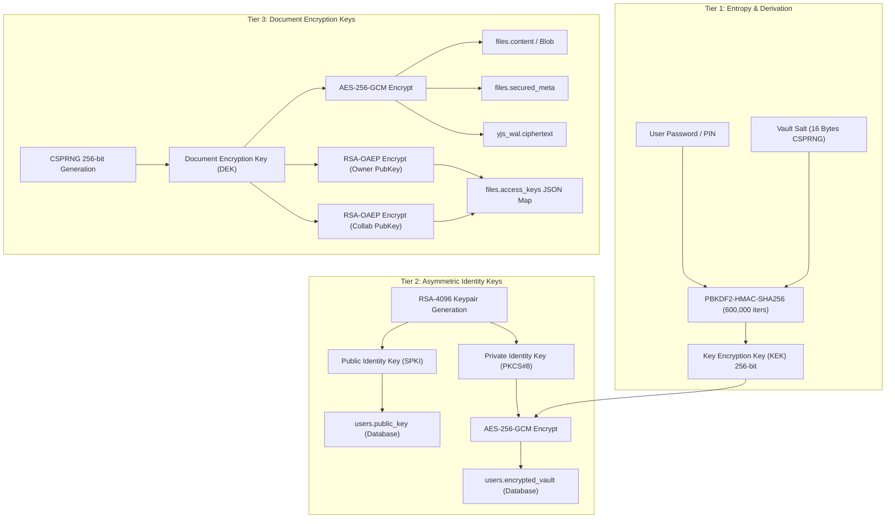
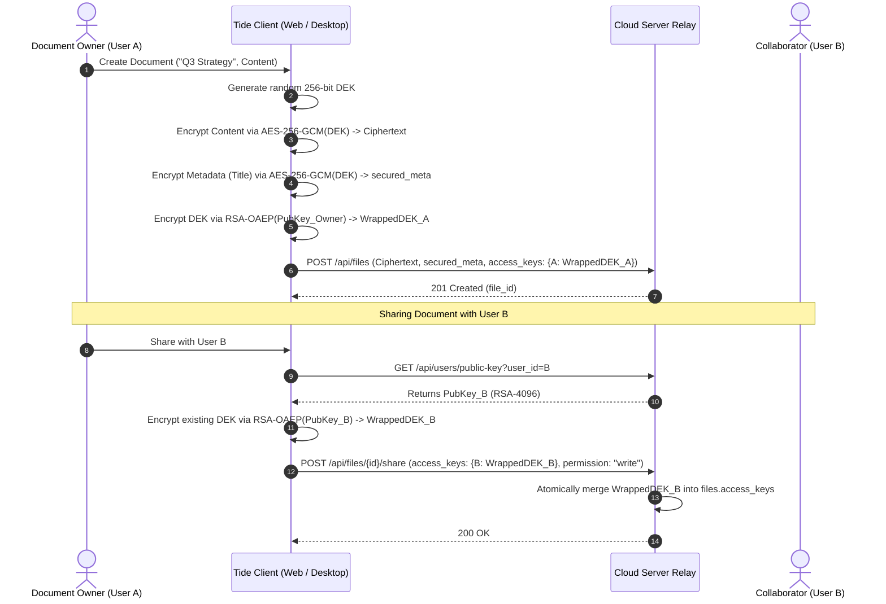
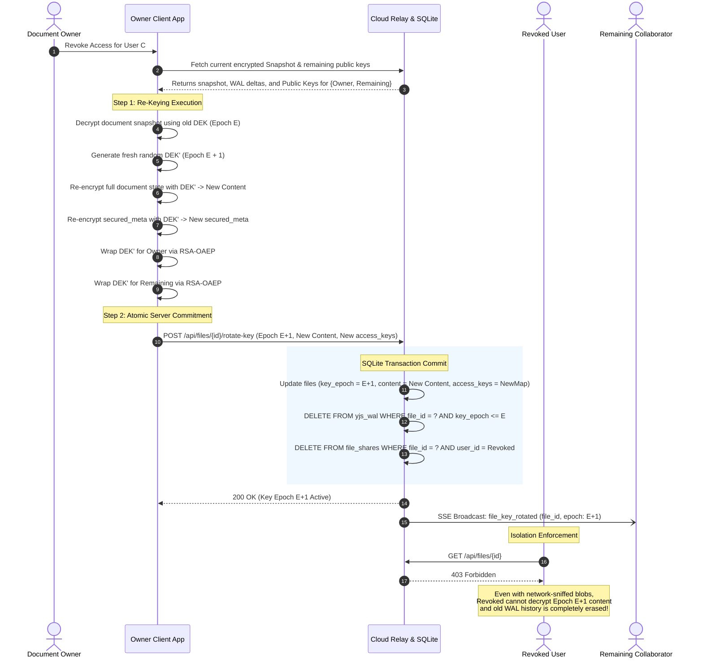
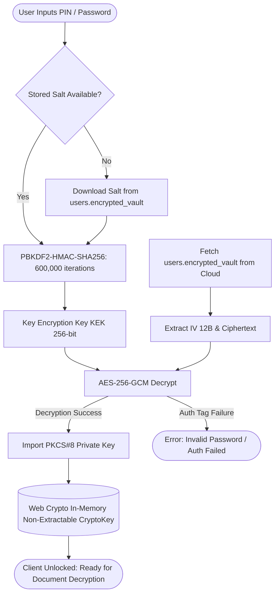
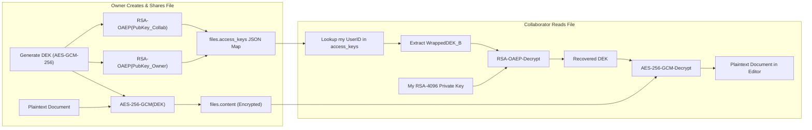
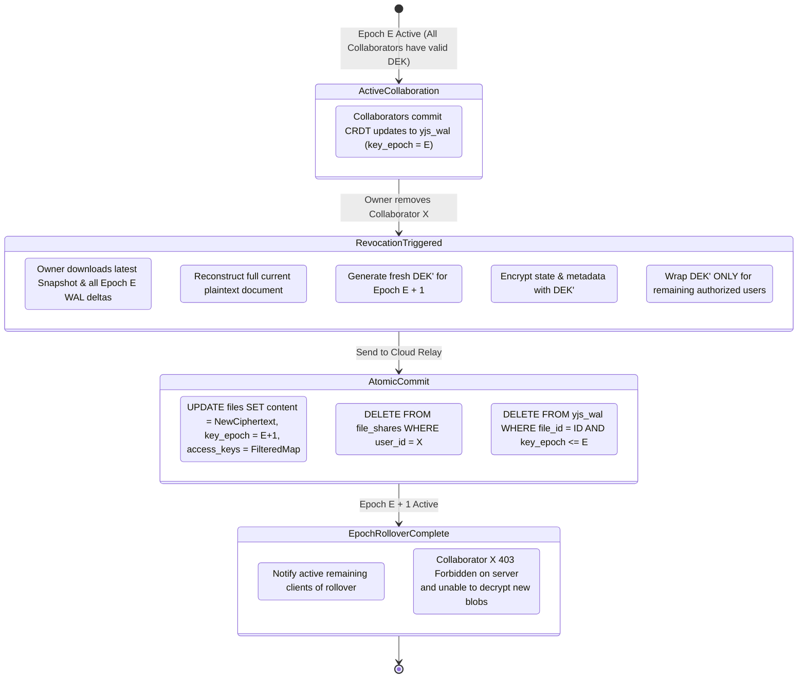

# 03. Zero-Knowledge Cryptography Specification

> **Status:** Standardized Architecture Specification  
> **Applies to:** `cloud/` (Go Sync & Storage Relay), `web/` (TypeScript / Web Crypto API), `core/` (Rust `tide-core`)  
> **Primary Source Code:** `web/src/lib/crypto.ts`, `web/src/lib/cryptoV2.ts`, `cloud/internal/store/sqlite.go`, `cloud/internal/api/files.go`  

---

## 1. Executive Summary & Zero-Knowledge Security Model

Tide Cloud is architected around a strict **Zero-Knowledge / End-to-End Encrypted (E2EE)** computational model. The server infrastructure operates purely as an untrusted, blind storage relay and metadata coordinator. At no point in the lifecycle of any document, task, calendar event, quicknote, or attachment does the server possess the cryptographic material required to inspect, transform, or deduce plaintext user data.

```
+-------------------------------------------------------------------------------+
|                                CLIENT BOUNDARY                                |
|                                                                               |
|   +-------------------+    PBKDF2 / Argon2id     +------------------------+   |
|   |  Passphrase / PIN | -----------------------> | Key Encryption Key KEK |   |
|   +-------------------+                          +------------------------+   |
|                                                              |                |
|                                                              v                |
|   +-----------------------------------------------------------------------+   |
|   | Master Identity Keypair: RSA-4096 (PKCS#8 Private Key & SPKI Public)  |   |
|   +-----------------------------------------------------------------------+   |
|                               |                                               |
|                               v                                               |
|   +---------------------------------------+   AES-256-GCM                     |
|   | Document Encryption Key (DEK) 256-bit | --------------> [ Plaintext Doc ] |
|   +---------------------------------------+                                   |
|            |                      |                                           |
|            | RSA-OAEP Wrap        | RSA-OAEP Wrap                             |
|            v                      v                                           |
|   +------------------+   +------------------+                                 |
|   | Owner Wrapped DEK|   | Peer Wrapped DEK |                                 |
|   +------------------+   +------------------+                                 |
+------------|----------------------|-------------------------------------------+
             |                      |
             | TLS 1.3 Transport    | (Zero-Knowledge Payload)
             v                      v
+-------------------------------------------------------------------------------+
|                             CLOUD SERVER RELAY                                |
|                                                                               |
|   - Blind Opaque Blobs: `files.content`, `files.secured_meta`                 |
|   - Multi-User Access Map: `files.access_keys` {"userA": "...", "userB": "..."}|
|   - Blind Index Identity: `email_blind_index`, `username_blind_index`         |
|   - Key Epoch Tracker: `files.key_epoch`, `yjs_wal.key_epoch`                |
|   * ZERO PLAINTEXT ACCESS * ZERO DEK ACCESS * ZERO PRIVATE KEY ACCESS *       |
+-------------------------------------------------------------------------------+
```

### Threat Model & Trust Assumptions

| Threat Actor | Capabilities | Security Guarantee |
| :--- | :--- | :--- |
| **Compromised Server / Malicious Admin** | Full root filesystem and SQLite database access, read/write database inspection, arbitrary query injection. | **Zero Plaintext Leakage**: All document bodies, titles, metadata, and collaborative CRDT delta updates are encrypted with client-generated AES-256 keys. Private keys are encrypted client-side with PBKDF2-derived KEKs. |
| **Honest-but-Curious Server** | Follows protocol specifications correctly but attempts to correlate document contents, user identities, or collaboration graphs. | **Confidentiality & Blind Identifiers**: User identifiers (emails, usernames) are stored as cryptographic blind hashes (`HMAC-SHA256`). Payloads remain opaque byte buffers. |
| **Passive Network Eavesdropper** | Intercepts all traffic between client and cloud relay. | **Dual Layer Protection**: Protected by standard TLS 1.3 in-transit, backed by end-to-end payload cryptography resistant to TLS termination or MITM proxies. |
| **Revoked Collaborator** | Possesses prior historical DEKs and previous Yjs CRDT states. | **Forward Secrecy via Key Rotation & WAL Truncation**: Upon revocation, documents are re-keyed under a new epoch ($\text{epoch} + 1$), historical CRDT deltas are pruned/re-encrypted, and the revoked user is omitted from the access key envelope. |

### Data Classification: Plaintext vs. Blind Storage

| Data Entity | Storage Location | State on Server | Encryption Layer |
| :--- | :--- | :--- | :--- |
| **Document Content (Notes, Markdown, Tasks)** | `files.content` or Blob Store | Ciphertext (Opaque Binary) | AES-256-GCM via document-specific DEK |
| **Document Title & Sensitive Attributes** | `files.secured_meta` | Ciphertext (Opaque Binary) | AES-256-GCM via document-specific DEK |
| **Yjs Collaborative CRDT Updates** | `yjs_wal.ciphertext` | Ciphertext (Opaque Binary) | AES-256-GCM via document-specific DEK |
| **Collaborator Key Ring** | `files.access_keys` | JSON Map of Base64 Wrapped DEKs | RSA-OAEP-4096 (per recipient public key) |
| **User Identity Private Key** | `users.encrypted_vault` | Ciphertext (Base64 PKCS#8) | AES-256-GCM via client KEK (PBKDF2/Argon2id) |
| **User Email / Username** | `users.email_blind_index` | 64-char Hex String | HMAC-SHA256 via Server Master Pepper |
| **Document Hierarchy & Types** | `files.parent_id`, `files.type` | Plaintext Metadata | Unencrypted for relational routing |
| **Sharing Permission Grants** | `file_shares.permission` | Plaintext Metadata | Unencrypted for authorization verification |

---

## 2. Mathematical Foundations & Cryptographic Primitives

Tide enforces standard, modern cryptographic primitives compliant with NIST SP 800-38D, RFC 8017 (PKCS #1 v2.2), and RFC 8018 (PKCS #5 v2.1).

### 2.1 AES-256-GCM (Authenticated Bulk Data Encryption)

Bulk encryption of all document payloads, attachments, file metadata, and real-time CRDT updates is performed using **AES-256-GCM** (Advanced Encryption Standard in Galois/Counter Mode).

$$\text{Ciphertext}, \text{Tag} = \text{AES-GCM-Encrypt}(K_{\text{DEK}}, \text{IV}, \text{Plaintext}, \text{AAD})$$

- **Key Size ($K_{\text{DEK}}$):** 256 bits (32 octets), generated using CSPRNG (`crypto.getRandomValues`).
- **Initialization Vector ($\text{IV}$):** Strictly 96 bits (12 octets) generated uniformly at random for every single encryption operation.
- **Authentication Tag:** 128 bits (16 octets) verifying both payload ciphertext integrity and authenticity.
- **Non-Repeatability Invariant:** An IV must **never** be reused with the same DEK. Under GCM mode, IV reuse leaks the authentication subkey $H = E_K(0^{128})$, destroying the authenticity guarantees of all messages encrypted under that key.

### 2.2 RSA-4096 / RSA-OAEP (Asymmetric Key Encapsulation)

Asymmetric key exchange and multi-user document key distribution use 4096-bit RSA keys with **OAEP** (Optimal Asymmetric Encryption Padding) parameterized with SHA-256:

$$\text{WrappedDEK} = \text{RSA-OAEP-Encrypt}(PK_{\text{recipient}}, \text{DEK}, \text{Hash} = \text{SHA-256}, \text{MGF} = \text{MGF1-SHA-256})$$

- **Modulus Length:** 4096 bits ($N = p \cdot q$).
- **Public Exponent ($e$):** 65537 ($2^{16} + 1$).
- **Hash Function:** SHA-256 (256-bit digest).
- **Mask Generation Function:** MGF1 utilizing SHA-256.
- **Label Parameter:** Empty octet string ($L = \epsilon$).
- **Security Strength:** Provides $\ge 128$ bits of equivalent symmetric security, rendering classical integer factorization attacks computationally infeasible.

### 2.3 PBKDF2-HMAC-SHA256 & Argon2id (Key Derivation Function)

User authentication passphrases and PINs never derive cryptographic master keys directly. They undergo key derivation to produce a 256-bit Key Encryption Key ($\text{KEK}$):

$$\text{KEK} = \text{PBKDF2}(\text{PRF} = \text{HMAC-SHA256}, \text{Password}, \text{Salt}, c = 600\,000, dkLen = 32)$$

- **Salt:** 16 octets (128 bits) minimum of CSPRNG entropy stored in plaintext alongside the encrypted vault.
- **Iteration Count ($c$):**
  - **Standard Tier (Current):** $600\,000$ iterations (exceeding OWASP 2024 recommendations for PBKDF2-HMAC-SHA256).
  - **Legacy Tier (Backward Compatibility):** $100\,000$ iterations (recognized during login migration; accounts are upgraded upon authentication).
- **Memory-Hard Alternative (Argon2id):**
  - Parameterized with: $\text{Time} = 3$, $\text{Memory} = 64\,\text{MB}$ ($65\,536\,\text{KiB}$), $\text{Parallelism} = 4$.

### 2.4 HMAC-SHA256 Blind Indexing

To allow the cloud relay to query user records by email, username, or phone number without learning the plaintext PII, Tide uses keyed cryptographic blind indexes:

$$\text{BlindIndex}(X) = \text{Hex}(\text{HMAC-SHA256}(K_{\text{pepper}}, \text{Normalize}(X)))$$

- **Input Normalization:**
  $$\text{Normalize}(X) = \text{ToLower}(\text{TrimWhitespace}(X))$$
- **Master Pepper ($K_{\text{pepper}}$):** High-entropy 256-bit secret stored in the server environment configuration (`BLIND_INDEX_PEPPER`), never accessible via client network responses or written into the database itself.

---

## 3. Key Hierarchy & Derivation Architecture

The Tide zero-knowledge model enforces a strict three-tier key hierarchy separating authentication secrets, identity keys, and per-entity storage keys.



### 3.1 Vault Registration & Generation Sequence

When a user registers:
1. The client generates a random 16-byte `vault_salt`.
2. The client derives the 256-bit $\text{KEK}$ using $\text{PBKDF2-SHA256}(\text{password}, \text{vault\_salt}, 600\,000)$.
3. The client generates an RSA-4096 keypair $(\text{PubIdent}, \text{PrivIdent})$.
4. The private key is exported to standard PKCS#8 binary DER format.
5. The client encrypts the PKCS#8 private key using $\text{AES-256-GCM}$ keyed with $\text{KEK}$ with a unique 12-byte IV:
   $$\text{VaultCiphertext} = \text{AES-GCM-Encrypt}_{\text{KEK}}(\text{IV}_{\text{vault}}, \text{PrivIdent}_{\text{PKCS8}})$$
6. The client packages the result into a vault bundle:
   ```json
   {
     "salt": "base64...",
     "iv": "base64...",
     "ciphertext": "base64..."
   }
   ```
7. The public key is exported to SubjectPublicKeyInfo (SPKI) PEM/base64 format.
8. The client transmits `encrypted_vault` and `public_key` along with blind indices to the server. The raw passphrase and $\text{KEK}$ are immediately cleared from client memory.

### 3.2 Vault Unlock & Session Key Management

When a user logs in:
1. The client requests the user's `encrypted_vault` and salt from `cloud/`.
2. The user inputs their passphrase.
3. The client derives $\text{KEK}$ locally.
4. The client decrypts `encrypted_vault` using $\text{AES-256-GCM}$.
5. The decrypted PKCS#8 bytes are imported into the browser's non-extractable Web Crypto subsystem (`extractable = false`).
6. The decrypted private key resides strictly in application memory and is never persisted to unencrypted local storage or cookies.

---

## 4. Multi-User Sharing & Envelope Encryption

Tide achieves multi-user sharing without compromising zero-knowledge guarantees via **Envelope Encryption**. Every document is encrypted using a unique, dedicated symmetric key ($\text{DEK}$). Access control is established by encrypting this single DEK with the public identity key of each authorized collaborator.

### 4.1 Storage Schema: `files.access_keys`

The database column `files.access_keys` stores an envelope mapping user UUIDs to their individually encrypted copies of the file's DEK:

```json
{
  "usr_01HXYZ789A": {
    "wrapped_key": "qK7...[Base64 Encrypted DEK via User A RSA-4096]...",
    "created_at": 1731698400
  },
  "usr_01HXYZ999B": {
    "wrapped_key": "xM2...[Base64 Encrypted DEK via User B RSA-4096]...",
    "created_at": 1731698425
  }
}
```

### 4.2 Document Creation Flow



### 4.3 Document Decryption Protocol

When User B attempts to view or edit the document:
1. User B downloads the file payload from `cloud/`, receiving:
   - `content`: Bulk ciphertext.
   - `secured_meta`: Encrypted title and attributes.
   - `access_keys`: Key map containing entry for User B (`WrappedDEK_B`).
2. User B extracts `WrappedDEK_B` using their authenticated `user_id`.
3. User B un-envelopes the DEK using their non-extractable private key:
   $$\text{DEK} = \text{RSA-OAEP-Decrypt}(\text{PrivKey}_B, \text{WrappedDEK}_B)$$
4. User B decrypts `secured_meta` and `content` using $\text{AES-256-GCM}(\text{DEK})$.
5. Decrypted state is loaded into the local editor / CRDT engine.

### 4.4 Password-Protected Documents (Double-Envelope Mode)

If a document is configured with a standalone document password:
1. The client derives a document Key Encryption Key ($\text{KEK}_{\text{doc}}$) via $\text{PBKDF2}(\text{password}, \text{pwd\_salt})$.
2. The $\text{DEK}$ is encrypted with $\text{KEK}_{\text{doc}}$ using $\text{AES-256-GCM}$:
   $$\text{WrappedDEK}_{\text{pwd}} = \text{AES-GCM-Encrypt}_{\text{KEK}_{\text{doc}}}(\text{IV}, \text{DEK})$$
3. In this mode, `files.metadata` stores flags `{ "has_custom_password": true, "pwd_salt": "..." }`. The envelope requires knowledge of the password before un-enveloping can succeed.

---

## 5. Key Rotation & Revocation Protocol (Forward Secrecy)

A critical vulnerability in naive envelope encryption systems is **Post-Revocation Read Access**: if a collaborator is revoked merely by deleting their entry from `files.access_keys`, that collaborator already knows the old $\text{DEK}$ and can decrypt any future document updates or historical archives they capture.

Tide solves this problem through a strict **Key Rotation and WAL Truncation Protocol**.



### Protocol Steps for Revocation

1. **Eviction Initiation:** The owner or administrator removes collaborator $U_{\text{revoked}}$ from the file.
2. **Current State Consolidation:** The owner's client downloads the latest snapshot and replays all pending Yjs CRDT entries from `yjs_wal` to assemble the absolute latest plaintext state.
3. **Fresh DEK Generation:** The client generates a new 256-bit symmetric key $\text{DEK}'$.
4. **Re-Encryption:**
   - The compiled document state is encrypted with $\text{DEK}'$ using a fresh 12-byte IV.
   - The metadata (`secured_meta`) is re-encrypted with $\text{DEK}'$.
5. **Re-Wrapping for Remaining Peers:** The client encrypts $\text{DEK}'$ using RSA-OAEP for all valid remaining users $\{U_1, U_2, \dots, U_k\} \setminus \{U_{\text{revoked}}\}$. The revoked user is completely omitted.
6. **Atomic Server Mutation & WAL Truncation:**
   The client executes an atomic update via the Go backend:
   ```sql
   BEGIN TRANSACTION;
   
   -- 1. Advance epoch and update encrypted payload & access keys
   UPDATE files 
   SET content = :new_content,
       secured_meta = :new_meta,
       access_keys = :new_access_keys,
       key_epoch = key_epoch + 1,
       updated_at = CURRENT_TIMESTAMP
   WHERE id = :file_id;

   -- 2. Delete sharing permissions
   DELETE FROM file_shares 
   WHERE file_id = :file_id AND user_id = :revoked_user_id;

   -- 3. TRUNCATE HISTORICAL WAL ENTRIES
   -- Erases past CRDT deltas encrypted under older DEK epochs
   DELETE FROM yjs_wal 
   WHERE file_id = :file_id AND key_epoch <= :prior_epoch;

   COMMIT;
   ```
7. **Broadcast & Real-Time Eviction:** The server broadcasts an SSE / WebSocket invalidation message. Active clients decrypt subsequent updates under $\text{epoch} + 1$, while $U_{\text{revoked}}$ is disconnected and blocked by authorization middleware.

---

## 6. Blind Index Threat Model & Collision Architecture

The server must look up accounts by email or username (e.g., during login, password reset, or user invites) without storing plaintext addresses or usernames. Tide achieves this with HMAC-SHA256 blind indexing.

### 6.1 Cryptographic Blind Index Construction

```
Plaintext User Input (" User@Example.COM ")
                     |
                     v
             Normalize String
       - Trim leading/trailing whitespace
       - Lowercase transformation ("user@example.com")
                     |
                     v
             HMAC-SHA256 Engine
       Key: Server Master Pepper (Env: BLIND_INDEX_PEPPER)
                     |
                     v
             64-Character Hex String
       ("e3b0c44298fc1c149afbf4c8996fb92427ae41e4649b934ca495991b7852b855")
                     |
                     v
   Stored in SQLite: `users.email_blind_index`
```

### 6.2 Threat Analysis & Countermeasures

#### Attack Vector 1: Offline Dictionary & Rainbow Table Attacks
- **Threat:** An adversary who dumps the SQLite database attempts to pre-calculate hashes of known email lists or dictionary passwords to de-anonymize the user base.
- **Defense:** The blind index is computed using **HMAC-SHA256** keyed with a high-entropy 256-bit secret pepper (`BLIND_INDEX_PEPPER`). The pepper is injected via environment variables at runtime and is **never** stored in the database. Without the pepper, offline rainbow tables and pre-computed hash lookup tables are mathematically useless.

#### Attack Vector 2: Exfiltration of Database + Pepper
- **Threat:** An adversary compromises both the SQLite database file and the server environment variables.
- **Defense:** An attacker with both assets could perform dictionary verification against candidate email addresses. To mitigate large-scale scanning:
  - Input normalization ensures consistent hashing, but user passwords protecting the private vault remain protected under client-side PBKDF2 (600,000 iterations).
  - Even if an attacker identifies that a particular email exists in the database, they cannot read any notes, files, or metadata, as those require the client-derived KEK.

#### Attack Vector 3: Frequency Analysis & Correlation
- **Threat:** If an identifier is identical across systems, correlation attacks might trace user activities.
- **Defense:** Blind indices are strictly scoped. Tide supports unique user-specific salts in combination with the master pepper for non-globally searchable fields (`phone_blind_index`).

### 6.3 Collision Handling & Schema Constraints

- **`email_blind_index`:** Defined with a `UNIQUE` constraint in SQLite (`users.email_blind_index TEXT UNIQUE`). Collisions under SHA-256 (probability $2^{-256}$) are treated as cryptographically impossible.
- **`username_blind_index`:** Standard index without strict database-level unique enforcement to support legacy username migration and display name flexibility:
  ```sql
  CREATE INDEX IF NOT EXISTS idx_users_username_blind ON users(username_blind_index);
  ```
  If a duplicate username blind index query occurs, the server returns the record matching the authenticated session identity.

---

## 7. Multi-Platform Audit & Parity Invariants

Tide cryptographic operations run across three heterogeneous runtime environments:
1. **Web / Mobile PWA:** Browser runtime executing TypeScript using the native **Web Crypto API** (`window.crypto.subtle`).
2. **Cloud Server:** Pure Go binary executing Go standard library cryptography (`crypto/aes`, `crypto/cipher`, `crypto/rsa`, `crypto/sha256`, `golang.org/x/crypto`).
3. **Desktop / Native Core:** Rust core (`tide-core`) executing `ring`, `aes-gcm`, and `rsa` crates.

To ensure seamless interoperability and prevent corrupted data, all platforms must adhere to the following **Cryptographic Parity Invariants**:

```
+---------------------------------------------------------------------------------------+
|                               PARITY INVARIANT MATRIX                                 |
+----------------------+--------------------+--------------------+----------------------+
| Parameter            | Web Crypto (TS)    | Cloud (Go)         | Native Core (Rust)   |
+----------------------+--------------------+--------------------+----------------------+
| AES Mode             | AES-GCM (256-bit)  | cipher.NewGCM      | aes_gcm::Aes256Gcm   |
| AES IV Length        | 12 Bytes (96 bits) | 12 Bytes (96 bits) | 12 Bytes (96 bits)   |
| AES Tag Length       | 16 Bytes (128 bits)| 16 Bytes (128 bits)| 16 Bytes (128 bits)  |
| RSA Key Length       | 4096 bits          | 4096 bits          | 4096 bits            |
| RSA Padding          | RSA-OAEP           | rsa.EncryptOAEP    | rsa::Oaep            |
| OAEP Hash            | SHA-256            | sha256.New()       | sha2::Sha256         |
| OAEP MGF             | MGF1 (SHA-256)     | sha256.New()       | rsa::pkcs1v15::MGF1  |
| OAEP Label           | ArrayBuffer(0)     | []byte("")         | b""                  |
| Private Key Format   | PKCS#8 DER         | x509.MarshalPKCS8  | pkcs8::PrivateKeyInfo|
| Public Key Format    | SPKI DER / PEM     | x509.MarshalPKIX   | spki::SubjectPublicKey|
| PBKDF2 Iterations    | 600,000            | 600,000            | 600,000              |
| PBKDF2 Salt Length   | 16 Bytes           | 16 Bytes           | 16 Bytes             |
| Blind Index Algo     | HMAC-SHA256 (Hex)  | HMAC-SHA256 (Hex)  | HMAC-SHA256 (Hex)    |
+----------------------+--------------------+--------------------+----------------------+
```

### Detailed Invariant Rules

1. **Strict 96-Bit IV Generation:**
   - Implementations must reject any IV that is not exactly 12 octets. 
   - 16-byte (128-bit) IVs trigger additional GHASH computations in GCM, introducing interoperability issues between Go and WebCrypto. All implementations strictly mandate 12-byte IVs.

2. **Combined Ciphertext + Tag Framing:**
   - Web Crypto appends the 16-byte authentication tag directly to the end of the ciphertext buffer (`ciphertext || tag`).
   - The Go backend and Rust core must expect and emit this exact trailing tag format when writing or reading raw blob payloads.

3. **RSA Modulus & Exponent Uniformity:**
   - The public exponent $e$ must be $65537$ ($0x010001$).
   - Any private key import must validate that the modulus $N$ is exactly 4096 bits.

4. **Character Encoding:**
   - All string normalization operations (passphrase, usernames, emails) must be encoded as UTF-8 octets prior to hashing or key derivation.
   - Base64 encoding must use standard RFC 4648 with `=` padding characters (`stdEncoding` in Go, `window.btoa` in Web, `base64::STANDARD` in Rust).

---

## 8. Cryptographic Architecture Diagrams

### 8.1 Key Derivation & Vault Decryption Lifecycle



### 8.2 Document Envelope Sharing & Decryption Flow



### 8.3 Collaborator Revocation & WAL Truncation Lifecycle



---

## 9. Verification & Self-Audit Checklist

Every implementation change touching cryptographic routines must pass the following audit checklist before deployment:

- [x] **No Plaintext Leakage:** Plaintext strings (titles, contents, usernames, raw emails) never appear in unencrypted database columns or server request/response logging.
- [x] **Fresh IVs on Every Write:** Every call to `AES-GCM` uses a cryptographically fresh 96-bit IV generated via CSPRNG. Hardcoded or predictable counters are strictly forbidden.
- [x] **Authentication Tag Validation:** All decrypt operations verify the trailing 128-bit authentication tag before returning plaintext. Any integrity discrepancy throws a strict cryptographic exception.
- [x] **Envelope Access Isolation:** Removing a collaborator from `file_shares` must always trigger key rotation and WAL truncation, preventing read access to future edits.
- [x] **Non-Extractable Memory Keys:** Client-side private keys are imported into Web Crypto with `extractable: false`, mitigating browser extension memory scraping.
- [x] **Pepper Confidentiality:** The server blind index pepper is exclusively supplied via environment configuration and never checked into version control or reflected across API endpoints.
