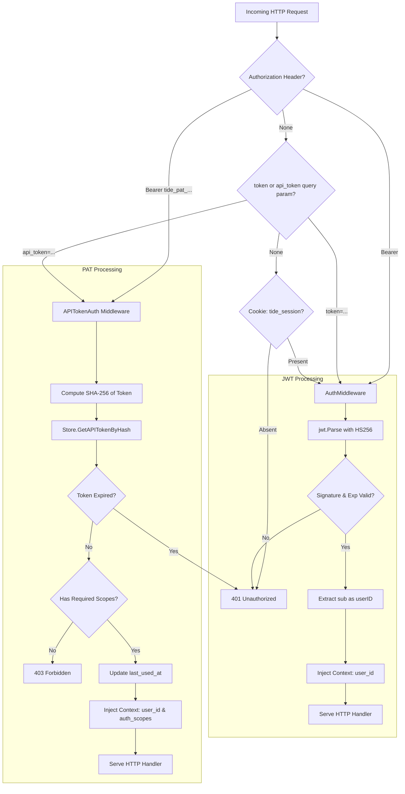
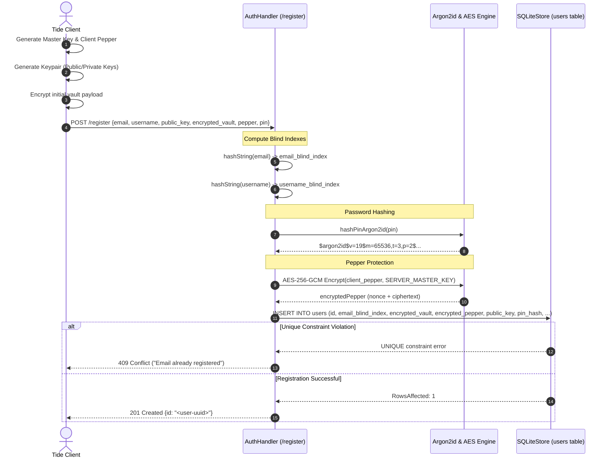
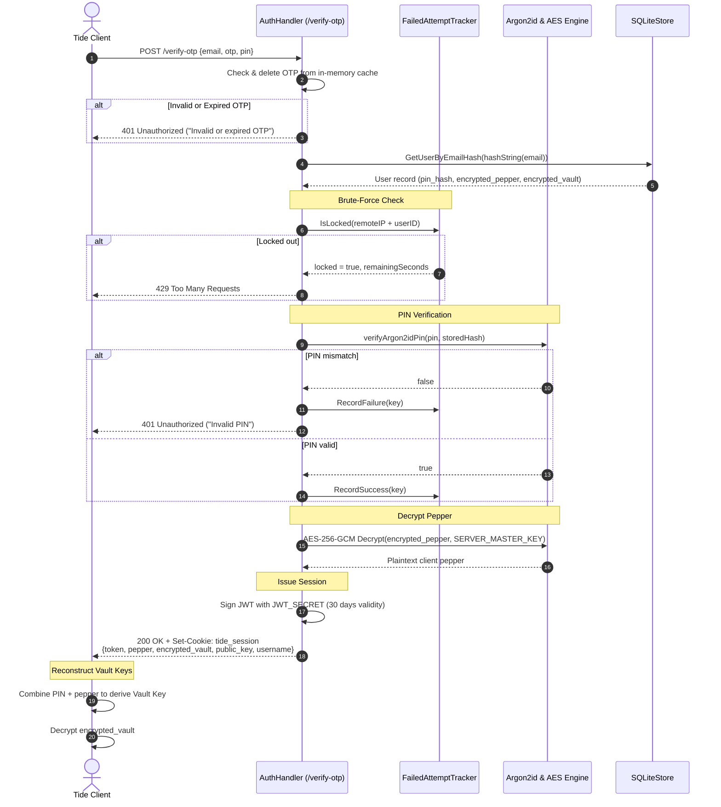

# Authentication, Credentials & Session Management Specification

This specification provides an exhaustive technical analysis and documentation of the authentication, credential handling, blind indexing, and session management architecture implemented in Tide Cloud (`cloud/internal/api/auth.go`, `cloud/internal/api/middleware.go`, `cloud/internal/api/api_tokens.go`, `cloud/internal/api/external.go`, and `cloud/internal/store/sqlite.go`).

---

## 1. Architectural Security Model

Tide follows a strict **Zero-Knowledge Data Vault** architecture combined with **Server-Side Identity Verification**:

```
+-----------------------------------------------------------------------------------+
|                                CLIENT BOUNDARY                                    |
|                                                                                   |
|  +------------------------+      +--------------------+      +-----------------+  |
|  | Master Encryption Key  | ---> |   Data Encryption  | ---> | Encrypted Files |  |
|  | (Derived from Pass/PIN)|      |      Key (DEK)     |      | & Notes Vault   |  |
|  +------------------------+      +--------------------+      +-----------------+  |
|              |                                                        |           |
|              v                                                        |           |
|   Derives Public Key & Pepper                                         |           |
+-----------------------------------------------------------------------|-----------+
                               |                                        |
       Registration / Auth     |                                        | Encrypted
             Payload           v                                        v Payloads
+-----------------------------------------------------------------------------------+
|                                SERVER BOUNDARY                                    |
|                                                                                   |
|  - Never sees plaintext password or Master Encryption Key                         |
|  - Stores opaque `encrypted_vault` and `public_key`                               |
|  - Uses Blind Indexes (`email_blind_index`) to query users without PII            |
|  - Encrypts client-supplied pepper using AES-256-GCM + SERVER_MASTER_KEY          |
|  - Enforces session tokens (JWT) & Personal Access Tokens (PAT)                   |
+-----------------------------------------------------------------------------------+
```

### Zero-Knowledge Vault vs Server Authentication
1. **Zero-Knowledge Vault**:
   - The user's notes, events, tasks, and file contents are encrypted client-side using authenticated encryption (AES-256-GCM or XChaCha20-Poly1305).
   - The server stores the user's encrypted vault (`encrypted_vault` BLOB) and asymmetric public key (`public_key`), but has **no cryptographic capability** to decrypt user data payloads.
2. **Server Authentication**:
   - The server authenticates user identity to protect API endpoints, rate-limit malicious traffic, and orchestrate synchronization.
   - Authentication tokens do not grant the server access to plaintext user files; they merely authorize the client to download the encrypted vault and submit encrypted updates.

---

## 2. Blind Index System

### 2.1 Why Plaintext Identifiers Are Never Stored
In conventional cloud architectures, user tables store plaintext or lowercase email addresses and usernames. In the event of a database leak, insider threat, or SQL injection vulnerability, attacker dumps immediately expose full user rosters and identities.

Tide prevents email/identity enumeration and database dump profiling through **Blind Indexing**:
- The `users` database table contains `email_blind_index`, `username_blind_index`, and `phone_blind_index`.
- Plaintext emails and phone numbers are discarded after processing and never persisted to the relational database.

### 2.2 Deterministic Lookup vs Zero-Knowledge Privacy
To allow $O(1)$ unique constraint enforcement and record lookup (e.g. `SELECT * FROM users WHERE email_blind_index = ?`), the index must be deterministic for a given identifier while remaining irreversible to an unauthorized observer.

```go
func hashString(s string) string {
    h := sha256.Sum256([]byte(s))
    return hex.EncodeToString(h[:])
}
```

- When registering or logging in, the identifier (e.g. email) is passed through a deterministic cryptographic hashing function to produce the blind index string.
- Database unique constraints are enforced against this index:
  ```sql
  CREATE TABLE users (
      id TEXT PRIMARY KEY,
      email_blind_index TEXT UNIQUE,
      username_blind_index TEXT,
      phone_blind_index TEXT UNIQUE,
      ...
  );
  ```

### 2.3 Pepper Security & Server Master Key Encryption
To prevent rainbow-table and dictionary attacks against blind indexes if the database alone is breached, the architecture employs a two-tier key/pepper model:
1. **Client Pepper**: During client key derivation, the client produces a secret pepper.
2. **Server-Side Encryption with `SERVER_MASTER_KEY`**:
   - Upon registration, the client transmits its pepper.
   - The server encrypts the pepper using **AES-256-GCM** with a cryptographically secure random 12-byte nonce and the server's secret master key (`ServerMasterKey`).
   - The resulting encrypted payload is saved in the `encrypted_pepper` column.
   - During successful authentication (e.g., OTP and PIN verification), the server decrypts `encrypted_pepper` using `ServerMasterKey` and returns the pepper to the client so the client can reconstruct its local vault encryption keys.

```go
// AES-256-GCM encryption of client pepper in AuthHandler.Register
block, err := aes.NewCipher(h.ServerMasterKey)
aesGCM, err := cipher.NewGCM(block)
nonce := make([]byte, aesGCM.NonceSize())
io.ReadFull(rand.Reader, nonce)
encryptedPepper := aesGCM.Seal(nonce, nonce, pepper, nil)
```

---

## 3. Registration & Password/PIN Hashing

### 3.1 Argon2id Parameter Configuration
Tide uses **Argon2id** (the hybrid version of Argon2 recommended by RFC 9106 and OWASP for password hashing):

| Parameter | Value | Constant in Code | Explanation |
| :--- | :--- | :--- | :--- |
| **Algorithm** | Argon2id v19 | `argon2.Version` | Resists both side-channel and GPU cracking attacks |
| **Memory Cost ($m$)** | $64 \text{ MiB}$ ($65,536 \text{ KiB}$) | `argon2Memory = 64 * 1024` | Sufficiently high to penalize ASIC/GPU parallelism |
| **Time Cost / Iterations ($t$)** | $3$ | `argon2Iterations = 3` | Execution loops |
| **Parallelism ($p$)** | $2$ threads | `argon2Parallelism = 2` | Concurrent execution lanes |
| **Salt Length** | $16$ bytes | `argon2SaltLength = 16` | Generated via `crypto/rand` |
| **Key Length** | $32$ bytes | `argon2KeyLength = 32` | Derived output length |

### 3.2 Stored Hash Format
The generated hash string follows the standard modular crypt format:
```
$argon2id$v=19$m=65536,t=3,p=2$<salt_b64>$<hash_b64>
```
Example:
`$argon2id$v=19$m=65536,t=3,p=2$1E8v+0bUf5kQz90yM9hXpw$O6Q8sFjYJ7+R5k...`

### 3.3 Verification & Constant-Time Comparison
To protect against side-channel timing attacks, hash validation executes strictly via constant-time comparison:
```go
computedHash := argon2.IDKey([]byte(pin), salt, iterations, memory, parallelism, uint32(len(expectedHash)))
return subtle.ConstantTimeCompare(computedHash, expectedHash) == 1
```

### 3.4 Transparent Legacy Migration
For backward compatibility with legacy accounts stored with raw SHA-256 hashes, `verifyAndMigratePin` detects legacy entries, validates them with `subtle.ConstantTimeCompare`, and immediately re-hashes the PIN using Argon2id, updating the database record in place.

### 3.5 Brute-Force Rate Limiting (`FailedAttemptTracker`)
PIN verification is protected by an in-memory lock-out tracker (`pinLimiter`):
- **Maximum Failed Attempts**: 5 attempts.
- **Lockout Duration**: 15 minutes (`15 * time.Minute`).
- **Lock Key**: Compound key of client IP and user ID (`<remote_ip>:<user_id>`).
- Successful verification resets the counter for that key.

---

## 4. One-Time Password (OTP) Authentication Handshake

Tide implements a passwordless/two-step verification protocol consisting of an email OTP and an optional local PIN validation.

```
 Client                          Tide Cloud API                     Email Provider (Resend)
   |                                   |                                      |
   | 1. POST /request-otp {email}      |                                      |
   |---------------------------------->|                                      |
   |                                   | 2. Computes email_blind_index        |
   |                                   |    Checks SQLite users table         |
   |                                   |    Generates 6-char OTP code         |
   |                                   |    Caches OTP in memory (5m expiry)  |
   |                                   |                                      |
   |                                   | 3. POST /emails                      |
   |                                   |------------------------------------->|
   |                                   |    Dispatches branded verification   |
   | 4. 200 OK {user_exists, username} |                                      |
   |<----------------------------------|                                      |
   |                                                                          |
   | 5. Client receives code via email <--------------------------------------+
   |                                   |
   | 6. POST /verify-otp {email, otp, pin}
   |---------------------------------->|
   |                                   | 7. Validates & deletes OTP from cache
   |                                   |    Verifies PIN with Argon2id        |
   |                                   |    Decrypts encrypted_pepper (AES)   |
   |                                   |    Issues JWT session token          |
   | 8. 200 OK + Set-Cookie            |
   |    {token, pepper, encrypted_vault,
   |     user_id, public_key, username}|
   |<----------------------------------|
```

### 4.1 OTP Generation & Storage
- **Code Format**: 6-character alphanumeric string generated via UUID prefix (`uuid.New().String()[:6]`).
- **Cache Storage**: In-memory hashmap `map[string]otpEntry` protected by `sync.Mutex`.
- **TTL**: 5 minutes (`time.Now().Add(5 * time.Minute)`).
- **Consumption**: The code is strictly single-use; it is immediately deleted from `otpCache` upon a successful comparison.

### 4.2 Email Delivery via Resend
- Production mode requires `RESEND_API_KEY`.
- Dispatches an HTML email from `Support <no-reply@go-tide.app>` to the user's email address.
- In `ENV != "production"`, if no API key is present, the OTP is printed to the server logs for development testing.
- In production, email delivery failure returns `503 Service Unavailable` without leaking internal state.

---

## 5. JWT Session Tokens & Revocation

### 5.1 Claims Structure
Tide issues JSON Web Tokens for API session management:

| Claim | Type | Description |
| :--- | :--- | :--- |
| `sub` | `string` | The user's internal UUID (`user.ID`) |
| `exp` | `int64` | Expiration timestamp (issued for 30 days: `time.Now().Add(30 * 24 * time.Hour).Unix()`) |
| `iat` | `int64` | Issued-at timestamp (set by `verify-otp` and dev login; tokens issued before 2026-11 lack it) |

> Correction: the code sets only `sub`, `iat` and `exp`; there is no `username` claim.
> `AuthMiddleware` puts `iat` into the request context (`tokenIssuedAtKey`) for fresh-session checks.

### 5.5 Fresh sessions and vault recovery endpoints
Endpoints that change the account vault (`PUT /auth/recovery-vault`, `POST /auth/replace-vault`)
require a **fresh session** (JWT `iat` at most 10 minutes old; tokens without `iat` are never fresh)
**and** a **key proof**: the answer to `POST /auth/key-challenge`, which encrypts 32 random bytes to
the stored RSA public key (RSA-OAEP, SHA-256). The challenge is one-time, valid 2 minutes and kept
only as a hash in memory. `replace-vault` keeps the previous vault in `encrypted_vault_prev` and is
refused (429) within 24 h of the last replacement. After a change the server mails a notice to the
address of the session's `verify-otp` (kept in memory 15 min) and `verify-otp` reports
`vault_replaced_at`. Details: `web/docs/crypto/VAULT_AND_PIN_SECURITY.md`.

### 5.2 Signing with HMAC-SHA256 (`HS256`)
- Signed using the server environment variable `JWT_SECRET`.
- **Startup Guard (`ValidateJWTSecret`)**: Called in `main.go`. If `JWT_SECRET` is unset or empty, the server immediately logs a `[SECURITY FATAL]` message and terminates execution, preventing insecure defaults.
- **Algorithm Enforcement**: The token verification parser explicitly checks that the signing algorithm is `*jwt.SigningMethodHMAC` to prevent algorithm confusion attacks (`alg: none` or RSA/HMAC substitution).

### 5.3 Cookie & Header Delivery
- Session tokens are returned in the JSON payload (`token`) AND set as an HTTP-only cookie:
  ```http
  Set-Cookie: tide_session=<token>; Path=/; Expires=<30d>; HttpOnly; SameSite=Lax; Secure
  ```
- The `Secure` attribute is automatically enabled when running over TLS, behind an HTTPS reverse proxy (`X-Forwarded-Proto: https`), or in production.

### 5.4 Token Tracking & Revocation
The database maintains a dedicated `tokens` table in SQLite for session invalidation and persistent token tracking:
```sql
CREATE TABLE IF NOT EXISTS tokens (
    token TEXT PRIMARY KEY,
    user_id TEXT NOT NULL,
    expires_at DATETIME NOT NULL
);
```

---

## 6. Personal Access Tokens (PAT)

In addition to ephemeral JWT sessions, Tide supports fine-grained Personal Access Tokens for CLI, scripts, MCP servers, and external third-party integrations (`cloud/internal/api/api_tokens.go`).

### 6.1 Token Generation & Hash Storage
- **Token Format**: `tide_pat_<64_hex_characters>` (32 bytes of cryptographic randomness from `crypto/rand`).
- **Token Prefix**: `tide_pat_<8_hex_chars>...` stored in plaintext for UI display.
- **Hash Storage**: The full token string is **never** stored in plaintext. Tide computes the SHA-256 hash (`hex(sha256(fullToken))`) and stores it in the `api_tokens` table:
  ```sql
  CREATE TABLE IF NOT EXISTS api_tokens (
      id TEXT PRIMARY KEY,
      user_id TEXT NOT NULL,
      name TEXT NOT NULL,
      token_hash TEXT NOT NULL UNIQUE,
      token_prefix TEXT NOT NULL,
      scopes TEXT NOT NULL,
      created_at DATETIME NOT NULL,
      expires_at DATETIME,
      last_used_at DATETIME,
      FOREIGN KEY(user_id) REFERENCES users(id) ON DELETE CASCADE
  );
  ```

### 6.2 Supported Scopes
Tokens can be restricted to specific least-privilege operations:

| Scope | Description |
| :--- | :--- |
| `events:read` | Read calendar events |
| `events:write` | Create and edit calendar events |
| `notes:read` | Read decrypted / shared notes |
| `notes:write` | Create and edit notes |
| `todos:read` | Query and filter tasks/todos |
| `todos:create` | Create tasks |
| `todos:edit` | Update tasks and status |
| `todos:delete` | Delete tasks |
| `todos:write` | Full task management |
| `storage:expand` | Expand storage quota beyond 250 MB |
| `safe:<id>` | Access restricted to a specific safe |
| `folder:<id>` | Access restricted to a specific folder |
| `*` | Full administrative access across all endpoints |

---

## 7. Middleware Execution Flow & Context Injection

The backend provides two primary authentication middleware handlers:
1. `AuthMiddleware`: Evaluates JWT session tokens for interactive web and mobile client requests.
2. `APITokenAuth(store, scopes...)`: Evaluates SHA-256 hashed Personal Access Tokens for automated/external API integrations.



### Context Injection Values
When authentication succeeds, the verified identity details are injected into `r.Context()`:
- `user_id`: The verified user's UUID string.
- `auth_scopes`: (In PAT authentication) Array of authorized scope strings.

Handlers retrieve the authenticated user using:
```go
userID, ok := r.Context().Value("user_id").(string)
if !ok || userID == "" {
    http.Error(w, "Unauthorized", http.StatusUnauthorized)
    return
}
```

---

## 8. Sequence Diagrams

### 8.1 Registration Sequence


### 8.2 Login & Authentication Handshake

