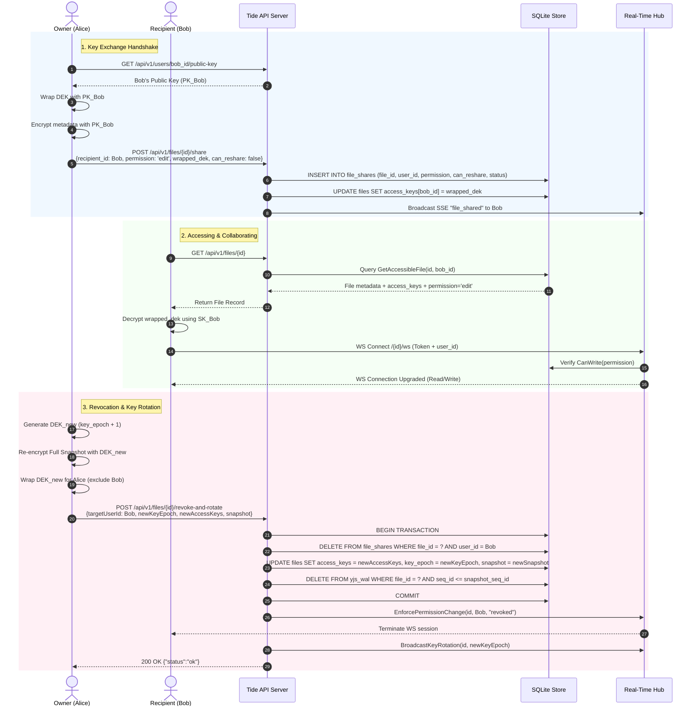

# Access Control, Permission Delegation, and Sharing Handshakes

## Overview

In Tide's zero-knowledge architecture, access control spans two distinct enforcement layers:
1. **Server-Side Authorization & Multi-Tenant Boundaries**: The backend (`cloud/internal/api/files.go` and `cloud/internal/store/sqlite.go`) enforces identity validation, role-based capabilities, and delegation hierarchies.
2. **Cryptographic Access Control**: Data is end-to-end encrypted (E2EE). Knowing a file's ID or having metadata access is insufficient to inspect or modify plaintext. Access is fundamentally mediated through wrapped Data Encryption Keys (DEKs) managed per-user in `files.access_keys`.

This document details the multi-tenant permission validation, permission levels (`owner`, `editor`, `viewer`), re-sharing semantics (`can_reshare`), the asymmetric key exchange handshake, and the share revocation/key rotation protocol.

---

## 1. Authorization Architecture

### 1.1 Multi-Tenant File Resolution

The server evaluates access dynamically via `GetAccessibleFile(ctx, fileID, userID)` in `cloud/internal/store/sqlite.go`. Files are never accessible by guessable identifiers alone; each file query verifies either direct ownership or an active entry in `file_shares`.

```sql
SELECT 
    f.id, f.owner_id, f.parent_id, f.type, f.mime_type, f.size, 
    f.created_at, f.updated_at, f.blob_path, f.visibility, f.public_meta, 
    f.secured_meta, f.version, f.metadata, f.access_keys, f.key_epoch, 
    f.snapshot_seq_id, f.snapshot_iv, f.content,
    CASE 
        WHEN f.owner_id = ? THEN 'owner'
        WHEN s.permission IS NOT NULL THEN s.permission
        ELSE 'none'
    END AS permission
FROM files f
LEFT JOIN file_shares s 
    ON f.id = s.file_id 
    AND s.user_id = ? 
    AND s.status = 'accepted'
WHERE f.id = ? 
  AND (f.owner_id = ? OR s.user_id = ? OR f.visibility = 'public');
```

### 1.2 Ownership vs. Shared Access

- **Direct Ownership (`f.owner_id = userID`)**:
  - Unconditional administrative rights.
  - The owner holds the primary wrapped DEK in `files.access_keys[owner_id]`.
  - Controls life-cycle operations: deletion, moving, unsharing, purging, and key rotation.
- **Shared Access (`s.user_id = userID AND s.status = 'accepted'`)**:
  - Conditional rights determined by `s.permission` (`view` or `edit`).
  - Grants read/write access to encrypted payloads and real-time CRDT updates.
  - Cannot destroy the document, transfer ownership, or bypass delegation constraints.

---

## 2. Permission Roles

Access roles are evaluated through helper functions in `cloud/internal/store`:
- `CanAdmin(role string) bool`: Returns `true` if `role == "owner"`.
- `CanWrite(role string) bool`: Returns `true` if `role == "owner" || role == "edit"`.
- `CanRead(role string) bool`: Returns `true` if `role == "owner" || role == "edit" || role == "view"`.

| Capability | `owner` | `editor` (`edit`) | `viewer` (`view`) |
| :--- | :---: | :---: | :---: |
| **Read Encrypted File / Metadata** | Yes | Yes | Yes |
| **Unwrap DEK via `access_keys`** | Yes | Yes | Yes |
| **Receive Real-time Changes (CRDT/WS)** | Yes | Yes | Yes |
| **Push REST Updates (`PUT /files/{id}`)** | Yes | Yes | No |
| **Append CRDT WAL / Send Yjs Updates** | Yes | Yes | No |
| **Compact Yjs WAL** | Yes | Yes | No |
| **Secondary Sharing (if `can_reshare=true`)** | Yes | Yes (up to `edit`) | Yes (only `view`) |
| **Modify Share Permissions (`PATCH /shares`)** | Yes | No | No |
| **Revoke Share (`DELETE /shares/{id}`)** | Yes | No | No |
| **Rename / Move / Parent Change** | Yes | No | No |
| **Delete / Restore (`DELETE/POST /files/{id}`)**| Yes | No | No |
| **Key Rotation (`revoke-and-rotate`)** | Yes | No | No |
| **Permanent Purge (`POST /files/purge`)** | Yes | No | No |

### 2.1 Role Details

#### `owner`
- Holds root authority over the file record and associated WAL.
- Can update `visibility`, manage backups in `file_backups`, and initiate epoch incrementation via `/revoke-and-rotate`.

#### `editor` (`edit`)
- Can read ciphertext, obtain its personal wrapped DEK, and participate in collaborative sessions over WebSocket (`ws`).
- Has write permissions to commit state updates, upload new versions, and append delta updates to `yjs_wal`.
- Prohibited from renaming, moving, soft/hard deleting the file, or altering other users' permissions.

#### `viewer` (`view`)
- Read-only access to encrypted snapshots, WAL updates, and metadata.
- Can unwrap DEK to decrypt note contents locally for display.
- Blocked by `AuthMiddleware` and `CanWrite` checks from modifying file content, issuing compaction requests, or broadcasting CRDT mutations to WebSocket rooms.

---

## 3. Delegation & `can_reshare`

Tide supports delegated sharing where non-owners can invite additional collaborators, subject to strict privilege ceiling rules.

### 3.1 Delegation Rules

In `cloud/internal/api/files.go` (`ShareFile`):
1. **Owner Discretion**: The file owner can share with any valid user at any permission level (`view` or `edit`) and may explicitly set `can_reshare = true` or `false`.
2. **Re-sharer Qualification**: If `file.OwnerID != userID`, the server checks:
   ```go
   callerShare, err := h.Store.GetShare(r.Context(), fileID, userID)
   if err != nil || callerShare == nil || callerShare.Status != "accepted" || !callerShare.CanReshare {
       http.Error(w, "Forbidden: re-sharing is not permitted for this note", http.StatusForbidden)
       return
   }
   ```
3. **Privilege Escalation Prevention**:
   - A caller with `callerShare.Permission == "view"` **cannot** grant `edit` or `owner` permissions (capped at `view`).
   - A caller with `callerShare.Permission == "edit"` **cannot** grant `owner` or grant administrative privileges.
   - Non-owners are **never** permitted to delegate `can_reshare = true` to secondary invitees; `canReshare` is forced to `false`:
     ```go
     canReshare = false
     ```

---

## 4. The Key Exchange Handshake

Because the server never possesses plaintext file keys, inviting a user requires an asymmetric key wrapping handshake executed by the client.

### 4.1 Handshake Sequence

1. **Public Key Retrieval**:
   - The sharer queries the recipient's public key:
     `GET /api/v1/users/{id}/public-key` (or resolves via email blind index lookup).
   - Server returns the recipient's public ECDH/RSA identity key.
2. **Client-Side DEK Wrapping**:
   - The sharer unwraps the local file DEK using their own private key.
   - The sharer encrypts (wraps) the DEK with the recipient's public key:
     $$\text{WrappedDEK}_{\text{recipient}} = \text{Encrypt}_{\text{PK}_{\text{recipient}}}(\text{DEK})$$
   - The sharer encrypts file title/metadata into `secured_meta` using the recipient's public key.
3. **Share Request (`POST /api/v1/files/{fileID}/share`)**:
   - The payload provides `recipient_id`, `permission`, `can_reshare`, `secured_meta`, and `wrapped_dek`:
     ```json
     {
       "recipient_id": "usr_987654",
       "permission": "edit",
       "can_reshare": false,
       "secured_meta": "<base64-encoded-meta>",
       "wrapped_dek": "<base64-encoded-wrapped-dek>"
     }
     ```
4. **Server Storage**:
   - Creates/updates `file_shares` with status `pending` (or `accepted` for trusted contacts).
   - Atomically updates the `files.access_keys` JSON document to store the recipient's wrapped DEK:
     ```json
     {
       "usr_owner123": { "wrapped_key": "..." },
       "usr_987654":   { "wrapped_key": "..." }
     }
     ```
5. **Verification on Retrieval**:
   - When the recipient accesses `GET /api/v1/files/{fileID}`, the server checks that the caller has an active share and that `files.access_keys` contains an entry for `recipient_id`.
   - The client parses `access_keys[current_user_id].wrapped_key`, decrypts it with their private key to recover the DEK, and decrypts the document content.

---

## 5. Share Revocation & Key Rotation Protocol

Revoking access in a zero-knowledge system requires forward secrecy: removing a share must guarantee that the revoked user cannot read future revisions or CRDT deltas.

### 5.1 Simple Revocation (`DELETE /api/v1/files/{fileID}/shares/{userID}`)

When an owner revokes a user's access without an immediate new snapshot:
1. `RemoveShare(ctx, fileID, targetUserID)` removes the record from `file_shares`.
2. `RemoveFileAccessKey(ctx, fileID, targetUserID)` deletes the target user's key entry from `files.access_keys`.
3. The WebSocket Hub drops the target user's connections and revokes real-time access:
   ```go
   h.Hub.EnforcePermissionChange(fileID, targetUserID, "revoked")
   ```
4. Broker broadcasts an SSE event `file_updated` to `targetUserID`, signalling the frontend client to purge local caches.

### 5.2 Atomic Revocation and Key Rotation (`POST /api/v1/files/{fileID}/revoke-and-rotate`)

To achieve forward secrecy against a revoked user who previously held the DEK:
1. **Client Re-encryption**:
   - The owner generates a new Data Encryption Key: $\text{DEK}_{\text{new}}$.
   - Increment `key_epoch = key_epoch + 1`.
   - Compresses and re-encrypts the current note document snapshot with $\text{DEK}_{\text{new}}$:
     $$\text{snapshot\_ciphertext} = \text{AES-GCM}(\text{DEK}_{\text{new}}, \text{snapshot\_iv}, \text{FullDocState})$$
   - Wraps $\text{DEK}_{\text{new}}$ for the owner and all remaining authorized users, producing `newAccessKeys`.
2. **Server Atomic Execution (`RevokeShareAndRotateKey`)**:
   - Inside an exclusive SQLite transaction:
     a. Deletes `targetUserID` from `file_shares`.
     b. Updates `files`:
        - `access_keys = newAccessKeys` (omitting `targetUserID`).
        - `secured_meta = newSecuredMeta`.
        - `key_epoch = newKeyEpoch`.
        - `snapshot_seq_id = (SELECT COALESCE(MAX(seq_id), 0) FROM yjs_wal WHERE file_id = ?)`.
        - `snapshot_iv = iv`.
        - `content = ciphertext`.
     c. Truncates all existing delta entries in `yjs_wal` up to `snapshot_seq_id`:
        ```sql
        DELETE FROM yjs_wal WHERE file_id = ? AND seq_id <= ?;
        ```
3. **Session Eviction & Epoch Notification**:
   - The Hub immediately disconnects `targetUserID`:
     ```go
     h.Hub.EnforcePermissionChange(fileID, targetUserID, "revoked")
     ```
   - The Hub broadcasts `BroadcastKeyRotation(fileID, newKeyEpoch)` to active WebSocket peers, notifying them to re-fetch their wrapped key for the new epoch.

---

## 6. Architecture & Workflow Diagram



---

## 7. Security Boundaries & Invariants

1. **Zero-Plaintext Invariant**: Plaintext file content or DEKs are never transmitted to or persisted on the server. The server acts exclusively as an untrusted coordinator for encrypted blobs, wrapped keys, and CRDT deltas.
2. **Access Key Prerequisite**: Possession of an entry in `file_shares` without a corresponding entry in `files.access_keys` results in an un-decryptable state. The client verifies cryptographic integrity before displaying or mutating state.
3. **Non-Escalation Guarantee**: Delegated sharers (`can_reshare = true`) can never assign permissions higher than their own, can never grant `can_reshare` to downstream users, and can never trigger epoch rotation or destructive file operations.
4. **Post-Revocation Isolation**: Once `revoke-and-rotate` commits, WAL deltas encrypted under older epochs are permanently pruned, preventing revoked parties from reconstructing state updates beyond the revocation boundary.
