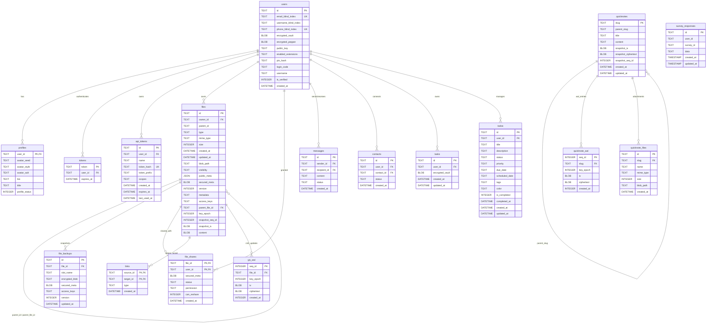

# Database Schema Reference

> **Engine:** SQLite 3 via `modernc.org/sqlite` (Pure Go, CGO-free)  
> **Schema Definition:** `cloud/internal/store/sqlite.go`  
> **Version:** Migration ARC-02 (Current Schema Version: `11`)

---

## 1. Database Engine Context & Configuration

The Tide cloud storage engine operates on a local or mounted SQLite database using WAL (Write-Ahead Logging) mode. SQLite is configured to provide strict data safety, zero-corruption concurrency, and referential integrity across all subsystems.

### Connection Pools & Pragmas

Two distinct connection pools are maintained by `SQLiteStore` (`cloud/internal/store/sqlite.go`):

| Connection Pool | Max Open | Max Idle | Lifetime | Configuration DSN Pragmas | Purpose |
| :--- | :---: | :---: | :---: | :--- | :--- |
| **Writer Pool (`DB`)** | `1` | `1` | 1 hour | `_pragma=busy_timeout(5000)&_pragma=journal_mode(WAL)&_pragma=synchronous(NORMAL)&_pragma=foreign_keys(ON)` | Dedicated single-writer pool eliminating write-lock collisions and database file lock escalation. |
| **Reader Pool (`reader`)** | `max(4, 2 * CPU)` | `max(2, CPU)` | 1 hour | `_pragma=busy_timeout(5000)&_pragma=journal_mode(WAL)&_pragma=synchronous(NORMAL)&_pragma=query_only(true)&_pragma=foreign_keys(ON)` | Multi-reader pool executing non-blocking reads concurrently with active transactions. |

### Pragma Directives

- **`journal_mode(WAL)`**: Write-Ahead Logging allows simultaneous non-blocking concurrent reads while a write transaction is committed.
- **`synchronous(NORMAL)`**: WAL mode with `NORMAL` synchronizes on checkpoint operations, providing ACID durability without per-transaction disk sync overhead.
- **`busy_timeout(5000)`**: Queries waiting on write locks sleep and retry for up to 5,000 milliseconds before raising `SQLITE_BUSY`.
- **`foreign_keys(ON)`**: Enforces cascading deletes and foreign key constraints across relational boundaries.
- **`query_only(true)`**: Strict safety flag set on the reader pool to prevent unintended table mutation.

---

## 2. Entity-Relationship Diagram (ERD)



---

## 3. Table-by-Table Schema Specification

### 3.1 `users`

**Purpose:** Core user identity, cryptographic public keys, zero-knowledge account vaults, and privacy-preserving blind search indexes.

#### DDL Statement
```sql
CREATE TABLE users (
    id TEXT PRIMARY KEY,
    email_blind_index TEXT UNIQUE,
    username_blind_index TEXT,
    phone_blind_index TEXT UNIQUE,
    encrypted_vault BLOB NOT NULL,
    encrypted_pepper BLOB NOT NULL,
    public_key TEXT NOT NULL,
    enabled_extensions TEXT DEFAULT '[]',
    pin_hash TEXT,
    login_code TEXT,
    username TEXT,
    created_at DATETIME NOT NULL,
    is_verified INTEGER DEFAULT 0
);
```

#### Column Definitions
| Column | Type | Nullable | Default | Constraints / Indexes | Description |
| :--- | :--- | :---: | :--- | :--- | :--- |
| `id` | `TEXT` | No | *None* | `PRIMARY KEY` | Unique User UUID (v4). |
| `email_blind_index` | `TEXT` | Yes | `NULL` | `UNIQUE` | HMAC-SHA256 hash of normalized email for deterministic query lookup without storing plaintext. |
| `username_blind_index` | `TEXT` | Yes | `NULL` | None | HMAC-SHA256 blind index for username lookup. |
| `phone_blind_index` | `TEXT` | Yes | `NULL` | `UNIQUE` | HMAC-SHA256 blind index for phone lookup. |
| `encrypted_vault` | `BLOB` | No | *None* | None | Client private key bundle and identity keys, encrypted by user's PIN/password KEK. |
| `encrypted_pepper` | `BLOB` | No | *None* | None | AES-GCM encrypted server-side pepper protecting key derivation. |
| `public_key` | `TEXT` | No | *None* | None | Base64-encoded user public key (RSA / Curve25519) used for multi-user E2EE key wrapping. |
| `enabled_extensions` | `TEXT` | Yes | `'[]'` | None | JSON array of active user extension identifiers (e.g. `["finance"]`). |
| `pin_hash` | `TEXT` | Yes | `NULL` | None | Salted cryptographic hash of PIN for verification/unlock. |
| `login_code` | `TEXT` | Yes | `NULL` | None | Temporary OTP/magic-link token hash. |
| `username` | `TEXT` | Yes | `NULL` | None | Plaintext display handle for user discovery and public profile routes. |
| `is_verified` | `INTEGER` | Yes | `0` | None | Verification status (`0` = unverified, `1` = verified email/identity). |
| `created_at` | `DATETIME` | No | *None* | None | Account registration timestamp (RFC3339 / UTC). |

---

### 3.2 `files`

**Purpose:** Hierarchical file, note, document, and event tree nodes. Implements envelope encryption with per-user Data Encryption Key (DEK) distribution and soft-delete/trash mechanics.

#### DDL Statement
```sql
CREATE TABLE files (
    id TEXT PRIMARY KEY,
    owner_id TEXT NOT NULL,
    parent_id TEXT,
    type TEXT NOT NULL,
    mime_type TEXT,
    size INTEGER NOT NULL,
    created_at DATETIME NOT NULL,
    updated_at DATETIME NOT NULL,
    blob_path TEXT,
    public_meta JSON,
    secured_meta BLOB,
    visibility TEXT DEFAULT 'private',
    version INTEGER DEFAULT 1,
    metadata TEXT,
    access_keys TEXT,
    parent_file_id TEXT REFERENCES files(id) ON DELETE CASCADE,
    key_epoch INTEGER NOT NULL DEFAULT 1,
    snapshot_seq_id INTEGER NOT NULL DEFAULT 0,
    snapshot_iv BLOB,
    content BLOB,
    FOREIGN KEY(owner_id) REFERENCES users(id)
);
```

#### Column Definitions
| Column | Type | Nullable | Default | Constraints / Indexes | Description |
| :--- | :--- | :---: | :--- | :--- | :--- |
| `id` | `TEXT` | No | *None* | `PRIMARY KEY` | File node UUID. |
| `owner_id` | `TEXT` | No | *None* | `FK → users(id)` | Author/owner user ID. Indexed via `idx_files_owner`. |
| `parent_id` | `TEXT` | Yes | `NULL` | Index | Parent folder UUID (tree hierarchy). Indexed via `idx_files_parent`. |
| `type` | `TEXT` | No | *None* | None | Node classification: `'file'`, `'folder'`, `'note'`, `'event'`, `'canvas'`. |
| `mime_type` | `TEXT` | Yes | `NULL` | None | MIME type string (e.g. `application/pdf`, `text/markdown`). |
| `size` | `INTEGER` | No | *None* | None | Stored payload size in bytes. |
| `created_at` | `DATETIME` | No | *None* | None | Record creation timestamp. |
| `updated_at` | `DATETIME` | No | *None* | None | Record modification timestamp. |
| `blob_path` | `TEXT` | Yes | `NULL` | None | Relative path to raw file content in blob storage (`data/blobs/...`). |
| `public_meta` | `JSON` | Yes | `NULL` | None | Unencrypted metadata (e.g., calendar start/end times, public note attributes). |
| `secured_meta` | `BLOB` | Yes | `NULL` | None | AES-GCM client-encrypted metadata payload (title, encrypted tags). |
| `visibility` | `TEXT` | Yes | `'private'` | Index | Access level: `'private'`, `'public'`, `'shared'`. Indexed via `idx_files_visibility`. |
| `version` | `INTEGER` | Yes | `1` | None | Encryption/envelope format version (V1 legacy vs V2 envelope DEK). |
| `metadata` | `TEXT` | Yes | `NULL` | None | JSON object for system/tree attributes. Soft deletions store `{"deleted_at": "<ISO-timestamp>"}`. |
| `access_keys` | `TEXT` | Yes | `NULL` | None | Envelope encryption JSON map: `{"<user_id>": {"wrapped_key": "...", "ephem_pk": "..."}}`. |
| `parent_file_id` | `TEXT` | Yes | `NULL` | `FK → files(id)` | Cascading foreign key linking nested document sub-elements. |
| `key_epoch` | `INTEGER` | No | `1` | None | Cryptographic key rotation generation for real-time collaboration. |
| `snapshot_seq_id` | `INTEGER` | No | `0` | None | Sequence watermark in `yjs_wal` up to which `content` / snapshot is compacted. |
| `snapshot_iv` | `BLOB` | Yes | `NULL` | None | Initialization vector (12-byte AES-GCM IV) for `content` snapshot. |
| `content` | `BLOB` | Yes | `NULL` | None | Compacted encrypted document snapshot payload. |

#### Trashed File Handling
Files are soft-deleted by setting the JSON path `metadata.deleted_at`. Trashed items are excluded from standard tree queries (`WHERE json_extract(metadata, '$.deleted_at') IS NULL`) and purged permanently by background GC when `deleted_at < datetime('now', '-7 days')`.

#### Indexes
- `CREATE INDEX idx_files_parent ON files(parent_id);`
- `CREATE INDEX idx_files_owner ON files(owner_id);`
- `CREATE INDEX idx_files_visibility ON files(visibility);`

---

### 3.3 `file_backups`

**Purpose:** File revision snapshot slots and delta line-patch history preserving point-in-time recovery versions.

#### DDL Statement
```sql
CREATE TABLE file_backups (
    id TEXT PRIMARY KEY,
    file_id TEXT NOT NULL,
    slot_name TEXT NOT NULL,
    encrypted_blob TEXT NOT NULL,
    secured_meta BLOB,
    updated_at DATETIME NOT NULL,
    access_keys TEXT DEFAULT '{}',
    version INTEGER DEFAULT 1,
    FOREIGN KEY(file_id) REFERENCES files(id),
    UNIQUE(file_id, slot_name)
);
```

#### Column Definitions
| Column | Type | Nullable | Default | Constraints / Indexes | Description |
| :--- | :--- | :---: | :--- | :--- | :--- |
| `id` | `TEXT` | No | *None* | `PRIMARY KEY` | Unique backup record UUID. |
| `file_id` | `TEXT` | No | *None* | `FK → files(id)` | Target file identifier. |
| `slot_name` | `TEXT` | No | *None* | `UNIQUE(file_id, slot_name)` | Backup slot identifier: `"1 week"` base copy, or delta slots: `"10 minutes"`, `"30 minutes"`, `"1 hour"`, `"1 day"`, `"2 days"`. |
| `encrypted_blob` | `TEXT` | No | *None* | None | Encrypted content backup payload (base snapshot ciphertext or line-patch JSON). |
| `secured_meta` | `BLOB` | Yes | `NULL` | None | Encrypted file metadata at the time of backup. |
| `access_keys` | `TEXT` | Yes | `'{}'` | None | Envelope JSON map of wrapped DEKs per user required to restore V2 encrypted backups. |
| `version` | `INTEGER` | Yes | `1` | None | Schema version (1 = V1 raw ciphertext, 2 = V2 {data, iv} payload). |
| `updated_at` | `DATETIME` | No | *None* | None | Timestamp of last backup snapshot update. |

---

### 3.4 `file_shares`

**Purpose:** Multi-user file sharing permissions, Access Control Lists (ACLs), and recipient envelope key distribution.

#### DDL Statement
```sql
CREATE TABLE file_shares (
    file_id TEXT NOT NULL,
    user_id TEXT NOT NULL,
    secured_meta BLOB,
    status TEXT DEFAULT 'pending',
    permission TEXT NOT NULL DEFAULT 'view',
    can_reshare INTEGER NOT NULL DEFAULT 0,
    created_at DATETIME NOT NULL,
    PRIMARY KEY (file_id, user_id),
    FOREIGN KEY(file_id) REFERENCES files(id),
    FOREIGN KEY(user_id) REFERENCES users(id)
);
```

#### Column Definitions
| Column | Type | Nullable | Default | Constraints / Indexes | Description |
| :--- | :--- | :---: | :--- | :--- | :--- |
| `file_id` | `TEXT` | No | *None* | `PK, FK → files(id)` | Shared file identifier. |
| `user_id` | `TEXT` | No | *None* | `PK, FK → users(id)` | Recipient user identifier. Indexed via `idx_file_shares_user`. |
| `secured_meta` | `BLOB` | Yes | `NULL` | None | Legacy V1 recipient-wrapped file key bundle. |
| `status` | `TEXT` | Yes | `'pending'` | None | Invitation status: `'pending'`, `'accepted'`. |
| `permission` | `TEXT` | No | `'view'` | None | Access level: `'view'`, `'edit'`, `'share'`. |
| `can_reshare` | `INTEGER` | No | `0` | None | Boolean flag (0/1) permitting the recipient to share the file with third parties. |
| `created_at` | `DATETIME` | No | *None* | None | Share grant creation timestamp. |

#### Indexes
- `CREATE INDEX idx_file_shares_user ON file_shares(user_id);`

---

### 3.5 `links`

**Purpose:** Bidirectional graph connections (backlinks and explicit references) between document and note nodes.

#### DDL Statement
```sql
CREATE TABLE links (
    source_id TEXT NOT NULL,
    target_id TEXT NOT NULL,
    type TEXT NOT NULL,
    created_at DATETIME NOT NULL,
    PRIMARY KEY (source_id, target_id),
    FOREIGN KEY(source_id) REFERENCES files(id),
    FOREIGN KEY(target_id) REFERENCES files(id)
);
```

#### Column Definitions
| Column | Type | Nullable | Default | Constraints / Indexes | Description |
| :--- | :--- | :---: | :--- | :--- | :--- |
| `source_id` | `TEXT` | No | *None* | `PK, FK → files(id)` | Originating document UUID. Indexed via `idx_links_source`. |
| `target_id` | `TEXT` | No | *None* | `PK, FK → files(id)` | Referenced target document UUID. Indexed via `idx_links_target`. |
| `type` | `TEXT` | No | *None* | None | Relationship type: `'manual'`, `'auto'`, `'reference'`, `'mention'`. |
| `created_at` | `DATETIME` | No | *None* | None | Link creation timestamp. |

#### Indexes
- `CREATE INDEX idx_links_source ON links(source_id);`
- `CREATE INDEX idx_links_target ON links(target_id);`

---

### 3.6 `messages`

**Purpose:** End-to-end encrypted direct messaging and communication exchange between contacts.

#### DDL Statement
```sql
CREATE TABLE messages (
    id TEXT PRIMARY KEY,
    sender_id TEXT NOT NULL,
    recipient_id TEXT NOT NULL,
    content TEXT NOT NULL,
    status TEXT DEFAULT 'pending',
    created_at DATETIME NOT NULL,
    FOREIGN KEY(sender_id) REFERENCES users(id),
    FOREIGN KEY(recipient_id) REFERENCES users(id)
);
```

#### Column Definitions
| Column | Type | Nullable | Default | Constraints / Indexes | Description |
| :--- | :--- | :---: | :--- | :--- | :--- |
| `id` | `TEXT` | No | *None* | `PRIMARY KEY` | Unique message UUID. |
| `sender_id` | `TEXT` | No | *None* | `FK → users(id)` | Author user ID. |
| `recipient_id` | `TEXT` | No | *None* | `FK → users(id)` | Recipient user ID. Composite indexed with `created_at`. |
| `content` | `TEXT` | No | *None* | None | E2EE JSON envelope string containing ciphertext and encryption nonce (`{"ciphertext": "...", "nonce": "..."}`). |
| `status` | `TEXT` | Yes | `'pending'` | None | Message delivery status: `'pending'`, `'delivered'`, `'read'`. |
| `created_at` | `DATETIME` | No | *None* | Index | Sent timestamp. Indexed via `idx_messages_recipient_created`. |

#### Indexes
- `CREATE INDEX idx_messages_recipient_created ON messages(recipient_id, created_at);`

---

### 3.7 `contacts`

**Purpose:** Social relationships, friend graphs, and mutual contact connection requests.

#### DDL Statement
```sql
CREATE TABLE contacts (
    id TEXT PRIMARY KEY,
    user_id TEXT NOT NULL,
    contact_id TEXT NOT NULL,
    status TEXT NOT NULL,
    created_at DATETIME NOT NULL,
    FOREIGN KEY(user_id) REFERENCES users(id),
    FOREIGN KEY(contact_id) REFERENCES users(id),
    UNIQUE(user_id, contact_id)
);
```

#### Column Definitions
| Column | Type | Nullable | Default | Constraints / Indexes | Description |
| :--- | :--- | :---: | :--- | :--- | :--- |
| `id` | `TEXT` | No | *None* | `PRIMARY KEY` | Contact connection UUID. |
| `user_id` | `TEXT` | No | *None* | `FK → users(id)` | Requesting/initiating user ID. |
| `contact_id` | `TEXT` | No | *None* | `FK → users(id)` | Target contact user ID (`contact_user_id`). |
| `status` | `TEXT` | No | *None* | None | Connection state: `'pending'`, `'accepted'`. |
| `created_at` | `DATETIME` | No | *None* | None | Contact request creation timestamp. |

#### Constraints
- `UNIQUE(user_id, contact_id)` prevents duplicate relationship records between user pairs.

---

### 3.8 `tasks`

**Purpose:** Encrypted user task vault entries for zero-knowledge personal task management.

#### DDL Statement
```sql
CREATE TABLE tasks (
    id TEXT PRIMARY KEY,
    user_id TEXT NOT NULL,
    encrypted_vault BLOB NOT NULL,
    created_at DATETIME NOT NULL,
    updated_at DATETIME NOT NULL,
    FOREIGN KEY(user_id) REFERENCES users(id)
);
```

#### Column Definitions
| Column | Type | Nullable | Default | Constraints / Indexes | Description |
| :--- | :--- | :---: | :--- | :--- | :--- |
| `id` | `TEXT` | No | *None* | `PRIMARY KEY` | Task item UUID. |
| `user_id` | `TEXT` | No | *None* | `FK → users(id)` | Owner user ID. Indexed via `idx_tasks_user`. |
| `encrypted_vault` | `BLOB` | No | *None* | None | AES-GCM encrypted binary vault containing title, status, due_date, ciphertext, and nonce. |
| `created_at` | `DATETIME` | No | *None* | None | Task creation timestamp. |
| `updated_at` | `DATETIME` | No | *None* | None | Task last update timestamp. |

#### Indexes
- `CREATE INDEX idx_tasks_user ON tasks(user_id);`

---

### 3.9 `todos`

**Purpose:** Structured plaintext todo items for external integrations, third-party sync, and REST API access.

#### DDL Statement
```sql
CREATE TABLE todos (
    id TEXT PRIMARY KEY,
    user_id TEXT NOT NULL,
    title TEXT NOT NULL,
    description TEXT DEFAULT '',
    status TEXT DEFAULT 'todo',
    priority TEXT DEFAULT 'medium',
    due_date TEXT DEFAULT '',
    scheduled_date TEXT DEFAULT '',
    tags TEXT DEFAULT '[]',
    color TEXT DEFAULT '',
    is_completed INTEGER DEFAULT 0,
    completed_at DATETIME,
    created_at DATETIME DEFAULT CURRENT_TIMESTAMP,
    updated_at DATETIME DEFAULT CURRENT_TIMESTAMP,
    FOREIGN KEY (user_id) REFERENCES users(id)
);
```

#### Column Definitions
| Column | Type | Nullable | Default | Constraints / Indexes | Description |
| :--- | :--- | :---: | :--- | :--- | :--- |
| `id` | `TEXT` | No | *None* | `PRIMARY KEY` | Todo item UUID. |
| `user_id` | `TEXT` | No | *None* | `FK → users(id)` | Owner user ID. Indexed via `idx_todos_user`. |
| `title` | `TEXT` | No | *None* | None | Todo title / summary. |
| `description` | `TEXT` | Yes | `''` | None | Detailed description / markdown note. |
| `status` | `TEXT` | Yes | `'todo'` | Index | Status: `'todo'`, `'in_progress'`, `'done'`, `'archived'`. Indexed via `idx_todos_status`. |
| `priority` | `TEXT` | Yes | `'medium'` | Index | Priority: `'low'`, `'medium'`, `'high'`, `'urgent'`. Indexed via `idx_todos_priority`. |
| `due_date` | `TEXT` | Yes | `''` | Index | Due date string (YYYY-MM-DD or RFC3339). Indexed via `idx_todos_due_date`. |
| `scheduled_date` | `TEXT` | Yes | `''` | None | Planned execution date string. |
| `tags` | `TEXT` | Yes | `'[]'` | None | JSON array of category/tag strings (e.g. `["work", "tide"]`). |
| `color` | `TEXT` | Yes | `''` | None | UI color token or hex string. |
| `is_completed` | `INTEGER` | Yes | `0` | None | Boolean flag (0/1) for completion status. |
| `completed_at` | `DATETIME` | Yes | `NULL` | None | Completion timestamp. |
| `created_at` | `DATETIME` | Yes | `CURRENT_TIMESTAMP` | Index | Record creation timestamp. Indexed via `idx_todos_created`. |
| `updated_at` | `DATETIME` | Yes | `CURRENT_TIMESTAMP` | None | Record update timestamp. |

#### Indexes
- `CREATE INDEX idx_todos_user ON todos(user_id);`
- `CREATE INDEX idx_todos_due_date ON todos(due_date);`
- `CREATE INDEX idx_todos_status ON todos(status);`
- `CREATE INDEX idx_todos_priority ON todos(priority);`
- `CREATE INDEX idx_todos_created ON todos(created_at);`

---

### 3.10 `profiles`

**Purpose:** Publicly queryable user profile cards, display personas, and generative avatar parameters.

#### DDL Statement
```sql
CREATE TABLE profiles (
    user_id TEXT PRIMARY KEY,
    avatar_seed TEXT NOT NULL,
    avatar_style TEXT NOT NULL DEFAULT 'notionists',
    avatar_salt TEXT NOT NULL DEFAULT '',
    bio TEXT NOT NULL,
    title TEXT NOT NULL,
    profile_status INTEGER NOT NULL DEFAULT 0,
    FOREIGN KEY(user_id) REFERENCES users(id)
);
```

#### Column Definitions
| Column | Type | Nullable | Default | Constraints / Indexes | Description |
| :--- | :--- | :---: | :--- | :--- | :--- |
| `user_id` | `TEXT` | No | *None* | `PRIMARY KEY, FK → users(id)` | User UUID. |
| `avatar_seed` | `TEXT` | No | *None* | None | Seed string for deterministic generative avatar rendering. |
| `avatar_style` | `TEXT` | No | `'notionists'` | None | Avatar illustration style variant. |
| `avatar_salt` | `TEXT` | No | `''` | None | Randomizing salt for avatar customization. |
| `bio` | `TEXT` | No | *None* | None | User bio and description. |
| `title` | `TEXT` | No | *None* | None | Role, profession, or display title (`display_name`). |
| `profile_status` | `INTEGER` | No | `0` | None | Status flags (0 = default/online, etc.). |

---

### 3.11 `api_tokens`

**Purpose:** Personal Access Tokens (PATs) for external automation (e.g. Home Assistant, cron jobs, MCP tools).

#### DDL Statement
```sql
CREATE TABLE api_tokens (
    id TEXT PRIMARY KEY,
    user_id TEXT NOT NULL,
    name TEXT NOT NULL,
    token_hash TEXT NOT NULL UNIQUE,
    token_prefix TEXT NOT NULL,
    scopes TEXT NOT NULL DEFAULT '[]',
    created_at DATETIME NOT NULL,
    expires_at DATETIME,
    last_used_at DATETIME,
    FOREIGN KEY(user_id) REFERENCES users(id)
);
```

#### Column Definitions
| Column | Type | Nullable | Default | Constraints / Indexes | Description |
| :--- | :--- | :---: | :--- | :--- | :--- |
| `id` | `TEXT` | No | *None* | `PRIMARY KEY` | Unique token identifier UUID. |
| `user_id` | `TEXT` | No | *None* | `FK → users(id)` | Token owner user ID. Indexed via `idx_api_tokens_user`. |
| `name` | `TEXT` | No | *None* | None | Descriptive label provided by user (e.g. "MCP Server"). |
| `token_hash` | `TEXT` | No | *None* | `UNIQUE` | SHA-256 hash of the bearer token string (`tide_pat_...`). Indexed via `idx_api_tokens_hash`. |
| `token_prefix` | `TEXT` | No | *None* | None | Masked prefix for UI presentation (e.g. `tide_pat_a1b2c3d4...`). |
| `scopes` | `TEXT` | No | `'[]'` | None | JSON array of authorized scopes: `["events:read", "events:write", "notes:read", "notes:write"]`. |
| `created_at` | `DATETIME` | No | *None* | None | Token generation timestamp. |
| `expires_at` | `DATETIME` | Yes | `NULL` | None | Expiration timestamp (NULL denotes never expires). |
| `last_used_at` | `DATETIME` | Yes | `NULL` | None | Timestamp when the token was last used to authenticate an API request. |

#### Indexes
- `CREATE INDEX idx_api_tokens_user ON api_tokens(user_id);`
- `CREATE INDEX idx_api_tokens_hash ON api_tokens(token_hash);`

---

### 3.12 `quicknotes`

**Purpose:** Ephemeral note sharing and standalone encrypted pastebin-style documents identified by URL slugs.

#### DDL Statement
```sql
CREATE TABLE quicknotes (
    slug TEXT PRIMARY KEY,
    parent_slug TEXT,
    title TEXT NOT NULL DEFAULT 'Untitled Quicknote',
    content TEXT NOT NULL DEFAULT '',
    snapshot_iv BLOB,
    snapshot_ciphertext BLOB,
    snapshot_seq_id INTEGER DEFAULT 0,
    created_at DATETIME NOT NULL,
    updated_at DATETIME NOT NULL
);
```

#### Column Definitions
| Column | Type | Nullable | Default | Constraints / Indexes | Description |
| :--- | :--- | :---: | :--- | :--- | :--- |
| `slug` | `TEXT` | No | *None* | `PRIMARY KEY` | URL routing slug (e.g. `quick-3f7a9c`). |
| `parent_slug` | `TEXT` | Yes | `NULL` | Index | Optional parent quicknote slug for nested threads. Indexed via `idx_quicknotes_parent_slug`. |
| `title` | `TEXT` | No | `'Untitled Quicknote'` | None | Plaintext display title. |
| `content` | `TEXT` | No | `''` | None | Unencrypted fallback or display text content. |
| `snapshot_iv` | `BLOB` | Yes | `NULL` | None | 12-byte initialization vector for compacted encrypted snapshot. |
| `snapshot_ciphertext` | `BLOB` | Yes | `NULL` | None | Compacted AES-GCM encrypted document snapshot. |
| `snapshot_seq_id` | `INTEGER` | Yes | `0` | None | Compaction sequence watermark corresponding to `quicknote_wal.seq_id`. |
| `created_at` | `DATETIME` | No | *None* | None | Creation timestamp. |
| `updated_at` | `DATETIME` | No | *None* | None | Last modification timestamp. |

#### Indexes
- `CREATE INDEX idx_quicknotes_parent_slug ON quicknotes(parent_slug);`

---

### 3.13 `quicknote_wal`

**Purpose:** Append-only Write-Ahead Log for concurrent CRDT delta updates to quicknotes.

#### DDL Statement
```sql
CREATE TABLE quicknote_wal (
    seq_id INTEGER PRIMARY KEY AUTOINCREMENT,
    slug TEXT NOT NULL,
    key_epoch INTEGER NOT NULL DEFAULT 1,
    iv BLOB NOT NULL,
    ciphertext BLOB NOT NULL,
    created_at INTEGER NOT NULL,
    FOREIGN KEY(slug) REFERENCES quicknotes(slug) ON DELETE CASCADE
);
```

#### Column Definitions
| Column | Type | Nullable | Default | Constraints / Indexes | Description |
| :--- | :--- | :---: | :--- | :--- | :--- |
| `seq_id` | `INTEGER` | No | *Auto* | `PRIMARY KEY AUTOINCREMENT` | Monotonically increasing change sequence ID. Composite indexed with `slug`. |
| `slug` | `TEXT` | No | *None* | `FK → quicknotes(slug) ON DELETE CASCADE` | Associated quicknote slug. |
| `key_epoch` | `INTEGER` | No | `1` | None | Cryptographic key epoch used to encrypt this update delta. |
| `iv` | `BLOB` | No | *None* | None | AES-GCM initialization vector. |
| `ciphertext` | `BLOB` | No | *None* | None | Encrypted CRDT update binary blob. |
| `created_at` | `INTEGER` | No | *None* | None | Unix timestamp in milliseconds. |

#### Indexes
- `CREATE INDEX idx_quicknote_wal_slug ON quicknote_wal(slug, seq_id);`

---

### 3.14 `quicknote_files`

**Purpose:** Binary file and image attachments uploaded to quicknote documents.

#### DDL Statement
```sql
CREATE TABLE quicknote_files (
    id TEXT PRIMARY KEY,
    slug TEXT NOT NULL,
    name TEXT NOT NULL,
    mime_type TEXT,
    size INTEGER NOT NULL,
    blob_path TEXT NOT NULL,
    created_at DATETIME NOT NULL,
    FOREIGN KEY(slug) REFERENCES quicknotes(slug) ON DELETE CASCADE
);
```

#### Column Definitions
| Column | Type | Nullable | Default | Constraints / Indexes | Description |
| :--- | :--- | :---: | :--- | :--- | :--- |
| `id` | `TEXT` | No | *None* | `PRIMARY KEY` | Attachment file UUID. |
| `slug` | `TEXT` | No | *None* | `FK → quicknotes(slug) ON DELETE CASCADE` | Parent quicknote slug. Indexed via `idx_quicknote_files_slug`. |
| `name` | `TEXT` | No | *None* | None | Original filename. |
| `mime_type` | `TEXT` | Yes | `NULL` | None | Media type of the attachment. |
| `size` | `INTEGER` | No | *None* | None | Byte length of the attachment. |
| `blob_path` | `TEXT` | No | *None* | None | Relative path to attachment data on disk. |
| `created_at` | `DATETIME` | No | *None* | None | Upload timestamp. |

#### Indexes
- `CREATE INDEX idx_quicknote_files_slug ON quicknote_files(slug);`

---

### 3.15 `survey_responses`

**Purpose:** Encrypted or structured user survey submissions and application feedback telemetry.

#### DDL Statement
```sql
CREATE TABLE survey_responses (
    id TEXT PRIMARY KEY,
    user_id TEXT NOT NULL,
    survey_id TEXT NOT NULL,
    data TEXT NOT NULL DEFAULT '{}',
    created_at TIMESTAMP NOT NULL DEFAULT CURRENT_TIMESTAMP,
    updated_at TIMESTAMP NOT NULL DEFAULT CURRENT_TIMESTAMP
);
```

#### Column Definitions
| Column | Type | Nullable | Default | Constraints / Indexes | Description |
| :--- | :--- | :---: | :--- | :--- | :--- |
| `id` | `TEXT` | No | *None* | `PRIMARY KEY` | Survey response submission UUID. |
| `user_id` | `TEXT` | No | *None* | Index | Submitting user ID. Indexed via `idx_survey_responses_user`. |
| `survey_id` | `TEXT` | No | *None* | Index | Survey identifier or question cohort ID. Indexed via `idx_survey_responses_survey`. |
| `data` | `TEXT` | No | `'{}'` | None | JSON payload containing responses or encrypted answer blob. |
| `created_at` | `TIMESTAMP` | No | `CURRENT_TIMESTAMP` | Index | Submission timestamp. Indexed via `idx_survey_responses_created`. |
| `updated_at` | `TIMESTAMP` | No | `CURRENT_TIMESTAMP` | None | Last update timestamp. |

#### Indexes
- `CREATE INDEX idx_survey_responses_user ON survey_responses(user_id);`
- `CREATE INDEX idx_survey_responses_survey ON survey_responses(survey_id);`
- `CREATE INDEX idx_survey_responses_created ON survey_responses(created_at);`

---

### 3.16 `yjs_wal`

**Purpose:** Append-only Write-Ahead Log storing real-time encrypted CRDT (Yjs) update deltas for collaborative editing.

#### DDL Statement
```sql
CREATE TABLE yjs_wal (
    seq_id INTEGER PRIMARY KEY AUTOINCREMENT,
    file_id TEXT NOT NULL,
    key_epoch INTEGER NOT NULL,
    iv BLOB NOT NULL,
    ciphertext BLOB NOT NULL,
    created_at INTEGER NOT NULL,
    FOREIGN KEY(file_id) REFERENCES files(id) ON DELETE CASCADE
);
```

#### Column Definitions
| Column | Type | Nullable | Default | Constraints / Indexes | Description |
| :--- | :--- | :---: | :--- | :--- | :--- |
| `seq_id` | `INTEGER` | No | *Auto* | `PRIMARY KEY AUTOINCREMENT` | Monotonically ascending delta sequence number. Composite indexed with `file_id`. |
| `file_id` | `TEXT` | No | *None* | `FK → files(id) ON DELETE CASCADE` | Target file UUID. Deleting a file cascades and purges all WAL deltas. |
| `key_epoch` | `INTEGER` | No | *None* | None | Epoch key version used for encrypting this delta. |
| `iv` | `BLOB` | No | *None* | None | 12-byte initialization vector for AES-GCM delta decryption. |
| `ciphertext` | `BLOB` | No | *None* | None | Encrypted binary Yjs update message (`update_data`). |
| `created_at` | `INTEGER` | No | *None* | None | Unix timestamp in milliseconds when update was received. |

#### Indexes
- `CREATE INDEX idx_yjs_wal_file_seq ON yjs_wal(file_id, seq_id);`

---

### 3.17 Auxiliary Table: `tokens`

**Purpose:** Ephemeral user authentication session tokens.

#### DDL Statement
```sql
CREATE TABLE tokens (
    token TEXT PRIMARY KEY,
    user_id TEXT NOT NULL,
    expires_at DATETIME NOT NULL,
    FOREIGN KEY(user_id) REFERENCES users(id)
);
```

#### Column Definitions
| Column | Type | Nullable | Default | Constraints | Description |
| :--- | :--- | :---: | :--- | :--- | :--- |
| `token` | `TEXT` | No | *None* | `PRIMARY KEY` | Bearer session token string. |
| `user_id` | `TEXT` | No | *None* | `FK → users(id)` | Authenticated user ID. |
| `expires_at` | `DATETIME` | No | *None* | None | Session expiration timestamp. |

---

## 4. Deterministic Migration Roadmap (ARC-02)

Database schema mutations are tracked via SQLite's internal `PRAGMA user_version`. Migrations execute deterministically inside transactional blocks:

| Version | Name | Primary Changes |
| :---: | :--- | :--- |
| **`1`** | `file_visibility_and_shares_metadata` | Added `visibility` to `files`; added `secured_meta`, `status`, `permission`, `can_reshare` to `file_shares`; added `status` to `messages`. |
| **`2`** | `finance_linked_accounts` | Initialized double-entry accounting extension primitives. |
| **`3`** | `file_versions_metadata_and_access_keys` | Added `version`, `metadata`, and `access_keys` columns to `files` table for envelope encryption. |
| **`4`** | `user_verification_and_avatar_salt` | Added `is_verified` flag to `users` table and `avatar_salt` to `profiles` table. |
| **`5`** | `file_backups_v2` | Added `secured_meta`, `access_keys`, and `version` columns to `file_backups` table. |
| **`6`** | `yjs_wal_and_crdt_fields` | Created `yjs_wal` table; added `parent_file_id`, `key_epoch`, `snapshot_seq_id`, `snapshot_iv`, and `content` to `files`. |
| **`7`** | `quicknotes_and_wal` | Created `quicknotes` and `quicknote_wal` tables for ephemeral document sharing. |
| **`8`** | `quicknotes_parent_slug` | Added `parent_slug` column and index `idx_quicknotes_parent_slug` to `quicknotes`. |
| **`9`** | `quicknote_files` | Created `quicknote_files` table and attachment index `idx_quicknote_files_slug`. |
| **`10`** | `todos_api_table` | Created `todos` table and associated indices (`user`, `due_date`, `status`, `priority`, `created_at`). |
| **`11`** | `surveys_api_table` | Created `survey_responses` table and associated indices. |

---

## 5. Security & Zero-Knowledge Architecture

1. **Zero-Knowledge User Vaults:**
   User cryptographic keys are stored exclusively inside `users.encrypted_vault` (encrypted on the client side with a key derived from the user's PIN/password). The server never possesses the plaintext master key.
2. **Blind Indexing:**
   Searchable user identifiers (email and phone number) are protected by HMAC-SHA256 blind indexing (`email_blind_index`, `phone_blind_index`). The server can locate accounts deterministically during login without storing raw credentials in the database.
3. **Envelope Encryption & Key Rotation:**
   Collaborative documents store wrapped Data Encryption Keys (DEKs) in `files.access_keys`. When a shared user's access is revoked, `SQLiteStore.RevokeShareAndRotateKey` increments `key_epoch`, re-wraps the DEK for remaining authorized members, updates `secured_meta`, and purges legacy `yjs_wal` updates encrypted with older epochs.
