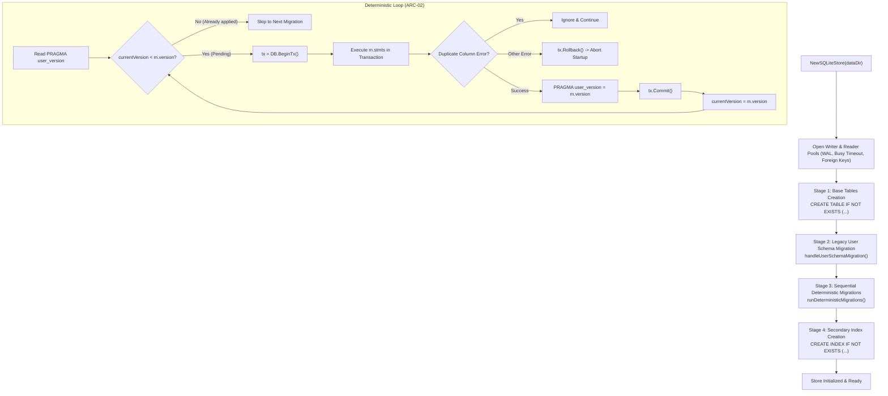

# Deterministic Database Migrations Specification

> **Engine:** SQLite 3 via `modernc.org/sqlite` (Pure Go, CGO-free)  
> **Source Implementation:** `cloud/internal/store/sqlite.go` (`s.migrate()`, `s.runDeterministicMigrations()`)  
> **Tracking Mechanism:** SQLite `PRAGMA user_version`  
> **Architecture Pattern:** ARC-02 Sequential Deterministic Migrations  
> **Current Schema Version:** `11`

---

## 1. Migration Philosophy

The Tide cloud storage and collaboration engine requires high reliability, zero-configuration deployments, and strict cryptographic data integrity. Database migrations in Tide adhere to the following architectural tenets:

1. **Pure Go & Zero External Dependencies:**
   - No external CLI tools, binary wrappers, or third-party migration frameworks (e.g., `golang-migrate`, `goose`, `flyway`, or heavy ORM migrations) are used.
   - The entire migration engine is implemented in standard Go code within `cloud/internal/store/sqlite.go`, compiling into a single self-contained binary.

2. **Embedded In-Process Execution on Database Boot:**
   - Every time `NewSQLiteStore(dataDir)` initializes a database connection, it executes `s.migrate()`.
   - Development, test, and production environments always advance automatically to the latest required schema without requiring separate deployment steps or manual database administrative intervention.

3. **Atomic Schema Upgrades via `PRAGMA user_version`:**
   - SQLite provides an internal 32-bit signed user-defined integer slot in the database header (`PRAGMA user_version`).
   - The migration subsystem uses `user_version` as the single source of truth for the applied schema revision, completely avoiding dedicated migration metadata tables.

4. **Linear, Monotonic Progression:**
   - Migrations are defined as an ordered, append-only slice of versions ($1 \to 2 \to \dots \to N$).
   - Versions are applied sequentially; skipping, branching, or out-of-order execution is strictly prohibited.

5. **Safe, Non-Destructive Invariants:**
   - Production migrations never drop active columns or delete unmigrated user data.
   - Backward-compatible column additions with defaults (`DEFAULT`, `NULL`) ensure running systems or legacy payloads do not break during rolling updates.

---

## 2. Execution Lifecycle & Architecture

The database initialization workflow follows a structured four-stage boot pipeline:



### 2.1 Stage 1: Base Tables Creation
When an empty database is opened, `s.migrate()` first runs an idempotent baseline batch of `CREATE TABLE IF NOT EXISTS` statements for core tables:
- `users`, `files`, `file_backups`, `file_shares`, `tokens`, `links`, `messages`, `contacts`, `tasks`, `profiles`, `api_tokens`, `quicknotes`, `quicknote_wal`, `quicknote_files`, `todos`.

### 2.2 Stage 2: Legacy User Schema Recreation Bridge
Before the deterministic migration loop was standardized in ARC-02, an earlier schema version used an incompatible column `encrypted_data` and a conflicting unique constraint on `username_blind_index`. 
`handleUserSchemaMigration()` inspects the table metadata using `PRAGMA table_info(users)`:
- If legacy structures exist, it performs an atomic 4-step table recreation within an explicit transaction:
  1. `ALTER TABLE users RENAME TO users_old;`
  2. Create the modern `users` table.
  3. Migrate and map valid columns (`encrypted_vault`, `encrypted_pepper`, etc.).
  4. `DROP TABLE users_old;`
- If no legacy table is detected, it attempts incremental column additions (`encrypted_vault`, `pin_hash`, etc.) while gracefully ignoring duplicate column errors.

### 2.3 Stage 3: Deterministic Sequential Migrations (`runDeterministicMigrations`)
The core migration engine executes as follows:

```go
func (s *SQLiteStore) runDeterministicMigrations() error {
    var currentVersion int
    if err := s.DB.QueryRow("PRAGMA user_version;").Scan(&currentVersion); err != nil {
        return fmt.Errorf("failed to get current database schema user_version: %w", err)
    }

    migrations := []schemaMigration{ ... }

    for _, m := range migrations {
        if currentVersion >= m.version {
            continue
        }

        tx, err := s.DB.BeginTx(context.Background(), nil)
        if err != nil {
            return fmt.Errorf("migration to version %d failed to begin transaction: %w", m.version, err)
        }

        for _, stmt := range m.stmts {
            if _, execErr := tx.Exec(stmt); execErr != nil {
                if isDuplicateColumnError(execErr) {
                    continue
                }
                _ = tx.Rollback()
                return fmt.Errorf("migration to version %d failed: %w", m.version, execErr)
            }
        }

        if _, err := tx.Exec(fmt.Sprintf("PRAGMA user_version = %d;", m.version)); err != nil {
            _ = tx.Rollback()
            return fmt.Errorf("migration to version %d failed to update user_version: %w", m.version, err)
        }

        if err := tx.Commit(); err != nil {
            return fmt.Errorf("migration to version %d failed to commit: %w", m.version, err)
        }

        currentVersion = m.version
    }
    return nil
}
```

#### Key Lifecycle Characteristics:
1. **Initial Version Inspection:**  
   Querying `PRAGMA user_version;` fetches the active integer schema version. For a brand-new database created from scratch, `user_version` defaults to `0`.
2. **Strict Sequential Progression:**  
   The system iterates through the static `migrations` slice. Any migration with `m.version <= currentVersion` is skipped immediately without acquiring a transaction lock.
3. **Atomic Transactional Wrapping:**  
   Each migration step is isolated inside an immediate transaction (`BeginTx`). Multiple statements belonging to a single migration revision succeed or fail as an indivisible unit.
4. **Idempotent Column Handling:**  
   SQLite does not natively support `ADD COLUMN IF NOT EXISTS`. If a database previously had a column added out-of-band or via baseline DDL, `isDuplicateColumnError(err)` detects the `duplicate column name` error string and skips the statement safely rather than failing the transaction.
5. **Atomic Version Bumping:**  
   `PRAGMA user_version = %d;` is executed **inside** the migration transaction. When `tx.Commit()` succeeds, both the schema DDL changes and the version indicator persist atomically to disk.
6. **Failure Rollback:**  
   If any statement fails for reasons other than duplicate column names, `tx.Rollback()` is invoked immediately, the application terminates startup with a descriptive error, and `user_version` remains at the previously verified version.

### 2.4 Stage 4: Secondary Index Creation
After all deterministic migrations have completed and all columns exist across all revisions, secondary indices (`idx_files_parent`, `idx_todos_user`, `idx_quicknote_wal_slug`, etc.) are created using `CREATE INDEX IF NOT EXISTS`.

---

## 3. Comprehensive History of Migrations (Versions 1 to 11)

The table below summarizes all deterministic migrations registered in `cloud/internal/store/sqlite.go`:

| Version | Migration Identifier | Primary Subsystem | Key Schema Additions |
| :---: | :--- | :--- | :--- |
| **1** | `file_visibility_and_shares_metadata` | Files & Sharing | Visibility levels, share permissions, reshare capability |
| **2** | `finance_linked_accounts` | Finance Extension | Extension reservation / no-op placeholder |
| **3** | `file_versions_metadata_and_access_keys` | Envelope Encryption | File versioning, JSON metadata, wrapped access keys |
| **4** | `user_verification_and_avatar_salt` | Auth & Profile | Verification status, profile avatar cryptographic salt |
| **5** | `file_backups_v2` | Backup & Recovery | Backup secured metadata, backup access keys, schema version |
| **6** | `yjs_wal_and_crdt_fields` | Real-time CRDT Sync | `yjs_wal` append log, file key epochs, snapshots, content |
| **7** | `quicknotes_and_wal` | Collaboration Sync | `quicknotes` base table, `quicknote_wal` delta stream |
| **8** | `quicknotes_parent_slug` | Hierarchical Notes | `quicknotes.parent_slug` nested tree hierarchy |
| **9** | `quicknote_files` | Binary Assets | `quicknote_files` attachment registry with blob storage mapping |
| **10** | `todos_api_table` | Task Management | `todos` relational entity with scheduling and indexing |
| **11** | `surveys_api_table` | Telemetry & Surveys | `survey_responses` dynamic response storage |

---

### Migration 1: `file_visibility_and_shares_metadata`

- **Version:** `1`
- **Purpose:** Introduced granular access controls and file-sharing metadata to support collaborative workspaces and peer-to-peer message tracking.
- **Statements Executed:**
  ```sql
  ALTER TABLE files ADD COLUMN visibility TEXT DEFAULT 'private';
  ALTER TABLE file_shares ADD COLUMN secured_meta BLOB;
  ALTER TABLE file_shares ADD COLUMN status TEXT DEFAULT 'pending';
  ALTER TABLE file_shares ADD COLUMN permission TEXT NOT NULL DEFAULT 'view';
  ALTER TABLE file_shares ADD COLUMN can_reshare INTEGER NOT NULL DEFAULT 0;
  ALTER TABLE messages ADD COLUMN status TEXT DEFAULT 'pending';
  ```
- **Architectural Impact:**
  - `files.visibility`: Enables access level toggling (`private`, `shared`, `public`).
  - `file_shares.permission`: Differentiates between read-only (`view`) and collaborative (`edit`) capabilities.
  - `file_shares.can_reshare`: Explicit boolean flag (0/1) governing downstream re-sharing delegation.
  - `file_shares.secured_meta`: Stores AES-GCM encrypted metadata envelopes specifically wrapped for the share recipient.
  - `messages.status`: Allows tracking of peer message delivery states (`pending`, `delivered`, `read`).

---

### Migration 2: `finance_linked_accounts`

- **Version:** `2`
- **Purpose:** Reserved placeholder for the finance extension schema.
- **Statements Executed:**
  ```go
  // stmts: []string{} (empty)
  ```
- **Architectural Impact:**
  - Preserves deterministic sequential numbering without altering the database schema.
  - Demonstrates the engine's capability to register milestone or no-op transitional revisions without breaking the linear version ladder.

---

### Migration 3: `file_versions_metadata_and_access_keys`

- **Version:** `3`
- **Purpose:** Introduced envelope encryption key management (`access_keys`) and structured file versioning for Zero-Knowledge multi-user access.
- **Statements Executed:**
  ```sql
  ALTER TABLE files ADD COLUMN version INTEGER DEFAULT 1;
  ALTER TABLE files ADD COLUMN metadata TEXT;
  ALTER TABLE files ADD COLUMN access_keys TEXT;
  ```
- **Architectural Impact:**
  - `files.version`: Monotonically increasing revision counter for concurrent file modification conflict resolution.
  - `files.metadata`: Unencrypted JSON metadata bucket for non-sensitive attributes.
  - `files.access_keys`: JSON envelope storing wrapped file encryption keys indexed by user ID:
    ```json
    {
      "usr_alice": "wrapped_symmetric_key_base64...",
      "usr_bob": "wrapped_symmetric_key_base64..."
    }
    ```
    This column is maintained atomically via `UpdateFileAccessKey` using SQLite's native `json_set` function.

---

### Migration 4: `user_verification_and_avatar_salt`

- **Version:** `4`
- **Purpose:** Added user verification flags for email/phone challenges and individualized cryptographic salts for deterministic avatar generation.
- **Statements Executed:**
  ```sql
  ALTER TABLE users ADD COLUMN is_verified INTEGER DEFAULT 0;
  ALTER TABLE profiles ADD COLUMN avatar_salt TEXT NOT NULL DEFAULT '';
  ```
- **Architectural Impact:**
  - `users.is_verified`: Integer boolean (0 = unverified, 1 = verified) gating authenticated account operations.
  - `profiles.avatar_salt`: Prevents rainbow table attacks or identity linkage across public profile seeds by hashing avatar seeds with a per-user random salt.

---

### Migration 5: `file_backups_v2`

- **Version:** `5`
- **Purpose:** Upgraded the encrypted file backup subsystem to match the multi-user envelope encryption and secured metadata format of V2 files.
- **Statements Executed:**
  ```sql
  ALTER TABLE file_backups ADD COLUMN secured_meta BLOB;
  ALTER TABLE file_backups ADD COLUMN access_keys TEXT DEFAULT '{}';
  ALTER TABLE file_backups ADD COLUMN version INTEGER DEFAULT 1;
  ```
- **Architectural Impact:**
  - Enables backup snapshots to store encrypted file metadata (`secured_meta`) alongside raw data blobs.
  - Preserves wrapped access keys within backup snapshots, ensuring backups can be restored by authorized collaborators even if the primary file record is corrupted or purged.

---

### Migration 6: `yjs_wal_and_crdt_fields`

- **Version:** `6`
- **Purpose:** Laid the foundation for real-time collaborative text editing by introducing the Yjs Write-Ahead Log (`yjs_wal`) and CRDT state tracking columns.
- **Statements Executed:**
  ```sql
  CREATE TABLE IF NOT EXISTS yjs_wal (
      seq_id INTEGER PRIMARY KEY AUTOINCREMENT,
      file_id TEXT NOT NULL,
      key_epoch INTEGER NOT NULL,
      iv BLOB NOT NULL,
      ciphertext BLOB NOT NULL,
      created_at INTEGER NOT NULL,
      FOREIGN KEY(file_id) REFERENCES files(id) ON DELETE CASCADE
  );
  CREATE INDEX IF NOT EXISTS idx_yjs_wal_file_seq ON yjs_wal(file_id, seq_id);
  ALTER TABLE files ADD COLUMN parent_file_id TEXT REFERENCES files(id) ON DELETE CASCADE;
  ALTER TABLE files ADD COLUMN key_epoch INTEGER NOT NULL DEFAULT 1;
  ALTER TABLE files ADD COLUMN snapshot_seq_id INTEGER NOT NULL DEFAULT 0;
  ALTER TABLE files ADD COLUMN snapshot_iv BLOB;
  ALTER TABLE files ADD COLUMN content BLOB;
  ```
- **Architectural Impact:**
  - `yjs_wal`: Stores encrypted Yjs incremental binary update vectors as an append-only sequence indexed by `(file_id, seq_id)`.
  - `files.key_epoch`: Tracks encryption key rotations; updates created under older epochs can be re-wrapped or compacted.
  - `files.snapshot_seq_id`: Pointer indicating the last `seq_id` merged into the compiled base document snapshot (`files.content`).
  - `files.parent_file_id`: Supports document branching, nesting, or revision tracking with cascading deletion.

---

### Migration 7: `quicknotes_and_wal`

- **Version:** `7`
- **Purpose:** Implemented the standalone Quicknotes engine, providing lightweight, ephemeral or shareable real-time collaborative scratchpads decoupled from standard file trees.
- **Statements Executed:**
  ```sql
  CREATE TABLE IF NOT EXISTS quicknotes (
      slug TEXT PRIMARY KEY,
      title TEXT NOT NULL DEFAULT 'Untitled Quicknote',
      content TEXT NOT NULL DEFAULT '',
      snapshot_iv BLOB,
      snapshot_ciphertext BLOB,
      snapshot_seq_id INTEGER DEFAULT 0,
      created_at DATETIME NOT NULL,
      updated_at DATETIME NOT NULL
  );
  CREATE TABLE IF NOT EXISTS quicknote_wal (
      seq_id INTEGER PRIMARY KEY AUTOINCREMENT,
      slug TEXT NOT NULL,
      key_epoch INTEGER NOT NULL DEFAULT 1,
      iv BLOB NOT NULL,
      ciphertext BLOB NOT NULL,
      created_at INTEGER NOT NULL,
      FOREIGN KEY(slug) REFERENCES quicknotes(slug) ON DELETE CASCADE
  );
  CREATE INDEX IF NOT EXISTS idx_quicknote_wal_slug ON quicknote_wal(slug, seq_id);
  ```
- **Architectural Impact:**
  - High-performance, slug-indexed notes enabling direct URL-based sharing.
  - Employs the identical CRDT WAL architecture as Migration 6, storing encrypted delta updates that synchronize clients over Server-Sent Events (SSE).

---

### Migration 8: `quicknotes_parent_slug`

- **Version:** `8`
- **Purpose:** Added hierarchical organization to Quicknotes, allowing notes to nest within parent notes.
- **Statements Executed:**
  ```sql
  ALTER TABLE quicknotes ADD COLUMN parent_slug TEXT;
  CREATE INDEX IF NOT EXISTS idx_quicknotes_parent_slug ON quicknotes(parent_slug);
  ```
- **Architectural Impact:**
  - Converts the flat quicknotes collection into a self-referencing tree structure.
  - Enables sub-notebooks, breadcrumb navigation, and tree queries while maintaining backward compatibility for unparented root notes (`parent_slug IS NULL`).

---

### Migration 9: `quicknote_files`

- **Version:** `9`
- **Purpose:** Added binary asset attachment capabilities to quicknotes (e.g., inline images, audio clips, and PDF documents).
- **Statements Executed:**
  ```sql
  CREATE TABLE IF NOT EXISTS quicknote_files (
      id TEXT PRIMARY KEY,
      slug TEXT NOT NULL,
      name TEXT NOT NULL,
      mime_type TEXT,
      size INTEGER NOT NULL,
      blob_path TEXT NOT NULL,
      created_at DATETIME NOT NULL,
      FOREIGN KEY(slug) REFERENCES quicknotes(slug) ON DELETE CASCADE
  );
  CREATE INDEX IF NOT EXISTS idx_quicknote_files_slug ON quicknote_files(slug);
  ```
- **Architectural Impact:**
  - Decouples binary payloads from SQLite table storage: metadata is stored in `quicknote_files` while raw content resides on disk or S3 via `blob_path`.
  - Cascades deletions: when a parent quicknote is deleted, all referenced attachment records are automatically removed.

---

### Migration 10: `todos_api_table`

- **Version:** `10`
- **Purpose:** Introduced structured task and todo management natively into the cloud database schema.
- **Statements Executed:**
  ```sql
  CREATE TABLE IF NOT EXISTS todos (
      id TEXT PRIMARY KEY,
      user_id TEXT NOT NULL,
      title TEXT NOT NULL,
      description TEXT DEFAULT '',
      status TEXT DEFAULT 'todo',
      priority TEXT DEFAULT 'medium',
      due_date TEXT DEFAULT '',
      scheduled_date TEXT DEFAULT '',
      tags TEXT DEFAULT '[]',
      color TEXT DEFAULT '',
      is_completed INTEGER DEFAULT 0,
      completed_at DATETIME,
      created_at DATETIME DEFAULT CURRENT_TIMESTAMP,
      updated_at DATETIME DEFAULT CURRENT_TIMESTAMP,
      FOREIGN KEY (user_id) REFERENCES users(id)
  );
  CREATE INDEX IF NOT EXISTS idx_todos_user ON todos(user_id);
  CREATE INDEX IF NOT EXISTS idx_todos_due_date ON todos(due_date);
  CREATE INDEX IF NOT EXISTS idx_todos_status ON todos(status);
  CREATE INDEX IF NOT EXISTS idx_todos_priority ON todos(priority);
  CREATE INDEX IF NOT EXISTS idx_todos_created ON todos(created_at);
  ```
- **Architectural Impact:**
  - Provides a high-throughput relational store for task management supporting status workflows (`todo`, `in_progress`, `done`, `archived`) and priorities (`low`, `medium`, `high`, `urgent`).
  - Indexed for complex multi-predicate queries (by user, due date, status, priority, and creation timestamp).

---

### Migration 11: `surveys_api_table`

- **Version:** `11`
- **Purpose:** Added flexible dynamic survey response storage for telemetry, onboarding flows, and user feedback collection.
- **Statements Executed:**
  ```sql
  CREATE TABLE IF NOT EXISTS survey_responses (
      id TEXT PRIMARY KEY,
      user_id TEXT NOT NULL,
      survey_id TEXT NOT NULL,
      data TEXT NOT NULL DEFAULT '{}',
      created_at TIMESTAMP NOT NULL DEFAULT CURRENT_TIMESTAMP,
      updated_at TIMESTAMP NOT NULL DEFAULT CURRENT_TIMESTAMP
  );
  CREATE INDEX IF NOT EXISTS idx_survey_responses_user ON survey_responses(user_id);
  CREATE INDEX IF NOT EXISTS idx_survey_responses_survey ON survey_responses(survey_id);
  CREATE INDEX IF NOT EXISTS idx_survey_responses_created ON survey_responses(created_at);
  ```
- **Architectural Impact:**
  - Schema-agnostic storage of user feedback through the `data TEXT` JSON payload.
  - Multi-column indexing facilitates fast lookups by respondent (`user_id`), questionnaire campaign (`survey_id`), and submission timeline (`created_at`).

---

## 4. Migration Invariants & Guarantees

The deterministic migration framework in Tide enforces three non-negotiable guarantees:

### 4.1 Backward Compatibility
1. **Never Drop Live Columns:**  
   Standard sequential migrations never execute `ALTER TABLE ... DROP COLUMN` on active columns. Obsolete columns are deprecated in application logic and left dormant to prevent data corruption during rollbacks.
2. **Mandatory Defaults:**  
   Every new column added to an existing table must include a safe `DEFAULT` value or be nullable (`NULL`). This ensures existing rows remain valid immediately upon schema alteration without requiring lock-heavy batch table rewrites.
3. **Payload Preservation:**  
   Cryptographic payloads (e.g., `encrypted_vault`, `secured_meta`, `ciphertext`, `iv`) are treated as opaque binary data. Migrations never attempt to mutate or re-encode ciphertext inside SQL scripts.

### 4.2 Idempotency & Fault Tolerance
1. **Resilience to Pre-existing Columns:**  
   The helper `isDuplicateColumnError` checks error messages for the `duplicate column name` string:
   ```go
   func isDuplicateColumnError(err error) bool {
       if err == nil {
           return false
       }
       msg := strings.ToLower(err.Error())
       return strings.Contains(msg, "duplicate column name")
   }
   ```
   If a column was previously added manually or via a partial test run, the migration catches the error, skips the statement, and proceeds cleanly.
2. **Defensive DDL Constructs:**  
   All table creations use `CREATE TABLE IF NOT EXISTS`, and all index creations use `CREATE INDEX IF NOT EXISTS`.
3. **Monotonic Gate Check:**  
   The `if currentVersion >= m.version` condition guarantees that once a migration version has committed, its statements are never executed a second time.

### 4.3 Atomicity & Rollback Guarantee
1. **Single-Transaction Encapsulation:**  
   Every migration version runs within its own transaction initiated via `s.DB.BeginTx(context.Background(), nil)`.
2. **Transactional `PRAGMA user_version`:**  
   Because SQLite allows `PRAGMA user_version` to participate in active transactions, the version increment is committed simultaneously with the schema DDL changes.
3. **Immediate Abort on Error:**  
   If any statement fails:
   - `_ = tx.Rollback()` reverts all DDL alterations from that specific migration step.
   - The method returns a formatted error (`migration to version X failed: ...`).
   - `NewSQLiteStore` halts application startup, preventing the server from running in a corrupted or half-migrated state.
   - `user_version` remains strictly at the last successfully completed version.

---

## 5. Developer Guide: Adding a New Migration (Version 12+)

When adding schema modifications to `cloud/internal/store/sqlite.go`, follow this procedure:

1. **Verify Current Target Version:**  
   Inspect `sqlite.go` and verify the highest registered `version` (currently `11`). Your new migration must have `version = 12`.
2. **Define Migration Struct:**  
   Append the new migration to the `migrations` slice inside `runDeterministicMigrations()`:
   ```go
   {
       version: 12,
       name:    "your_descriptive_feature_name",
       stmts: []string{
           "ALTER TABLE files ADD COLUMN compression_type TEXT DEFAULT 'none';",
           "CREATE INDEX IF NOT EXISTS idx_files_compression ON files(compression_type);",
       },
   },
   ```
3. **Update Baseline `tables` & `indices` DDL:**  
   If adding an entirely new table or index, also add it to the initial `tables` or `indices` strings in `migrate()` with `IF NOT EXISTS`. This ensures newly provisioned blank databases contain all tables from day one without running legacy DDL transitions.
4. **Adhere to Invariants:**
   - Always specify `DEFAULT` values for new columns.
   - Never use `DROP COLUMN` or destructive `RENAME`.
   - Never embed business logic or data transformations that depend on external network calls.
5. **Update Documentation:**  
   Update this file (`cloud/docs/database/02-deterministic-migrations.md`) and `01-schema-reference.md` with the new version details, rationale, and schema definitions.
6. **Execute Verification:**  
   Compile and run static analysis:
   ```bash
   cd cloud && go build ./... && go vet ./...
   ```
