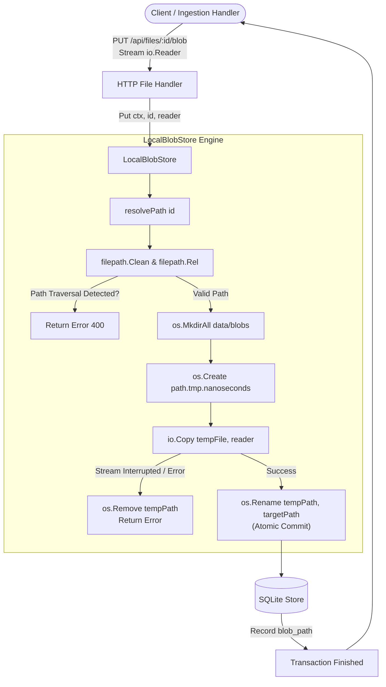

# Blob Storage Engine Specification

## 1. Executive Summary & Storage Philosophy

The Tide cloud architecture adheres to a strict separation of concerns between **relational metadata** and **binary payload storage**. While SQLite manages user accounts, file records, access control lists (ACLs), cryptographic key envelopes, and real-time CRDT write-ahead logs, the underlying binary assets (encrypted file attachments, large note snapshots, and rich media assets) are managed by a dedicated **Blob Storage Subsystem**.

### Core Architectural Principles

1. **Decoupled Payload Storage:** File records within SQLite maintain pointers (`blob_path`) to opaque binary objects. The relational database never stores large raw binaries as `BLOB` columns, avoiding database file bloat, preserving B-Tree cache efficiency, and keeping WAL check-pointing fast.
2. **Zero-Knowledge Opacity:** All payloads sent to the blob storage subsystem are encrypted client-side using authenticated symmetric encryption (AES-GCM-256) prior to transmission. The blob engine treats every payload as an opaque, unverifiable sequence of bytes.
3. **Stream-Oriented I/O:** Payload ingestion (`Put`) and retrieval (`Get`) operate strictly over Go streaming abstractions (`io.Reader` and `io.ReadCloser`). Payloads are streamed directly to and from persistent storage with constant memory consumption, preventing out-of-memory (OOM) spikes during concurrent transfers.
4. **Interface Isolation:** The storage backend is abstracted behind the `BlobStore` Go interface, decoupling storage operations from the underlying physical storage mechanism.
5. **Atomic Durability:** Writes are guaranteed to be atomic through temporary file staging and atomic filesystem renames, eliminating partial write hazards during process crashes or ungraceful client disconnections.

---

## 2. Interface Abstraction (`BlobStore`)

The storage subsystem defines an explicit, technology-agnostic interface located in `cloud/internal/store/blob.go`:

```go
// BlobStore defines the interface for storing binary blobs.
type BlobStore interface {
    // Put stores the content from the provided reader under the given blob ID.
    // The write must be atomic: readers never observe partially written data.
    Put(ctx context.Context, id string, r io.Reader) error

    // Get retrieves a readable stream for the specified blob ID.
    // Returns ErrNotFound if the target blob does not exist.
    Get(ctx context.Context, id string) (io.ReadCloser, error)

    // Exists checks if the blob exists in the underlying store.
    Exists(ctx context.Context, id string) bool

    // Delete permanently deletes the blob identified by the given ID.
    // Must return nil if the file does not exist (idempotent removal).
    Delete(ctx context.Context, id string) error

    // GetSize returns the exact size of the stored blob in bytes.
    // Returns ErrNotFound if the target blob does not exist.
    GetSize(ctx context.Context, id string) (int64, error)
}
```

### Operational Contracts

| Method | Conceptual Operation | Input Signature | Return Values | Error Semantics |
| :--- | :--- | :--- | :--- | :--- |
| `Put` | `WriteBlob` | `ctx`, `id string`, `r io.Reader` | `error` | Returns traversal errors, disk I/O errors, or context aborts. |
| `Get` | `ReadBlob` | `ctx`, `id string` | `io.ReadCloser`, `error` | Returns `store.ErrNotFound` if file missing; stream must be closed by caller. |
| `Exists` | `BlobExists` | `ctx`, `id string` | `bool` | Returns `true` if present and accessible; `false` on missing or error. |
| `Delete` | `DeleteBlob` | `ctx`, `id string` | `error` | Idempotent; returns `nil` if already absent (`os.IsNotExist`). |
| `GetSize` | `BlobSize` | `ctx`, `id string` | `int64`, `error` | Returns byte length of file; returns `store.ErrNotFound` if missing. |

---

## 3. `LocalBlobStore` Engine Implementation

The default production implementation for single-node deployments is `LocalBlobStore`, which manages binary storage directly on the host operating system filesystem.

### 3.1 Storage Path Hierarchy

The storage root is initialized at server startup from the configured data directory:

```go
blobStore := store.NewLocalBlobStore(filepath.Join(dataDir, "blobs"))
```

Blobs are identified by unique string identifiers (typically standard UUID v4 or ULID strings) and are stored flat or hierarchically within the directory tree:

```
data/
└── blobs/
    ├── 018f3a21-998a-781e-b81b-53c8ea4a57f1
    ├── 3c49e25d-bb82-411a-8e2b-2a62ffda5c92
    ├── 7b1c4e92-3490-48e0-a7d1-e5d892014bba
    └── a623c914-df76-4be4-b4a5-c335839212ad
```

### 3.2 Path Traversal Vulnerability Mitigation

Because blob IDs originate from external client requests or database records, the path resolution routine enforces defensive path validation against directory traversal attacks (such as `../../etc/passwd` or `..\\Windows\\System32`):

```go
func (s *LocalBlobStore) resolvePath(id string) (string, error) {
    cleanBase := filepath.Clean(s.BasePath)
    target := filepath.Clean(filepath.Join(cleanBase, id))
    rel, err := filepath.Rel(cleanBase, target)
    if err != nil || strings.HasPrefix(rel, "..") || rel == "." {
        return "", fmt.Errorf("invalid blob id: path traversal detected")
    }
    return target, nil
}
```

#### Security Validation Stages:
1. **Canonical Normalization:** Both `BasePath` and the target combination `filepath.Join(cleanBase, id)` are processed through `filepath.Clean()`, resolving relative path separators (`.`, `..`) and eliminating redundant directory delimiters.
2. **Relative Path Extraction:** `filepath.Rel(cleanBase, target)` computes the lexical relative path between the root and target.
3. **Boundary Escape Detection:**
   - If `err != nil`, the paths reside on different volume roots (e.g. cross-drive references on Windows).
   - If `strings.HasPrefix(rel, "..")`, the requested target escapes outside `cleanBase`.
   - If `rel == "."`, the requested target is identical to the root storage directory rather than an entity within it.
   - Any violation immediately yields an explicit `"invalid blob id: path traversal detected"` error, rejecting the operation before any filesystem call is attempted.

### 3.3 Atomic File Write Pattern

To prevent race conditions, corrupted reads, and partial file persistence resulting from interrupted client uploads or abrupt system shutdowns, `LocalBlobStore.Put()` uses a two-phase staging pattern:

```go
func (s *LocalBlobStore) Put(ctx context.Context, id string, r io.Reader) error {
    path, err := s.resolvePath(id)
    if err != nil {
        return err
    }

    // 1. Ensure target directory exists
    if err := os.MkdirAll(filepath.Dir(path), 0755); err != nil {
        return err
    }

    // 2. Stage into a unique temporary file
    tempPath := fmt.Sprintf("%s.tmp.%d", path, time.Now().UnixNano())
    f, err := os.Create(tempPath)
    if err != nil {
        return err
    }

    // 3. Stream data from reader to temporary file
    _, err = io.Copy(f, r)
    f.Close()

    // 4. Abort and clean up on stream failure
    if err != nil {
        os.Remove(tempPath)
        return err
    }

    // 5. Atomic commit via filesystem rename
    return os.Rename(tempPath, path)
}
```

#### Atomic Guarantees:
- **Temporary Isolation:** The staging file (`<path>.tmp.<nanoseconds>`) resides on the same physical filesystem and directory as the target path.
- **POSIX Atomic Rename:** `os.Rename()` utilizes atomic rename semantics (`rename(2)` on Unix/POSIX, `MoveFileEx` with `MOVEFILE_REPLACE_EXISTING` on Windows), ensuring:
  1. No reader can observe an incomplete, zero-length, or partially populated blob.
  2. If a file already exists at the target path, it is atomically replaced.
  3. If an upload fails midway through `io.Copy`, the temporary file is deleted and the target path remains unaltered.

---

## 4. Blob Lifecycle, Retention & Garbage Collection

### 4.1 Deduplication & Reference Counting

A single encrypted binary blob on disk can be referenced by multiple file records (for example, duplicated note attachments, snapshots, or version branches). To ensure data integrity, blobs are never deleted blindly. Instead, Tide enforces **reference-counted lifecycle management**.

The database tracking is performed by `CountBlobReferencesExcluding` in `cloud/internal/store/sqlite.go`:

```sql
SELECT COUNT(1) FROM files WHERE blob_path = ? AND id NOT IN (?)
```

```go
func (s *SQLiteStore) CountBlobReferencesExcluding(
    ctx context.Context, 
    blobPath string, 
    excludedFileIDs []string,
) (int, error)
```

#### Reference Evaluation Flow:
- When deleting a file record with ID `X`, the system queries if any *other* active or trashed file record still references `blobPath` (excluding `X`).
- If `refs == 0`, no other file record in SQLite relies on the binary asset, and the physical blob can be safely removed via `BlobStore.Delete()`.
- If `refs > 0`, the physical blob on disk is retained to satisfy the remaining referencing records.

### 4.2 Trashed Files: Soft-Deletion vs. Permanent Purging

Tide supports a two-stage deletion protocol:

1. **Soft Deletion (`deleted_at` Timestamp):**
   - When a user moves a file or note to the trash, the file's JSON metadata is updated:
     ```json
     { "deleted_at": "2026-11-15T20:00:00Z" }
     ```
   - The file record remains in SQLite, and the associated blob on disk remains untouched.
   - Users can restore the file from the trash within the grace retention window without data loss.

2. **Explicit Permanent Deletion:**
   - If an owner explicitly chooses "Permanent Delete" through the UI or API (`/api/files/{id}?permanent=true`), the file record is immediately deleted from SQLite.
   - The system queries all associated blobs (`GetFileBlobPaths`), checks whether each blob is referenced elsewhere (`CountBlobReferencesExcluding`), and purges unreferenced blobs immediately.

### 4.3 Background Garbage Collection Worker

Files left in the trash are subject to automated retention purging. A background worker runs continuously inside the cloud daemon (`cloud/cmd/server/main.go`):

```go
// Background cleanup worker for trashed files older than 7 days
go func() {
    ticker := time.NewTicker(1 * time.Hour)
    // Run once on startup:
    if err := sqliteStore.PurgeOldTrashedFiles(context.Background(), blobStore); err != nil {
        log.Printf("[GC] Error purging old trashed files: %v", err)
    }
    for range ticker.C {
        if err := sqliteStore.PurgeOldTrashedFiles(context.Background(), blobStore); err != nil {
            log.Printf("[GC] Error purging old trashed files: %v", err)
        }
    }
}()
```

#### Garbage Collection Algorithm (`PurgeOldTrashedFiles`):

```sql
SELECT id FROM files 
WHERE json_extract(metadata, '$.deleted_at') IS NOT NULL 
  AND datetime(json_extract(metadata, '$.deleted_at')) < datetime('now', '-7 days');
```

1. **Target Identification:** Queries SQLite for all file IDs whose `deleted_at` timestamp is older than 7 days (`datetime('now', '-7 days')`).
2. **Blob Association Lookup:** Resolves all blob paths associated with the expiring files via `s.GetFileBlobPaths(ctx, id)`.
3. **Record Eviction:** Executes `s.DeleteFile(ctx, id)` within SQLite, removing the database record and associated share/metadata links.
4. **Reference Verification:** For each collected `blobPath`, executes `s.CountBlobReferencesExcluding(ctx, blobPath, nil)`.
5. **Physical Eviction:** If the reference count is zero (`refs == 0`), calls `blobStore.Delete(ctx, blobPath)` to reclaim disk storage.

---

## 5. Lifecycle Architecture Flowcharts

### 5.1 Blob Write and Atomic Ingestion Lifecycle



### 5.2 Trashed File Deletion and Hourly GC Lifecycle

```mermaid
flowchart TD
    subgraph Client Initiated Operations
        SoftDel[User Deletes File] -->|Soft Delete| MarkTrash["Set metadata.deleted_at = now()\nBlob Retained on Disk"]
        HardDel[User Empties Trash] -->|Permanent Delete| ImmediatePurge[Trigger Immediate Purge]
    end

    subgraph Background Garbage Collection Worker (1-Hour Ticker)
        Ticker([Hourly Ticker / Startup]) --> Query["SELECT id FROM files\nWHERE deleted_at < now() - 7 days"]
        Query --> Loop{For each expired file ID}
        Loop --> GetPaths["GetFileBlobPaths(ctx, id)"]
        GetPaths --> DelRec["DeleteFile(ctx, id) from SQLite"]
        DelRec --> CheckRefs{"CountBlobReferencesExcluding\n(refs == 0?)"}
        CheckRefs -->|refs > 0| RetainBlob["Retain Blob\n(Other files still reference payload)"]
        CheckRefs -->|refs == 0| DeleteDisk["blobStore.Delete(ctx, blobPath)\n(Physical Unlink)"]
    end

    ImmediatePurge --> GetPaths
```

---

## 6. Future Cloud Storage Compatibility (S3 / MinIO / GCS)

While `LocalBlobStore` satisfies single-instance deployments, high-availability multi-node deployments require object storage. Because all blob operations interact exclusively with the `BlobStore` interface, the engine can be expanded with distributed backends without altering API handlers or SQLite logic.

### 6.1 Proposed Cloud Object Storage Backend

```go
package store

import (
    "context"
    "io"
    "github.com/aws/aws-sdk-go-v2/service/s3"
)

type S3BlobStore struct {
    client     *s3.Client
    bucket     string
    keyPrefix  string
}

func NewS3BlobStore(client *s3.Client, bucket, prefix string) *S3BlobStore {
    return &S3BlobStore{
        client:    client,
        bucket:    bucket,
        keyPrefix: prefix,
    }
}

func (s *S3BlobStore) Put(ctx context.Context, id string, r io.Reader) error {
    key := s.resolveKey(id)
    _, err := s.client.PutObject(ctx, &s3.PutObjectInput{
        Bucket: &s.bucket,
        Key:    &key,
        Body:   r,
    })
    return err
}

func (s *S3BlobStore) Get(ctx context.Context, id string) (io.ReadCloser, error) {
    key := s.resolveKey(id)
    out, err := s.client.GetObject(ctx, &s3.GetObjectInput{
        Bucket: &s.bucket,
        Key:    &key,
    })
    if err != nil {
        if isS3NoSuchKey(err) {
            return nil, ErrNotFound
        }
        return nil, err
    }
    return out.Body, nil
}

func (s *S3BlobStore) Exists(ctx context.Context, id string) bool {
    key := s.resolveKey(id)
    _, err := s.client.HeadObject(ctx, &s3.HeadObjectInput{
        Bucket: &s.bucket,
        Key:    &key,
    })
    return err == nil
}

func (s *S3BlobStore) Delete(ctx context.Context, id string) error {
    key := s.resolveKey(id)
    _, err := s.client.DeleteObject(ctx, &s3.DeleteObjectInput{
        Bucket: &s.bucket,
        Key:    &key,
    })
    return err
}

func (s *S3BlobStore) GetSize(ctx context.Context, id string) (int64, error) {
    key := s.resolveKey(id)
    out, err := s.client.HeadObject(ctx, &s3.HeadObjectInput{
        Bucket: &s.bucket,
        Key:    &key,
    })
    if err != nil {
        if isS3NoSuchKey(err) {
            return 0, ErrNotFound
        }
        return 0, err
    }
    if out.ContentLength != nil {
        return *out.ContentLength, nil
    }
    return 0, nil
}
```

### 6.2 Architectural Benefits of Multi-Cloud Object Storage

1. **MinIO Self-Hosted Compatibility:** Because AWS SDK v2 supports custom endpoint URLs, self-hosted deployments can use MinIO on-premise without code modifications.
2. **Direct-to-Object Presigned Transfers (Future Optimization):** For massive attachments (e.g. video clips or multi-gigabyte files), the cloud server can generate time-bounded Presigned Upload/Download URLs, offloading high-bandwidth streaming from the application server nodes.
3. **Stateless Cloud Instances:** Multi-node Tide server clusters behind a load balancer can share an identical S3/GCS bucket and LiteFS/PostgreSQL metadata layer, eliminating local disk synchronization bottlenecks.
