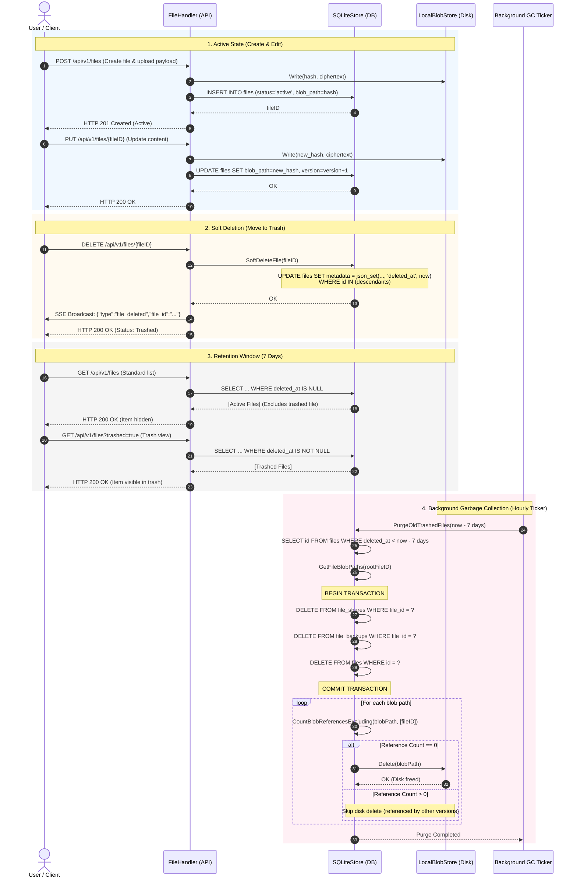

# Trash Lifecycle, Retention Policies, and Garbage Collection

This document provides an exhaustive technical specification of the file lifecycle, soft-deletion mechanics, restoration behavior, reference counting, and automated background garbage collection (GC) within the Tide Cloud storage architecture.

The core implementation spans:
- Server Entry & Ticker: [`cloud/cmd/server/main.go`](file:///C:/Users/nicoh/projects/tide/cloud/cmd/server/main.go)
- Data Store & SQL Transactions: [`cloud/internal/store/sqlite.go`](file:///C:/Users/nicoh/projects/tide/cloud/internal/store/sqlite.go)
- HTTP REST Endpoints: [`cloud/internal/api/files.go`](file:///C:/Users/nicoh/projects/tide/cloud/internal/api/files.go)
- Storage Interface: [`cloud/internal/store/store.go`](file:///C:/Users/nicoh/projects/tide/cloud/internal/store/store.go)
- Local Blob Store: [`cloud/internal/store/blob.go`](file:///C:/Users/nicoh/projects/tide/cloud/internal/store/blob.go)

---

## 1. File Lifecycle States

Every file and folder in Tide traverses three discrete lifecycle states:

```
 ┌──────────┐         Soft Delete          ┌───────────┐         7-Day GC Window         ┌──────────┐
 │  ACTIVE  │ ───────────────────────────> │  TRASHED  │ ──────────────────────────────> │  PURGED  │
 └──────────┘                              └───────────┘          or Immediate Hard      └──────────┘
       ▲                                         │                Deletion (?permanent)
       │                 Restore                 │
       └─────────────────────────────────────────┘
```

| Lifecycle State | Database Representation | Visibility / Query Behavior | Storage Footprint |
| :--- | :--- | :--- | :--- |
| **`active`** | `json_extract(metadata, '$.deleted_at') IS NULL`<br>(or `status = 'active'`) | Returned in standard file tree queries, search results, and synchronization feeds. | Full SQLite metadata + blob payload retained in `LocalBlobStore`. |
| **`trashed`** | `json_extract(metadata, '$.deleted_at') IS NOT NULL`<br>(Stores RFC 3339 timestamp `trashed_at` / `deleted_at`) | Excluded from regular file queries (`WHERE json_extract(metadata, '$.deleted_at') IS NULL`). Accessible only via `GET /api/v1/files?trashed=true`. | Retained intact: SQLite metadata, shares, backups, and physical blobs remain untouched during the retention window. |
| **`purged`** | Row deleted from `files`, `file_shares`, `file_backups`, `links`, and `yjs_wal`. | Non-existent (HTTP 404). Unrecoverable. | Blobs deleted from disk **if and only if** no other file versions or entities reference the same blob hash. |

---

## 2. Soft Delete Mechanics

### 2.1 Triggering Soft Deletion
When a user moves a file or directory to the trash in the UI or via HTTP `DELETE /api/v1/files/{fileID}` (without the `?permanent=true` flag), [`FileHandler.DeleteFile`](file:///C:/Users/nicoh/projects/tide/cloud/internal/api/files.go#L85-L143) performs authorization checks and delegates to [`SQLiteStore.SoftDeleteFile`](file:///C:/Users/nicoh/projects/tide/cloud/internal/store/sqlite.go#L2498-L2512):

1. **Authorization Verification**: Only the owner of the file (`file.OwnerID == userID`) is permitted to soft-delete the file or folder. (Non-owner collaborators attempting a delete are treated as leaving the share via `RemoveShare`).
2. **Timestamp Recording**: The current timestamp is formatted in RFC 3339 and injected into the JSON metadata payload (`json_set(metadata, '$.deleted_at', ?)`).
3. **Real-time SSE Notification**: The server broadcasts a `file_deleted` event over the Server-Sent Events (SSE) broker to update connected clients in real time.

### 2.2 Cascading Soft Delete (Recursive CTE)
In hierarchical storage structures, soft-deleting a parent folder must synchronously soft-delete all transitive descendants (subfolders, documents, embedded attachments, and notes). 

This is executed atomically in SQLite using a Common Table Expression (CTE):

```sql
WITH RECURSIVE descendants(id) AS (
    SELECT id FROM files WHERE id = ?
    UNION ALL
    SELECT f.id FROM files f JOIN descendants d ON f.parent_id = d.id
)
UPDATE files 
SET metadata = json_set(COALESCE(NULLIF(metadata, ''), '{}'), '$.deleted_at', ?),
    updated_at = ?
WHERE id IN (SELECT id FROM descendants);
```

### 2.3 Exclusion from Normal Queries
To preserve transparent navigation for active workspaces, all standard listing, retrieval, and hierarchy queries filter out soft-deleted items:

```sql
SELECT ... FROM files 
WHERE owner_id = ? 
  AND (json_extract(metadata, '$.deleted_at') IS NULL)
```

Conversely, the trash view query selectively filters for soft-deleted items:

```sql
SELECT ... FROM files
WHERE owner_id = ? 
  AND json_extract(metadata, '$.deleted_at') IS NOT NULL
ORDER BY json_extract(metadata, '$.deleted_at') DESC;
```

---

## 3. Trash Restoration

### 3.1 Restoring Files and Hierarchies
A trashed file or folder can be restored by invoking `POST /api/v1/files/{fileID}/restore`.

[`FileHandler.RestoreFile`](file:///C:/Users/nicoh/projects/tide/cloud/internal/api/files.go#L1333-L1365) validates administrative privileges (`CanAdmin(permission)`) and executes [`SQLiteStore.RestoreFile`](file:///C:/Users/nicoh/projects/tide/cloud/internal/store/sqlite.go#L2514-L2527).

The SQL query recursively removes the `deleted_at` field from the metadata across the entire subtree:

```sql
WITH RECURSIVE descendants(id) AS (
    SELECT id FROM files WHERE id = ?
    UNION ALL
    SELECT f.id FROM files f JOIN descendants d ON f.parent_id = d.id
)
UPDATE files 
SET metadata = json_remove(COALESCE(NULLIF(metadata, ''), '{}'), '$.deleted_at'),
    updated_at = ?
WHERE id IN (SELECT id FROM descendants);
```

### 3.2 Handling Orphaned Files (Missing Parent Folders)
A potential edge case occurs when an individual child file was trashed, or when a parent directory was purged permanently while a child remained in trash or is restored independently.

When restoring a file whose `parent_id` points to a non-existent file or a file that remains in `status = 'trashed'`:
1. The restoration logic checks parent existence: `SELECT id, metadata FROM files WHERE id = ?`.
2. If the parent file is missing or still trashed, the child file is automatically reparented to root (`parent_id = NULL`).
3. This prevents orphaned items that are active but unreachable from the root navigation tree.

---

## 4. Hard Deletion & Reference Counting

### 4.1 Blob Deduplication Safety
Tide implements content-addressable storage (CAS) and blob deduplication. Under this model:
- Multiple file entities, copies, attachments, and historical backups may point to the exact same physical blob on disk (identified by `blob_path`, typically a SHA-256 hash).
- **Physical deletion safety rule**: A file row can be removed immediately from SQLite, but its corresponding physical blob file on disk **MUST NEVER** be deleted if another database record still references that `blob_path`.

```
 Files Table                          LocalBlobStore
┌───────────────────────┐             ┌────────────────────────────────┐
│ File A (Active)       │ ──────────> │                                │
│ blob_path = 'abc123'  │             │  data/blobs/ab/c1/abc123...    │
├───────────────────────┤             │  (Single disk copy)            │
│ File B (Trashed)      │ ──────────> │                                │
│ blob_path = 'abc123'  │             └────────────────────────────────┘
└───────────────────────┘
  ▲ When File B is purged,
    CountBlobReferencesExcluding('abc123', ['File B']) == 1 > 0
    => BLOB IS PRESERVED ON DISK!
```

### 4.2 `CountBlobReferencesExcluding` Implementation
To verify whether a blob can safely be deleted, [`SQLiteStore.CountBlobReferencesExcluding`](file:///C:/Users/nicoh/projects/tide/cloud/internal/store/sqlite.go#L1255-L1276) counts remaining references while excluding the files undergoing deletion:

```go
func (s *SQLiteStore) CountBlobReferencesExcluding(
    ctx context.Context, 
    blobPath string, 
    excludedFileIDs []string,
) (int, error) {
    if len(excludedFileIDs) == 0 {
        var count int
        query := `SELECT COUNT(1) FROM files WHERE blob_path = ?`
        err := s.readDB().QueryRowContext(ctx, query, blobPath).Scan(&count)
        return count, err
    }

    placeholders := make([]string, len(excludedFileIDs))
    args := make([]interface{}, 0, 1+len(excludedFileIDs))
    args = append(args, blobPath)
    for i, id := range excludedFileIDs {
        placeholders[i] = "?"
        args = append(args, id)
    }

    query := fmt.Sprintf(
        `SELECT COUNT(1) FROM files WHERE blob_path = ? AND id NOT IN (%s)`, 
        strings.Join(placeholders, ","),
    )
    var count int
    err := s.readDB().QueryRowContext(ctx, query, args...).Scan(&count)
    return count, err
}
```

If `count == 0`, `blobStore.Delete(ctx, blobPath)` is safely executed.

---

## 5. Background Garbage Collector (Hourly Ticker)

### 5.1 GC Goroutine Lifecycle
In [`cloud/cmd/server/main.go`](file:///C:/Users/nicoh/projects/tide/cloud/cmd/server/main.go#L239-L251), a background worker runs continuously on a 1-hour ticker and runs an immediate cycle at startup:

```go
// Start background cleanup worker for trashed files older than 1 week
go func() {
    ticker := time.NewTicker(1 * time.Hour)
    // Run once on startup:
    if err := sqliteStore.PurgeOldTrashedFiles(context.Background(), blobStore); err != nil {
        log.Printf("[GC] Error purging old trashed files: %v", err)
    }
    for range ticker.C {
        if err := sqliteStore.PurgeOldTrashedFiles(context.Background(), blobStore); err != nil {
            log.Printf("[GC] Error purging old trashed files: %v", err)
        }
    }
}()
```

### 5.2 7-Day Retention Rule
The GC identifies candidates using SQLite's date-time functions, matching items whose soft-delete timestamp is older than 7 days:

```sql
SELECT id FROM files 
WHERE json_extract(metadata, '$.deleted_at') IS NOT NULL 
  AND datetime(json_extract(metadata, '$.deleted_at')) < datetime('now', '-7 days');
```

### 5.3 Transactional Purge & Blob Cleanup
When executing [`PurgeOldTrashedFiles`](file:///C:/Users/nicoh/projects/tide/cloud/internal/store/sqlite.go#L2581-L2619):
1. **Identify Blob Dependencies**: Collects all blob paths in the file hierarchy using [`GetFileBlobPaths`](file:///C:/Users/nicoh/projects/tide/cloud/internal/store/sqlite.go#L1220-L1253).
2. **Transactional Database Deletion**: Deletes database records within a single transaction across all associated tables in [`DeleteFile`](file:///C:/Users/nicoh/projects/tide/cloud/internal/store/sqlite.go#L1166-L1218):
   - `file_shares`
   - `file_backups`
   - `links`
   - `yjs_wal`
   - `files`
3. **Blob Deletion with Reference Check**: For each collected blob path, verifies if any remaining files reference it. If `CountBlobReferencesExcluding == 0`, the unreferenced file is removed from disk via [`LocalBlobStore.Delete`](file:///C:/Users/nicoh/projects/tide/cloud/internal/store/blob.go).

---

## 6. Complete Lifecycle Sequence Diagram

The following Mermaid sequence diagram illustrates the complete end-to-end lifecycle: creation, editing, soft deletion into trash, retention duration, and eventual automated purge by the garbage collector.



---

## 7. Edge Cases & Resilience

1. **Immediate Hard Delete (`?permanent=true`)**:
   When the user clicks "Delete Forever" in the trash view, the client calls `DELETE /api/v1/files/{fileID}?permanent=true`. This completely bypasses the 7-day retention period and runs immediate reference-checked purge of both database records and unreferenced disk blobs.
2. **Server Restart During GC**:
   Because `DeleteFile` runs inside an atomic SQLite transaction (`tx.BeginTx`), a crash or restart during purging will roll back cleanly without leaving orphaned foreign key references. On restart, the startup trigger (`PurgeOldTrashedFiles` in `main.go`) immediately resumes GC for remaining expired records.
3. **Collaborator vs. Owner Deletions**:
   Collaborators calling `DELETE /api/v1/files/{fileID}` do not delete or trash the file; instead, their share record is removed (`RemoveShare`). The only exception is when an editor removes a child attachment within a shared note where they hold write permissions.
