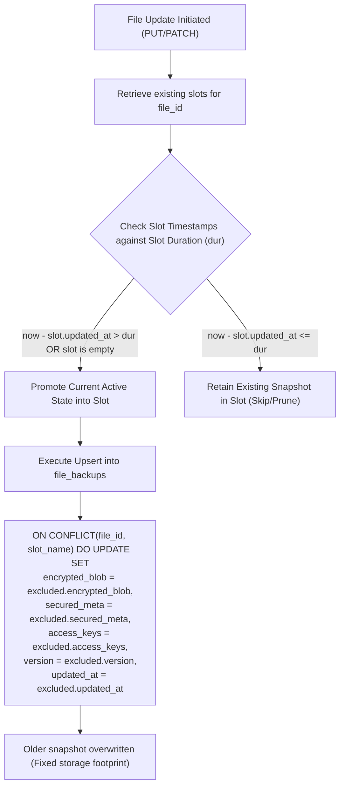
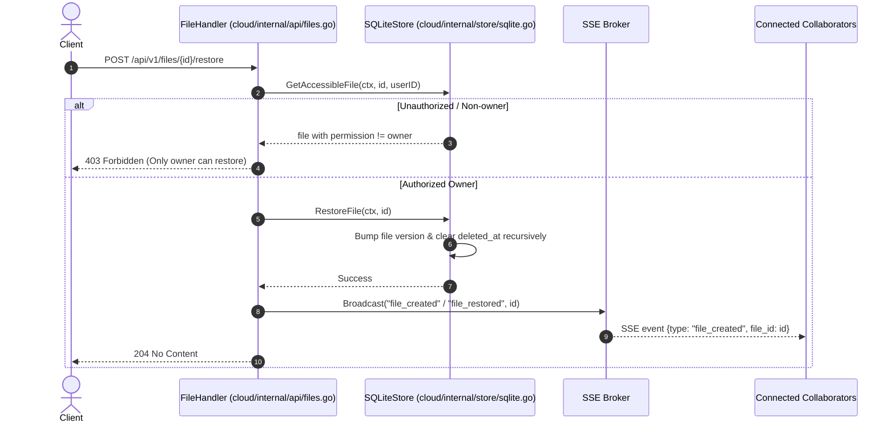

# Storage Architecture: Backup, Versioning, and Delta Retention

This document specifies the technical architecture and protocol for file versioning, rolling temporal backup slots, and delta patch preservation within Tide Cloud (`cloud/internal/store/sqlite.go` and `cloud/internal/api/files.go`).

---

## 1. Versioning Architecture & Backup Slots

Tide adopts a zero-knowledge, encrypted file management and collaboration model. To allow users to roll back unwanted mutations, recover from data corruption, or inspect historical revisions without causing unbounded disk explosion, Tide employs a **rolling temporal backup slot** strategy.

### Temporal Backup Slots

Rather than appending an immutable snapshot upon every single keystroke or micro-save (which would degrade storage I/O and balloon database size), Tide categorizes point-in-time recovery into **six standard temporal backup slots**:

| Slot Identifier | Granularity / Target Window | Primary Responsibility | Storage Mode |
|---|---|---|---|
| `10 minutes` | `T - 10m` | Immediate undo buffer; accidental deletion/edit protection | Client-side delta / snapshot |
| `30 minutes` | `T - 30m` | Short-term working session restore point | Client-side delta / snapshot |
| `1 hour` | `T - 1h` | Mid-session recovery point | Client-side delta / snapshot |
| `1 day` | `T - 24h` | End-of-day checkpoint | Client-side delta / snapshot |
| `2 days` | `T - 48h` | Pre-yesterday recovery point | Client-side delta / snapshot |
| `1 week` | `T - 7d` | Long-term archival checkpoint | Server-side full snapshot cascade (`handleBackupCascade`) |

### Prevention of Storage Explosion

In typical note-taking, rich-text editing, and collaborative editing environments, saving state every few seconds creates thousands of micro-revisions. Unchecked version storage leads to:
1. **Database Bloat:** Millions of rows of high-entropy encrypted blobs degrade B-Tree index traversal and cache efficiency in SQLite.
2. **Encryption Key Burden:** Retaining unbounded historical snapshots complicates envelope key rotation and re-encryption maintenance.
3. **Backup / Sync Overheads:** Synchronizing hundreds of revisions to mobile clients severely exhausts network bandwidth and battery life.

By employing **rolling slots with upsert conflict resolution** (`ON CONFLICT(file_id, slot_name)`), Tide guarantees:
- Maximum of **6 backup entries per file** at any given moment.
- O(1) storage overhead per file relative to its total historical lifespan.
- Immediate availability of crucial recovery horizons (from minutes ago to one week ago).

---

## 2. The `file_backups` Table Schema

The snapshot state is persisted in SQLite via the `file_backups` table.

### Schema Definition

```sql
CREATE TABLE IF NOT EXISTS file_backups (
    id             TEXT PRIMARY KEY,
    file_id        TEXT NOT NULL,
    slot_name      TEXT NOT NULL,          -- e.g. '10 minutes', '30 minutes', '1 hour', '1 day', '2 days', '1 week'
    encrypted_blob BLOB NOT NULL,          -- Encrypted file content / delta payload
    secured_meta   BLOB,                   -- Encrypted file metadata (title, tags, etc.)
    access_keys    TEXT DEFAULT '{}',      -- Zero-knowledge encrypted DEK envelope mapping
    version        INTEGER DEFAULT 1,      -- File version at time of snapshot
    updated_at     DATETIME NOT NULL,      -- Timestamp when this slot was updated
    FOREIGN KEY(file_id) REFERENCES files(id) ON DELETE CASCADE,
    UNIQUE(file_id, slot_name)
);

CREATE INDEX IF NOT EXISTS idx_file_backups_file ON file_backups(file_id);
```

### Column Specifications

- **`id` (TEXT PRIMARY KEY):** Globally unique UUID identifying the specific backup entry.
- **`file_id` (TEXT NOT NULL):** Foreign key referencing `files.id`. Cascades upon file deletion.
- **`user_id` / `owner_id`:** Inherited from the parent file record via join with `files.owner_id`. Access control checks enforce ownership or active share permissions prior to query execution.
- **`slot_name` / `slot_type` (TEXT NOT NULL):** Human-readable and machine-parsed identifier matching the six standard temporal slots.
- **`backup_num` / `version` (INTEGER):** The monotonic sequence number (`version`) of the active file at the time the backup snapshot was taken.
- **`encrypted_blob` / `content_blob_id` (BLOB):** The raw ciphertext bytes representing the document contents or the pointer/content payload. Because Tide operates under end-to-end encryption, the server cannot read or parse this payload.
- **`secured_meta` (BLOB):** Authenticated ciphertext containing document metadata (title, custom attributes) encrypted under the snapshot's Data Encryption Key (DEK).
- **`access_keys` (TEXT JSON):** The complete JSON map of participant public key hashes to encrypted DEKs active at the moment of backup creation.
- **`updated_at` / `created_at` (DATETIME NOT NULL):** Timestamp indicating when this snapshot was captured or promoted into this slot.

---

## 3. Slot Promotion & Pruning Algorithm

Backup snapshots are generated and promoted using a two-tier hybrid model:
1. **Server-Side Automated Cascade:** Evaluated during file updates (`handleBackupCascade` in `cloud/internal/api/files.go`).
2. **Client-Side Delta Promotion:** Calculated by the web/desktop client during active editing sessions and uploaded via `PUT /api/v1/files/{id}/backups/{slotName}`.

### Evaluation and Promotion Flow



### Algorithmic Rules

1. **Conflict Resolution:** Every slot upsert leverages SQLite's `ON CONFLICT(file_id, slot_name)` clause. Older snapshots occupying the slot are atomically overwritten. No historical leakage or zombie rows remain.
2. **Cascade Evaluation:** When `handleBackupCascade(ctx, fileID, blobBytes)` executes:
   - Existing backups for `fileID` are mapped by `slot_name`.
   - For slot interval $S$ with duration $D$, if $T_{\text{now}} - T_{\text{slot}} > D$ or no snapshot exists for $S$:
     - A new `FileBackup` struct is constructed with the current `blobBytes`, current `file.SecuredMeta`, current `file.AccessKeys`, and current `file.Version`.
     - `s.Store.UpsertFileBackup` overwrites the slot.

---

## 4. Zero-Knowledge Envelope Preservation

A critical challenge in end-to-end encrypted backup systems is handling **key rotation** and **collaborator revocation**.

### The Decryption Dilemma

In Tide's V2 crypto scheme:
- Every document is encrypted under a symmetric Data Encryption Key (DEK, AES-256-GCM).
- The DEK is wrapped individually for each authorized user using their public key:
  $$\text{access\_keys} = \{ \text{user\_id}_A: \text{Enc}_{\text{pubA}}(\text{DEK}), \text{user\_id}_B: \text{Enc}_{\text{pubB}}(\text{DEK}) \}$$
- If User B is removed or access is revoked, a key rotation occurs: a new DEK ($\text{DEK}'$) is generated, and all active content is re-encrypted.

### Why Backups Must Store Historical `access_keys`

If the backup table stored only `encrypted_blob` and relied on the active file's `access_keys`:
1. Any key rotation on the active file would render all previous backups **cryptographically unrecoverable** because the active file's $\text{DEK}'$ cannot decrypt a blob encrypted under the historical $\text{DEK}$.
2. If a user changed their private key or devices were provisioned with updated keys, the historic ciphertext would be irreversibly orphaned.

### Tide's Envelope Isolation Guarantee

`file_backups` stores a verbatim copy of `access_keys` and `secured_meta` as they existed at the exact timestamp of backup creation:
```json
{
  "access_keys": {
    "usr_01H...": {
      "encrypted_dek": "aGVs...",
      "epoch": 2,
      "algorithm": "X25519-AES-GCM"
    }
  }
}
```
When restoring or previewing a historical backup:
- The client fetches the backup record via `GET /api/v1/files/{fileID}/backups/{slotName}`.
- The client inspects the snapshot's embedded `access_keys`.
- The client unwraps the historical DEK using its private key from the corresponding epoch.
- Content is safely decrypted in memory without corrupting active session keys.

---

## 5. Backup Restoration Protocol

Tide supports seamless restoration of file state from backups via an authorized REST endpoint.

### Endpoint Specification

- **Method:** `POST`
- **Route:** `/api/v1/files/{id}/restore` (or `/api/v1/files/{id}/restore/{backupId}`)
- **Authorization:** Bearer JWT required; caller must have **Admin / Owner** permission (`store.CanAdmin(file.Permission)`).

### Sequence of Operations



### Step-by-Step Restoration Mechanics

1. **Authorization Gate:**
   - The handler invokes `h.Store.GetAccessibleFile(r.Context(), id, userID)`.
   - It validates `store.CanAdmin(file.Permission)`. If the user is only an editor or viewer, the request is rejected with `403 Forbidden`.
2. **State Restoration & Version Increment:**
   - When restoring from a specific slot payload (`UpdateFileBackup` / `RestoreFile`):
     - The backup's `encrypted_blob` is copied to the active file's primary storage (or blob pointer).
     - The backup's `secured_meta` is restored to `files.secured_meta`.
     - The backup's `access_keys` are restored to `files.access_keys`.
     - The active file's `version` is monotonically bumped:
       $$\text{version}_{\text{new}} = \max(\text{version}_{\text{current}}, \text{version}_{\text{backup}}) + 1$$
     - `updated_at` is set to `time.Now()`.
3. **Soft-Delete Recovery:**
   - If the file was previously in the trash, `RestoreFile` executes a recursive Common Table Expression (CTE) targeting the file and all its descendants:
     ```sql
     WITH RECURSIVE descendants(id) AS (
         SELECT id FROM files WHERE id = ?
         UNION ALL
         SELECT f.id FROM files f JOIN descendants d ON f.parent_id = d.id
     )
     UPDATE files 
     SET metadata = json_remove(COALESCE(NULLIF(metadata, ''), '{}'), '$.deleted_at'),
         updated_at = ?
     WHERE id IN (SELECT id FROM descendants);
     ```
4. **SSE Event Emission & Client Cache Invalidation:**
   - The server triggers `h.broadcastToFileUsers(id, file.OwnerID, fmt.Sprintf(`{"type":"file_created","file_id":"%s"}`, id))`.
   - All active subscribers (owner and active share recipients) receive the SSE event.
   - Client applications invalidate local caches and re-fetch the latest state, ensuring collaborative synchronization without split-brain anomalies.
