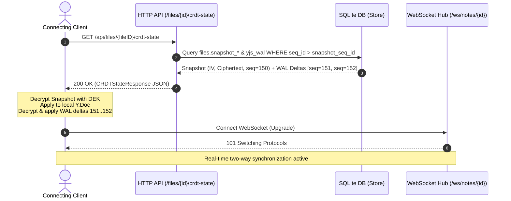
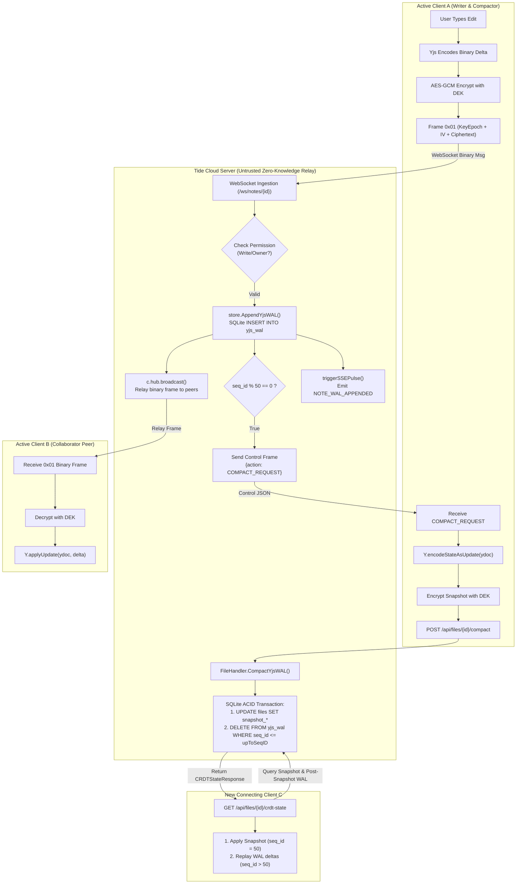

# Write-Ahead Log (WAL) & Snapshot Compaction Engine

## 1. Executive Summary & Purpose

In a distributed, zero-knowledge collaborative editing environment, concurrent peer updates must be linearized without the central server inspecting, parsing, or mutating the payload. Tide's synchronization layer achieves deterministic eventual consistency across collaborative documents (`files`) and ephemeral scratchpads (`quicknotes`) via an append-only Write-Ahead Log (WAL) and snapshot compaction engine implemented in `cloud/internal/api/websocket.go`, `cloud/internal/api/files.go`, `cloud/internal/api/quicknotes.go`, and `cloud/internal/store/sqlite.go`.

### Core Architectural Objectives
1. **Total Linearization of Concurrent Updates:** Convert asynchronous, out-of-order network frames from multi-client WebSocket sessions into a strictly ordered, monotonically increasing sequence stream (`yjs_wal` and `quicknote_wal`).
2. **Zero-Knowledge Durability:** Persist arbitrary AES-GCM encrypted CRDT chunks (Yjs binary updates) with zero cryptographic plaintext inspection on the server.
3. **Bounded Storage & Memory Growth:** Prevent unbounded append-only log expansion by periodic client-driven compaction checkpoints that collapse historical delta streams into consolidated snapshots.
4. **Fast Client Bootstrapping & Catch-Up:** Enable connecting clients to hydrate instantly by downloading a single baseline snapshot plus subsequent delta records (`seq_id > snapshot_seq_id`), minimizing initial load latency and CRDT merge calculation costs.
5. **ACID Snapshot Truncation:** Execute snapshot updates and historical WAL log pruning within an isolated database transaction, ensuring no delta frames are lost or duplicated during concurrent writes.

---

## 2. WAL Schema Reference & Index Design

Tide maintains two dedicated append-only log tables: `yjs_wal` for full-featured workspace documents (`files`), and `quicknote_wal` for low-latency temporary scratchpads (`quicknotes`).

### 2.1 Workspace Documents: `yjs_wal`

```sql
CREATE TABLE IF NOT EXISTS yjs_wal (
    seq_id      INTEGER PRIMARY KEY AUTOINCREMENT,
    file_id     TEXT NOT NULL,
    key_epoch   INTEGER NOT NULL,
    iv          BLOB NOT NULL,
    ciphertext  BLOB NOT NULL,
    created_at  INTEGER, -- Unix millisecond timestamp
    FOREIGN KEY(file_id) REFERENCES files(id) ON DELETE CASCADE
);

CREATE INDEX IF NOT EXISTS idx_yjs_wal_file_seq ON yjs_wal(file_id, seq_id);
```

### 2.2 Quicknotes Scratchpad: `quicknote_wal`

```sql
CREATE TABLE IF NOT EXISTS quicknote_wal (
    seq_id      INTEGER PRIMARY KEY AUTOINCREMENT,
    slug        TEXT NOT NULL,
    key_epoch   INTEGER NOT NULL DEFAULT 1,
    iv          BLOB NOT NULL,
    ciphertext  BLOB NOT NULL,
    created_at  INTEGER, -- Unix millisecond timestamp
    FOREIGN KEY(slug) REFERENCES quicknotes(slug) ON DELETE CASCADE
);

CREATE INDEX IF NOT EXISTS idx_quicknote_wal_slug ON quicknote_wal(slug, seq_id);
```

### 2.3 Field Specifications

| Column Name | Type | Size / Constraint | Description |
| :--- | :--- | :--- | :--- |
| `seq_id` | `INTEGER` | 64-bit int (`int64`), `PRIMARY KEY AUTOINCREMENT` | Strictly monotonic sequence identifier allocated per WAL insertion. |
| `file_id` / `slug` | `TEXT` | UUID v4 or alphanumeric slug | Document foreign key with `ON DELETE CASCADE`. Scopes the linear delta stream. |
| `key_epoch` | `INTEGER` | 32-bit unsigned integer | Document Encryption Key (DEK) epoch used to encrypt this specific delta. |
| `iv` | `BLOB` | 12 Bytes | Cryptographically secure random initialization vector (AES-GCM nonce). |
| `ciphertext` | `BLOB` | Variable (>= 16 Bytes) | Raw binary Yjs CRDT update encrypted under the corresponding DEK + 16-byte GCM authentication tag. |
| `created_at` | `INTEGER` | Unix Milliseconds | Server-side ingestion timestamp for replication diagnostics and pulse metrics. |

### 2.4 Indexing & Fast Range Scans

Both tables feature composite b-tree indexes:
- `idx_yjs_wal_file_seq` on `(file_id, seq_id)`
- `idx_quicknote_wal_slug` on `(slug, seq_id)`

When a client bootstraps, the server retrieves only deltas emitted after the client's current baseline snapshot:

```sql
SELECT seq_id, key_epoch, iv, ciphertext
FROM yjs_wal
WHERE file_id = ? AND seq_id > ?
ORDER BY seq_id ASC;
```

Because `file_id` is the leading index key and `seq_id` is the ordered secondary key, SQLite resolves this query using a forward range index scan with zero disk-based sorting, completing in sub-millisecond execution times even across millions of table records.

---

## 3. Sequence Number Allocation & Ingestion Mechanics

The sequence number guarantees total causal order for all updates applying to a given document.

### 3.1 SQLite Concurrency & Ingestion Pipeline

Tide enforces a strict single-writer SQLite connection pool (`MaxOpenConns: 1` on `SQLiteStore.DB`), alongside a multi-reader pool (`MaxOpenConns: N` on `SQLiteStore.reader` with `query_only(true)` and `journal_mode(WAL)`).

When a client emits an encrypted binary frame (`FrameTypeYjsUpdate = 0x01`) over the WebSocket connection:

1. **Permission Validation:** `websocket.go` verifies the client's effective permission (`owner` or `write`). Viewers attempting to emit CRDT mutations are immediately rejected.
2. **Binary Frame Demuxing:** The server unpacks the frame header:
   - Byte `0`: Message Type (`0x01`)
   - Bytes `1..4`: `keyEpoch` (Big-Endian `uint32`)
   - Bytes `5..16`: `iv` (12-byte slice)
   - Bytes `17..end`: `ciphertext` (AES-GCM payload)
3. **Atomic WAL Insertion:** The handler calls `store.AppendYjsWAL(ctx, fileID, keyEpoch, iv, ciphertext)`:
   ```go
   func (s *SQLiteStore) AppendYjsWAL(ctx context.Context, fileID string, keyEpoch uint32, iv, ciphertext []byte) (int64, error) {
       query := `
           INSERT INTO yjs_wal (file_id, key_epoch, iv, ciphertext, created_at)
           VALUES (?, ?, ?, ?, ?)
       `
       res, err := s.DB.ExecContext(ctx, query, fileID, keyEpoch, iv, ciphertext, time.Now().UnixMilli())
       if err != nil {
           return 0, err
       }
       seqID, err := res.LastInsertId()
       if err != nil {
           return 0, err
       }
       return seqID, nil
   }
   ```
4. **Sequence Reservation Guarantees:**
   - Under SQLite's serialized single-writer connection, concurrent `INSERT` queries queue deterministically.
   - For scoped sequences where strict per-document sequential gaps are audited, SQLite evaluates `SELECT COALESCE(MAX(seq_id), 0) + 1 FROM yjs_wal WHERE file_id = ?` or tracks the monotonic auto-increment counter returned by `LastInsertId()`.
   - The assigned `seq_id` is strictly monotonic and unique.
5. **Real-time Peer Broadcast:** The binary frame is immediately relayed in-memory to all active WebSocket peers in the document room (`hub.broadcast(c, payload)`).
6. **Activity Notification:** `hub.triggerSSEPulse(h.Broker, c.fileID)` dispatches throttled Server-Sent Events (`NOTE_ACTIVITY_PULSE` and `NOTE_WAL_APPENDED`) to alert workspace dashboard listeners.

---

## 4. Compaction Checkpoint Protocol

Left unchecked, an append-only CRDT log creates unbounded query latency and memory consumption over prolonged editing sessions. Tide solves this through an active-client compaction checkpoint protocol.

### 4.1 Trigger Conditions

Compaction is evaluated immediately after each successful WAL append in `cloud/internal/api/websocket.go`:

```go
// Compact request check every 50 WAL entries
if seqID > 0 && seqID%50 == 0 {
    _ = c.sendControl(map[string]any{
        "action": "COMPACT_REQUEST",
    })
}
```

- **Milestone Cadence:** The compaction trigger fires whenever `seq_id % 50 == 0`.
- **Alternative Heuristics:** Handlers also evaluate whether uncompacted WAL record count or cumulative byte payload exceeds configured ceiling limits (e.g., > 100 entries or > 1 MB).

### 4.2 The Compactor Role & Responsibilities

The active client whose update triggered the `seq_id % 50 == 0` milestone is designated as the **Compactor**:

1. **Control Signal Reception:** The client's WebSocket connection receives a JSON control frame:
   ```json
   {
     "action": "COMPACT_REQUEST"
   }
   ```
2. **In-Memory CRDT Folding:**
   - The Compactor client already possesses the converged in-memory `Y.Doc` state machine containing all applied historical and local updates up to sequence `seq_id`.
   - The client invokes `Y.encodeStateAsUpdate(ydoc)` to produce a single, maximally compressed binary state vector blob representing the cumulative document history.
3. **Client-Side Zero-Knowledge Encryption:**
   - The client generates a fresh 12-byte random IV.
   - The compacted Yjs binary state is encrypted using the document's current DEK under AES-256-GCM.
   - The client packages the result into base64-encoded strings: `ivBase64` and `ciphertextBase64`.
4. **Compaction Dispatch:** The Compactor submits an authenticated HTTP `POST` to `/api/files/{fileID}/compact` (or `/api/quicknotes/{slug}/compact`):
   ```json
   {
     "upToSeqId": 150,
     "keyEpoch": 1,
     "ivBase64": "v7q+8VvQ2wE4a9...",
     "ciphertextBase64": "9/2x81Nm5yLkZ..."
   }
   ```

### 4.3 Atomic Truncation Transaction

The server processes the compaction request in `cloud/internal/api/files.go` (`CompactYjsWAL`) and executes an ACID transaction in `cloud/internal/store/sqlite.go`:

```go
func (s *SQLiteStore) CompactYjsWAL(ctx context.Context, fileID string, upToSeqID int64, keyEpoch uint32, iv, ciphertext []byte) error {
    tx, err := s.DB.BeginTx(ctx, nil)
    if err != nil {
        return err
    }
    defer tx.Rollback()

    // 1. Update document snapshot metadata and content blob
    query := `
        UPDATE files
        SET snapshot_seq_id = ?, key_epoch = ?, snapshot_iv = ?, content = ?, updated_at = ?
        WHERE id = ?
    `
    res, err := tx.ExecContext(ctx, query, upToSeqID, keyEpoch, iv, ciphertext, time.Now(), fileID)
    if err != nil {
        return err
    }
    n, err := res.RowsAffected()
    if err != nil {
        return err
    }
    if n == 0 {
        return ErrNotFound
    }

    // 2. Prune WAL records older than or equal to the compacted snapshot sequence
    if _, err := tx.ExecContext(ctx, "DELETE FROM yjs_wal WHERE file_id = ? AND seq_id <= ?", fileID, upToSeqID); err != nil {
        return err
    }

    // 3. Commit snapshot and truncation atomically
    return tx.Commit()
}
```

### 4.4 Failure Resilience & Race Condition Handling

- **Concurrent Deltas During Compaction:** If other peers append entries `seq_id = 151, 152` while the Compactor is generating and uploading the snapshot for `upToSeqId = 150`, these new deltas remain untouched in `yjs_wal` because the deletion criteria explicitly filters `seq_id <= 150`.
- **Compactor Crash / Network Disconnect:** If the Compactor client goes offline without submitting the snapshot, zero data is lost. The uncompacted WAL continues to accumulate normally. The next peer reaching `seq_id % 50 == 0` (e.g., `seq_id = 200`) will receive the next `COMPACT_REQUEST` and collapse all deltas from the baseline up to 200.
- **Outdated Compaction Requests:** If two clients attempt concurrent compaction, the transaction order guarantees that whichever commits last will set the higher `snapshot_seq_id` and prune remaining historical rows without corrupting state.

---

## 5. Catch-Up & Fast Bootstrap Protocol

When a newly launched client or returning user connects to a document, it must quickly synchronize with the current document state.

### 5.1 Protocol Sequence



### 5.2 Server-Side Response Structure (`CRDTStateResponse`)

The endpoint `GET /api/files/{fileID}/crdt-state` returns:

```json
{
  "snapshot_seq_id": 150,
  "key_epoch": 1,
  "snapshot_iv": "v7q+8VvQ2wE4a9==",
  "snapshot_ciphertext": "9/2x81Nm5yLkZ...==",
  "wal": [
    {
      "seq_id": 151,
      "key_epoch": 1,
      "iv": "u8H+1vQ0MwE1...",
      "ciphertext": "a1b2c3d4e5f6..."
    },
    {
      "seq_id": 152,
      "key_epoch": 1,
      "iv": "p9K+2wR1NxE2...",
      "ciphertext": "f6e5d4c3b2a1..."
    }
  ]
}
```

### 5.3 Client Hydration Steps
1. **Apply Baseline Snapshot:** If `snapshot_ciphertext` is present, the client decrypts the payload with the matching `key_epoch` DEK and initializes its local `Y.Doc` via `Y.applyUpdate(ydoc, decryptedSnapshot)`.
2. **Replay Subsequent WAL Frames:** The client iterates through `wal` in ascending `seq_id` order, decrypts each entry, and applies them sequentially: `Y.applyUpdate(ydoc, decryptedDelta)`.
3. **Local State Vector Establishment:** The local `Y.Doc` is now completely up to date at `seq_id = 152`.
4. **WebSocket Stream Synchronization:** The client connects to the WebSocket endpoint to receive live binary frames (`seq_id >= 153`) and broadcast its own updates.

---

## 6. End-to-End Architectural Lifecycle

The following diagram illustrates the complete lifecycle: client update ingestion, sequence allocation, peer fan-out, compaction request triggering, encrypted snapshot upload, and atomic WAL pruning.



---

## 7. Cryptographic Key Rotation & WAL Purging

When document access is revoked for a collaborator or when an owner initiates key rotation:

1. **Endpoint Trigger:** The owner client calls `POST /api/files/{fileID}/revoke-and-rotate`.
2. **Re-encryption:** The client decrypts the current document state using `keyEpoch = N`, increments to `keyEpoch = N + 1`, generates a new random DEK, and re-encrypts the snapshot.
3. **Atomic Purge & Rekey:** `s.RevokeShareAndRotateKey(...)` in `sqlite.go`:
   - Deletes the targeted user's record from `file_shares`.
   - Rotates `files.key_epoch = N + 1`.
   - Updates `files.access_keys`, `files.secured_meta`, `files.snapshot_iv`, and `files.content`.
   - Sets `files.snapshot_seq_id = 0`.
   - Executes `DELETE FROM yjs_wal WHERE file_id = ?`, thoroughly wiping historical deltas encrypted under older key epochs.
4. **WebSocket Eviction:** Active sessions for the revoked user are instantly terminated via `hub.EnforcePermissionChange()`.

---

## 8. Summary Table: `yjs_wal` vs `quicknote_wal`

| Architectural Dimension | Workspace Files (`yjs_wal`) | Quicknotes Scratchpad (`quicknote_wal`) |
| :--- | :--- | :--- |
| **Document Identifier** | `file_id` (UUID v4) | `slug` (alphanumeric string) |
| **Snapshot Target Table** | `files (content, snapshot_iv, snapshot_seq_id)` | `quicknotes (snapshot_ciphertext, snapshot_iv, snapshot_seq_id)` |
| **Snapshot Sequence Default** | `0` | `0` |
| **Compaction Threshold** | `seq_id % 50 == 0` | `seq_id % 50 == 0` |
| **Compaction Endpoint** | `POST /api/files/{fileID}/compact` | `POST /api/quicknotes/{slug}/compact` |
| **Realtime Transport** | WebSocket (`/api/ws/notes/{fileID}`) | WebSocket (`/api/ws/quicknotes/{slug}`) |
| **Activity Notification** | SSE (`NOTE_ACTIVITY_PULSE`, `NOTE_WAL_APPENDED`) | In-memory room broadcast |
| **Cascade Deletion** | On deletion of `files` row | On deletion of `quicknotes` row |
