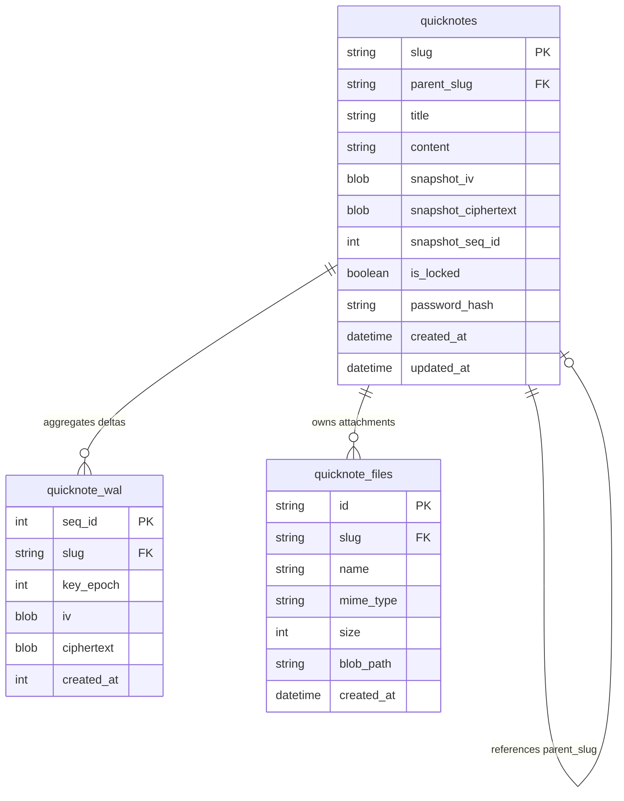
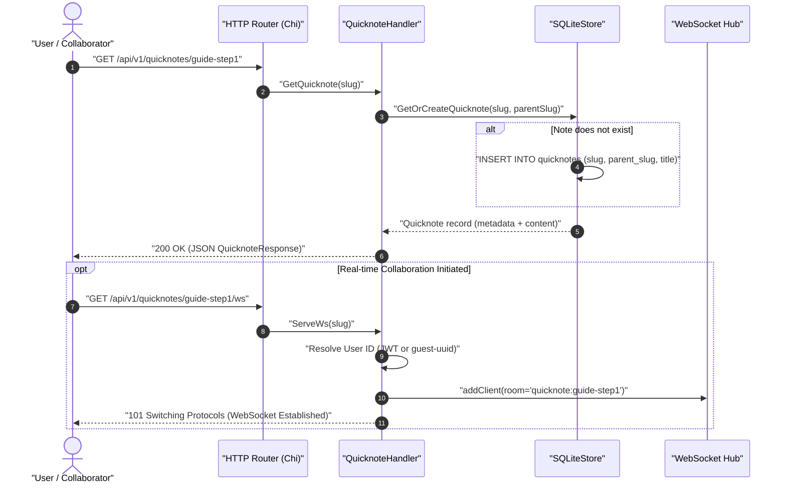
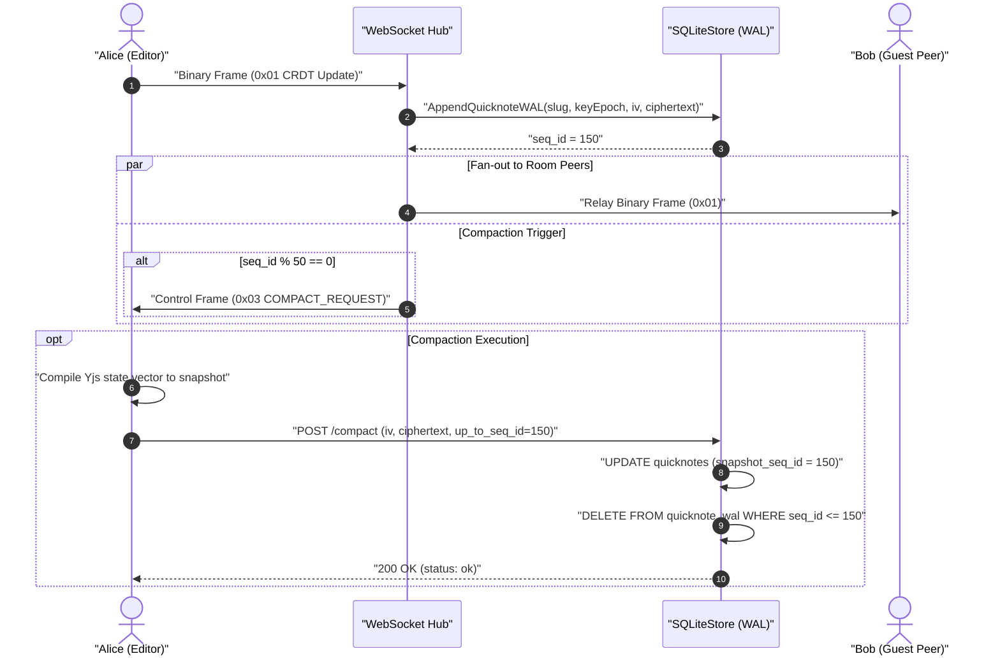
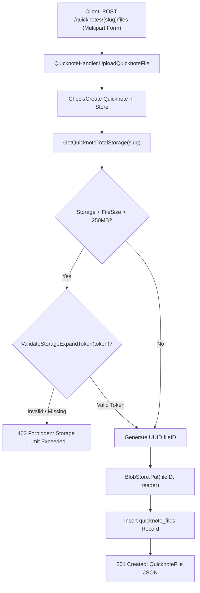

# Quicknotes Engine Architecture & Specification

## 1. Concept & Philosophy

The **Quicknotes Engine** (`cloud/internal/api/quicknotes.go`) provides an ephemeral, lightweight, real-time collaborative workspace within Tide. Unlike traditional notes tied strictly to authenticated user accounts, personal vault workspaces, and rigid filesystem hierarchies, Quicknotes are **addressable by URL slugs** without mandatory user registration.

### Core Architectural Principles
1. **Zero-Friction Access (Slug-First Routing):** Anyone with the URL slug can instantly read, create, or collaborate on a note. Documents are lazily initialized upon the first HTTP `GET` or WebSocket connection if they do not already exist.
2. **First-Class CRDT Collaboration:** Quicknotes utilize the same battle-tested Yjs Conflict-free Replicated Data Type (CRDT) engine, Write-Ahead Log (WAL), and binary WebSocket wire protocol as Tide's zero-knowledge personal files.
3. **Flexible Identity Model:** Sessions gracefully support both registered users (authenticated via JWT tokens or session cookies) and anonymous collaborators (assigned deterministic `guest-{uuid[:8]}` identities).
4. **Natural Hierarchical Organization:** Slugs support arbitrary parent-child nesting via `parent_slug` foreign relations, enabling documentation trees, step-by-step guides, and project workspaces (e.g., `/docs/guide` -> `/docs/guide/step1`).
5. **Integrated Asset Management:** Attachments, screenshots, and binary blobs are stored via the unified `BlobStore` abstraction, guarded by per-note quota boundaries and expansion tokens.

---

## 2. Slug Routing & Nested Hierarchy

### 2.1 Slugs as Natural Keys
Quicknotes use URL slugs as their primary key and natural address space. Slugs replace internal UUIDs in external communication, mapped to HTTP routes under `/api/v1/quicknotes/{slug}` and WebSocket endpoints at `/api/ws/quicknotes/{slug}` (or `/{slug}/ws`).

```
GET    /api/v1/quicknotes/{slug}                # Retrieve or lazily create quicknote
PUT    /api/v1/quicknotes/{slug}                # Update metadata & markdown content
GET    /api/v1/quicknotes/{slug}/tree           # Retrieve full nested subtree
GET    /api/v1/quicknotes/{slug}/crdt-state     # Fetch snapshot and uncompacted WAL
POST   /api/v1/quicknotes/{slug}/compact        # Commit compacted snapshot and prune WAL
GET    /api/v1/quicknotes/{slug}/files          # List file attachments
POST   /api/v1/quicknotes/{slug}/files          # Upload file attachment (multipart/form-data)
GET    /api/v1/quicknotes/{slug}/files/{fileID} # Stream file content / inline preview
DELETE /api/v1/quicknotes/{slug}/files/{fileID} # Remove attachment and blob
GET    /api/v1/quicknotes/{slug}/ws             # WebSocket real-time collaboration
GET    /api/ws/quicknotes/{slug}                # Canonical WebSocket gateway alias
```

### 2.2 Nested Hierarchies via `parent_slug`
Quicknotes support arbitrarily deep document hierarchies without requiring directory entities. Each quicknote record maintains an optional `parent_slug` reference:

```
workspace
  ├── guide (parent_slug = "workspace")
  │     ├── step1 (parent_slug = "guide")
  │     └── step2 (parent_slug = "guide")
  └── architecture (parent_slug = "workspace")
```

The hierarchical tree is queried using SQLite recursive Common Table Expressions (CTEs), traversing both upward (to locate root ancestors) and downward (to assemble all descendant nodes):

```sql
WITH RECURSIVE
  root_finder(slug, parent_slug) AS (
    SELECT slug, parent_slug FROM quicknotes WHERE slug = ?
    UNION ALL
    SELECT q.slug, q.parent_slug FROM quicknotes q
    JOIN root_finder rf ON q.slug = rf.parent_slug
  ),
  root_node AS (
    SELECT slug FROM root_finder WHERE parent_slug IS NULL OR parent_slug = ''
    LIMIT 1
  ),
  tree(slug, parent_slug, title) AS (
    SELECT q.slug, q.parent_slug, q.title FROM quicknotes q
    JOIN root_node rn ON q.slug = rn.slug
    UNION ALL
    SELECT c.slug, c.parent_slug, c.title FROM quicknotes c
    JOIN tree t ON c.parent_slug = t.slug
  )
SELECT slug, parent_slug, title FROM tree;
```

### 2.3 Slug Validation, Uniqueness & Collision Resolution
- **Format Requirements:** Slugs must contain only URL-safe alphanumeric characters, dashes, dots, and underscores (`^[a-zA-Z0-9-_.]+$`). Trailing and leading whitespace is trimmed immediately by API handlers.
- **Uniqueness:** Slugs are unique primary keys in the `quicknotes` database table.
- **Collision Handling:** If an unauthenticated user attempts to access an existing slug, they join the collaborative room as a guest editor. If the note is protected by access controls, authentication or password unlocking is enforced prior to payload retrieval.

---

## 3. Database Schema Reference

The Quicknotes engine leverages SQLite with WAL mode (`PRAGMA journal_mode = WAL;`) for high concurrency and transactional integrity.



### 3.1 `quicknotes` Table
Primary entity storing metadata, the latest compacted CRDT snapshot, and optional access credentials:

```sql
CREATE TABLE IF NOT EXISTS quicknotes (
    slug TEXT PRIMARY KEY,
    parent_slug TEXT,
    title TEXT NOT NULL DEFAULT 'Untitled Quicknote',
    content TEXT NOT NULL DEFAULT '',
    snapshot_iv BLOB,
    snapshot_ciphertext BLOB,
    snapshot_seq_id INTEGER DEFAULT 0,
    is_locked BOOLEAN NOT NULL DEFAULT 0,
    password_hash TEXT,
    created_at DATETIME NOT NULL,
    updated_at DATETIME NOT NULL,
    FOREIGN KEY(parent_slug) REFERENCES quicknotes(slug) ON DELETE SET NULL
);

CREATE INDEX IF NOT EXISTS idx_quicknotes_parent_slug ON quicknotes(parent_slug);
```

| Field | Type | Description |
| :--- | :--- | :--- |
| `slug` | `TEXT PRIMARY KEY` | Human-readable natural identifier for the quicknote. |
| `parent_slug` | `TEXT` | Slug of parent note in hierarchical structures (nullable). |
| `title` | `TEXT` | Note title, defaults to `'Untitled Quicknote'`. |
| `content` | `TEXT` | Plaintext Markdown fallback / cache for search indexing. |
| `snapshot_iv` | `BLOB` | 12-byte initialization vector for compacted CRDT snapshot. |
| `snapshot_ciphertext` | `BLOB` | AES-GCM encrypted binary representation of compiled Yjs state. |
| `snapshot_seq_id` | `INTEGER` | WAL sequence ID up to which the snapshot is fully compacted. |
| `is_locked` | `BOOLEAN` | Flags whether access requires password authentication. |
| `password_hash` | `TEXT` | Cryptographic hash (bcrypt or PBKDF2) for note-level lock protection. |
| `created_at` | `DATETIME` | UTC timestamp of record creation. |
| `updated_at` | `DATETIME` | UTC timestamp of last modification. |

### 3.2 `quicknote_wal` Table
Append-only log recording incremental binary CRDT operations:

```sql
CREATE TABLE IF NOT EXISTS quicknote_wal (
    seq_id INTEGER PRIMARY KEY AUTOINCREMENT,
    slug TEXT NOT NULL,
    key_epoch INTEGER NOT NULL DEFAULT 1,
    iv BLOB NOT NULL,
    ciphertext BLOB NOT NULL,
    created_at INTEGER NOT NULL,
    FOREIGN KEY(slug) REFERENCES quicknotes(slug) ON DELETE CASCADE
);

CREATE INDEX IF NOT EXISTS idx_quicknote_wal_slug ON quicknote_wal(slug, seq_id);
```

| Field | Type | Description |
| :--- | :--- | :--- |
| `seq_id` | `INTEGER PK AUTOINCREMENT` | Strict monotonically increasing sequence order across updates. |
| `slug` | `TEXT` | Foreign key referencing parent `quicknotes(slug)`. |
| `key_epoch` | `INTEGER` | Version epoch for client encryption keying. |
| `iv` | `BLOB` | 12-byte random initialization vector for delta update. |
| `ciphertext` | `BLOB` | Encrypted binary Yjs update delta (Contract 1.1 format). |
| `created_at` | `INTEGER` | Unix epoch millisecond timestamp when ingested. |

### 3.3 `quicknote_files` Table
Metadata tracking files and image attachments associated with a quicknote:

```sql
CREATE TABLE IF NOT EXISTS quicknote_files (
    id TEXT PRIMARY KEY,
    slug TEXT NOT NULL,
    name TEXT NOT NULL,
    mime_type TEXT,
    size INTEGER NOT NULL,
    blob_path TEXT NOT NULL,
    created_at DATETIME NOT NULL,
    FOREIGN KEY(slug) REFERENCES quicknotes(slug) ON DELETE CASCADE
);

CREATE INDEX IF NOT EXISTS idx_quicknote_files_slug ON quicknote_files(slug);
```

| Field | Type | Description |
| :--- | :--- | :--- |
| `id` | `TEXT PK` | UUIDv4 string identifying the file attachment. |
| `slug` | `TEXT` | Foreign key referencing parent `quicknotes(slug)`. |
| `name` | `TEXT` | Original filename as provided during upload. |
| `mime_type` | `TEXT` | Media MIME type (e.g. `image/png`, `application/pdf`). |
| `size` | `INTEGER` | File size in bytes. |
| `blob_path` | `TEXT` | Storage locator key in `BlobStore` (`LocalBlobStore` or S3). |
| `created_at` | `DATETIME` | UTC timestamp of upload completion. |

---

## 4. Real-Time Collaboration & Synchronization Engine

### 4.1 WebSocket Gateway & Room Multiplexing
WebSocket connections are established at `GET /api/v1/quicknotes/{slug}/ws` or `/api/ws/quicknotes/{slug}`. The handler initializes a dedicated collaboration room inside the server's central WebSocket `Hub`:

```go
roomID := "quicknote:" + slug
client := &Client{
    hub:        hub,
    fileID:     roomID,
    userID:     userID,
    yClientID:  yClientID,
    conn:       conn,
    send:       make(chan []byte, 256),
    done:       make(chan struct{}),
    permission: "edit",
}
hub.addClient(client)
```

### 4.2 Client Authentication & Identity Resolution
Identity resolution in `ServeWs` adheres to a tiered fallback sequence:
1. **Context Authentication:** If already verified by upstream HTTP middleware (`user_id` context value).
2. **Bearer Token & Query Token:** Checks `Authorization: Bearer <jwt>`, query param `?token=<jwt>`, or cookie `tide_session`.
3. **Guest Identity Fallback:** If unauthenticated, the engine constructs a transient guest identifier:
   ```go
   userID = "guest-" + uuid.New().String()[:8]
   ```
All collaborators receive the `"edit"` permission role by default unless the note is locked.

### 4.3 Wire Protocol & Binary Framing
WebSocket payloads adhere to the binary frame specification defined in Tide Protocol Contract 1.1:

```
+-------------------+--------------------+--------------------+------------------------+
| Message Type (1B) | Key Epoch (4B, BE) | IV / Nonce (12B)   | Ciphertext + Tag (16B) |
+-------------------+--------------------+--------------------+------------------------+
```

1. **CRDT Delta Updates (`0x01`):**
   - The server validates minimum length (`len >= 33`).
   - Extracts `keyEpoch`, `iv` (bytes 1–17), and `ciphertext` (bytes 17+).
   - Inserts the update into `quicknote_wal` via `h.store.AppendQuicknoteWAL`.
   - Fans out the exact binary frame to all other peers in `roomID`.
2. **Awareness & Presence Updates (`0x02`):**
   - Transient presence states (cursors, selections, active user labels).
   - Relayed entirely in memory via `c.hub.broadcast(c, payload)`.
   - Never committed to disk or SQLite WAL.
3. **Control Messages (`0x03`):**
   - JSON-encoded signaling frames (`PEER_LEFT`, `COMPACT_REQUEST`).

### 4.4 Compaction Cycle
To prevent the SQLite WAL from growing indefinitely:
1. **Heuristic Trigger:** Every 50 WAL entries appended to a quicknote (`seqID % 50 == 0`), the server transmits a `COMPACT_REQUEST` control message to the active writer:
   ```json
   { "action": "COMPACT_REQUEST" }
   ```
2. **Compacted Snapshot Submission:** The client compiles its local Yjs state vector into an encrypted snapshot and calls `POST /api/v1/quicknotes/{slug}/compact`:
   ```json
   {
     "iv": "<base64>",
     "ciphertext": "<base64>",
     "up_to_seq_id": 150
   }
   ```
3. **Atomic Pruning:** The server updates `snapshot_iv`, `snapshot_ciphertext`, and `snapshot_seq_id` in `quicknotes`, then deletes all WAL rows in `quicknote_wal` where `seq_id <= up_to_seq_id` within a single database transaction.

---

## 5. Binary Asset Management

### 5.1 Asset Upload Endpoint (`POST /{slug}/files`)
Files are uploaded as standard `multipart/form-data` under the field name `file`.
- **Pre-Initialization:** Calling upload on an uninitialized slug automatically invokes `GetOrCreateQuicknote`.
- **Per-Note Storage Quota:** A strict **250MB storage ceiling** is enforced per quicknote:
  ```go
  const maxStorage = 250 * 1024 * 1024 // 250MB
  currentStorage, _ := h.store.GetQuicknoteTotalStorage(ctx, slug)
  if currentStorage + header.Size > maxStorage { ... }
  ```
- **Storage Expansion Token:** If the upload exceeds 250MB, the user can supply an expansion token via header (`X-Access-Token` or `Authorization: Bearer`), form field `token`, or query parameter `?token=`. If validated against `ValidateStorageExpandToken`, the upload proceeds.
- **Blob Persistence:** The payload is streamed into `BlobStore` (`LocalBlobStore` on disk or S3), indexed under a generated UUIDv4, and recorded in `quicknote_files`.

### 5.2 Streaming Downloads (`GET /{slug}/files/{fileID}`)
- **Header Synthesis:** Sets `Content-Type` based on recorded MIME type, `Content-Length` from stored byte count, and sets appropriate `Content-Disposition`.
- **Inline Rendering:** If the attachment is an image (`image/*`) or if the request specifies `?inline=true` / `?inline=1`, the disposition is set to `inline; filename="..."` to permit live browser rendering in the editor canvas.
- **Direct Streaming:** Content is transferred via `io.Copy(w, rc)` without buffering entire files in memory.

### 5.3 Deletion
Calling `DELETE /{slug}/files/{fileID}` removes the database record from `quicknote_files` and purges the binary object from `BlobStore`.

---

## 6. Security, Locking & Access Control

### 6.1 Password Protection & Locking Mechanics
Quicknotes support optional password locking to enable private sharing:
- `is_locked` denotes whether reading or editing requires authorization.
- `password_hash` stores the hashed passphrase (salted bcrypt or PBKDF2-HMAC-SHA256).
- **Challenge-Response Flow:**
  1. If `is_locked == true` and no valid session token exists, API calls return `401 Unauthorized` with challenge headers.
  2. The client submits the passphrase to verify access. Upon verification, the server issues a scoped signed JWT granting `edit` or `read` privileges for `slug`.
  3. WebSocket connection attempts to a locked slug without a valid token are rejected immediately during the HTTP upgrade phase (`401 Unauthorized` or `403 Forbidden`).

### 6.2 Zero-Knowledge Encryption Support
While Quicknotes support plaintext collaboration for instant sharing, they fully support the zero-knowledge E2EE pipeline:
- CRDT update frames (`FrameTypeCRDTUpdate`) can transport AES-GCM ciphertexts encrypted with a document key derived on the client side (e.g. from the URL hash `#key=...`).
- The cloud server relays and persists raw encrypted bytes without access to the key.

### 6.3 Rate Limiting & Abuse Prevention
- **Creation Throttling:** Rapid generation of random slugs from single IP addresses is restricted via token bucket rate limiting.
- **Frame Rate Limiting:** WebSocket read pump enforces a maximum frame size of 10MB (`c.conn.SetReadLimit(10 * 1024 * 1024)`) and drops malformed frames shorter than `MinEncryptedFrameLen`.
- **Heartbeat Deadlines:** 30-second read deadlines with pong handlers ensure unresponsive guest sockets are promptly pruned from memory.

---

## 7. Architectural Diagrams

### 7.1 Quicknote Lifecycle & Lazy Initialization Flow



### 7.2 WebSocket Real-Time Yjs Collaboration & Compaction Flow



### 7.3 Binary Attachment Upload, Quota & Storage Flow



---

## 8. Summary of API Endpoints & Contracts

| Method | Route | Description | Request Format | Response Format |
| :--- | :--- | :--- | :--- | :--- |
| `GET` | `/{slug}` | Get or lazily create quicknote metadata & text | Query: `?parent_slug=...` | `QuicknoteResponse` JSON |
| `PUT` | `/{slug}` | Save title, content, and parent slug | `SaveQuicknoteRequest` JSON | `{"status": "ok"}` |
| `GET` | `/{slug}/tree` | Get hierarchical ancestry & descendant tree | None | `QuicknoteTreeResponse` JSON |
| `GET` | `/{slug}/crdt-state` | Fetch compacted snapshot & pending WAL | None | `QuicknoteCRDTStateResponse` JSON |
| `POST` | `/{slug}/compact` | Commit compacted snapshot & prune WAL | Base64 snapshot JSON | `{"status": "ok"}` |
| `GET` | `/{slug}/files` | List attached files | None | `[]QuicknoteFile` JSON |
| `POST` | `/{slug}/files` | Upload attachment (250MB limit) | `multipart/form-data` | `QuicknoteFile` JSON |
| `GET` | `/{slug}/files/{fileID}` | Download / stream file content | Query: `?inline=true` | Binary Stream |
| `DELETE` | `/{slug}/files/{fileID}` | Delete attachment & blob | None | `204 No Content` |
| `GET` | `/{slug}/ws` | WebSocket collaboration gateway | Binary / WebSocket | Binary Frames |
