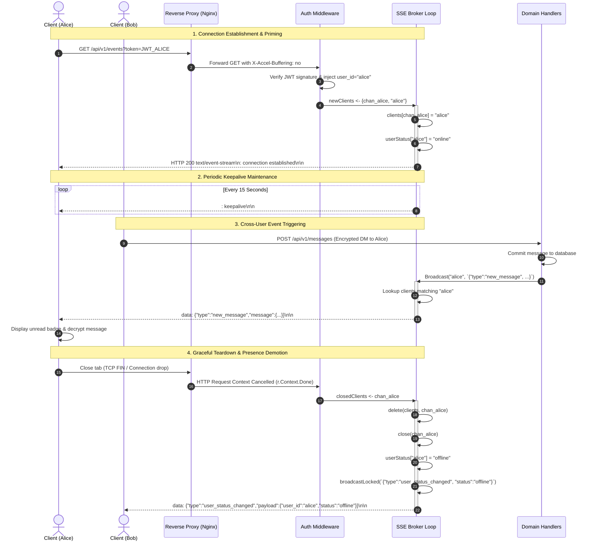

# Server-Sent Events (SSE) Notification Stream Specification

## 1. Executive Summary & Architecture Overview

Tide utilizes Server-Sent Events (SSE) via the HTTP/1.1 and HTTP/2 streaming protocol to deliver real-time, asynchronous, unidirectional notifications from the cloud server to connected web and mobile clients. While high-frequency collaborative editing (CRDT mutations and cursor awareness) is handled through dedicated document-level WebSockets, general operational notifications—such as file sharing, metadata updates, permission revocations, encrypted direct messaging alerts, contact state changes, and user presence—are distributed through a centralized, lightweight SSE notification broker.

The SSE subsystem is implemented in `cloud/internal/api/events.go` and exposed via the HTTP route `GET /api/v1/events`. It operates on an authenticated, low-overhead event-loop architecture designed to push JSON payloads to clients with minimal resource utilization and sub-millisecond dispatch latencies.

### Core Architectural Principles
1. **Unidirectional Efficiency:** Avoids full-duplex WebSocket framing overhead for operations that only require server-to-client push semantics.
2. **Standard Web Compatibility:** Operates natively over standard HTTP, traversing strict corporate firewalls, reverse proxies, and NAT gateways without custom framing protocols.
3. **Targeted and Broadcast Routing:** Supports both user-scoped unicast/multicast delivery (e.g. notifications intended only for document collaborators or direct-message recipients) and global presence broadcasts.
4. **Channel Isolation & Non-Blocking Fanout:** Employs Go channel multiplexing to prevent slow or unresponsive network clients from blocking internal notification pipelines.
5. **Proxy Resilience:** Disables intermediate proxy buffering and emits periodic keep-alive comment frames to preserve long-lived persistent TCP streams.

---

## 2. Broker Architecture & Concurrency Model

The event distribution engine revolves around the `Broker` struct located in `cloud/internal/api/events.go`. The broker manages concurrent client connections, handles channel lifecycle events, and multiplexes outgoing messages.

### 2.1 The Broker Struct

```go
type Broker struct {
    // Map of active client channels to their authenticated User ID
    clients map[chan string]string

    // Channel to register newly established client streams
    newClients chan clientReq

    // Channel to deregister disconnected client streams
    closedClients chan chan string

    // Ingestion queue for outgoing message events
    messages chan messageEvent

    // Current presence status per user ("online", "away", "busy", "offline")
    userStatus map[string]string

    // Monotonic timestamp of last observed client activity
    lastSeen map[string]time.Time

    // Mutex guarding access to clients, userStatus, and lastSeen maps
    mu sync.RWMutex
}
```

### 2.2 Core Internal Types

- `clientReq`: Represents a registration request initiated when an HTTP request opens the SSE stream:
  ```go
  type clientReq struct {
      msgChan chan string
      userID  string
  }
  ```
- `messageEvent`: Encapsulates an outbound notification destined for a single user or all connected users:
  ```go
  type messageEvent struct {
      TargetUserID string // Empty string indicates global broadcast; otherwise unicast to TargetUserID
      Data         string // Raw serialized JSON payload
  }
  ```

### 2.3 Channel Multiplexing Engine (`listen()`)

The broker launches a dedicated background goroutine running `listen()` during startup (`NewBroker()`). This event loop processes three primary event channels via a continuous `select` construct:

1. **New Client Ingestion (`case req := <-b.newClients`):**
   - Acquires `b.mu.Lock()`.
   - Counts existing active connections for `req.userID`.
   - Registers the client channel `req.msgChan` mapped to `req.userID`.
   - If this is the user's first concurrent connection (`activeChannels == 0`), updates `userStatus[userID]` to `"online"` (if previously blank or `"offline"`), records `lastSeen[userID] = time.Now()`, and invokes `b.broadcastLocked()` to inform all active clients of the user's online presence.
   - Releases lock.

2. **Client Teardown (`case s := <-b.closedClients`):**
   - Acquires `b.mu.Lock()`.
   - Retrieves `userID` for channel `s`, removes `s` from `b.clients`, and closes channel `s`.
   - Checks if any remaining channels exist for this `userID`. If no active channels remain, records `lastSeen[userID] = time.Now()`, marks `userStatus[userID] = "offline"`, and broadcasts a `"user_status_changed"` payload to all connected clients.
   - Releases lock.

3. **Message Fanout (`case event := <-b.messages`):**
   - Acquires `b.mu.RLock()`.
   - Iterates through the `b.clients` map.
   - If `event.TargetUserID == ""` (broadcast) or `userID == event.TargetUserID` (targeted unicast/multicast):
     - Executes a non-blocking select write:
       ```go
       select {
       case clientChan <- event.Data:
       default:
           // Client channel buffer full or client lagging: drop frame to prevent pipeline stalling
       }
       ```
   - Releases read lock.

---

## 3. SSE HTTP Endpoint & Protocol Semantics

The SSE endpoint is registered on the main API router under:
```http
GET /api/v1/events
```

### 3.1 HTTP Headers & Proxy Directives

To establish an unbuffered, persistent HTTP streaming channel, the handler enforces standard W3C Server-Sent Events headers alongside reverse-proxy bypass directives:

```http
HTTP/1.1 200 OK
Content-Type: text/event-stream
Cache-Control: no-cache
Connection: keep-alive
Access-Control-Allow-Origin: *
X-Accel-Buffering: no
```

| Header | Purpose |
| :--- | :--- |
| `Content-Type: text/event-stream` | Informs the client browser/library to treat the incoming byte stream as an SSE event sequence conforming to the HTML5 standard. |
| `Cache-Control: no-cache` | Disables HTTP client, browser, and intermediary proxy caching. |
| `Connection: keep-alive` | Ensures the underlying TCP socket remains open indefinitely across multiple events. |
| `Access-Control-Allow-Origin: *` | Permits cross-origin event consumption in environments where the frontend is served from a separate domain or port. |
| `X-Accel-Buffering: no` | Explicitly instructs Nginx and reverse-proxy caches to disable response buffering, streaming chunks to the client immediately upon flush. |

### 3.2 Response Controller & Deadline Reset

In Go 1.20+, default HTTP read and write deadlines can terminate long-lived streaming connections. `Broker.ServeHTTP` initializes an `http.NewResponseController` and clears the deadlines:

```go
rc := http.NewResponseController(w)
if rc != nil {
    rc.SetReadDeadline(time.Time{})
    rc.SetWriteDeadline(time.Time{})
}
```

Streaming capabilities are verified via type assertion to `http.Flusher`. If unsupported by the underlying network stack, the server aborts with `500 Internal Server Error`.

---

## 4. Client Lifecycle & Connection Management

```
+---------------+              +--------------------+              +--------------------+
| Client Device |              |   AuthMiddleware   |              |     SSE Broker     |
+---------------+              +--------------------+              +--------------------+
        |                                |                                   |
        | 1. GET /api/v1/events          |                                   |
        |    (Bearer / Cookie / ?token)  |                                   |
        |------------------------------->|                                   |
        |                                | 2. Validate JWT & Inject user_id  |
        |                                |---------------------------------->|
        |                                |                                   | 3. Set headers & flusher
        |                                |                                   | 4. Register client channel
        | 5. ": connection established"  |                                   |
        |<-------------------------------------------------------------------|
        |                                |                                   |
        |                                |                                   | === Loop: Keep-Alive ===
        | 6. ": keepalive\n\n" (every 15s)|                                  |
        |<-------------------------------------------------------------------|
        |                                |                                   |
        |                                |                                   | === Asynchronous Event ===
        |                                |        Event Published            |
        |                                |        (Broadcast / Direct)       |
        |                                |---------------------------------->|
        | 7. "data: {json}\n\n"          |                                   |
        |<-------------------------------------------------------------------|
        |                                |                                   |
        | 8. Client Disconnect (TCP FIN) |                                   |
        |------------------------------->|                                   |
        |                                | Context Cancelled (r.Context.Done)|
        |                                |---------------------------------->| 9. Deregister channel
        |                                |                                   | 10. Close client channel
        |                                |                                   | 11. Broadcast offline if last
```

### 4.1 Authentication Handshake

The endpoint requires authenticated sessions enforced by `api.AuthMiddleware`. Because standard browser `EventSource` JavaScript APIs do not allow setting custom HTTP request headers, three authentication modalities are supported:

1. **Standard Header:** `Authorization: Bearer <JWT>` (used by native mobile clients, desktop wrappers, or custom `fetch` ReadableStream listeners).
2. **Query Parameter:** `GET /api/v1/events?token=<JWT>` (primary fallback for standard browser `new EventSource('/api/v1/events?token=...')`).
3. **Session Cookie:** `Cookie: tide_session=<JWT>` (fallback for same-site web browser contexts).

The middleware validates the token signature using the mandatory server secret `JWT_SECRET`. Upon successful validation, the authenticated subject `user_id` is injected into the request context (`r.Context().Value("user_id")`). Requests lacking a valid token are immediately rejected with `401 Unauthorized`.

### 4.2 Stream Registration & Initial Handshake

Upon successful authentication:
1. An unbuffered string channel `messageChan := make(chan string)` is created.
2. The channel is dispatched to `b.newClients <- clientReq{msgChan: messageChan, userID: userID}`.
3. The server immediately transmits an initial comment ping frame to prime the HTTP buffer and notify client hooks that the pipeline is open:
   ```http
   : connection established\n\n
   ```
4. `flusher.Flush()` is executed immediately.

### 4.3 Keep-Alive / Heartbeat Ticker

To prevent intervening stateful middleboxes (e.g., AWS ALB, Nginx, Cloudflare, NAT firewalls) from closing idle TCP sockets due to inactivity timeouts, `Broker.ServeHTTP` maintains an internal 15-second keepalive ticker:

```go
ticker := time.NewTicker(15 * time.Second)
defer ticker.Stop()
```

Every 15 seconds, if no domain event has been dispatched, a comment line is written to the wire:
```http
: keepalive\n\n
```
Comment frames (lines starting with `:`) are silently ignored by compliant SSE client parsers while resetting TCP idle timers.

### 4.4 Disconnect Detection & Resource Cleanup

Disconnections are tracked asynchronously via the HTTP request context's completion signal:
```go
notify := r.Context().Done()

go func() {
    <-notify
    b.closedClients <- messageChan
}()
```
When a client terminates the connection (navigates away, closes the browser tab, or experiences network failure), `r.Context().Done()` fires. The registration channel `messageChan` is submitted to `b.closedClients`, which purges the subscriber entry from `b.clients` and safely closes the channel.

### 4.5 Inactivity Sweeper (`reaper()`)

In addition to socket disconnection hooks, the broker maintains a background reaper goroutine (`broker.reaper()`) running every 30 seconds to clean up orphaned presence states.

If a user was marked `"online"` but has zero open client channels and an elapsed duration exceeding 90 seconds since their `lastSeen` timestamp:
- `userStatus[userID]` is transitioned to `"offline"`.
- A `"user_status_changed"` payload (`status: "offline"`) is broadcast to all active subscribers.

---

## 5. Event Taxonomy & Payload Specifications

All SSE payload bodies sent to clients are encapsulated in standard SSE `data: <json>\n\n` formatting. Every JSON payload includes a top-level `"type"` string identifying the event discriminator, alongside structured metadata.

```
data: {"type":"<EVENT_TYPE>", ...fields}\n\n
```

### 5.1 `file_updated`

- **Trigger:** Emitted when a document or file has undergone metadata alterations, snapshot persistence, or when sharing permissions have been modified or revoked.
- **Scope:** Unicast to the affected user or multicast to all active file collaborators (`broadcastToFileUsers`).
- **Purpose:** Directs client applications to invalidate local cached metadata, refresh access permissions, or lock UI edit controls if rights were rescinded.

```json
{
  "type": "file_updated",
  "file_id": "018d9f45-8bc2-701a-94ef-9b0c238b1d91"
}
```

#### Detailed Payload Attributes:
| Field | Type | Description |
| :--- | :--- | :--- |
| `type` | string | Always `"file_updated"`. |
| `file_id` | string (UUID) | The unique identifier of the modified file. |
| `updated_at` | string (ISO 8601, optional) | Timestamp of the update. |
| `action` | string (optional) | Specific trigger: `"metadata_changed"`, `"permission_changed"`, `"revoked"`. |

---

### 5.2 `file_shared`

- **Trigger:** Emitted when an existing file is shared with a new recipient user.
- **Scope:** Unicast targeted to the recipient (`recipient.ID`).
- **Purpose:** Informs the recipient's client device that a new document is accessible, prompting an immediate background fetch of file metadata and wrapped Data Encryption Keys (DEKs).

```json
{
  "type": "file_shared",
  "file_id": "018d9f45-8bc2-701a-94ef-9b0c238b1d91"
}
```

#### Detailed Payload Attributes:
| Field | Type | Description |
| :--- | :--- | :--- |
| `type` | string | Always `"file_shared"`. |
| `file_id` | string (UUID) | The unique identifier of the shared file. |
| `owner_id` | string (UUID, optional) | User ID of the document owner. |
| `permission` | string (optional) | Granted capability: `"read"` or `"write"`. |

---

### 5.3 `new_message` / `message_received`

- **Trigger:** Generated when an end-to-end encrypted direct message is committed via `POST /api/v1/messages`.
- **Scope:** Dispatched to both the recipient user (`recipient.ID`) and the sender (`senderID`) for cross-tab/cross-device multi-session synchronization.
- **Purpose:** Notifies the active chat view to append the encrypted message payload or increment unread message badges.

```json
{
  "type": "new_message",
  "message": {
    "id": "msg_01h8x123abc456",
    "sender_id": "usr_998124",
    "sender_name": "alice",
    "recipient_id": "usr_110293",
    "encrypted_content": "v1:GCM:aW5pdFZlY3Rvcg==:Y2lwaGVydGV4dERhdGE=",
    "created_at": "2026-11-15T20:30:00Z"
  }
}
```

#### Detailed Payload Attributes:
| Field | Type | Description |
| :--- | :--- | :--- |
| `type` | string | `"new_message"` (or legacy alias `"message_received"`). |
| `message.id` | string | Unique database primary key of the message. |
| `message.sender_id` | string (UUID) | Author's user identifier. |
| `message.sender_name`| string | Display username of the sender. |
| `message.recipient_id`| string (UUID)| Target recipient's user identifier. |
| `message.encrypted_content`| string | Ciphertext and IV encrypted with recipient's public key or shared ratchet. |
| `message.created_at`| string (ISO 8601) | Server reception timestamp. |

---

### 5.4 `contact_request`

- **Trigger:** Generated when a user initiates, accepts, or declines a contact relationship (`POST /api/v1/contacts/{contactID}`).
- **Scope:** Unicast targeted to the counterpart contact user.
- **Purpose:** Triggers live updates in the contacts list and friendship request badging without requiring polling.

```json
{
  "type": "contact_request",
  "payload": {
    "request_id": "cr_01h92k88x99",
    "sender_id": "usr_998124",
    "sender_name": "alice",
    "status": "pending",
    "action": "created"
  }
}
```

#### Detailed Payload Attributes:
| Field | Type | Description |
| :--- | :--- | :--- |
| `type` | string | Always `"contact_request"`. |
| `payload.request_id` | string | Contact request unique record ID. |
| `payload.sender_id` | string (UUID) | User initiating the social relationship. |
| `payload.status` | string | State: `"pending"`, `"accepted"`, `"declined"`, `"removed"`. |
| `payload.action` | string | Event reason: `"created"`, `"accepted"`, `"revoked"`. |

---

### 5.5 `user_status_changed` / `presence_updated`

- **Trigger:** Fired when a user connects their first client session, disconnects their last active session, or manually updates their status via `PUT /api/v1/user/status`.
- **Scope:** Broadcast to all connected clients (`BroadcastAll` or `broadcastLocked`).
- **Purpose:** Synchronizes real-time status indicators (online, offline, away, busy) across friend lists and active workspace participant cards.

```json
{
  "type": "user_status_changed",
  "payload": {
    "user_id": "usr_998124",
    "status": "online"
  }
}
```

#### Detailed Payload Attributes:
| Field | Type | Description |
| :--- | :--- | :--- |
| `type` | string | `"user_status_changed"`. |
| `payload.user_id` | string (UUID) | Identifier of the user whose status changed. |
| `payload.status` | string | Current state: `"online"`, `"offline"`, `"away"`, `"busy"`. |

---

## 6. End-to-End Sequence Diagram

The following diagram illustrates client authentication, stream initialization, keep-alive heartbeat processing, targeted and broadcast event routing, and graceful connection teardown.



---

## 7. Scalability & Clustering Considerations

### 7.1 Current Single-Node In-Memory Architecture

The existing broker in `events.go` maintains internal Go maps guarded by a read-write mutex (`sync.RWMutex`).

#### Advantages:
- **Zero External Infrastructure:** Operates without Redis, RabbitMQ, or NATS dependencies.
- **Ultra-Low Latency:** In-memory channel dispatch executes in microsecond ranges without network serialization.
- **Minimal Memory Footprint:** Each client connection requires only an HTTP response buffer and a standard 64-bit Go channel pointer (~4–8 KB per connection).

#### Limitations:
- **Vertical Bound:** Bounded by the file descriptor limit and RAM of a single operating system instance.
- **Single-Node Isolation:** When running multiple API server replicas behind a round-robin load balancer, an event emitted on Node A will not reach a user whose SSE connection terminated on Node B.

### 7.2 Distributed Multi-Node Architecture (Redis / NATS Pub-Sub)

To support horizontal scaling across multi-node clusters, the single-node broker can be extended using an external Publish/Subscribe backplane.

```
+--------------------------------------------------------------------------------+
|                                Distributed Cluster                             |
|                                                                                |
|    +----------------------+                       +----------------------+     |
|    |     API Node A       |                       |     API Node B       |     |
|    |  +----------------+  |                       |  +----------------+  |     |
|    |  | Local Broker A |  |                       |  | Local Broker B |  |     |
|    |  +----------------+  |                       |  +----------------+  |     |
|    +----------|-----------+                       +----------|-----------+     |
|               |                                              |                 |
|               |            Redis Pub/Sub / NATS              |                 |
|               +----------------------|-----------------------+                 |
|                                      v                                         |
|                          +-----------------------+                             |
|                          | Channel: events:user  |                             |
|                          | Channel: events:all   |                             |
|                          +-----------------------+                             |
+--------------------------------------------------------------------------------+
```

#### Proposed Clustering Design:
1. **Sharded User Channels:** Node instances subscribe to `tide:events:user:<userID>` for each user currently possessing one or more local channels on that specific node.
2. **Global Broadcast Channel:** Every node subscribes to `tide:events:global`.
3. **Dispatch Flow:**
   - When `Broker.Broadcast(userID, data)` is called on *any* node, the node executes `PUBLISH tide:events:user:<userID> data`.
   - The node hosting the active SSE connection receives the Pub/Sub message and writes it to the corresponding local client channels.
4. **Presence Tracking via Redis Hashes:** Ephemeral user presence transitions from an internal Go map to a distributed Redis Hash (`tide:presence:users`) with TTL-based key expiration or Redis heartbeat keys.

---

## 8. Client-Side Integration Patterns

### 8.1 Standard JavaScript / Web Browser Implementation

Modern web frontends establish SSE connections using the browser's native `EventSource` interface or the `fetch` API with `ReadableStream` (when custom headers are necessary).

```typescript
// Example: Standard browser EventSource integration
function connectNotificationStream(authToken: string) {
  const sseUrl = `/api/v1/events?token=${encodeURIComponent(authToken)}`;
  const eventSource = new EventSource(sseUrl);

  eventSource.onopen = () => {
    console.log('[SSE] Stream connected successfully');
  };

  eventSource.onmessage = (event: MessageEvent) => {
    try {
      const payload = JSON.parse(event.data);
      handleServerEvent(payload);
    } catch (err) {
      console.error('[SSE] Failed to parse message frame:', err, event.data);
    }
  };

  eventSource.onerror = (error) => {
    console.warn('[SSE] Stream error or disconnect, browser will reconnect automatically', error);
  };

  return eventSource;
}

function handleServerEvent(event: { type: string; [key: string]: any }) {
  switch (event.type) {
    case 'file_updated':
      console.log('File updated:', event.file_id);
      break;
    case 'file_shared':
      console.log('New file shared:', event.file_id);
      break;
    case 'new_message':
      console.log('Direct message received:', event.message);
      break;
    case 'contact_request':
      console.log('Contact status update:', event.payload);
      break;
    case 'user_status_changed':
      console.log('Presence changed:', event.payload.user_id, event.payload.status);
      break;
    default:
      console.info('Unhandled event type:', event.type);
  }
}
```

### 8.2 Reconnection & Backoff Best Practices
- **Browser EventSource Native Retries:** Standard `EventSource` automatically retries connection drops after 3 seconds. The server may optionally provide `retry: 5000\n\n` to customize retry pacing.
- **Idempotency & Reconciliation:** SSE delivers transient operational hints. Clients encountering disconnections should perform a catch-up HTTP query (e.g. `GET /api/files`, `GET /api/messages`) upon reconnecting to guarantee consistent state across network interruptions.
