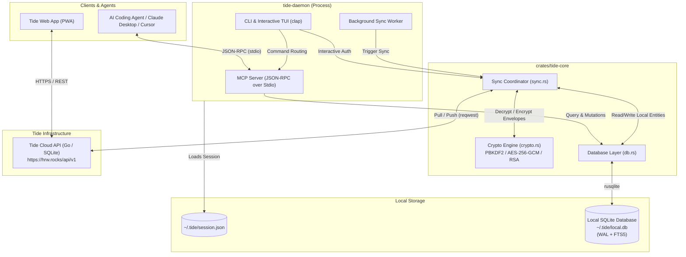
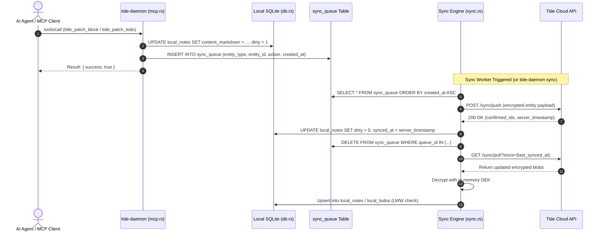

# Tide Core Architecture & Daemon Internals

> **Target Workspace:** `core/` (`crates/tide-core` & `crates/tide-daemon`)  
> **Status:** Production / Active  
> **Runtime Target:** Cross-platform (Windows, macOS, Linux)

---

## 1. System Overview

Tide Core provides a high-performance, offline-first local synchronization engine and Model Context Protocol (MCP) daemon for the Tide knowledge workspace. Built in Rust, it allows desktop users and autonomous AI coding agents (such as Antigravity, Claude Desktop, Cursor, and Windsurf) to securely query, link, update, and manipulate notes, outlines, and task graphs with zero-latency local SQLite operations and zero cloud leakage of decrypted vault materials.

### Primary Responsibilities

1. **Local-First Persistence & Full-Text Search**:
   - Manages a local SQLite database (defaulting to `~/.tide/local.db`) running in Write-Ahead Logging (`WAL`) mode with full-text search (`fts5`).
   - Maintains normalized tables for notes, bidirectional note graph links, tasks/todos, and local sync queues.

2. **Zero-Knowledge Decryption & Cryptographic Parity**:
   - Operates in strict parity with Tide's web client (`cryptoV2.ts`).
   - Unlocks client-side encrypted vaults via user PIN and PBKDF2 key derivation (HMAC-SHA256, 600,000 iterations).
   - Manages RSA-4096 / RSA-2048 private key unwrapping and AES-256-GCM note envelope decryption.

3. **Autonomous AI MCP Daemon**:
   - Implements a Model Context Protocol (MCP standard `2024-11-05`) server over standard I/O (`stdio`).
   - Exposes token-optimized tools (`tide_search`, `tide_get_note_outline`, `tide_get_note_section`, `tide_get_note_graph`, `tide_list_todos`, `tide_patch_todo`, `tide_get_block`, `tide_patch_block`, etc.) designed specifically to eliminate context bloat for LLMs.

4. **Bi-Directional Cloud Synchronization**:
   - Replicates local changes to the Tide Cloud API (`https://hrw.rocks/api/v1` or custom endpoint).
   - Pulls remote notes, folders, and todos, applying conflict resolution policies (Last-Write-Wins based on microsecond/millisecond timestamps with local-dirty preservation).

---

## 2. Workspace Structure

The Rust workspace at `core/` is divided into two decoupled crates:

```
core/
├── Cargo.toml
├── build.sh
├── Dockerfile
├── docs/
│   └── ARCHITECTURE.md          # This document
└── crates/
    ├── tide-core/               # Shared engine library
    │   ├── Cargo.toml
    │   └── src/
    │       ├── lib.rs           # Public interface exports
    │       ├── crypto.rs        # PBKDF2, AES-256-GCM, RSA-OAEP, DEK unwrapping
    │       ├── db.rs            # Rusqlite connection, schema migrations, FTS5, CRUD
    │       └── sync.rs          # TideClient HTTP client, session store, pull/push sync
    └── tide-daemon/             # Binary executable
        ├── Cargo.toml
        └── src/
            ├── main.rs          # CLI parser (clap), TUI interactive menu, daemon runner
            └── mcp.rs           # Stdio JSON-RPC MCP server protocol & tool dispatcher
```

### `crates/tide-core`
- **`crypto.rs`**: Zero-knowledge encryption layer. Replicates Tide's Web Crypto / subtle implementation:
  - `derive_kek(pin, salt, iterations)`: Derives Key Encryption Key using PBKDF2-HMAC-SHA256 (600,000 rounds).
  - `unlock_vault(pin, encrypted_vault_json, pepper)`: Decrypts user's personal private keys and root DEK.
  - `decrypt_aes_gcm` & `encrypt_aes_gcm`: AES-256-GCM 12-byte nonce with appended 16-byte MAC tag.
  - `decrypt_rsa_oaep`: Decrypts enveloped DEKs using PKCS#8 RSA private keys.
- **`db.rs`**: SQLite encapsulation using `rusqlite` (with bundled SQLCipher readiness):
  - Table definitions: `local_notes`, `fts_notes`, `note_links`, `local_todos`, `sync_queue`.
  - Schema initialization & triggers (`local_notes_ai`, `local_notes_ad`, `local_notes_au`) ensuring real-time FTS5 index consistency.
  - CRUD operations and graph extraction (parsing markdown `[[wikilinks]]` and Markdown links).
- **`sync.rs`**: Cloud sync coordinator and HTTP client using `reqwest`:
  - `SessionInfo`: Authentication token, User UUID, encrypted vault payload, and server URL stored at `~/.tide/session.json`.
  - `TideClient`: Communicates with `/auth/request-otp`, `/auth/verify-otp`, `/notes`, `/todos`, and sync endpoints.
  - Decrypts cloud payloads and persists state to local SQLite.

### `crates/tide-daemon`
- **`main.rs`**: Entry point compiled into the `tide-daemon` binary:
  - Command-line arguments parsed via `clap`: `mcp`, `init`, `login`, `sync`, `run`.
  - Fallback interactive terminal menu when launched without arguments.
  - Handles path normalization (`~` to system home directory on Windows/Linux/macOS).
- **`mcp.rs`**: Stdio Model Context Protocol engine:
  - Async JSON-RPC line-buffered reader on `stdin` and writer on `stdout`.
  - Token-efficient semantic toolset providing structural outline parsing, block targeting, and full-text search.

---

## 3. High-Level Architecture Diagram



---

## 4. Threading & Runtime Model

Tide Core is engineered around Rust's asynchronous `tokio` multi-threaded runtime while adhering to SQLite's single-writer concurrency constraints.

```
+-----------------------------------------------------------------------------------+
|                                  Tokio Multi-Thread Runtime                       |
|                                                                                   |
|  +------------------------+  +------------------------+  +---------------------+  |
|  |     MCP Stdio Task     |  |   Background Sync      |  |  Reqwest Async I/O  |  |
|  |   tokio::io::stdin()   |  |   tokio::time::interval|  |  Non-blocking HTTPS |  |
|  +-----------+------------+  +-----------+------------+  +----------+----------+  |
|              |                           |                          |             |
|              |                           v                          |             |
|              |               +-----------------------+              |             |
|              |               |  Sync Coordinator     |<-------------+             |
|              |               +-----------+-----------+                            |
|              |                           |                                        |
|              v                           v                                        |
|  +-----------------------------------------------------------------------------+  |
|  |                       SQLite Connection Barrier                             |  |
|  |  - rusqlite::Connection (Synchronous, blocking OS threads)                  |  |
|  |  - PRAGMA journal_mode = WAL; (Concurrent readers, single writer)           |  |
|  |  - PRAGMA busy_timeout = 5000;                                              |  |
|  |  - Dedicated blocking thread pool or Arc<Mutex<Database>> for concurrency   |  |
|  +-----------------------------------------------------------------------------+  |
+-----------------------------------------------------------------------------------+
```

### 1. Asynchronous I/O (`tokio` + `reqwest`)
- **JSON-RPC MCP Server**: Stdio stream is processed asynchronously via `tokio::io::BufReader(tokio::io::stdin()).lines()`. This allows the server to remain responsive and handle client pings or abort signals without blocking on OS input buffers.
- **Network Requests**: Cloud synchronization uses non-blocking HTTP requests via `reqwest::Client` with connection pooling, automatic TLS negotiation, and JSON streaming.

### 2. Blocking SQLite Operations (`rusqlite`)
- SQLite C-bindings are inherently synchronous. SQLite executes filesystem calls on the host thread.
- To prevent thread starvation on the Tokio async worker pool:
  - Database access is coordinated with bounded locks.
  - Pragmas configured at initialization:
    ```sql
    PRAGMA journal_mode = WAL;
    PRAGMA foreign_keys = ON;
    PRAGMA busy_timeout = 5000;
    ```
  - `WAL` (Write-Ahead Logging) mode allows multiple concurrent readers to access cached pages simultaneously without waiting for write transactions to finish.

### 3. Cryptographic Execution
- PBKDF2 key derivation with 600,000 iterations is computationally intensive (~200–400ms on modern CPUs).
- Vault unlock executes during authentication or daemon startup and is held in-memory for the duration of the session, avoiding recurrent PBKDF2 derivation during tool execution.

---

## 5. Daemon Lifecycle & Configuration

### Lifecycle Stages

1. **CLI Invocation**:
   ```bash
   # AI Agent MCP Stdio mode
   tide-daemon mcp --db-path ~/.tide/local.db

   # Manual login and initial sync
   tide-daemon login

   # Explicit sync run
   tide-daemon sync --pin 123456

   # Persistent background service
   tide-daemon run
   ```

2. **Session Initialization & Discovery**:
   - Resolves configuration directory:
     - Windows: `%USERPROFILE%\.tide\`
     - Linux/macOS: `$HOME/.tide/`
   - Loads stored credentials from `~/.tide/session.json`.

3. **Vault Unlocking**:
   - The user's PIN is either provided via CLI flag (`--pin`), interactive prompt, or cached environment variable.
   - Computes KEK, unwraps the user's RSA private key and master DEK (Data Encryption Key).

4. **Service Mode Execution**:
   - **MCP Mode**: Enters an infinite JSON-RPC loop reading lines from `stdin` and returning JSON responses over `stdout`. All diagnostic logs are sent strictly to `stderr` or tracing facilities to preserve JSON-RPC protocol compliance.
   - **Daemon Run Mode**: Runs until an OS interrupt (`tokio::signal::ctrl_c()`) is received.

### Configuration Format (`~/.tide/session.json`)

```json
{
  "token": "ey...",
  "user_id": "usr_94b8e214-41d9-4b68-98e3-0d5bfa4a120b",
  "email": "user@example.com",
  "base_url": "https://hrw.rocks/api/v1",
  "encrypted_vault": "{\"salt\":\"...\",\"iv\":\"...\",\"ciphertext\":\"...\",\"iterations\":600000}",
  "pepper": "optional_hex_pepper_value"
}
```

### Agent Integration Example (`claude_desktop_config.json`)

```json
{
  "mcpServers": {
    "tide": {
      "command": "tide-daemon",
      "args": ["mcp", "--db-path", "~/.tide/local.db"]
    }
  }
}
```

---

## 6. Data Flow & Sync Engine

### Local Mutation & Sync Pipeline



### Conflict Resolution Strategy

1. **Last-Write-Wins (LWW) with Local Dirty Shielding**:
   - Every entity records `updated_at` (Unix epoch milliseconds or microseconds) and a boolean `dirty` flag.
   - When pulling remote updates:
     - If `remote.updated_at > local.updated_at` and `local.dirty == false`: The local record is safely overwritten with the remote state.
     - If `remote.updated_at > local.updated_at` and `local.dirty == true`: Conflict exists. The local unsynced edits are preserved, and an entry is retained in the sync queue or marked for 3-way reconciliation to avoid losing user or agent work.
2. **Atomic Block Patching**:
   - The MCP tool `tide_patch_block` isolates mutations to specific markdown block IDs or sections. This drastically minimizes merge surface compared to full-document overwrites.
3. **Queue Re-try & Backoff**:
   - Failed sync operations increment `sync_queue.attempts`.
   - Exponential backoff avoids saturating networks or Cloud endpoints during transient disconnects.

---

## 7. Model Context Protocol (MCP) Tool Reference

The daemon exposes specialized tools tailored for LLM reasoning loops:

| Tool Name | Parameters | Purpose |
|:---|:---|:---|
| `tide_search` | `query: string`, `limit?: int` | Fast SQLite FTS5 BM25 search over titles and markdown contents. Returns snippet matches. |
| `tide_get_note_outline` | `note_id: string` | Returns only heading hierarchy (`#`, `##`, `###`) and checklists (`[ ]`, `[x]`). Saves 90%+ tokens. |
| `tide_get_note_section` | `note_id: string`, `heading: string` | Extracts the targeted section between headers. |
| `tide_get_note_graph` | `note_id: string` | Returns outgoing `[[links]]` and incoming backlinks for relational context. |
| `tide_list_todos` | `status?: string` | Lists local tasks filtered by status (`pending`, `completed`). |
| `tide_patch_todo` | `id: string`, `is_completed: bool`, `status: string` | Atomically updates todo state. |
| `tide_get_note` | `note_id: string` | Retrieves full raw markdown text for a note. |
| `tide_get_block` | `note_id: string`, `block_id: string` | Inspects a single block identified by TipTap/Markdown block markers. |
| `tide_get_focused_blocks` | `note_id: string` | Finds blocks highlighted with agent focus markers (`data-focus` or `<!-- focus -->`). |
| `tide_patch_block` | `note_id: string`, `block_id: string`, `content: string` | Replaces single block content with precise boundary checking. |

---

## 8. Verification & Build Commands

To build and verify the `core/` workspace:

```bash
# Check compilation across all crates
cargo check --manifest-path core/Cargo.toml

# Run unit and integration tests
cargo test --manifest-path core/Cargo.toml

# Compile release binaries
cargo build --release --manifest-path core/Cargo.toml

# Verify static typing and clippy lints
cargo clippy --manifest-path core/Cargo.toml --all-targets -- -D warnings
```
