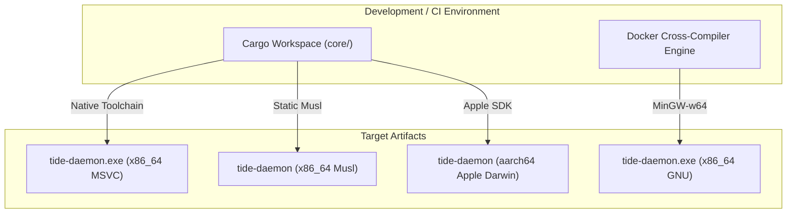
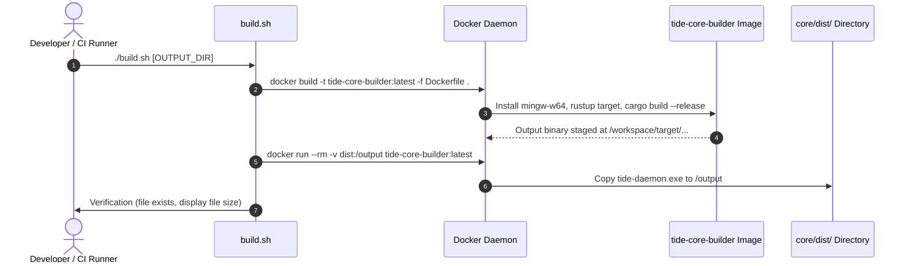

# Tide Core: Build & Distribution Guide

> **Target Binaries:** `tide-daemon` (CLI / MCP Server), `tide-core` (Library)  
> **Source Directory:** [core/](file:///C:/Users/nicoh/projects/tide/core)  
> **Relevant Configs:** [Cargo.toml](file:///C:/Users/nicoh/projects/tide/core/Cargo.toml), [Dockerfile](file:///C:/Users/nicoh/projects/tide/core/Dockerfile), [build.sh](file:///C:/Users/nicoh/projects/tide/core/build.sh)  
> **Primary Maintainers:** Platform & Core Engineering  

---

## Table of Contents

1. [Architecture & Target Platforms](#1-architecture--target-platforms)
2. [The Dockerized Cross-Compilation Pipeline](#2-the-dockerized-cross-compilation-pipeline)
   - [Overview & Rationale](#overview--rationale)
   - [Deep Dive: Dockerfile Breakdown](#deep-dive-dockerfile-breakdown)
   - [Deep Dive: build.sh Automation Script](#deep-dive-buildsh-automation-script)
   - [Cross-Platform Execution & Path Handling](#cross-platform-execution--path-handling)
3. [Static Linking & Dependency Management](#3-static-linking--dependency-management)
   - [SQLite and SQLCipher Amalgamation](#sqlite-and-sqlcipher-amalgamation)
   - [TLS Stack: Rustls vs. Vendored OpenSSL](#tls-stack-rustls-vs-vendored-openssl)
   - [C Runtime (CRT) & MinGW Static Linking](#c-runtime-crt--mingw-static-linking)
4. [Output Artifacts & Optimization Profiles](#4-output-artifacts--optimization-profiles)
   - [Artifact Structure & Distribution Layout](#artifact-structure--distribution-layout)
   - [Binary Size Optimization Matrix](#binary-size-optimization-matrix)
   - [Cargo Profile Configurations](#cargo-profile-configurations)
5. [Development & Native Build Workflows](#5-development--native-build-workflows)
   - [General Cargo Commands](#general-cargo-commands)
   - [Native Windows Builds (MSVC & GNU)](#native-windows-builds-msvc--gnu)
   - [Native Linux Builds (GNU & Musl)](#native-linux-builds-gnu--musl)
   - [Native macOS Builds (Universal Binary)](#native-macos-builds-universal-binary)
6. [CI/CD & Automated Release Pipeline](#6-cicd--automated-release-pipeline)
   - [GitHub Actions Matrix Workflow](#github-actions-matrix-workflow)
   - [Checksum Generation (SHA-256)](#checksum-generation-sha-256)
   - [Automated Release Packaging & Asset Upload](#automated-release-packaging--asset-upload)
7. [Troubleshooting & Known Pitfalls](#7-troubleshooting--known-pitfalls)

---

## 1. Architecture & Target Platforms

`tide-daemon` is designed as a zero-dependency, ultra-low-latency, single-binary daemon implementing the Model Context Protocol (MCP `2024-11-05`) and local-first cryptographic synchronization engine.

Because `tide-daemon` is spawned over standard input/output (`stdio`) by host AI applications—including Antigravity, Claude Desktop, Cursor, and Windsurf—or executed as a background service on local workstations, it must satisfy strict deployment requirements:

- **Zero External Shared Library Dependencies:** The binary must not fail due to missing dynamic runtime libraries such as `msvcp140.dll`, `libgcc_s_seh-1.dll`, `libsqlite3.so`, or system OpenSSL libraries.
- **Instantaneous Cold-Start:** Process initialization and stdio handshake must execute within single-digit milliseconds (<10ms) to ensure MCP tool discovery does not trigger timeouts.
- **Minimal RAM Footprint:** In idle state, background memory usage should remain below 25 MB.
- **Portability:** Cross-platform support across desktop operating systems.

### Target Platform Matrix

| Target Triple | OS / Architecture | ABI / Toolchain | Primary Use Case |
|---|---|---|---|
| `x86_64-pc-windows-gnu` | Windows (64-bit) | MinGW-w64 (GCC) | Dockerized cross-compilation target (CI and non-Windows hosts) |
| `x86_64-pc-windows-msvc` | Windows (64-bit) | MSVC (Visual Studio) | Native Windows builds and official release distribution |
| `x86_64-unknown-linux-musl` | Linux (64-bit) | Musl libc (Static) | Fully portable static binary for all Linux distributions |
| `x86_64-unknown-linux-gnu` | Linux (64-bit) | Glibc (>= 2.31) | Standard Linux environments and containers |
| `aarch64-apple-darwin` | macOS (64-bit ARM) | Clang / LLVM | Apple Silicon (M1/M2/M3/M4) native execution |
| `x86_64-apple-darwin` | macOS (64-bit Intel) | Clang / LLVM | Intel-based macOS legacy execution |



---

## 2. The Dockerized Cross-Compilation Pipeline

### Overview & Rationale

Building a Windows executable from a Linux environment (or a developer's workstation without a full Visual Studio installation) typically presents toolchain and dynamic linkage hurdles. The workspace provides a self-contained, reproducible containerized cross-compilation pipeline located in:

- [core/Dockerfile](file:///C:/Users/nicoh/projects/tide/core/Dockerfile)
- [core/build.sh](file:///C:/Users/nicoh/projects/tide/core/build.sh)

This setup uses a Debian-based Linux image (`rust:bookworm`) equipped with the `mingw-w64` GCC cross-compiler targeting `x86_64-pc-windows-gnu`.



---

### Deep Dive: Dockerfile Breakdown

The [Dockerfile](file:///C:/Users/nicoh/projects/tide/core/Dockerfile) defines the complete toolchain sandbox:

```dockerfile
FROM rust:bookworm AS builder

# 1. Install MinGW-w64 toolchain for Windows 64-bit cross-compilation
RUN apt-get update && apt-get install -y --no-install-recommends \
    mingw-w64 \
    && rm -rf /var/lib/apt/lists/*

# 2. Register Rust target for 64-bit Windows GNU
RUN rustup target add x86_64-pc-windows-gnu

# 3. Configure Cargo linker for MinGW
ENV CARGO_TARGET_X86_64_PC_WINDOWS_GNU_LINKER=x86_64-w64-mingw32-gcc

# 4. Set workspace working directory
WORKDIR /workspace

# 5. Copy workspace sources into container
COPY . .

# 6. Execute release compilation targeting x86_64-pc-windows-gnu
RUN cargo build --release --target x86_64-pc-windows-gnu

# 7. Prepare default output staging directory
RUN mkdir -p /output && \
    cp target/x86_64-pc-windows-gnu/release/tide-daemon.exe /output/

# 8. Expose mountable output volume
VOLUME ["/output"]

# 9. Copy binary to mounted volume on run
CMD ["sh", "-c", "mkdir -p /output && cp /workspace/target/x86_64-pc-windows-gnu/release/tide-daemon.exe /output/ && echo '[+] Successfully copied tide-daemon.exe to /output'"]
```

#### Key Elements:
1. **Base Image (`rust:bookworm`)**: Supplies modern GLIBC and pre-installed Rust stable compiler toolchain (`cargo`, `rustc`, `rustup`).
2. **`mingw-w64`**: Provides the GNU C/C++ cross-compiler headers and binaries (`x86_64-w64-mingw32-gcc`, `ar`, `windres`) required to compile native C components (such as SQLite C amalgamation in `rusqlite`).
3. **`CARGO_TARGET_X86_64_PC_WINDOWS_GNU_LINKER`**: Instructs `cargo` and `rustc` to route linking through the MinGW wrapper rather than the default host linker.
4. **Volume Mounting**: The `/output` directory serves as an export conduit, allowing the built binary to be extracted to the host filesystem without lingering intermediate containers.

---

### Deep Dive: build.sh Automation Script

The [build.sh](file:///C:/Users/nicoh/projects/tide/core/build.sh) script orchestrates building the Docker image and extracting the artifact:

```bash
#!/usr/bin/env bash
set -euo pipefail

# Help / usage
if [ "${1:-}" = "-h" ] || [ "${1:-}" = "--help" ]; then
    echo "Usage: $0 [OUTPUT_DIR]"
    echo ""
    echo "Builds tide-daemon.exe via Docker cross-compilation and outputs to OUTPUT_DIR."
    echo "Default OUTPUT_DIR: <core_dir>/dist"
    exit 0
fi

SCRIPT_DIR="$(cd "$(dirname "${BASH_SOURCE[0]}")" && pwd)"
OUTPUT_DIR="${1:-"$SCRIPT_DIR/dist"}"
IMAGE_NAME="tide-core-builder:latest"

# Check Docker prerequisite
if ! command -v docker >/dev/null 2>&1; then
    echo "Error: docker is required but not found in PATH." >&2
    exit 1
fi

# Ensure output directory exists and obtain absolute path
mkdir -p "$OUTPUT_DIR"
ABS_OUTPUT_DIR="$(cd "$OUTPUT_DIR" && pwd -P)"

# Prevent path conversion issues in MSYS / Git Bash environments on Windows
export MSYS_NO_PATHCONV=1

echo "==> Building Docker image ($IMAGE_NAME)..."
docker build -t "$IMAGE_NAME" -f "$SCRIPT_DIR/Dockerfile" "$SCRIPT_DIR"

echo "==> Exporting tide-daemon.exe to $ABS_OUTPUT_DIR..."
docker run --rm -v "$ABS_OUTPUT_DIR:/output" "$IMAGE_NAME"

TARGET_BIN="$ABS_OUTPUT_DIR/tide-daemon.exe"
if [ -f "$TARGET_BIN" ]; then
    echo "==> Build complete: $TARGET_BIN"
    if command -v ls >/dev/null 2>&1; then
        ls -lh "$TARGET_BIN"
    fi
else
    echo "Error: Output binary not found at $TARGET_BIN" >&2
    exit 1
fi
```

### Cross-Platform Execution & Path Handling

When running bash scripts under Windows (via Git Bash, MSYS2, or Cygwin), POSIX-style paths (e.g., `/c/Users/...`) are automatically translated into Windows paths (e.g., `C:\Users\...`). However, Docker for Windows volume mount syntax `-v /host/path:/container/path` can become corrupted if MSYS transforms `/output` into a local drive path like `C:\output`.

To prevent this:
- **`export MSYS_NO_PATHCONV=1`**: Disables automated POSIX path rewriting during the invocation of Windows executables.
- **`pwd -P`**: Resolves symlinks and provides a canonical path string.

---

## 3. Static Linking & Dependency Management

Achieving true portability requires eliminating all dynamically linked system libraries.

### SQLite and SQLCipher Amalgamation

`tide-core` uses `rusqlite` to manage local SQLite databases with FTS5 search and encryption.

In [Cargo.toml](file:///C:/Users/nicoh/projects/tide/core/Cargo.toml):
```toml
rusqlite = { version = "0.31", features = [
    "bundled",
    "bundled-sqlcipher-vendored-openssl",
    "backup",
    "blob",
    "chrono"
] }
```

- **`bundled`**: Directs `rusqlite`'s build script (`build.rs`) to compile the bundled SQLite C amalgamation source code directly into the Rust crate archive rather than linking against a dynamic `sqlite3.dll` or `libsqlite3.so`.
- **`bundled-sqlcipher-vendored-openssl`**: Compiles SQLCipher database encryption natively while vending OpenSSL cryptographic primitives, preventing mismatches between host and target dynamic libraries.

### TLS Stack: Rustls vs. Vendored OpenSSL

For network requests (`reqwest`), using system OpenSSL (`native-tls`) introduces runtime dependencies on `libssl.so` or `libcrypto.so` on Linux, and external DLLs on Windows.

To maintain self-contained binaries across all platforms, network requests leverage Rustls:
```toml
reqwest = { version = "0.12", features = ["json", "stream"] }
```
When compiling for fully static targets, configuring `rustls-tls` ensures that all TLS handshake logic, X.509 certificate parsing, and cipher suites are written in pure Rust and linked statically into the binary.

### C Runtime (CRT) & MinGW Static Linking

When compiling with MinGW (`x86_64-pc-windows-gnu`), GCC can dynamically link against runtime helper libraries:
- `libgcc_s_seh-1.dll`
- `libwinpthread-1.dll`
- `libstdc++-6.dll`

To eliminate these dependencies and produce a completely standalone executable, pass static linker flags:

```bash
export RUSTFLAGS="-C target-feature=+crt-static -C link-args=-static"
```

For native Windows MSVC (`x86_64-pc-windows-msvc`), static CRT linking is configured via `.cargo/config.toml` or `RUSTFLAGS`:
```toml
[target.x86_64-pc-windows-msvc]
rustflags = ["-C", "target-feature=+crt-static"]
```

This embeds the C runtime (`libcmt.lib`) directly into `tide-daemon.exe`, allowing the binary to execute on clean Windows installations without requiring the Microsoft Visual C++ Redistributable (`vcruntime140.dll`).

---

## 4. Output Artifacts & Optimization Profiles

### Artifact Structure & Distribution Layout

Upon completion of the build script, binaries are deposited into the distribution directory:

```
core/
└── dist/
    ├── tide-daemon.exe        # Windows 64-bit release executable
    └── tide-daemon            # Linux / macOS release executable (when built natively)
```

### Binary Size Optimization Matrix

To minimize binary footprint for fast downloading, deployment, and low memory mapping overhead, the following compiler optimization flags are used:

| Flag | Value | Effect |
|---|---|---|
| `opt-level` | `"z"` or `3` | `"z"` optimizes aggressively for binary size; `3` optimizes for maximum execution performance. |
| `lto` | `true` (or `"fat"`) | Link-Time Optimization performs cross-crate dead code elimination and inlining. |
| `codegen-units` | `1` | Restricts code generation to a single unit, maximizing compiler optimization scope across modules. |
| `panic` | `"abort"` | Disables stack unwinding tables and landing pads, stripping exception-handling metadata. |
| `strip` | `true` | Strips all debug symbols, symbol tables, and DWARF sections from the final binary. |

### Cargo Profile Configurations

Recommended release profile additions in root [core/Cargo.toml](file:///C:/Users/nicoh/projects/tide/core/Cargo.toml):

```toml
[profile.release]
opt-level = "z"         # Optimize for size (use 3 if CPU throughput dominates)
lto = true              # Enable whole-program Link-Time Optimization
codegen-units = 1       # Maximize inlining and dead-code stripping
panic = "abort"         # Abort on panic, removing stack-unwinding machinery
strip = true            # Automatically strip debug symbols from binary

[profile.release-perf]
inherits = "release"
opt-level = 3           # Focus strictly on runtime execution speed
```

---

## 5. Development & Native Build Workflows

### General Cargo Commands

All native builds originate from the `core/` directory:

```bash
# 1. Typecheck the entire workspace
cargo check --workspace

# 2. Execute unit, crypto, and integration tests
cargo test --workspace

# 3. Build only the daemon executable in development mode
cargo build -p tide-daemon

# 4. Build all workspace crates in release mode
cargo build --workspace --release
```

### Native Windows Builds (MSVC & GNU)

#### Option A: MSVC Toolchain (Recommended for Windows Hosts)
Prerequisites: Visual Studio 2022 Build Tools (with C++ Desktop Development).

```powershell
# Add MSVC target
rustup target add x86_64-pc-windows-msvc

# Build static executable
$env:RUSTFLAGS="-C target-feature=+crt-static"
cargo build -p tide-daemon --release --target x86_64-pc-windows-msvc
```
The output binary will be located at:
`core/target/x86_64-pc-windows-msvc/release/tide-daemon.exe`

#### Option B: MinGW GNU Toolchain
Prerequisites: MinGW-w64 on `PATH`.

```powershell
rustup target add x86_64-pc-windows-gnu
cargo build -p tide-daemon --release --target x86_64-pc-windows-gnu
```

---

### Native Linux Builds (GNU & Musl)

#### Musl (Fully Static Single Binary)
Prerequisites: `musl-tools` package (`sudo apt install musl-tools`).

```bash
# Add Musl target
rustup target add x86_64-unknown-linux-musl

# Build static binary
cargo build -p tide-daemon --release --target x86_64-unknown-linux-musl
```
The output binary will have zero dynamic shared object (`.so`) dependencies:
```bash
file target/x86_64-unknown-linux-musl/release/tide-daemon
# Result: ELF 64-bit LSB executable, statically linked
```

---

### Native macOS Builds (Universal Binary)

Apple Silicon and Intel Macs require different target architectures. You can create a Universal 2 binary using `lipo`:

```bash
# 1. Add macOS targets
rustup target add aarch64-apple-darwin
rustup target add x86_64-apple-darwin

# 2. Build for Apple Silicon (ARM64)
cargo build -p tide-daemon --release --target aarch64-apple-darwin

# 3. Build for Intel (x86_64)
cargo build -p tide-daemon --release --target x86_64-apple-darwin

# 4. Combine into universal binary
mkdir -p dist
lipo -create \
  target/aarch64-apple-darwin/release/tide-daemon \
  target/x86_64-apple-darwin/release/tide-daemon \
  -output dist/tide-daemon
```

---

## 6. CI/CD & Automated Release Pipeline

### GitHub Actions Matrix Workflow

Below is the standard continuous deployment specification for automated cross-platform releases (`.github/workflows/release-core.yml`):

```yaml
name: Release Tide Core & Daemon

on:
  push:
    tags:
      - 'core-v*'
  workflow_dispatch:

permissions:
  contents: write

jobs:
  build-release:
    name: Build (${{ matrix.target }})
    runs-on: ${{ matrix.os }}
    strategy:
      fail-fast: false
      matrix:
        include:
          - os: windows-latest
            target: x86_64-pc-windows-msvc
            binary_name: tide-daemon.exe
            archive_name: tide-daemon-${{ github.ref_name }}-x86_64-windows.zip
            rustflags: "-C target-feature=+crt-static"

          - os: ubuntu-latest
            target: x86_64-unknown-linux-musl
            binary_name: tide-daemon
            archive_name: tide-daemon-${{ github.ref_name }}-x86_64-linux-musl.tar.gz
            rustflags: ""

          - os: macos-latest
            target: aarch64-apple-darwin
            binary_name: tide-daemon
            archive_name: tide-daemon-${{ github.ref_name }}-aarch64-macos.tar.gz
            rustflags: ""

    steps:
      - name: Checkout repository
        uses: actions/checkout@v4

      - name: Install Rust toolchain
        uses: dtolnay/rust-toolchain@stable
        with:
          targets: ${{ matrix.target }}

      - name: Install Linux build dependencies (Musl)
        if: matrix.target == 'x86_64-unknown-linux-musl'
        run: sudo apt-get update && sudo apt-get install -y musl-tools

      - name: Rust Cache
        uses: Swatinem/rust-cache@v2
        with:
          workspaces: "core -> core/target"

      - name: Build release binary
        working-directory: core
        env:
          RUSTFLAGS: ${{ matrix.rustflags }}
        run: cargo build -p tide-daemon --release --target ${{ matrix.target }}

      - name: Package archive (Windows)
        if: runner.os == 'Windows'
        working-directory: core
        shell: pwsh
        run: |
          $binPath = "target/${{ matrix.target }}/release/${{ matrix.binary_name }}"
          Compress-Archive -Path $binPath -DestinationPath "${{ matrix.archive_name }}"
          $hash = (Get-FileHash -Algorithm SHA256 "${{ matrix.archive_name }}").Hash.ToLower()
          "$hash  ${{ matrix.archive_name }}" | Out-File -Encoding utf8 "${{ matrix.archive_name }}.sha256"

      - name: Package archive (Unix)
        if: runner.os != 'Windows'
        working-directory: core
        run: |
          BIN_PATH="target/${{ matrix.target }}/release/${{ matrix.binary_name }}"
          chmod +x "$BIN_PATH"
          tar -czvf "${{ matrix.archive_name }}" -C "target/${{ matrix.target }}/release" "${{ matrix.binary_name }}"
          sha256sum "${{ matrix.archive_name }}" > "${{ matrix.archive_name }}.sha256"

      - name: Upload artifact to release
        uses: softprops/action-gh-release@v2
        with:
          files: |
            core/${{ matrix.archive_name }}
            core/${{ matrix.archive_name }}.sha256
```

---

## 7. Troubleshooting & Known Pitfalls

### 1. Docker Volume Mount Permissions on Linux
**Issue:** When running `./build.sh` on a Linux host, the created `dist/tide-daemon.exe` may be owned by `root`.  
**Resolution:** Run the container with the host UID/GID or run `chown` in the build script:
```bash
docker run --rm --user "$(id -u):$(id -g)" -v "$ABS_OUTPUT_DIR:/output" "$IMAGE_NAME"
```

### 2. Git Bash Path Translation (`MSYS_NO_PATHCONV`)
**Issue:** `docker run` fails with `invalid volume specification: /output` when executed on Windows Git Bash.  
**Resolution:** Ensure `export MSYS_NO_PATHCONV=1` is set before invoking docker commands to prevent Git Bash from translating POSIX mount target `/output` into a Windows host drive letter.

### 3. MinGW C Compiler Toolchain Selection
**Issue:** Cross-compilation fails with `x86_64-w64-mingw32-gcc: command not found`.  
**Resolution:** Verify that `mingw-w64` is installed. The Cargo linker configuration must explicitly specify:
```bash
export CARGO_TARGET_X86_64_PC_WINDOWS_GNU_LINKER="x86_64-w64-mingw32-gcc"
```

### 4. SQLite FTS5 Compiler Errors
**Issue:** SQLite compiles without Full-Text Search 5 support, causing table creation failures during runtime initialization.  
**Resolution:** `rusqlite` builds SQLite with FTS5 enabled when specified in crate features or compiler flags. Ensure that neither `SQLITE_OMIT_FTS5` nor conflicting build options are passed in `CFLAGS`.
