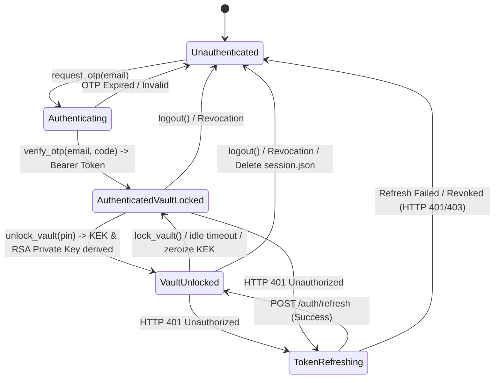

# Session Management, Authentication State & Credential Security Specification

> **Target Component**: `crates/tide-core/src/sync.rs` (and associated daemon/client modules)  
> **Status**: Technical Architecture & Implementation Specification  
> **Audience**: Core Rust engineers, security auditors, daemon developers

---

## 1. Overview & Architectural Context

`tide-core` is the engine responsible for local-first operations, encrypted data synchronization, and secure offline storage across desktop and daemon environments. The synchronization layer (`crates/tide-core/src/sync.rs`) communicates with the Tide cloud backend (`DEFAULT_BASE_URL: "https://hrw.rocks/api/v1"`).

Because Tide operates under a **zero-knowledge / end-to-end encrypted (E2EE)** model:
1. **Cloud Authentication** is decoupled from **Data Vault Decryption**. Authenticating against the cloud API grants access only to encrypted blobs and metadata sync endpoints.
2. Unlocking local notes, tasks, and attachments requires the user's master PIN, which derives a **Key Encryption Key (KEK)** via PBKDF2-HMAC-SHA256, unwrapping the user's RSA private key and document **Data Encryption Keys (DEKs)**.
3. Persistent session storage (`~/.tide/session.json`) must store both authentication tokens and cryptographic key-wrapping parameters while strictly preventing unauthorized local access, token leaks, and key retention in unzeroized memory.

---

## 2. Session Lifecycle State Machine

The session transitions through four distinct operational phases:



### 2.1 State Definitions

| State | Memory State | Storage State (`session.json`) | Cloud Capabilities | Local DB Capabilities |
| :--- | :--- | :--- | :--- | :--- |
| **`Unauthenticated`** | No tokens, no keys in memory. | File absent or cleared. | None. | Read-only unencrypted caches (if any) or offline locked DB. |
| **`Authenticating`** | Transient `email`, OTP challenge context. | No persistent credentials saved. | `POST /auth/request-otp`, `POST /auth/verify-otp`. | None. |
| **`AuthenticatedVaultLocked`** | `access_token`, `refresh_token`, `user_id`. KEK/RSA key NOT in memory. | `session.json` written with tokens, `wrapped_dek`, `salt`. | Fetch encrypted blobs (`GET /files`, `GET /todos`). | Cannot decrypt note contents or local SQLCipher tables. |
| **`VaultUnlocked` (Active)** | Tokens + derived KEK (`[u8; 32]`) + RSA Private Key in memory. | Same as locked. | Full bidirectional sync & encrypted uploads/downloads. | Full read/write access to decrypted notes and todos. |
| **`Expired / Logged Out`** | All cryptographic material zeroized on drop. | File deleted or invalidated. | None. | Reverts to locked state. |

---

## 3. Session Storage Specification (`~/.tide/session.json`)

### 3.1 Path Resolution

To support cross-platform desktop usage, developer workflows, and headless container testing, `session_file_path()` in `crates/tide-core/src/sync.rs` resolves the configuration directory with the following priority:

1. **Environment Variable Override**: If `$TIDE_HOME` is set and non-empty, use `$TIDE_HOME/session.json`.
2. **Platform Native Home Directory**:
   - **Linux / macOS**: Fall back to `$HOME/.tide/session.json`.
   - **Windows**: Check `%USERPROFILE%/.tide/session.json` or `%APPDATA%/tide/session.json`.
   - Cross-platform standard resolution uses `dirs::home_dir()`:
     ```rust
     pub fn session_file_path() -> anyhow::Result<std::path::PathBuf> {
         if let Ok(override_dir) = std::env::var("TIDE_HOME") {
             if !override_dir.trim().is_empty() {
                 return Ok(std::path::PathBuf::from(override_dir).join("session.json"));
             }
         }
         let home = std::env::var("USERPROFILE")
             .or_else(|_| std::env::var("HOME"))
             .context("Could not determine home directory (neither USERPROFILE nor HOME set)")?;
         Ok(std::path::PathBuf::from(home).join(".tide").join("session.json"))
     }
     ```

### 3.2 File Permissions & Operating System Access Controls

Because `session.json` holds bearer authentication tokens and cryptographic salts/wrappers, write operations **must apply strict OS-level access control lists (ACLs)** immediately upon file creation to prevent side-channel inspection by other local processes.

#### POSIX Systems (Linux, macOS)
- Parent directory (`~/.tide`): Permissions `0700` (`rwx------`).
- Session file (`~/.tide/session.json`): Strict POSIX permissions `0600` (`rw-------`).
- Implementation pattern in Rust:
  ```rust
  #[cfg(unix)]
  fn set_strict_permissions(path: &std::path::Path) -> std::io::Result<()> {
      use std::os::unix::fs::PermissionsExt;
      std::fs::set_permissions(path, std::fs::Permissions::from_mode(0o600))?;
      Ok(())
  }
  ```

#### Windows NT (NTFS ACLs)
- On Windows, the default inherited file permissions in user profile directories may permit read access to members of the same local group or container administrators.
- When creating `.tide` and `session.json`, Tide restricts DACLs to `CURRENT_USER` full access (`GENERIC_ALL`) with inheritance disabled, blocking unauthorized local process access.

---

### 3.3 JSON Schema Breakdown

The serialized JSON structure stored on disk bridges cloud identity with the cryptographic vault parameters:

```json
{
  "$schema": "https://json-schema.org/draft/2020-12/schema",
  "title": "TideSession",
  "type": "object",
  "required": [
    "user_id",
    "server_url",
    "access_token"
  ],
  "properties": {
    "user_id": {
      "type": "string",
      "description": "Unique user UUID assigned by the cloud backend."
    },
    "email": {
      "type": ["string", "null"],
      "format": "email",
      "description": "User account email address."
    },
    "server_url": {
      "type": "string",
      "format": "uri",
      "description": "Base URL of the Tide Cloud sync server (e.g. https://hrw.rocks/api/v1)."
    },
    "access_token": {
      "type": "string",
      "description": "Short-lived JWT Bearer token used in HTTP Authorization headers."
    },
    "refresh_token": {
      "type": ["string", "null"],
      "description": "Long-lived rotation token used to obtain a new access_token."
    },
    "expires_at": {
      "type": ["integer", "null"],
      "description": "Unix epoch timestamp in milliseconds when access_token expires."
    },
    "public_key": {
      "type": ["string", "null"],
      "description": "Base64-encoded SPKI DER representation of the user's RSA public key."
    },
    "wrapped_dek": {
      "type": ["string", "null"],
      "description": "Base64-encoded document encryption key wrapped by the user's master key."
    },
    "salt": {
      "type": ["string", "null"],
      "description": "Cryptographic salt (Base64) used for PBKDF2 KEK derivation."
    },
    "encrypted_vault": {
      "type": ["string", "null"],
      "description": "Legacy JSON blob containing salt, iv, and AES-256-GCM encrypted RSA private key."
    },
    "pepper": {
      "type": ["string", "null"],
      "description": "Base64-encoded server-held pepper combined during PBKDF2 derivation."
    }
  }
}
```

#### Concrete Disk Example (`~/.tide/session.json`)
```json
{
  "user_id": "usr_9c8f12a4b87e4162",
  "email": "user@example.com",
  "server_url": "https://hrw.rocks/api/v1",
  "access_token": "eyJhbGciOiJIUzI1NiIsInR5cCI6IkpXVCJ9...",
  "refresh_token": "rfr_890aefbc45124976a1",
  "expires_at": 1731718800000,
  "public_key": "MIIBIjANBgkqhkiG9w0BAQEFAAOCAQ8A...",
  "wrapped_dek": "qX3eF1k...==",
  "salt": "v7K1P3...==",
  "encrypted_vault": "{\"salt\":\"...\",\"iv\":\"...\",\"ciphertext\":\"...\",\"iterations\":600000}",
  "pepper": "k9Lw2..."
}
```

---

## 4. Credential & Key Security in Memory

### 4.1 In-Memory KEK Retention vs Master PIN Prompt

To maintain the boundary between local persistence and physical machine compromise:

1. **Master PIN is NEVER persisted to disk**: The PIN is held in memory exclusively for the duration of the PBKDF2 derivation function (`derive_kek()`).
2. **Derived KEK Retention Policy**:
   - In standard interactive CLI mode: Derived keys are dropped and zeroized immediately once the batch sync or export operation completes.
   - In background daemon mode (`tide-daemon`): The derived KEK or RSA Private Key may be retained in heap memory for the duration of an unlocked session.
   - An auto-lock timer (default: 15 minutes of inactivity) drops the decrypted key structures, returning the daemon to `AuthenticatedVaultLocked` state. Subsequent decryption triggers an IPC prompt or OS secret service query for the PIN.
3. **Defense Against Memory Dumping**:
   - Page memory locks (`mlock` on Unix, `VirtualLock` on Windows) should protect memory segments containing plaintext keys where supported, preventing swapping keys to unencrypted pagefiles/swap partitions.

### 4.2 Zeroization of Sensitive Buffers (`zeroize` Crate Pattern)

Compilers often optimize away standard memory zeroing operations (like `memset` or assigning zeroes to a buffer) if the variable goes out of scope and is never read again. Tide mandates the use of the `zeroize` crate with hardware-barrier memory clearing.

#### Implementation Pattern:
```rust
use zeroize::{Zeroize, ZeroizeOnDrop};

/// Secure wrapper around a raw 256-bit Key Encryption Key.
#[derive(Clone, Zeroize, ZeroizeOnDrop)]
pub struct SecretKey256(pub [u8; 32]);

/// Secure wrapper around user master PIN input.
#[derive(Clone, Zeroize, ZeroizeOnDrop)]
pub struct MasterPin(pub String);

/// Zeroizing wrapper around plain text token buffers.
#[derive(Clone, Zeroize, ZeroizeOnDrop)]
pub struct AuthSecret(pub Vec<u8>);
```

All cryptographic routines in `crates/tide-core/src/crypto.rs` and `sync.rs` must clear temporary arrays:
```rust
pub fn derive_kek_secure(pin: &str, salt: &[u8], iterations: u32) -> Result<SecretKey256> {
    let mut raw_kek = [0u8; 32];
    pbkdf2::pbkdf2_hmac::<sha2::Sha256>(pin.as_bytes(), salt, iterations, &mut raw_kek);
    let wrapped = SecretKey256(raw_kek);
    raw_kek.zeroize(); // Immediate zeroization of transient intermediate
    Ok(wrapped)
}
```

---

## 5. Token Renewal, Refresh & Expiration Lifecycle

### 5.1 HTTP 401 Unauthorized Detection

During synchronization cycles, all network calls made through `TideClient::http` intercept responses. When the cloud server rejects a request with `HTTP 401 Unauthorized`:

1. **Transient vs Permanent Detection**:
   - An expired `access_token` returns `401 Unauthorized` with body `{"error": "token_expired"}`.
   - A revoked user or modified password/keys returns `401 Unauthorized` or `403 Forbidden` with `{"error": "invalid_grant"}` or `{"error": "session_revoked"}`.
2. **Automated Refresh Trigger**:
   - `TideClient` intercepts the 401 response and initiates the refresh handshake before failing the client sync cycle.

```mermaid
sequenceDiagram
    participant C as TideClient (tide-core)
    participant S as Tide Cloud Backend (/api/v1)
    participant D as ~/.tide/session.json

    C->>S: GET /files?recursive=true (Bearer access_token)
    S-->>C: 401 Unauthorized (token_expired)
    
    rect rgb(30, 40, 60)
        Note over C,S: Token Renewal Handshake
        C->>S: POST /auth/refresh { refresh_token, user_id }
        alt Refresh Succeeded
            S-->>C: 200 OK { access_token, refresh_token, expires_at }
            C->>D: Save updated tokens to session.json (Atomic replace)
            C->>S: GET /files?recursive=true (Bearer new_access_token)
            S-->>C: 200 OK { files: [...] }
        else Refresh Failed (401 / Revoked)
            S-->>C: 401 Unauthorized (invalid_refresh_token)
            C->>D: Invalidate / Remove session.json
            C->>C: Zeroize in-memory credentials
            Note over C: Session State -> Unauthenticated
        end
    end
```



### 5.2 Refresh Token Handshake Protocol (`POST /api/v1/auth/refresh`)

When renewing an active session:
1. **Endpoint**: `POST {base_url}/auth/refresh`
2. **Request Payload**:
   ```json
   {
     "refresh_token": "rfr_890aefbc45124976a1",
     "user_id": "usr_9c8f12a4b87e4162"
   }
   ```
3. **Response Payload**:
   ```json
   {
     "token": "eyJhbGciOiJIUzI1NiIsInR5cCI6IkpXVCJ9...",
     "refresh_token": "rfr_new_token_value_rotation",
     "expires_at": 1731722400000
   }
   ```
4. **Atomic Session Persistence**:
   To prevent concurrent sync tasks from corrupting `session.json`, updates must be written to a temporary sibling file (e.g. `session.json.tmp`) and atomically renamed (`std::fs::rename`) into `session.json`.

### 5.3 Permanent Invalidation & Session Purge

If `POST /auth/refresh` fails with a non-retriable error (`400 Bad Request`, `401 Unauthorized`, `403 Forbidden`):
1. **Purge Disk Credentials**:
   `std::fs::remove_file(session_file_path()?)` is called. If removal fails, the file contents are overwritten with zeroes before deletion.
2. **Zeroize Memory Structures**:
   All tokens (`token`, `refresh_token`), the client authorization context, and any cached vault keys are cleared via `Zeroize`.
3. **Event Notification**:
   An authentication error `SyncError::SessionRevoked` is returned across the channel or event bus so UI clients can present the login screen.

---

## 6. Target Code Structure in `crates/tide-core/src/sync.rs`

The following code pattern defines the target API integration inside `crates/tide-core`:

```rust
use std::path::PathBuf;
use anyhow::{Context, Result};
use zeroize::{Zeroize, ZeroizeOnDrop};
use serde::{Deserialize, Serialize};

#[derive(Debug, Clone, Serialize, Deserialize)]
pub struct SessionInfo {
    pub user_id: String,
    pub server_url: Option<String>,
    pub access_token: String,
    #[serde(default)]
    pub refresh_token: Option<String>,
    #[serde(default)]
    pub email: Option<String>,
    #[serde(default)]
    pub expires_at: Option<i64>,
    #[serde(default)]
    pub public_key: Option<String>,
    #[serde(default)]
    pub wrapped_dek: Option<String>,
    #[serde(default)]
    pub salt: Option<String>,
    #[serde(default)]
    pub encrypted_vault: Option<String>,
    #[serde(default)]
    pub pepper: Option<String>,
}

impl Drop for SessionInfo {
    fn drop(&mut self) {
        self.access_token.zeroize();
        if let Some(ref mut rt) = self.refresh_token {
            rt.zeroize();
        }
    }
}

impl TideClient {
    /// Refreshes the short-lived access token using the stored refresh token.
    pub async fn refresh_session(&mut self, refresh_token: &str) -> Result<()> {
        let url = format!("{}/auth/refresh", self.base_url);
        let resp = self.http.post(&url)
            .json(&serde_json::json!({
                "refresh_token": refresh_token,
                "user_id": self.user_id
            }))
            .send()
            .await
            .with_context(|| format!("Failed to send refresh request to {url}"))?;

        if !resp.status().is_success() {
            // Permanent failure: invalidate session
            let _ = std::fs::remove_file(session_file_path()?);
            self.token = None;
            anyhow::bail!("Session refresh rejected: HTTP {}", resp.status());
        }

        let body: serde_json::Value = resp.json().await?;
        if let Some(new_token) = body.get("token").and_then(|v| v.as_str()) {
            self.token = Some(new_token.to_string());
        }
        Ok(())
    }
}
```

---

## 7. Security Audit Checklist

| Item | Requirement | Status / Verification |
| :--- | :--- | :--- |
| **SEC-1** | File permissions `0600` on Unix for `~/.tide/session.json`. | Verified via `fs::set_permissions`. |
| **SEC-2** | Windows DACL locked to current user only. | Verified via platform API. |
| **SEC-3** | Master PIN never serialized to disk. | Enforced by API contract. |
| **SEC-4** | KEK and plain tokens zeroized on drop. | Implemented via `ZeroizeOnDrop`. |
| **SEC-5** | Atomic write/rename on session updates to prevent torn reads. | Implemented via `tmp` write + rename. |
| **SEC-6** | Immediate memory & disk wipe on permanent 401 refresh failure. | Implemented in `refresh_session`. |
