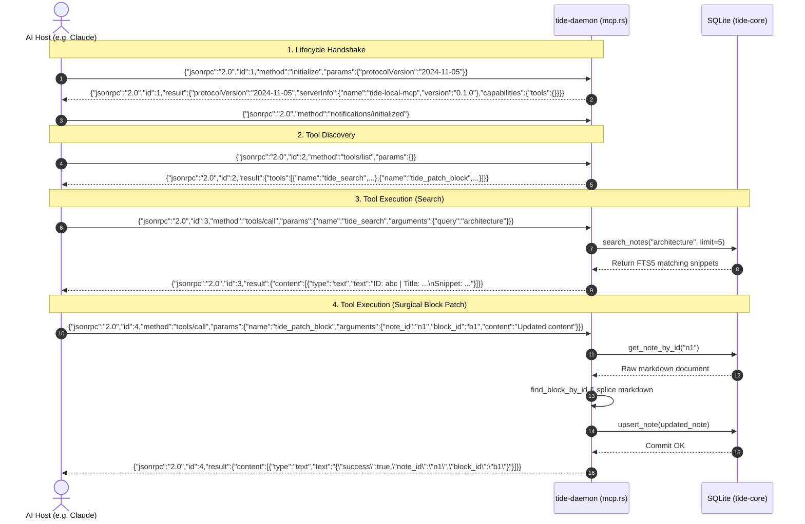

# `tide-daemon` Crate Deep-Dive

**Crate Path:** [`core/crates/tide-daemon`](file:///C:/Users/nicoh/projects/tide/core/crates/tide-daemon)  
**Binary Name:** `tide-daemon`  
**Rust Edition:** 2021  
**Version:** `0.1.0`

---

## 1. Crate Purpose

`tide-daemon` is the standalone executable binary of the Tide workspace. It serves as both the **command-line harness (CLI)** and the **Stdio Model Context Protocol (MCP) server** for AI coding assistants and agentic environments (such as Claude Desktop, Cursor, Antigravity, and Gemini).

Key responsibilities:
- **CLI Runtime & User Onboarding:** Command parsing, interactive menu fallback, OTP email verification, 600,000-iteration PBKDF2 vault unlocking, and session caching.
- **Stdio MCP 2.0 Server:** Real-time line-delimited JSON-RPC 2.0 server operating over standard input/output (`stdin`/`stdout`), exposing Tide's local encrypted storage to AI agents without network latency.
- **Surgical Token-Saving Agent Tools:** Fine-grained note retrieval and manipulation (`tide_search`, `tide_get_note_outline`, `tide_get_note_section`, `tide_get_block`, `tide_patch_block`, `tide_get_focused_blocks`).
- **Local Persistence & Sync Orchestration:** Interfacing directly with `tide-core`'s SQLite database engine (`rusqlite` in WAL mode) and Cloud Sync client (`TideClient`).

---

## 2. Binary Architecture & Module Layout

```
tide-daemon
├── src/main.rs (CLI parser, interactive menu, session management, command dispatch)
└── src/mcp.rs  (Stdio JSON-RPC 2.0 loop, MCP tool registry, block parser, AST scanner)
```

### 2.1 Dependencies (`Cargo.toml`)

`tide-daemon` links to the workspace core and Tokio asynchronous runtime ecosystem:
- `tide-core`: Shared domain crate containing SQLite storage (`Database`), zero-knowledge cryptography (`unlock_vault`), and cloud sync client (`TideClient`).
- `tokio`: Async runtime with `macros`, `rt-multi-thread`, `io-util`, and `signal`.
- `clap`: Declarative argument parsing using derive macros (`Parser`, `Subcommand`).
- `serde` & `serde_json`: High-performance JSON serialization/deserialization for JSON-RPC 2.0 frames.
- `tracing` & `tracing-subscriber`: Structured logging and diagnostic telemetry (sent to stderr to avoid polluting stdout).
- `anyhow`: Ergonomic context-rich error bubbling throughout CLI commands.

---

## 3. CLI Architecture (`src/main.rs`)

### 3.1 Command-Line Dispatch (`clap`)

The entrypoint parses options and subcommands defined in the `Cli` and `Commands` enums:

```rust
#[derive(Parser)]
#[command(name = "tide-daemon", version = "0.1.0", about = "Tide Local Harness & MCP Daemon")]
struct Cli {
    #[command(subcommand)]
    command: Option<Commands>,
}

#[derive(Subcommand)]
enum Commands {
    /// Start the Stdio MCP server for AI agents
    Mcp {
        #[arg(long, default_value = "~/.tide/local.db")]
        db_path: String,
    },
    /// Initialize local database
    Init {
        #[arg(long, default_value = "~/.tide/local.db")]
        db_path: String,
    },
    /// Log in with email OTP, unlock vault with PIN, and sync notes & todos
    Login {
        #[arg(long)] email: Option<String>,
        #[arg(long)] code: Option<String>,
        #[arg(long)] pin: Option<String>,
        #[arg(long)] token: Option<String>,
        #[arg(long, default_value = "~/.tide/local.db")] db_path: String,
    },
    /// Sync notes and todos using existing session
    Sync {
        #[arg(long, default_value = "~/.tide/local.db")]
        db_path: String,
        #[arg(long)]
        pin: Option<String>,
    },
    /// Run daemon background service
    Run {
        #[arg(long, default_value = "~/.tide/local.db")]
        db_path: String,
    },
}
```

### 3.2 Command Workflows

1. **`mcp`:**
   - Resolves database path (expands `~/` via `USERPROFILE` on Windows or `HOME` on Unix).
   - Ensures parent directories exist (`ensure_parent_dir`).
   - Opens local SQLite database with `tide_core::Database::open(&path)`.
   - Transfers control to `mcp::run_mcp_server(db)`.

2. **`init`:**
   - Opens the database file, automatically running schema creation, table triggers, and FTS5 virtual tables (`notes_fts`).
   - Verifies database health and logs confirmation.

3. **`login` (`perform_login_and_sync`):**
   - Connects to Tide Cloud API (`https://hrw.rocks/api/v1`).
   - Requests email OTP via `client.request_otp(&email)` if credentials are not passed.
   - Prompts for or verifies 6-digit confirmation code via `client.verify_otp(&email, &code)`.
   - Prompts for Vault PIN and unlocks the RSA Master Key using PBKDF2 (600,000 iterations) via `unlock_vault`.
   - Persists credentials securely to `~/.tide/session.json`.
   - Pulls and decrypts notes and todos into the local database.

4. **`sync` (`perform_sync_with_session`):**
   - Reads active credentials from `load_session()`.
   - Unlocks the RSA Master Key with user PIN.
   - Performs bi-directional synchronization with the remote cloud store.

5. **`run`:**
   - Runs daemon as a long-lived background service waiting on OS termination signals (`tokio::signal::ctrl_c()`).

6. **Interactive Fallback (`run_interactive_menu`):**
   - When executed with no subcommands (e.g. double-clicked in File Explorer or launched directly), displays an interactive TUI menu (`[1] Login & Sync`, `[2] Sync`, `[3] Start Stdio MCP Server`, `[4] Exit`).

---

## 4. The MCP Server Event Loop (`src/mcp.rs`)

### 4.1 Stdio JSON-RPC 2.0 Framing

The Model Context Protocol (MCP) specifies JSON-RPC 2.0 message exchange over `stdin` and `stdout`. Logging and diagnostics **must strictly use `stderr`** so that stdout contains only clean, line-delimited JSON envelopes.

```rust
pub async fn run_mcp_server(db: Database) -> Result<()> {
    let stdin = tokio::io::stdin();
    let mut reader = BufReader::new(stdin).lines();
    let mut stdout = tokio::io::stdout();

    while let Some(line) = reader.next_line().await? {
        let line = line.trim();
        if line.is_empty() {
            continue;
        }

        let req: Value = match serde_json::from_str(line) {
            Ok(v) => v,
            Err(_) => continue, // Ignore malformed framing
        };

        // Parse id, method, params...
        // Dispatch tool calls...
        // Format response...
    }
    Ok(())
}
```

### 4.2 Protocol Lifecycle Handling

`mcp.rs` adheres to MCP specification version `2024-11-05`:

| Method | Type | Description / Response Payload |
|---|---|---|
| `initialize` | Request | Advertises server metadata (`tide-local-mcp v0.1.0`), protocol version (`2024-11-05`), and tool capabilities (`capabilities: { tools: {} }`). |
| `notifications/initialized` | Notification | Client confirmation of handshake completion. No response is returned (`None`). |
| `ping` | Request | Keep-alive check. Responds with empty object `{}`. |
| `tools/list` | Request | Returns the catalogue of 10 available local database and note analysis tools with their JSON Schema inputs. |
| `tools/call` | Request | Executes target tool against local SQLite database, returning structured text content in `result.content[0].text`. |
| *(unknown)* | Request | Returns standard JSON-RPC error `-32601` (`Method not found`). |

---

## 5. Tool Registry & Surgical Markdown Block Parser

To minimize token usage and latency for LLM agents, `tide-daemon` provides fine-grained, surgical tools rather than dumping entire notes:

```
┌────────────────────────────────────────────────────────┐
│                   MCP Tool Registry                    │
├──────────────────────────┬─────────────────────────────┤
│ Tool Name                │ Functionality               │
├──────────────────────────┼─────────────────────────────┤
│ tide_search              │ FTS5 snippet search         │
│ tide_get_note_outline    │ Headings & checklists only  │
│ tide_get_note_section    │ Targeted heading extraction │
│ tide_get_note_graph      │ Bidirectional link edges    │
│ tide_list_todos          │ Filterable task list        │
│ tide_patch_todo          │ Atomic task update          │
│ tide_get_note            │ Full raw markdown retrieval │
│ tide_get_block           │ Single block by block_id    │
│ tide_get_focused_blocks  │ Reading/focus marked blocks │
│ tide_patch_block         │ Atomic block replacement    │
└──────────────────────────┴─────────────────────────────┘
```

### 5.1 Dual-Syntax Block Parsing Engine (`parse_blocks`)

`mcp.rs` features a specialized AST scanner capable of recognizing block identifiers in two standard formats:

1. **HTML Comment Syntax (Markdown-Native):**
   ```markdown
   <!-- block_id: 12345 -->
   <!-- ai-focus -->
   This is the targeted content block.
   ```
2. **HTML Tag / Attribute Syntax:**
   ```html
   <div data-block-id="12345" data-ai-focus="true">
     This is the targeted content block.
   </div>
   ```

### 5.2 Atomic Block Replacement (`tide_patch_block`)

When an agent updates a block via `tide_patch_block`:
1. The note is loaded from SQLite by `note_id`.
2. `find_block_by_id` pinpoints byte boundaries `full_start` and `full_end` in `content_markdown`.
3. The replacement content is formatted with preserving wrappers (maintaining `data-block-id` or comment tags).
4. The string is spliced in-place:
   ```rust
   let mut updated = String::with_capacity(note.content_markdown.len() + replacement.len());
   updated.push_str(&note.content_markdown[..block.full_start]);
   updated.push_str(&replacement);
   updated.push_str(&note.content_markdown[block.full_end..]);
   note.content_markdown = updated;
   ```
5. `updated_at` timestamp is updated to current Unix epoch and `dirty = true` flag is set.
6. `db.upsert_note(&note)` atomically writes the change to SQLite and updates the FTS5 index.

---

## 6. Concurrency & Synchronization Model

```
       ┌─────────────────────────────────────────────────────────┐
       │                Stdio Event Loop (Tokio)                 │
       │   Non-blocking Line Reader (tokio::io::BufReader)       │
       └────────────────────────────┬────────────────────────────┘
                                    │
                                    ▼
       ┌─────────────────────────────────────────────────────────┐
       │             Tool Call Dispatcher (mcp.rs)               │
       └────────────────────────────┬────────────────────────────┘
                                    │
                         Calls Database Engine
                                    │
                                    ▼
       ┌─────────────────────────────────────────────────────────┐
       │               tide-core Database Engine                 │
       │  • rusqlite::Connection with WAL (Write-Ahead Logging)  │
       │  • PRAGMA busy_timeout = 5000                           │
       │  • Atomic transactions on writes (BEGIN IMMEDIATE)      │
       └─────────────────────────────────────────────────────────┘
```

- **Async Stdio Non-Blocking I/O:** Reading and writing over standard I/O is asynchronous using Tokio's `AsyncBufReadExt` and `AsyncWriteExt`. The server yields to the Tokio scheduler between messages.
- **SQLite Concurrency with WAL Mode:** The underlying SQLite connection is configured with `PRAGMA journal_mode = WAL;` and `PRAGMA busy_timeout = 5000;`. Multiple readers do not block writers, and writes complete atomically.
- **Transaction Isolation:** Block and todo patches are committed atomically, preventing dirty or corrupted intermediate states if an agent interaction is canceled mid-flight.

---

## 7. Signal Handling & Graceful Teardown

`tide-daemon` handles graceful shutdowns when triggered by CLI signals (`Ctrl+C` / `SIGINT` / `SIGTERM`) or EOF on stdin:

1. **EOF on Stdin:**
   - When the host AI process closes stdin (e.g., Claude Desktop exits), `reader.next_line()` returns `Ok(None)`.
   - The while-loop terminates naturally, dropping database connections.
   - Active SQLite WAL buffers are flushed to disk, closing temporary locks cleanly (`.db-shm`, `.db-wal`).

2. **OS Signals (`SIGINT` / `SIGTERM`):**
   - In `run` mode, `tokio::signal::ctrl_c().await?` intercepts termination.
   - Active transactions are finalized.
   - The process exits with code 0 without leaving orphaned lock files.

---

## 8. Protocol Handshake & Tool Call Sequence



---

## 9. Error Codes & Diagnostics

| Code / Scenario | Cause | Daemon Response / Action |
|---|---|---|
| `-32601` | Method not found | Returns JSON-RPC error `{"code": -32601, "message": "Method not found: <method>"}`. |
| Invalid JSON line | Framing error or garbage on stdin | Discarded silently; event loop proceeds to next line. |
| Note not found | Non-existent `note_id` passed to tool | Tool returns descriptive text: `Note with ID <id> not found.`. |
| Block not found | Invalid `block_id` in `tide_patch_block` | Returns JSON payload: `{"success": false, "error": "Block with ID ... not found"}`. |
| Diagnostic output | Internal status, warnings, info | Emitted strictly to `stderr` or tracing facilities, preserving clean `stdout` framing. |

---

## 10. Verification Commands

Verify compilation and syntax integrity of `tide-daemon`:

```bash
# Check compilation across all targets
cargo check -p tide-daemon

# Run tests
cargo test -p tide-daemon

# Run binary in initialization mode
cargo run -p tide-daemon -- init --db-path target/test.db
```
