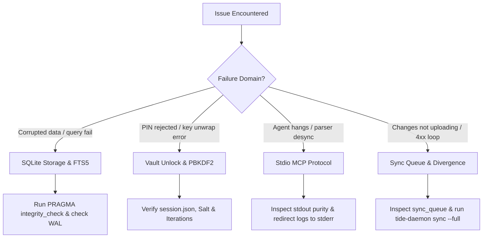

# Tide Core & Daemon Diagnostic and Troubleshooting Playbook

**Document Version:** 1.0.0  
**Target Architecture:** `crates/tide-core`, `crates/tide-daemon`, SQLite Storage, MCP Stdio Server  
**Audience:** Core Rust developers, DevOps, systems engineers, and AI agent integrators  
**Canonical Path:** `core/docs/guides/TROUBLESHOOTING.md`

---

## 1. Architectural Overview & Triage Flowchart

`tide-core` and `tide-daemon` implement an offline-first, zero-knowledge architecture. Local operations occur directly against an embedded SQLite database (`~/.tide/local.db`) in Write-Ahead Logging (WAL) mode. Decryption occurs strictly client-side using symmetric Data Encryption Keys (DEKs) wrapped by a master RSA keypair protected via PBKDF2 key derivation.

When troubleshooting issues across the harness, determine whether the failure resides in the **database/storage layer**, the **cryptographic/vault lifecycle**, the **Stdio MCP 2.0 communication channel**, or the **cloud synchronization queue**.



### Key Storage & Configuration Paths

| Component | Unix / macOS Path | Windows Path | Description |
| :--- | :--- | :--- | :--- |
| **Main Database** | `~/.tide/local.db` | `%USERPROFILE%\.tide\local.db` | Primary SQLite database file |
| **Write-Ahead Log** | `~/.tide/local.db-wal` | `%USERPROFILE%\.tide\local.db-wal` | Active WAL transaction journal |
| **Shared Memory** | `~/.tide/local.db-shm` | `%USERPROFILE%\.tide\local.db-shm` | WAL index shared memory file |
| **Session Cache** | `~/.tide/session.json` | `%USERPROFILE%\.tide\session.json` | Vault salts, wrapped master keys, JWTs |
| **Daemon Logs** | `~/.tide/logs/daemon.log` | `%USERPROFILE%\.tide\logs\daemon.log` | Stderr trace logs (when file logging enabled) |

---

## 2. Diagnostic Commands & Tools

When troubleshooting unexpected behavior or data anomalies, always execute diagnostic queries against `~/.tide/local.db` using the standard `sqlite3` CLI or an administrative connection in `tide-core`.

### 2.1 Verifying SQLite Database Health

Corrupt page headers, missing b-tree leaf nodes, or incomplete writes following an OS crash will trigger `SQLITE_CORRUPT` (error code 11).

#### Full Integrity Check
Scans the entire database schema, index trees, table structures, and page allocation freelists:
```sql
PRAGMA integrity_check;
```
- **Expected Output:** `ok`
- **Error Output:** Returns specific corruption reports (e.g., `Page 42 is never used`, `row 10 missing from index idx_notes_updated_at`).

#### Rapid Quick Check
Performs a fast structural check, omitting index-to-table cross-validation:
```sql
PRAGMA quick_check;
```
- Use `quick_check` in automated startup hooks or container healthchecks where latency is restricted to `< 100ms`.

#### Foreign Key Constraint Verification
Ensures that parent-child relationships (notes, note blocks, links, and tags) have not orphaned rows:
```sql
PRAGMA foreign_key_check;
```
- Any rows returned represent orphaned records that violate relational integrity.

---

### 2.2 Inspecting the Local Sync Queue

The `sync_queue` table acts as the transactional outbox ledger. Stalled, perpetually retrying, or unparseable items can block downstream operations.

#### List Ordered Queue Entries
```sql
SELECT 
    id, 
    entity_type, 
    entity_id, 
    action, 
    status, 
    retry_count, 
    last_error, 
    datetime(created_at/1000, 'unixepoch') AS created_utc,
    datetime(updated_at/1000, 'unixepoch') AS updated_utc
FROM sync_queue 
ORDER BY created_at ASC;
```

#### Identify Poison-Pill Mutations
Find items that have exceeded standard retry thresholds or failed permanently:
```sql
SELECT id, entity_type, entity_id, action, retry_count, last_error 
FROM sync_queue 
WHERE status = 'FAILED' OR retry_count >= 5;
```

#### Queue Volume by State
```sql
SELECT status, COUNT(*) AS total 
FROM sync_queue 
GROUP BY status;
```

---

### 2.3 Checking FTS5 Index Consistency

Tide uses an SQLite FTS5 virtual table (`note_snippets_fts`) for sub-millisecond lexical search, BM25 ranking, and prefix matching. If database crashes occur during raw disk transactions or triggers fail, the FTS shadow b-trees can become unsynchronized with the parent `notes` table.

#### Validate FTS5 Internal Invariants
Run the SQLite FTS5 internal integrity command:
```sql
INSERT INTO note_snippets_fts(note_snippets_fts) VALUES('integrity-check');
```
- If the FTS index is completely intact, the statement executes silently with zero rows affected.
- If inconsistencies exist, SQLite raises: `Error: SQL logic error: fts5: structural error in note_snippets_fts`.

#### Repair & Rebuild Corrupt FTS5 Indexes
To rebuild the inverted index from the canonical `notes` table:
```sql
-- 1. Rebuild the virtual index from underlying content
INSERT INTO note_snippets_fts(note_snippets_fts) VALUES('rebuild');

-- 2. Optimize the internal segment tree
INSERT INTO note_snippets_fts(note_snippets_fts) VALUES('optimize');
```

If manual synchronization is required:
```sql
DELETE FROM note_snippets_fts;
INSERT INTO note_snippets_fts(rowid, note_id, title, content)
SELECT rowid, id, title, content 
FROM notes 
WHERE is_deleted = 0;
```

---

## 3. Common Issues & Remediation Recipes

### 3.1 Recipe 1: Vault Unlock Failures

#### Symptom
Executing `tide-daemon login` or `tide-daemon sync` aborts with errors such as:
- `DecryptionError: Invalid authentication tag`
- `KeyDerivationError: Failed to unwrap RSA private key with derived KEK`
- `Invalid credentials / Session verification failed`

#### Root Causes
1. **Incorrect Master PIN:** The user supplied an incorrect PIN.
2. **Salt Mismatch:** The cryptographic salt in `~/.tide/session.json` was overwritten, corrupted, or altered during file synchronization.
3. **PBKDF2 Iteration Count Discrepancy:**
   - **Modern Standard:** 600,000 iterations (`PBKDF2-HMAC-SHA256`).
   - **Legacy Accounts:** 100,000 iterations (pre-v2.0 migration).
   If a client compiled with the 600k constant attempts to unlock a vault configured with 100k iterations (or vice-versa), key derivation yields an entirely different Key Encryption Key (KEK), leading to immediate AES-GCM tag verification failure.
4. **Session Token Corruption:** Truncated JSON write to `session.json` after an abrupt system termination.

#### Remediation Steps

##### Step 1: Inspect `session.json` Structure
Verify that `~/.tide/session.json` is valid JSON and contains required cryptographic parameters:
```json
{
  "user_id": "usr_94b2e8...",
  "email": "user@example.com",
  "access_token": "eyJhbG...",
  "refresh_token": "rt_71a0...",
  "salt": "base64_encoded_salt==",
  "iterations": 600000,
  "wrapped_master_key": "base64_encoded_ciphertext=="
}
```

##### Step 2: Test Legacy Iteration Fallback
If `iterations` is absent in `session.json`, `tide-core` should attempt dual-phase unlocking:
1. Attempt KEK derivation with `600,000` iterations.
2. Upon tag mismatch, attempt fallback with `100,000` iterations.
3. If the legacy derivation succeeds, re-encrypt the master key envelope using `600,000` iterations and update `session.json`.

##### Step 3: Complete Session Reset & Re-Authentication
If the session file is corrupted, delete the invalid session and trigger a fresh authentication handshake:
```bash
# 1. Back up damaged session for forensics
mv ~/.tide/session.json ~/.tide/session.json.bak

# 2. Re-authenticate via OTP and re-derive keys
tide-daemon login --email user@example.com
```

---

### 3.2 Recipe 2: Database Lock Contention (`SQLITE_BUSY`, Code 5)

#### Symptom
Operations fail with:
```
sqlite3.OperationalError: database is locked (error code 5)
```
Or `tide-daemon` logs indicate: `rusqlite::Error: DatabaseLocked`. The file `local.db-wal` expands into hundreds of megabytes or gigabytes without shrinking.

#### Root Causes
1. **Concurrent Writers / Long Transactions:** A process started an `EXCLUSIVE` or `IMMEDIATE` transaction and suspended or blocked on network I/O.
2. **Missing `busy_timeout`:** A CLI utility or external script opened `~/.tide/local.db` without specifying `PRAGMA busy_timeout = 5000;`.
3. **Passive Checkpoint Starvation:** Continuous active readers prevent SQLite from wrapping the WAL log back to the beginning, resulting in unbounded WAL growth.

#### Remediation Steps

##### Step 1: Terminate Hanging Processes Holding Database Handles
Identify which process is locking `local.db`:

- **Linux / macOS:**
  ```bash
  lsof ~/.tide/local.db
  # or
  fuser ~/.tide/local.db
  ```
- **Windows (PowerShell):**
  ```powershell
  # Using Sysinternals Handle tool if installed
  handle.exe -u "$env:USERPROFILE\.tide\local.db"
  ```
Kill any orphaned `tide-daemon` or MCP subprocesses holding the lock.

##### Step 2: Force WAL Checkpoint Recovery
When no active transactions are executing, force SQLite to truncate the WAL file:
```bash
sqlite3 ~/.tide/local.db "PRAGMA wal_checkpoint(TRUNCATE);"
```
- **Result Schema:** `(busy, log, checkpointed)`
- A successful checkpoint returns `0|0|0`. If the first value is `1`, active read locks are still preventing complete truncation.

##### Step 3: Verify Connection PRAGMAs in Custom Tools
Ensure every connection initialized against `local.db` applies standard Tide connection pragmas:
```sql
PRAGMA journal_mode = WAL;
PRAGMA busy_timeout = 5000;
PRAGMA synchronous = NORMAL;
```

---

### 3.3 Recipe 3: MCP Broken Pipe & Stdio Stream Desynchronization

#### Symptom
AI agent environments (Cursor, Claude Desktop, Antigravity) suddenly disconnect from `tide-daemon`, throw `Unexpected token`, or raise `JSON-RPC Parse Error: Expected object, got string`.

#### Root Causes
1. **Stdout Pollution:** Diagnostic logs, panic backtraces, or debugging `println!` output were emitted to `stdout` instead of `stderr`. The MCP client expects strict line-delimited JSON-RPC 2.0 frames; any extraneous text corrupts the protocol framing.
2. **CRLF vs LF Newline Mismatch on Windows:** Windows terminals or pipelines sending `\r\n` when the JSON-RPC parser expects pure `\n`, or escaping issues with multibyte UTF-8 characters.
3. **Broken Pipe (EPIPE / SIGPIPE):** The host agent closed its pipe, but `tide-daemon` attempted to flush an MCP notification, terminating unexpectedly.

#### Remediation Steps

##### Step 1: Enforce Strict Stderr Routing for Logging
In `crates/tide-daemon`, all `tracing` telemetry and log events must be bound explicitly to `std::io::stderr`:
```rust
// In tide-daemon initialization
tracing_subscriber::fmt()
    .with_writer(std::io::stderr)
    .with_env_filter(EnvFilter::from_default_env())
    .init();
```

##### Step 2: Verify Stdio Cleanliness
Test `tide-daemon` MCP startup from the terminal. The output to `stdout` must be completely silent until a valid JSON-RPC frame is sent to `stdin`:
```bash
# Unix
tide-daemon mcp 2> daemon_debug.log

# Windows PowerShell
tide-daemon.exe mcp 2> daemon_debug.log
```
Send an `initialize` JSON frame:
```json
{"jsonrpc":"2.0","id":1,"method":"initialize","params":{"protocolVersion":"2024-11-05","capabilities":{},"clientInfo":{"name":"test-client","version":"1.0.0"}}}
```
Verify that `daemon_debug.log` contains internal traces, while stdout receives strictly valid JSON-RPC responses.

##### Step 3: Windows Line-Ending Normalization
In `crates/tide-daemon/src/mcp.rs`, ensure line-reading accounts for optional carriage returns:
```rust
let line = raw_line.trim_end_matches(['\r', '\n']);
```

---

### 3.4 Recipe 4: Sync Divergence & Conflict Loops

#### Symptom
- Items remain in `sync_queue` with status `'FAILED'` or `'PENDING'` indefinitely.
- The daemon logs repeated `HTTP 409 Conflict`, `HTTP 422 Unprocessable Entity`, or `HTTP 400 Bad Request`.
- Edits made on remote devices fail to appear locally.

#### Root Causes
1. **Poison-Pill Mutation:** A local change references a deleted note or an invalid payload structure that the cloud API permanently rejects.
2. **High-Water Mark Stagnation:** The client's stored `last_synced_at` cursor is ahead of the server's time due to clock skew, skipping new delta updates.
3. **Stale Lock in Sync State:** A crashed synchronization left records with `status = 'IN_FLIGHT'`.

#### Remediation Steps

##### Step 1: Reset Stuck In-Flight Queue Entries
Reset records stuck in `'IN_FLIGHT'` back to `'PENDING'`:
```sql
UPDATE sync_queue 
SET status = 'PENDING', retry_count = 0 
WHERE status = 'IN_FLIGHT';
```

##### Step 2: Purge or Archive Poison-Pill Items
Inspect failing records and remove persistently un-syncable items:
```sql
-- View errors
SELECT id, entity_type, action, last_error FROM sync_queue WHERE status = 'FAILED';

-- Remove permanently corrupted mutation
DELETE FROM sync_queue WHERE id = 'stuck_queue_uuid';
```

##### Step 3: Force Full Downstream Resynchronization
Execute the full resync command to ignore cached delta high-water marks and re-pull all notes and todos:
```bash
tide-daemon sync --full
```
This forces:
1. Flushing any non-poisonous items from the local `sync_queue`.
2. Setting `updated_after = 0` during the downstream pull.
3. Decrypting and upserting the full catalog of remote documents into `local.db`.

---

## 4. Emergency Data Recovery Playbook

When `tide-daemon` fails to start, cloud connectivity is severed, or key derivation credentials require extraction, use this emergency procedure to extract raw or decrypted notes directly from SQLite.

### 4.1 Safety First: Take a Cold Snapshot
Before running recovery queries or modifying database files, preserve the complete database state:
```bash
# Unix / macOS
mkdir -p ~/.tide/backup_emergency
cp ~/.tide/local.db* ~/.tide/backup_emergency/

# Windows PowerShell
New-Item -ItemType Directory -Force -Path "$env:USERPROFILE\.tide\backup_emergency"
Copy-Item "$env:USERPROFILE\.tide\local.db*" "$env:USERPROFILE\.tide\backup_emergency\"
```

Alternatively, use SQLite's atomic online backup:
```bash
sqlite3 ~/.tide/local.db ".backup ~/.tide/backup_emergency/recovered.db"
```

---

### 4.2 Extracting Notes Stored in Plaintext / Local Cache

If notes were stored in plaintext or decrypted into the local SQLite cache table:

```sql
-- Dump all active notes with ID, Title, and Content into CSV/Text format
.headers on
.mode column
SELECT id, title, datetime(updated_at/1000, 'unixepoch') AS updated_at, content 
FROM notes 
WHERE is_deleted = 0;
```

Export individual notes to disk:
```bash
sqlite3 ~/.tide/local.db "SELECT content FROM notes WHERE id = 'YOUR-NOTE-UUID';" > recovered_note.md
```

---

### 4.3 Direct Decryption of `encrypted_payload` (Zero-Knowledge Fallback)

If the local `content` field is blank and only `encrypted_payload` (AES-256-GCM envelope) exists in SQLite:

1. **Extract Cryptographic Materials:**
   - Retrieve `dek_salt` and `encrypted_payload` from `notes` table.
   - Retrieve `salt`, `iterations`, and `wrapped_master_key` from `session.json`.
2. **Derive KEK with OpenSSL / Python:**
   Run the following standalone recovery script to decrypt the payload using your master PIN:

```python
import base64
import json
import sqlite3
from cryptography.hazmat.primitives.ciphers.aead import AESGCM
from cryptography.hazmat.primitives.kdf.pbkdf2 import PBKDF2HMAC
from cryptography.hazmat.primitives import hashes

# 1. Configuration
PIN = "YOUR_MASTER_PIN"
SESSION_PATH = "~/.tide/session.json"
DB_PATH = "~/.tide/local.db"

# 2. Derive Key Encryption Key (KEK)
with open(SESSION_PATH) as f:
    session = json.load(f)

salt = base64.b64decode(session["salt"])
iterations = session.get("iterations", 600000)

kdf = PBKDF2HMAC(
    algorithm=hashes.SHA256(),
    length=32,
    salt=salt,
    iterations=iterations
)
kek = kdf.derive(PIN.encode("utf-8"))

# 3. Connect to DB and extract notes
conn = sqlite3.connect(DB_PATH)
cursor = conn.cursor()
cursor.execute("SELECT id, title, encrypted_payload FROM notes WHERE encrypted_payload IS NOT NULL")

for note_id, title, payload in cursor.fetchall():
    # Payload format: [12-byte IV] + [Ciphertext] + [16-byte Tag]
    iv = payload[:12]
    ciphertext_and_tag = payload[12:]
    
    aesgcm = AESGCM(kek)
    try:
        decrypted_bytes = aesgcm.decrypt(iv, ciphertext_and_tag, None)
        print(f"=== Successfully recovered note: {note_id} ({title}) ===")
        print(decrypted_bytes.decode("utf-8"))
    except Exception as e:
        print(f"Failed to decrypt note {note_id}: {e}")
```

---

## 5. Diagnostic Quick Reference Cheat Sheet

| Symptom / Task | Tool | Command |
| :--- | :--- | :--- |
| **Integrity Check** | `sqlite3` | `PRAGMA integrity_check;` |
| **FTS5 Invariant Test** | `sqlite3` | `INSERT INTO note_snippets_fts(note_snippets_fts) VALUES('integrity-check');` |
| **FTS5 Full Rebuild** | `sqlite3` | `INSERT INTO note_snippets_fts(note_snippets_fts) VALUES('rebuild');` |
| **Inspect Pending Sync** | `sqlite3` | `SELECT * FROM sync_queue WHERE status = 'PENDING';` |
| **Clear Poison Mutations** | `sqlite3` | `DELETE FROM sync_queue WHERE status = 'FAILED';` |
| **Force WAL Checkpoint** | `sqlite3` | `PRAGMA wal_checkpoint(TRUNCATE);` |
| **Test MCP Stdio** | `tide-daemon` | `tide-daemon mcp 2> stderr.log` |
| **Force Downstream Resync** | `tide-daemon` | `tide-daemon sync --full` |
| **Emergency DB Backup** | `sqlite3` | `sqlite3 ~/.tide/local.db ".backup ~/.tide/backup.db"` |

---
*End of Diagnostic and Troubleshooting Playbook.*
