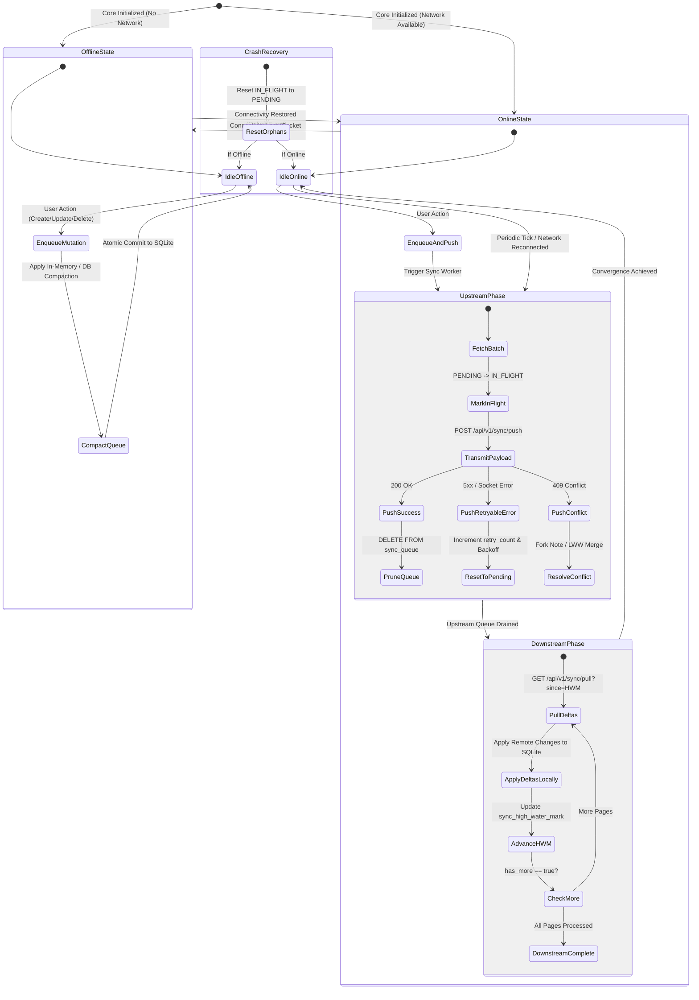

# Tide Offline-First Architecture & Local Convergence Specification

**Document Version:** 1.0.0  
**Target Module:** `crates/tide-core` (`src/db.rs`, `src/sync.rs`, `src/models.rs`)  
**Storage Engine:** Embedded SQLite (`~/.tide/local.db`)  
**Status:** Canonical Architectural Specification  

---

## 1. Executive Summary & The Offline-First Axiom

Traditional client-server applications treat local storage as an ephemeral cache, requiring an active internet connection to validate operations, assign server-authoritative IDs, and confirm writes. In contrast, Tide is built upon the **Offline-First Axiom**:

> **The Offline-First Axiom:**  
> The local SQLite database on the client machine is the primary, authoritative source of truth. The remote cloud infrastructure (`Tide Cloud API /api/v1`) serves as an asynchronous synchronization relay, secondary replica, and disaster recovery target—never as a synchronous gatekeeper for user operations.

```
┌────────────────────────────────────────────────────────────────────────┐
│                        Tide Desktop / CLI Client                       │
│                         (crates/tide-core)                             │
└───────────────────────────────────┬────────────────────────────────────┘
                                    │ Instant Read / Write
                                    │ (Zero Network Latency)
                                    ▼
                 ┌──────────────────────────────────────┐
                 │          Local SQLite DB             │
                 │        (~/.tide/local.db)            │
                 │                                      │
                 │ ┌───────────────┐  ┌───────────────┐ │
                 │ │ Domain Tables │  │  sync_queue   │ │
                 │ │ (notes, etc.) │  │ (Outbox Log)  │ │
                 │ └───────────────┘  └───────────────┘ │
                 └──────────────────┬───────────────────┘
                                    │ Asynchronous Background Sync
                                    │ (When Online)
                                    ▼
                 ┌──────────────────────────────────────┐
                 │           Tide Cloud API             │
                 │         (Convergence Relay)          │
                 └──────────────────────────────────────┘
```

### 1.1 Architectural Guarantees

1. **Zero UI Latency:** Every user action (creating a note, toggling a todo, updating tags, linking blocks) commits to local storage in sub-millisecond SQLite transactions. The interface never displays loading spinners or blocks user input while awaiting a remote response.
2. **Deterministic Offline Operation:** The client operates indefinitely without network connectivity. Full-text search (FTS5), graph traversals (`note_links`), and state reads/writes function identically regardless of connectivity state.
3. **Decoupled Synchronization:** Network dispatch occurs out-of-band via an asynchronous background engine (`crates/tide-core/src/sync.rs`) consuming a persistent transactional outbox (`sync_queue`).
4. **Zero-Knowledge Privacy at Rest and in Transit:** Local data remains protected by application-level envelope encryption (Data Encryption Keys wrapped with user KEKs), and the sync relay processes opaque cryptographic payloads.

---

## 2. Local State Transitions & Transaction Boundaries

To maintain strict consistency and eliminate split-brain states between domain records and pending remote operations, local state transitions follow a strict single-transaction pattern.

### 2.1 The Atomic Dual-Write Pattern

Whenever a user mutates a domain entity, `crates/tide-core` performs both the domain table write and the outbox enqueue inside the **exact same SQLite transaction**:

```
                  ┌────────────────────────────────────────┐
                  │       User Action (CLI / GUI)          │
                  └───────────────────┬────────────────────┘
                                      │
                       BEGIN IMMEDIATE TRANSACTION
                                      │
              ┌───────────────────────┴───────────────────────┐
              ▼                                               ▼
┌───────────────────────────┐                   ┌───────────────────────────┐
│   Write Domain Entity     │                   │  Enqueue Mutation Intent  │
│   (notes / todos / links) │                   │       (sync_queue)        │
└─────────────┬─────────────┘                   └─────────────┬─────────────┘
              │                                               │
              └───────────────────────┬───────────────────────┘
                                      │
                              COMMIT TRANSACTION
                                      │
                    ┌─────────────────┴─────────────────┐
                    ▼                                   ▼
          Local State Persisted                Outbox Item Ready
          (Immediate UI Refresh)               (Background Push)
```

#### Dual-Write Guarantees
- **No Orphaned State:** If SQLite rolls back due to a disk error or constraint violation, neither the domain entity nor the sync queue entry is written.
- **No Phantom Enqueues:** An intent cannot exist in `sync_queue` without its corresponding entity change having been successfully persisted to disk.
- **Crash Invariance:** If the application or OS crashes at any millisecond before the `COMMIT`, SQLite's Write-Ahead Log (WAL) ensures a clean rollback. If the crash occurs after `COMMIT`, both the entity state and the sync queue entry survive reboot.

### 2.2 Transaction Implementation Contract

In `crates/tide-core/src/db.rs`, domain operations wrap state transitions in `rusqlite::Transaction` with `BEGIN IMMEDIATE` to prevent read-upgrade deadlocks:

```rust
// Conceptual transaction boundary in crates/tide-core/src/db.rs
pub fn create_note_atomic(
    conn: &mut rusqlite::Connection,
    note: &NoteRecord,
    sync_entry: &SyncQueueEntry,
) -> Result<(), TideDbError> {
    let tx = conn.transaction_with_behavior(rusqlite::TransactionBehavior::Immediate)?;

    // 1. Write domain record
    tx.execute(
        "INSERT INTO notes (id, title, content_encrypted, folder_id, created_at, updated_at, is_deleted)
         VALUES (?1, ?2, ?3, ?4, ?5, ?6, ?7)",
        rusqlite::params![
            note.id,
            note.title,
            note.content_encrypted,
            note.folder_id,
            note.created_at,
            note.updated_at,
            note.is_deleted,
        ],
    )?;

    // 2. Enqueue sync outbox entry within the exact same transaction
    tx.execute(
        "INSERT INTO sync_queue (id, entity_type, entity_id, action, payload, status, retry_count, created_at, updated_at)
         VALUES (?1, ?2, ?3, ?4, ?5, 'PENDING', 0, ?6, ?6)",
        rusqlite::params![
            sync_entry.id,
            sync_entry.entity_type,
            sync_entry.entity_id,
            sync_entry.action,
            sync_entry.payload,
            sync_entry.created_at,
        ],
    )?;

    // 3. Atomic commit
    tx.commit()?;
    Ok(())
}
```

---

## 3. Mutation Queue Lifecycle & Offline Compaction

The `sync_queue` table acts as a reliable transactional write-ahead log for cloud synchronization.

### 3.1 Outbox Schema (`sync_queue`)

```sql
CREATE TABLE IF NOT EXISTS sync_queue (
    id TEXT PRIMARY KEY NOT NULL,             -- UUID v4 mutation entry identifier
    entity_type TEXT NOT NULL,                 -- 'note' | 'todo' | 'link'
    entity_id TEXT NOT NULL,                   -- Target resource UUID
    action TEXT NOT NULL,                      -- 'CREATE' | 'UPDATE' | 'DELETE'
    payload TEXT,                              -- Serialized JSON snapshot/envelope
    retry_count INTEGER NOT NULL DEFAULT 0,    -- Monotonic attempt counter
    last_error TEXT,                           -- Diagnostic error message from last run
    created_at INTEGER NOT NULL,               -- Monotonic epoch millisecond timestamp
    updated_at INTEGER NOT NULL,               -- Timestamp of last sync attempt
    status TEXT NOT NULL DEFAULT 'PENDING'     -- 'PENDING' | 'IN_FLIGHT' | 'FAILED'
);

CREATE INDEX IF NOT EXISTS idx_sync_queue_status_created 
    ON sync_queue (status, created_at ASC);
CREATE INDEX IF NOT EXISTS idx_sync_queue_entity 
    ON sync_queue (entity_id, created_at ASC);
```

### 3.2 Offline Mutation Compaction & Deduplication

During extended offline periods, a user may edit a note dozens of times, change its title, update tags, or delete a newly created item. Transmitting every intermediate keystroke or state change upstream upon reconnection wastes network bandwidth, degrades battery life, and increases server pressure.

`crates/tide-core` performs **offline queue compaction** prior to batch transmission using algebraic state folding:

| First Queued Action | Subsequent Action | Compacted Action | Behavioral Resolution |
|:-------------------|:-------------------|:-----------------|:----------------------|
| `CREATE`           | `UPDATE`           | `CREATE`         | Overwrite payload with newest state; keep original creation timestamp. |
| `CREATE`           | `DELETE`           | *None (Prune)*   | Delete both records from `sync_queue`. The entity was born and died offline; the server never needs to know. |
| `UPDATE`           | `UPDATE`           | `UPDATE`         | Replace old `UPDATE` payload with newest state; advance `updated_at`. |
| `UPDATE`           | `DELETE`           | `DELETE`         | Replace `UPDATE` with `DELETE`; drop intermediate content payload. |
| `DELETE`           | `CREATE`           | `UPDATE` / Re-create | Entity resurrected with same UUID or treated as new generation. |

#### Compaction Algorithm Invariant
Compaction executes within a local transaction:
```sql
-- Example compaction query for multiple pending UPDATEs on same entity
DELETE FROM sync_queue
WHERE entity_id = ?1 
  AND status = 'PENDING' 
  AND id != ?2; -- Keeps only the latest mutation record with the compacted payload
```

### 3.3 Monotonic Retry Counter & Error Capture

Every mutation attempt tracks its operational health:
- **`retry_count`:** Increments monotonically every time an upstream push returns a non-terminal failure (network timeout, HTTP 500, HTTP 502/503/504).
- **`last_error`:** Stores structured diagnostics, including HTTP response codes, error bodies, or socket timeout descriptions.
- **Exponential Backoff:** The sync worker delays retrying entries using a truncated exponential backoff formula:
  $$\Delta t = \min\left(t_{\text{base}} \times 2^{\text{retry\_count}} + \text{jitter}, \; t_{\text{max}}\right)$$
  Where $t_{\text{base}} = 2\,\text{seconds}$ and $t_{\text{max}} = 300\,\text{seconds}$.
- **Poison Pill Isolation:** If an entry fails with a 4xx client error (e.g., `400 Bad Request` or `422 Unprocessable Entity`), it is transitioned to `status = 'FAILED'`. It will not block subsequent independent mutations in the queue.

---

## 4. Reconnection & Convergence Protocol

When the client transitions from an offline state to an online state, convergence must occur deterministically without data loss or phantom rollbacks.

### 4.1 Strict Flush Order: Upstream Push Before Downstream Pull

To guarantee convergence, the synchronization engine enforces a strict two-phase flush order:

```
[Disconnected] ──► [Online Trigger] ──► [PHASE 1: Push Local Queue] ──► [PHASE 2: Pull Remote Deltas] ──► [Converged]
```

#### Why Push-Before-Pull is Non-Negotiable
If the client pulled remote changes before flushing local mutations:
1. A remote change to note $A$ could overwrite unpushed local modifications made offline to note $A$.
2. The local high-water mark would advance prematurely.
3. Subsequent local pushes could be rejected as stale or generate false conflict branches.

By pushing local outbox items first:
- Local modifications are registered upstream with their monotonic client timestamps.
- Any legitimate conflict is immediately surfaced and resolved before down-syncing.

### 4.2 Phase 1: Upstream Push Execution

1. **Acquire Lock:** Synchronizer acquires exclusive runtime lock to prevent concurrent push workers.
2. **Fetch Batch:** Select up to $N = 50$ records with `status = 'PENDING'` ordered by `created_at ASC`.
3. **Mark In-Flight:** Atomically update selected records to `status = 'IN_FLIGHT'` and record `updated_at`.
4. **Dispatch Upstream:** Send HTTP `POST /api/v1/sync/push` with payload batch:
   ```json
   {
     "client_id": "c7a6e1f0-...",
     "mutations": [
       {
         "mutation_id": "9b1deb4d-...",
         "entity_type": "note",
         "entity_id": "f81d4fae-...",
         "action": "UPDATE",
         "payload": { "...encrypted envelope..." },
         "client_timestamp": 1700000000000
       }
     ]
   }
   ```
5. **Handle Upstream Response:**
   - **`200 OK` (Success):** Delete acknowledged records from `sync_queue` in a single transaction.
   - **`409 Conflict`:** Trigger conflict resolution pipeline (Section 4.4).
   - **`5xx / Transport Failure`:** Revert `status` from `'IN_FLIGHT'` back to `'PENDING'`, increment `retry_count`, and store `last_error`.

### 4.3 Phase 2: Downstream Pull Execution

Once the outbox is clear (or all pending items have been pushed), the client synchronizes remote deltas:

1. **Read Cursor:** Retrieve the local persistent high-water mark timestamp:
   ```sql
   SELECT value FROM app_metadata WHERE key = 'sync_high_water_mark';
   ```
2. **Query Deltas:** Send HTTP `GET /api/v1/sync/pull?since={high_water_mark}&limit=100`.
3. **Apply Changes Locally:** In an atomic transaction:
   - For incoming `CREATE` / `UPDATE`: Insert or update the domain record only if the incoming `updated_at` is newer than the local record's `updated_at`.
   - For incoming `DELETE`: Mark record `is_deleted = 1` (tombstone) or delete according to retention policy.
   - Update `sync_high_water_mark` to the highest timestamp in the received batch.
4. **Repeat Until Exhausted:** If the response contains `has_more: true`, repeat pull phase until caught up.

### 4.4 Conflict Detection & Resolution Strategy

Tide combines **Last-Write-Wins (LWW)** metadata timestamps with **Non-Destructive Forking** for content safety:

1. **Timestamp Comparison:** When an incoming remote update arrives for an entity modified locally:
   - If `remote.updated_at > local.updated_at`: The remote state takes precedence for structural metadata.
2. **Content Conflict Guard (Zero Data Loss):**
   - If both local and remote note content were modified concurrently during network partition:
     - The remote content is applied to the primary note record.
     - The local uncommitted or divergent state is automatically saved as a fork:
       ```
       Title: "Project Notes (Conflicted Copy 2026-11-15)"
       ```
     - A notification is surfaced to the user with a diff summary.
3. **Todo Merging:** Todo lists with discrete block IDs merge additively: completed items stay completed, newly added items are unioned by block UUID.

---

## 5. Resilience Scenarios & Fault Tolerance

The offline-first engine must withstand real-world operational hazards without leaving the local database in an inconsistent state.

### 5.1 Scenario A: Abrupt Process Crash During Sync

**Failure Mode:** The application is killed (`SIGKILL`, task manager termination, kernel panic, or sudden power loss) while a batch of 50 mutations is `IN_FLIGHT`.

```
[Local DB: IN_FLIGHT] ────(Push Sent)────► [Server processing]
         ▲
    PROCESS CRASH!
```

**Recovery Protocol upon Restart:**
1. During initialization (`crates/tide-core/src/db.rs`), the daemon runs an orphan recovery query:
   ```sql
   UPDATE sync_queue 
   SET status = 'PENDING', 
       last_error = 'Process terminated while IN_FLIGHT; reset on startup'
   WHERE status = 'IN_FLIGHT';
   ```
2. **Server-Side Idempotency:** The push payload includes unique `mutation_id` (UUID v4) values. If the server already applied the mutation prior to the crash, the re-push upon reboot is acknowledged idempotently as `200 OK` without duplicating state or records.
3. SQLite WAL recovery automatically cleans up any uncommitted transactions, preserving total database integrity.

### 5.2 Scenario B: Network Interruption Mid-Payload Transmission

**Failure Mode:** The TCP socket drops after the client transmits half the HTTP body, or drops while waiting for the server's HTTP `200 OK` acknowledgment.

```
[Client Core] ───(HTTP POST)───► [Cellular Tower Drops Connection] ───X [Tide Cloud]
      │
 Socket Error: Broken Pipe / Connection Reset
```

**Recovery Protocol:**
1. The HTTP client in `crates/tide-core/src/sync.rs` catches the IO / connection error.
2. The batch transaction reverts:
   ```sql
   UPDATE sync_queue 
   SET status = 'PENDING',
       retry_count = retry_count + 1,
       last_error = 'Connection reset during payload transmission',
       updated_at = ?1
   WHERE id IN (?2, ?3, ...);
   ```
3. The queue remains persistent. The sync worker switches to backoff mode until the system connectivity monitor reports `NetworkStatus::Available`.

### 5.3 Scenario C: Extended Disconnection (Weeks/Months Offline)

**Failure Mode:** The device remains offline for months. Thousands of local edits accumulate. Server tombstones might have expired.

**Recovery Protocol:**
1. **Queue Compaction:** Periodic offline compaction prevents unbound queue growth, collapsing thousands of interim edits into final entity snapshots.
2. **Cursor Invalidation:** If the server detects that the client's `sync_high_water_mark` is older than the server's tombstone retention horizon (e.g., 30 days), the server returns `410 Gone (Cursor Expired)`.
3. **Full State Reconciliation:** The client initiates a reconciliation protocol: pushes all local pending state, then performs a full snapshot download, merging records via UUID matching without wiping local-only uncommitted notes.

---

## 6. Mermaid State Machine: Offline-First Synchronization

The following state machine governs the synchronization engine lifecycle in `crates/tide-core`:



---

## 7. Developer Invariants & Verification Checklist

When contributing code to `crates/tide-core`, engineers must adhere to the following invariants:

- [ ] **Never execute a remote HTTP call before a local DB write.** The local write must succeed first.
- [ ] **Never commit domain state without its corresponding `sync_queue` item.** Both must share the same `rusqlite::Transaction`.
- [ ] **Use UUID v4 for all entity IDs.** Client-generated IDs ensure collision-free local entity creation without remote ID coordination.
- [ ] **Always reset `IN_FLIGHT` queue items on daemon startup.** Prevent stale items from being permanently locked.
- [ ] **Never pull remote deltas before pushing local pending mutations.** Preserve the strict `Push -> Pull` sequence to eliminate overwrite hazards.
- [ ] **Ensure payload encryption is applied before enqueuing.** Plaintext note contents must never touch `sync_queue.payload`.
