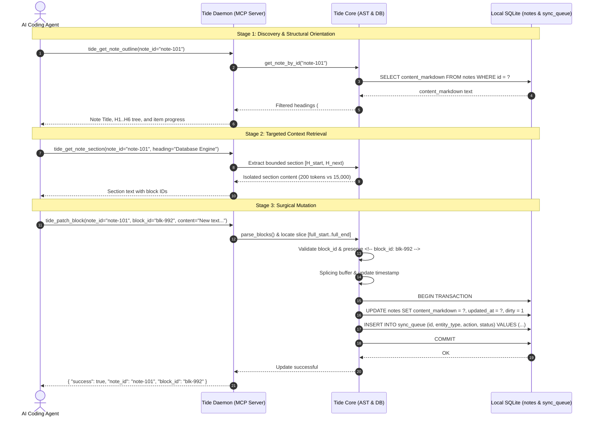

# Tide Block-Level Extraction, Outline Navigation, and Surgical Patching Protocol

**Document Version:** 1.0.0  
**Target Crates:** `crates/tide-daemon/src/mcp.rs`, `crates/tide-core`  
**Target Document Models:** TipTap 3 / ProseMirror JSON AST, Tide Markdown Extended  
**Status:** Canonical Technical Specification  

---

## 1. Architecture Overview

### 1.1 The Failure Mode of Full-Document Rewriting
Autonomous AI agents interacting with personal knowledge bases face severe failure modes when restricted to whole-document reading and rewriting (`GET /note`, `PUT /note`):

1. **Context Window Exhaustion:** A typical 30-page engineering design document or journal note consumes between 8,000 and 25,000 tokens. Loading entire documents into the agent context for small edits rapidly exhausts prompt budgets and inflates API costs.
2. **Hallucinatory Truncation & Silent Erasure:** Large Language Models instructed to emit an entire updated document frequently truncate later sections, summarize paragraphs they were not asked to edit, strip inline media, or drop complex syntax (e.g., custom code blocks or LaTeX formulas).
3. **Concurrent Mutation Collisions:** If a user edits paragraph A while an agent is rewriting paragraph B, coarse-grained document replacement overwrites user input.
4. **Local Sync Engine & CRDT Bloat:** In an offline-first architecture, pushing full document snapshots for every typo modification generates excessive tombstone overhead, bloats diff histories, and causes unnecessary network egress.

### 1.2 Surgical Block-Level Philosophy
Tide addresses this by treating every note not as a monolithic string of characters, but as an **acyclic, ordered tree of uniquely identified block nodes**.

```
+---------------------------------------------------------------------------------+
|                                 Note Document                                   |
+---------------------------------------------------------------------------------+
       |
       +---> [H1 Heading]            (blockId: "blk-01", level: 1)
       |
       +---> [Paragraph]             (blockId: "blk-02", text: "Overview...")
       |
       +---> [H2 Heading]            (blockId: "blk-03", level: 2)
       |        |
       |        +---> [TaskList]     (blockId: "blk-04")
       |        |        +---> [TaskItem] (blockId: "blk-05", checked: false)
       |        |        +---> [TaskItem] (blockId: "blk-06", checked: true)
       |        |
       |        +---> [CodeBlock]    (blockId: "blk-07", lang: "rust")
       |
       +---> [H2 Heading]            (blockId: "blk-08", level: 2)
                |
                +---> [Paragraph]    (blockId: "blk-09", text: "Conclusion...")
```

Under this protocol:
- **Navigation is Hierarchical:** Agents read the structural skeleton (`tide_get_note_outline`) at minimal token cost.
- **Reading is Zoomed:** Agents extract only the section (`tide_get_note_section`) or localized sliding window (`tide_get_focused_blocks`) relevant to their immediate goal.
- **Mutation is Surgical:** Agents patch target blocks in-place (`tide_patch_block`) using persistent UUIDs (`attrs.blockId`), leaving 99% of the document byte-for-byte untouched.

---

## 2. Document AST Parsing & Block Identification

Tide supports a dual representation of documents:
1. **TipTap 3 / ProseMirror JSON AST:** The authoritative in-memory and web-client rich text format.
2. **Tide Markdown Extended:** The serialized, human-readable storage format stored in SQLite (`notes.content_markdown`) and exported to files.

### 2.1 ProseMirror / TipTap AST Schema
A ProseMirror document root node has type `"doc"` with a linear array of top-level children in `"content"`.

```json
{
  "type": "doc",
  "content": [
    {
      "type": "heading",
      "attrs": {
        "level": 1,
        "blockId": "550e8400-e29b-41d4-a716-446655440000"
      },
      "content": [
        { "type": "text", "text": "Storage Architecture" }
      ]
    },
    {
      "type": "paragraph",
      "attrs": {
        "blockId": "6ba7b810-9dad-11d1-80b4-00c04fd430c8"
      },
      "content": [
        { "type": "text", "text": "Tide stores data locally in SQLite using WAL mode." }
      ]
    }
  ]
}
```

### 2.2 Recognized Block Node Types
The parser identifies and assigns block identities to the following node classifications:

| Node Type | Level | ProseMirror Attributes | Content Children | Markdown Equivalent |
| :--- | :--- | :--- | :--- | :--- |
| `heading` | Leaf Block | `level: 1..6`, `blockId: UUID` | Inline Nodes (`text`, `marks`) | `# Heading` to `###### Heading` |
| `paragraph` | Leaf Block | `blockId: UUID` | Inline Nodes (`text`, `marks`) | Plain text paragraph followed by `\n\n` |
| `codeBlock` | Leaf Block | `language: string`, `blockId: UUID` | Raw Text | ````lang ... ```` |
| `blockquote` | Container | `blockId: UUID` | Block Nodes (`paragraph`, etc.) | `> Quote line` |
| `bulletList` | Container | `blockId: UUID` | `listItem` nodes | `- Item` or `* Item` |
| `orderedList` | Container | `order: number`, `blockId: UUID` | `listItem` nodes | `1. Item` |
| `taskList` | Container | `blockId: UUID` | `taskItem` nodes | `- [ ]` or `- [x]` |
| `taskItem` | Item Block | `checked: bool`, `blockId: UUID` | Inline / Block Nodes | `- [ ] Task content` |

### 2.3 The Block Identity Invariant (`attrs.blockId`)
Every block node must satisfy the following strict invariants:
1. **Universally Unique & Stable:** A `blockId` is a 128-bit UUID (version 4) formatted as a canonical lowercase string (e.g., `"f47ac10b-58cc-4372-a567-0e02b2c3d479"`).
2. **Immutability Under Edit:** Editing the text, marks, or child nodes within a block *never* changes its `blockId`.
3. **No Collision Guarantee:** A `blockId` cannot appear more than once within the same document tree. Duplicate IDs detected during parsing are rejected or regenerated during sanitization.

### 2.4 Markdown Comment Serialization
When notes are stored or projected as Markdown, block IDs and metadata are persisted using standard HTML comments:

```markdown
<!-- block_id: 550e8400-e29b-41d4-a716-446655440000 -->
# Storage Architecture

<!-- block_id: 6ba7b810-9dad-11d1-80b4-00c04fd430c8 -->
Tide stores data locally in SQLite using WAL mode.

<!-- block_id: a1c3d5e7-1111-2222-3333-444455556666 -->
<!-- ai-focus -->
- [ ] Implement incremental page indexing
- [x] Configure SQLite pragma mmap_size
```

The daemon parser in `crates/tide-daemon/src/mcp.rs` (`parse_blocks`) matches both:
- `<!-- block_id: <uuid> -->`
- `<div data-block-id="<uuid>">`

It recognizes preceding or succeeding `<!-- ai-focus -->` annotations to tag blocks under active consideration.

---

## 3. The Heading Outline Protocol

The outline protocol enables an LLM agent to orient itself within large documents with near-zero token overhead.

### 3.1 Outline Generation (`tide_get_note_outline`)
When `tide_get_note_outline` is invoked with a `note_id`, the daemon reads the note content and extracts only the headings and checklist progress:

```rust
// crates/tide-daemon/src/mcp.rs
let mut outline = Vec::new();
outline.push(format!("Note: {} (ID: {})", note.title, note.id));
outline.push("Headings & Checklist items:".to_string());
for line in note.content_markdown.lines() {
    let trimmed = line.trim();
    if trimmed.starts_with('#') || trimmed.starts_with("- [ ]") || trimmed.starts_with("- [x]") {
        outline.push(format!("  {}", trimmed));
    }
}
```

#### Output Example
```text
Note: Infrastructure Roadmap (ID: 550e8400-e29b-41d4-a716-446655440000)
Headings & Checklist items:
  # System Architecture
  ## Database Layer
  - [x] Configure WAL mode
  - [ ] Set up backup replication
  ## Network Ingress
  ### TLS Termination
  - [ ] Rotate certificates
```

### 3.2 Hierarchical Section Boundaries (`tide_get_note_section`)
A note section is mathematically defined as the semi-open range $[H_{\text{start}}, H_{\text{next}})$, where:
- $H_{\text{start}}$ is the matched heading of level $L$.
- $H_{\text{next}}$ is the first subsequent heading in the document where $\text{level}(H_{\text{next}}) \le L$.
- If no subsequent heading with level $\le L$ exists, $H_{\text{next}} = \text{EOF}$.

```
Heading Tree Representation:
--------------------------------------------------------------------
# Overview (Level 1)
  Text A...
  ## Component 1 (Level 2)               <-- Section "Component 1" Begins
    Text B...
    ### Sub-detail 1.1 (Level 3)         <-- Included (Level 3 > Level 2)
      Text C...
  ## Component 2 (Level 2)               <-- Section "Component 1" Terminates!
    Text D...
# Summary (Level 1)                      <-- Terminates all previous
--------------------------------------------------------------------
```

#### Section Boundary Algorithm
```rust
let mut section_lines = Vec::new();
let mut capturing = false;
let mut target_level: Option<usize> = None;

for line in note.content_markdown.lines() {
    let trimmed = line.trim();
    if trimmed.starts_with('#') {
        let level = trimmed.chars().take_while(|&c| c == '#').count();
        if trimmed.contains(target_heading) && !capturing {
            capturing = true;
            target_level = Some(level);
            section_lines.push(line);
            continue;
        } else if capturing {
            if let Some(tl) = target_level {
                if level <= tl {
                    // Next heading of equal or higher hierarchy reached: terminate
                    break;
                }
            }
        }
    }
    if capturing {
        section_lines.push(line);
    }
}
```

This guarantees that sub-sections (e.g., an H3 or H4 beneath an H2) remain fully intact inside the extracted section payload, while sibling or parent sections are excluded.

---

## 4. Block Mutation Protocol (`tide_patch_block`)

`tide_patch_block` implements deterministic, in-place surgical replacement of target blocks.

### 4.1 Invocation Schema
```json
{
  "name": "tide_patch_block",
  "arguments": {
    "note_id": "e5f1b2c3-9821-4f12-9c3a-d68a9f243011",
    "block_id": "blk-992-para",
    "content": "The storage engine utilizes SQLite with WAL mode and memory-mapped I/O."
  }
}
```

### 4.2 Invariant Preservation Checklist
During execution, the patching engine strictly enforces the following rules:

1. **Identity Retention:** The original `block_id` MUST be preserved. If the client passes raw Markdown without comment anchors, the engine automatically re-wraps the replacement content with `<!-- block_id: <original_id> -->`.
2. **Anchor Sanitization:** If the client provides explicit opening/closing markup or comment wrappers, the engine validates that the client did not introduce a conflicting UUID.
3. **Marker Preservation:** If the target block was tagged with `<!-- ai-focus -->` and the replacement does not mention it, the engine preserves the focus tag to keep agent tracking stable.
4. **Surrounding Block Invariance:** Byte indices outside `[full_start..full_end]` remain bit-exact. No reformatting, indent alterations, or whitespace changes are applied to sibling blocks.
5. **Parent Structural Integrity:** When replacing a block inside a list or quote, list markers (e.g. `- `, `1. `) or quote prefixes (`> `) are maintained according to block boundaries.

### 4.3 In-Memory Patch & Storage Commit
```rust
// 1. Locate block bounds within note
let block = find_block_by_id(&note.content_markdown, block_id)
    .ok_or("Block not found")?;

// 2. Synthesize clean replacement with block metadata preserved
let mut replacement = format!("<!-- block_id: {} -->", block_id);
if block.is_focused && !new_content.contains("ai-focus") {
    rep.push_str("\n<!-- ai-focus -->");
}
rep.push('\n');
rep.push_str(new_content.trim());

// 3. Splice byte buffer
let mut updated = String::with_capacity(note.content_markdown.len() + replacement.len());
updated.push_str(&note.content_markdown[..block.full_start]);
updated.push_str(&replacement);
updated.push_str(&note.content_markdown[block.full_end..]);
note.content_markdown = updated;

// 4. Update timestamps & marks
let now = SystemTime::now().duration_since(UNIX_EPOCH).unwrap().as_secs() as i64;
note.updated_at = now;
note.dirty = true;

// 5. Transactional commit & sync queue insertion
db.upsert_note(&note)?;
```

### 4.4 Local Transaction & Sync Integration
When `db.upsert_note(&note)` runs:
1. SQLite updates the row in table `notes` inside an immediate transaction.
2. Full-text search tables (`note_snippets_fts`) and link tables (`note_links`) are updated via SQLite triggers or synchronous hooks.
3. An entry is queued in `sync_queue` with `action = 'UPDATE'` and `status = 'PENDING'`.
4. Downstream offline synchronization engines safely encrypt and stream only the modified note state.

---

## 5. Context-Aware Block Retrieval (`tide_get_focused_blocks`)

Agents often need more than an isolated single block to understand phrasing, tone, and logical transitions. `tide_get_focused_blocks` implements a **sliding context window**.

### 5.1 Focused Block Tagging
Blocks are marked as focused in one of two ways:
1. **Interactive Focus:** The user UI sets an `ai-focus` attribute or comment on the block currently under cursor/selection.
2. **Explicit Anchor:** Document templates or agent workflows inject `<!-- ai-focus -->` above the block requiring attention.

### 5.2 Sliding Window Extraction Model
Given an ordered sequence of blocks in a note:
$$B = [b_0, b_1, b_2, \dots, b_k, \dots, b_{n-1}]$$

If block $b_k$ is tagged with focus, the retrieval window for context radius $N$ (default $N = 2$) is computed as:
$$\text{Window}(b_k, N) = [b_{\max(0, k - N)}, \dots, b_k, \dots, b_{\min(n - 1, k + N)}]$$

```
+------------+     +------------+     +-------------------+     +------------+     +------------+
| Block k-2  | --> | Block k-1  | --> | Block k [FOCUSED] | --> | Block k+1  | --> | Block k+2  |
| (Sibling)  |     | (Preceding)|     | (Target Mutation) |     | (Succeeding|     | (Sibling)  |
+------------+     +------------+     +-------------------+     +------------+     +------------+
|<------------------------------ Sliding Context Window (N = 2) ------------------------------>|
```

### 5.3 Overlapping Window Deduplication
When multiple focused blocks exist in close proximity (e.g., $b_3$ and $b_5$), their sliding windows are unified into a contiguous interval:
$$\text{Merged Window} = [b_{\max(0, 3 - 2)}, \dots, b_{\min(n - 1, 5 + 2)}] = [b_1, \dots, b_7]$$

This avoids emitting redundant duplicate blocks in the tool response.

---

## 6. End-to-End Protocol Flow

The following sequence details how an AI agent uses the Block Protocol to discover, inspect, and patch a specific section of a note without ever downloading or rewriting the entire document.



---

## 7. Edge Cases & Error Handling

### 7.1 Target Block Not Found
- **Condition:** `block_id` does not exist in the target document.
- **MCP Response:**
  ```json
  {
    "success": false,
    "error": "Block with ID 'blk-invalid-uuid' not found in note 'note-101'"
  }
  ```
- **Agent Action:** Re-request `tide_get_note_outline` or `tide_get_note_section` to refresh block identifiers.

### 7.2 Empty or Corrupted Documents
- If a note is empty or contains no block anchors, the daemon wraps new content into a new block ID (`Uuid::new_v4()`).
- If invalid UTF-8 or malformed HTML comments are detected, comments without matching closing tags `-->` are safely ignored, preventing buffer out-of-bounds panics.

### 7.3 Multi-Block Replacement
- When an agent provides content that contains multiple paragraphs into `tide_patch_block`, the engine preserves the original `block_id` on the first paragraph and generates unique sequential `block_id` tags for subsequent paragraphs.

### 7.4 Zero-Knowledge Encryption Transparency
- All block extraction and patching operations execute entirely within the local daemon process using decrypted memory.
- At no point during block traversal are plaintext AST nodes leaked to remote network endpoints.
- Synchronization with the Tide Cloud relay occurs asynchronously through `sync_queue` using AES-256-GCM envelope encryption.
