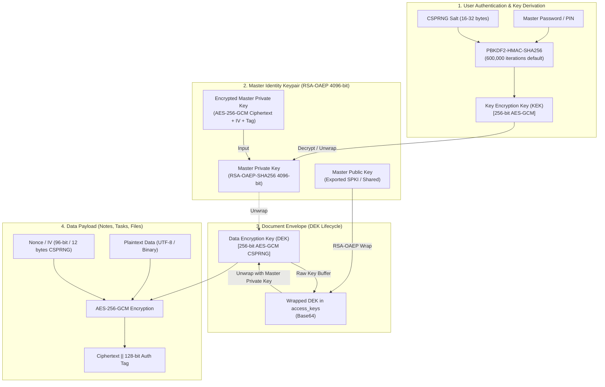

# Cryptographic Specification: Zero-Knowledge Envelope Encryption

- **Document Version:** 2.0.0
- **Status:** Canonical Specification & Architecture Standard
- **Target Modules:**
  - Rust Core: `crates/tide-core/src/crypto.rs` (`tide-core`)
  - Web Client: `web/src/lib/cryptoV2.ts` & `web/src/lib/crypto.ts` (Web Crypto API)
- **Security Paradigm:** Client-side Zero-Knowledge Architecture (End-to-End Encrypted)

---

## 1. Executive Summary & Security Philosophy

Tide implements a zero-knowledge, end-to-end encrypted (E2EE) data protection model. The central server (and any intermediary storage infrastructure) is treated as an untrusted coordinator. The server only ever stores and distributes encrypted blobs and wrapped cryptographic keys.

### Core Security Guarantees
1. **Confidentiality:** Plaintext data (notes, tasks, attachments, metadata) is encrypted client-side using unique symmetric keys before transmission.
2. **Authenticity & Integrity:** All encrypted payloads use Authenticated Encryption with Associated Data (AEAD) to prevent undetected bit-flipping, truncation, or ciphertext manipulation.
3. **Multi-User Sharing without Key Compromise:** Sharing documents between users utilizes asymmetric envelope encryption. A user never shares their master private key or personal password; instead, document-specific keys are re-wrapped for recipients.
4. **Defense in Depth (Double Wrapping):** Sensitive documents support optional secondary password protection. In this mode, the symmetric key is double-wrapped—first under a password-derived key, then under the asymmetric recipient key.
5. **Cross-Platform Cryptographic Parity:** Cryptographic operations in the Rust native core (`crates/tide-core/src/crypto.rs`) and web client (`web/src/lib/cryptoV2.ts`) are 100% byte-compatible and interchangeable.

---

## 2. Key Hierarchy & Architecture

The Tide key hierarchy divides responsibilities into key derivation, identity wrapping, document wrapping, and payload encryption.

### 2.1 Key Hierarchy Diagram



### 2.2 Text / ASCII Key Hierarchy Overview

```text
[Master Password / PIN]
         │
         ▼
 +──────────────────────────────────────────────────────+
 │ PBKDF2-HMAC-SHA256 (600,000 iterations, 16-byte salt) │
 +──────────────────────────────────────────────────────+
         │
         ▼
 [Derived KEK: 256-bit AES-GCM Key]
         │
         ▼ (Unwraps Master Private Key using AES-256-GCM)
 [Master RSA Keypair: RSA-OAEP 4096-bit, SHA-256]
  ├── Public Key: Published to server / directory for inbound sharing
  └── Private Key: Held in memory (non-extractable / zeroized on drop)
         │
         ▼ (Unwraps per-document DEK)
 [Document Encryption Key (DEK): 256-bit AES-GCM]
         │
         ▼ (Encrypts/Decrypts entity payload)
 [Plaintext Entity: Notes, Tasks, Attachments]
```

---

## 3. Data Encryption Key (DEK) Lifecycle

Each encryptable entity (note, task, attachment, list) possesses its own distinct Data Encryption Key (DEK).

### 3.1 DEK Generation
- **Algorithm:** AES-GCM (Symmetric).
- **Key Length:** 256 bits (32 bytes).
- **Entropy Source:** Cryptographically Secure Pseudorandom Number Generator (CSPRNG):
  - Rust: `rand::rngs::OsRng` or `ring::rand::SystemRandom`.
  - Web: `window.crypto.getRandomValues(new Uint8Array(32))` or `window.crypto.subtle.generateKey`.
- **Properties:**
  - Ephemeral during document creation; once exported and wrapped, the plaintext DEK is securely wiped or held strictly in transient memory.
  - Never persisted directly in plaintext to disk, LocalStorage, IndexedDB, or server databases.

### 3.2 Payload Encryption & Nonce Management
- **Cipher:** AES-256-GCM (Galois/Counter Mode) providing AEAD.
- **Nonce / IV (Initialization Vector):**
  - **Length:** 96 bits (12 bytes), strictly conforming to NIST SP 800-38D recommendations.
  - **Generation:** Fresh CSPRNG random generation for every individual encryption operation.
  - **Collision Resistance:** In AES-GCM, reusing an IV with the same key catastrophically breaks authenticity and confidentiality (recovering the GHASH authenticator key). Because each document has a unique DEK and nonces are generated via 96-bit CSPRNG, birthday-bound probability of IV collision is negligible ($< 2^{-32}$ for $2^{16}$ writes under a single DEK).
- **Authentication Tag:**
  - **Length:** 128 bits (16 bytes).
  - **Behavior:** The tag authenticates both the ciphertext and any optional Additional Authenticated Data (AAD). If verification fails during decryption, the operation aborts immediately and no plaintext is returned.

### 3.3 DEK Destruction & Zeroization
- **Rust Implementation:** DEK buffers and private key material implement the `zeroize::Zeroize` and `zeroize::ZeroizeOnDrop` traits, clearing memory with zeroes on scope exit.
- **Web Implementation:** Keys are imported with `extractable: false` when kept in application state, preventing script exfiltration via devtools or memory dumps where browser engine protections apply.

---

## 4. Envelope Encryption & Multi-User Sharing

Tide eliminates the need to distribute shared master keys by employing asymmetric envelope encryption.

### 4.1 Master Identity Keys
- **Algorithm:** RSA-OAEP (Optimal Asymmetric Encryption Padding).
- **Key Parameters:**
  - Modulus Size: 4096 bits.
  - Public Exponent: $65537$ (`0x010001`).
  - Hash Function: SHA-256 (for OAEP MGF1 and digest).
  - Label: Empty byte string (`""`).

### 4.2 The `access_keys` Map Format
When an entity is encrypted, its DEK is wrapped individually for each authorized user. The resulting wrapped keys are stored in a key-value dictionary serialized as JSON:

```typescript
export interface AccessKeysMap {
    [userID: string]: {
        wrapped_key: string; // Base64-encoded wrapped DEK (RSA-OAEP or AES-GCM)
        pwd_iv?: string;      // Base64-encoded 96-bit IV (used if double-wrapped)
    };
}
```

### 4.3 Multi-User Sharing Workflow
1. **Access Granting (Owner Action):**
   - User A (Owner) reads their own `access_keys[UserA.id]`.
   - User A unwraps the DEK using their RSA-OAEP private key.
   - User A fetches the recipient's (User B) public RSA-OAEP key from the server directory.
   - User A wraps the raw DEK using User B's public key (`RSA-OAEP-256`).
   - User A adds `access_keys[UserB.id] = { wrapped_key: base64(wrapped_dek) }` to the entity metadata and submits the updated metadata to the server.
   - **Crucial Invariant:** The actual ciphertext of the note/task is *not* re-encrypted; only the DEK is wrapped for the new recipient.

2. **Access Revocation:**
   - To revoke User B's access, User A generates a **new DEK** ($DEK_{new}$), re-encrypts the entity payload, wraps $DEK_{new}$ for remaining authorized users, removes User B from `access_keys`, and uploads the new ciphertext. This guarantees forward secrecy against revoked members.

### 4.4 Double-Wrapping (Custom Entity Password / PIN)
When a user sets a distinct custom password on a specific note or folder:
1. A fresh 16-byte random salt is generated (`pwd_salt`).
2. A password KEK (`pwdKey`) is derived via PBKDF2-HMAC-SHA256 (600,000 iterations).
3. **Inner Wrap (AES-256-GCM):** The raw DEK is encrypted with `pwdKey` using a unique 96-bit IV (`pwd_iv`).
4. **Outer Wrap (RSA-OAEP):** The resulting inner ciphertext is then wrapped with the user's Master Public Key.
5. **Decryption Sequence:**
   - First, unwrap outer layer using Master Private Key -> yields inner ciphertext.
   - Check `metadata.has_custom_password === true`.
   - Prompt user for password -> derive `pwdKey` using `metadata.pwd_salt`.
   - Unwrap inner layer using `pwdKey` and `pwd_iv` -> yields plaintext DEK.
   - Decrypt document content with DEK.

---

## 5. Password Stretching & KDF Specifications

### 5.1 PBKDF2-HMAC-SHA256 Standard Parameters
- **Pseudorandom Function (PRF):** HMAC with SHA-256.
- **Default Iterations:** `600,000` iterations.
  - Selected to align with OWASP Password Storage Cheat Sheet recommendations (minimum 600,000 for PBKDF2-HMAC-SHA256).
- **Legacy Fallback Iterations:** `100,000` iterations.
  - Retained exclusively to decrypt accounts created under early Tide V1 clients. Upgraded on successful authentication.
- **Salt Generation:**
  - Length: Minimum 16 bytes (128 bits), recommended 32 bytes (256 bits).
  - Source: CSPRNG (`crypto.getRandomValues` / `OsRng`).
  - Storage: Stored alongside the encrypted private key or metadata as standard Base64.
- **Key Output Length:** 256 bits (32 bytes) for AES-256-GCM KEK.

### 5.2 Password Stretching Evolution: PBKDF2 vs. Argon2id
While PBKDF2-HMAC-SHA256 is currently the baseline due to native availability in the Web Crypto API (`window.crypto.subtle`), `tide-core` supports transitioning to **Argon2id**:

| Parameter | PBKDF2-HMAC-SHA256 (Current Default) | Argon2id (V2 Extension / Native Core) |
| :--- | :--- | :--- |
| **Primary Defense** | CPU execution time | Memory hardness + CPU time |
| **GPU / ASIC Resistance** | Moderate (parallelizable on custom silicon) | High (memory bandwidth bottleneck) |
| **Web Browser Support** | Native (`SubtleCrypto`, hardware-accelerated) | Requires WebAssembly (Wasm) |
| **Standard Parameters** | Iterations: 600,000, Digest: SHA-256 | $m=64\text{ MB}$, $t=3\text{ passes}$, $p=4\text{ lanes}$ |
| **Salt Size** | 16 bytes (128 bits) | 16 or 32 bytes |
| **Specification Ref** | RFC 8018 / PKCS #5 v2.1 | RFC 9106 |

---

## 6. Binary Wire Format & Serialization Standards

Tide specifies two canonical serialization representations for cryptographic payloads: **JSON Envelope (V2 Web Format)** and **Packed Binary Format (High-Performance Wire Format)**.

### 6.1 JSON Envelope Format (Web & Storage Standard)

Used for document storage and client-server REST/JSON synchronization.

#### 1. Content Payload (`content_ciphertext`)
```json
{
  "data": "aGVsbG8gd29ybGQ...==", 
  "iv": "dGVzdG5vbmNlMTI="
}
```
- `data`: Base64-encoded string representing `Ciphertext || Authentication_Tag` (Standard Web Crypto output where the 16-byte tag is concatenated to the end of the ciphertext).
- `iv`: Base64-encoded 96-bit (12-byte) initialization vector.

#### 2. Encrypted DEK Object (`encrypted_dek`)
```json
{
  "wrapped_key": "UlNBLU9BRVAtQ0lQSEVSVEVYVA==...",
  "pwd_iv": "MTJieXRlcG5vbmNl" 
}
```
- `wrapped_key`: Base64-encoded ciphertext of the wrapped DEK.
- `pwd_iv`: Optional Base64-encoded 12-byte IV for double-wrapped custom passwords.

#### 3. Master Encrypted Private Key (`EncryptedPrivateKey`)
```json
{
  "salt": "c2FsdDE2Ynl0ZXNsaWNl...",
  "iv": "MTJieXRlc2l2MTI=",
  "ciphertext": "YWVzMjU2Z2NtZW5jcnlwdGVk..."
}
```

### 6.2 Packed Binary Wire Format (Compact Format)

For attachments, large blobs, or internal binary stream transport, Tide uses a contiguous packed layout:

```text
+-----------------------+----------------------------------+-----------------------+
|  IV / Nonce (12 Bytes)|       Ciphertext (N Bytes)       |  Auth Tag (16 Bytes)  |
+-----------------------+----------------------------------+-----------------------+
 0                     11 12                             N+11 N+12                N+27
```

- **Offset 0..11:** 12-byte (96-bit) CSPRNG GCM Nonce.
- **Offset 12..N+11:** Raw AES-GCM Ciphertext ($N$ bytes, identical length to plaintext).
- **Offset N+12..N+27:** 16-byte (128-bit) GCM Authentication Tag.
- **Total Overhead:** Exactly 28 bytes ($12 + 16$).
- **Encoding Rule:** If transmitted over text protocols, the entire packed byte buffer is encoded with Standard Base64 (RFC 4648 with `=` padding).

---

## 7. Strict Parity Checklist: Rust (`tide-core`) vs. Web (`cryptoV2.ts`)

To ensure seamless multi-platform operation (e.g., Desktop Tauri / Mobile Core in Rust, Web Client in TypeScript), implementations must adhere to the following parity mapping:

| Cryptographic Operation | Rust Native (`crates/tide-core/src/crypto.rs`) | Web Client (`web/src/lib/cryptoV2.ts` / `crypto.ts`) | Parity Validation Requirement |
| :--- | :--- | :--- | :--- |
| **DEK Generation** | `aes_gcm::Aes256Gcm::generate_key(&mut OsRng)` | `crypto.subtle.generateKey({ name: "AES-GCM", length: 256 }, ...)` | Generates 32 random bytes from OS entropy. |
| **Payload Encryption** | `Aes256Gcm::encrypt(nonce, payload)` | `crypto.subtle.encrypt({ name: "AES-GCM", iv }, key, data)` | Output byte buffer is `Ciphertext || 16-byte Tag`. Nonce is 12 bytes. |
| **Payload Decryption** | `Aes256Gcm::decrypt(nonce, payload_with_tag)` | `crypto.subtle.decrypt({ name: "AES-GCM", iv }, key, buffer)` | Rejects with error if Tag validation fails; zero plaintext leaked on error. |
| **RSA Keypair Gen** | `rsa::RsaPrivateKey::new(&mut OsRng, 4096)` | `crypto.subtle.generateKey({ name: "RSA-OAEP", modulusLength: 4096, ... })` | Modulus: 4096, Exponent: 65537, SHA-256 digest. |
| **Private Key Export** | `rsa::pkcs8::EncodePrivateKey::to_pkcs8_der()` | `crypto.subtle.exportKey("pkcs8", key)` | DER-encoded PKCS#8 format. |
| **Public Key Export** | `rsa::pkcs8::EncodePublicKey::to_public_key_der()` | `crypto.subtle.exportKey("spki", key)` | DER-encoded SubjectPublicKeyInfo (SPKI). |
| **RSA-OAEP Wrap** | `rsa::Oaep::new::<sha2::Sha256>()` encryption | `crypto.subtle.encrypt({ name: "RSA-OAEP" }, pubKey, dek)` | OAEP padding with SHA-256 for both digest and MGF1. Empty label. |
| **RSA-OAEP Unwrap** | `rsa::Oaep::new::<sha2::Sha256>()` decryption | `crypto.subtle.decrypt({ name: "RSA-OAEP" }, privKey, wrappedDek)` | Constant-time padding verification to prevent Manger/Bleichenbacher timing attacks. |
| **Password KDF** | `pbkdf2::pbkdf2_hmac::<sha2::Sha256>(pwd, salt, 600000, &mut key)` | `crypto.subtle.deriveKey({ name: "PBKDF2", salt, iterations: 600000, hash: "SHA-256" }, ...)` | Produces identical 32-byte derived key for identical password, salt, and iterations. |
| **Base64 Encoding** | `base64::engine::general_purpose::STANDARD` | `btoa` / custom `arrayBufferToBase64` (RFC 4648 with padding) | Strict standard Base64 string format with trailing padding. |

---

## 8. Security Invariants & Audit Guidelines

Developers and contributors touching `tide-core` or `web/src/lib/` must adhere to these non-negotiable invariants:

1. **No Hardcoded Nonces:** A hardcoded, constant, or repeated IV under the same key is a critical security vulnerability. All nonces must be drawn from a cryptographic RNG at execution time.
2. **No Unauthenticated Encryption:** Plain AES-CTR, AES-CBC without HMAC, or unverified ciphertexts are strictly forbidden. All symmetric encryption must be AES-256-GCM.
3. **Constant-Time Verification:** Any token, signature, or tag verification implemented outside WebCrypto must use constant-time comparison (e.g., `subtle::ConstantTimeEq` in Rust) to eliminate timing side-channels.
4. **Zeroization:** In Rust, all key structures holding decrypted material must implement memory wiping on drop. In TypeScript, keys must be held as non-extractable `CryptoKey` objects wherever possible.
5. **No Secrets in Logs:** Plaintext passwords, derived KEKs, unencrypted DEKs, or private keys must never be passed to `console.log`, `tracing`, or error exception strings.
