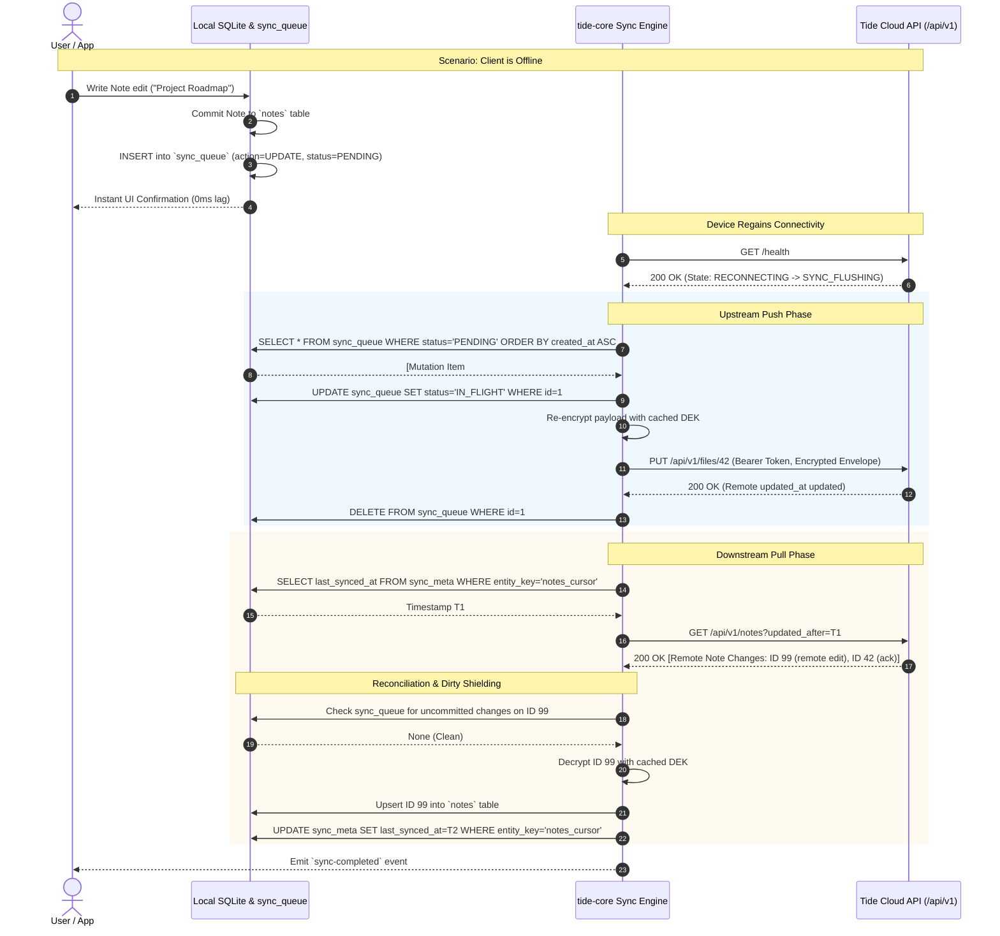

# Tide Offline-First Synchronization Protocol Specification

**Document Version:** 1.0.0  
**Target Module:** `crates/tide-core/src/sync.rs`  
**API Target:** Tide Cloud API (`/api/v1`)  
**Status:** Canonical Reference

---

## 1. Overview & Synchronization Model

Tide operates as an **offline-first, zero-knowledge encrypted workspace**. The synchronization engine in `crates/tide-core/src/sync.rs` orchestrates state convergence between the local embedded storage (SQLite) and the remote cloud backend (`Tide Cloud API /api/v1`).

### 1.1 Core Principles

1. **Local-First Reliability:** Every user mutation (create, edit, delete, tag, reorder) is committed locally to SQLite immediately within an atomic transaction. UI updates are instantaneous and decoupled from network availability.
2. **Client-Driven Hybrid Sync (Push/Pull):**
   - **Push (Upstream):** Client pushes committed mutations from a persistent transactional mutation queue (`sync_queue`) to the server.
   - **Pull (Downstream):** Client periodically polls or streams delta changes from the server using high-water mark timestamps (`updated_after`).
3. **End-to-End Encryption (E2EE) Preserved:**
   - Content payloads remain encrypted at rest and in transit using envelope encryption (Data Encryption Keys / DEKs wrapped with Key Encryption Keys / KEKs derived from user credentials).
   - The cloud server only acts as a blind sync relay and metadata ledger; it cannot inspect note bodies or decrypted contents.
4. **Session-Based Authentication:**
   - Client requests are authenticated using Bearer JWT tokens in the `Authorization: Bearer <jwt_or_pat>` header or via `X-API-Key` headers for personal access tokens.

---

## 2. Local Mutation Flow (`sync_queue`)

When any entity is created, modified, or deleted locally, a corresponding task is enqueued in the SQLite table `sync_queue` in the exact same database transaction that updates the local entity store.

### 2.1 SQLite Schema: `sync_queue`

```sql
CREATE TABLE IF NOT EXISTS sync_queue (
    id TEXT PRIMARY KEY NOT NULL,             -- UUID v4 mutation entry identifier
    entity_type TEXT NOT NULL,                 -- 'note' | 'todo' | 'link'
    entity_id TEXT NOT NULL,                   -- Target resource UUID
    action TEXT NOT NULL,                      -- 'CREATE' | 'UPDATE' | 'DELETE'
    payload TEXT,                              -- JSON-serialized snapshot / envelope
    retry_count INTEGER NOT NULL DEFAULT 0,    -- Monotonic attempt counter
    last_error TEXT,                           -- Diagnostic error message from last run
    created_at INTEGER NOT NULL,               -- Monotonic epoch millisecond timestamp
    updated_at INTEGER NOT NULL,               -- Timestamp of last sync attempt
    status TEXT NOT NULL DEFAULT 'PENDING'     -- 'PENDING' | 'IN_FLIGHT' | 'FAILED'
);

CREATE INDEX IF NOT EXISTS idx_sync_queue_status_created 
    ON sync_queue (status, created_at ASC);

CREATE INDEX IF NOT EXISTS idx_sync_queue_entity 
    ON sync_queue (entity_type, entity_id);
```

### 2.2 Action Types & Entity Targets

| Action | Target Entities | Semantics |
|---|---|---|
| `CREATE` | `note`, `todo`, `link` | Creates the resource upstream on the remote server. Contains full initial encrypted payload or entity representation. |
| `UPDATE` | `note`, `todo`, `link` | Updates existing entity. For notes, pushes new encrypted blob and updated metadata; for todos/links, pushes delta fields. |
| `DELETE` | `note`, `todo`, `link` | Marks entity as deleted / soft-deleted upstream or invokes HTTP DELETE. |

### 2.3 Compaction & Coalescing

To minimize bandwidth and avoid stale operations:
- Successive `UPDATE` operations for the same `entity_id` still in `PENDING` status are coalesced into a single updated payload snapshot with the latest local state.
- A `CREATE` followed by subsequent `UPDATE`s remains a `CREATE` containing the freshest payload.
- A `CREATE` followed by a `DELETE` for an un-synced entity removes both entries from the `sync_queue` entirely (no-op upstream).

---

## 3. Upstream Synchronization (Push Engine)

The push engine flushes pending items from `sync_queue` in FIFO order (`created_at ASC`), guarding monotonic state progression.

### 3.1 Push Pipeline

```
[sync_queue (PENDING)]
         │
         ▼
[Lock Queue Item (status = IN_FLIGHT)]
         │
         ▼
[Serialize & Encrypt Envelope with cached DEK]
         │
         ▼
[HTTP Request to /api/v1 endpoints with Bearer Token]
   ├── 200 OK / 201 Created ───► DELETE FROM sync_queue WHERE id = ?
   ├── 4xx Client Error     ───► Mark FAILED or handle conflict
   └── 5xx / Network Error  ───► Increment retry_count, reset status = PENDING, apply Backoff
```

### 3.2 Endpoint Mapping

- **Notes / Files:**
  - `CREATE`: `POST /api/v1/files` (or `POST /api/files`)
  - `UPDATE`: `PUT /api/v1/files/{id}` / `POST /api/v1/files/{id}/upload`
  - `DELETE`: `DELETE /api/v1/files/{id}`
- **Todos:**
  - `CREATE`: `POST /api/v1/todos`
  - `UPDATE`: `PUT /api/v1/todos/{id}` or `PATCH /api/v1/todos/{id}`
  - `DELETE`: `DELETE /api/v1/todos/{id}`
- **Links:**
  - `CREATE`: `POST /api/v1/links`
  - `UPDATE`: `PUT /api/v1/links/{id}`
  - `DELETE`: `DELETE /api/v1/links/{id}`

### 3.3 Envelope Serialization & Encryption

For E2EE entities (specifically `note`):
1. The plaintext editor content (Markdown, TipTap JSON) is compressed (zlib/gzip) and encrypted using AES-GCM-256 with the note's symmetric Data Encryption Key (DEK).
2. The DEK itself is stored locally in the secure key cache.
3. The generated ciphertext, initialization vector (IV), and auth tag are packaged into the encrypted payload envelope before making the HTTP call.

---

## 4. Downstream Synchronization (Pull Engine)

Downstream sync ensures changes made on other client devices are ingested into the local database.

### 4.1 High-Water Mark Polling

The client maintains high-water mark cursors in the local `sync_meta` table:

```sql
CREATE TABLE IF NOT EXISTS sync_meta (
    entity_key TEXT PRIMARY KEY NOT NULL,  -- e.g. 'notes_cursor', 'todos_cursor'
    last_synced_at INTEGER NOT NULL,       -- Unix timestamp in seconds or milliseconds
    last_etag TEXT
);
```

1. **Query Request:** The client queries endpoints with the cursor timestamp:
   - `GET /api/v1/notes?updated_after={last_synced_at}` (or via `/api/v1/files`)
   - `GET /api/v1/todos?updated_after={last_synced_at}`
2. **Batch Ingestion:**
   - Server returns entities modified strictly after `updated_after`, sorted by modification time ascending.
   - For each remote record:
     - Check if `entity_id` is currently in the local `sync_queue` with uncommitted changes (see Section 5 Dirty Shielding).
     - If clean, download remote payload, decrypt using cached or unwrapped DEK, and upsert into the local SQLite store.
3. **Cursor Advancement:**
   - Once all items in the batch are processed and committed locally, `last_synced_at` is updated to the maximum `updated_at` of the received batch.

---

## 5. Conflict Resolution: Last-Write-Wins (LWW) with Dirty Shielding

Tide implements a deterministic **Last-Write-Wins (LWW)** strategy supplemented with **Dirty Shielding** to prevent uncommitted local work from being silently overwritten by remote updates.

### 5.1 Dirty Shielding Algorithm

When processing a remote change for `entity_id` during Downstream Pull:

```
                  Remote Entity Change Received
                               │
                               ▼
        Is `entity_id` present in local `sync_queue`?
                               │
            ┌──────────────────┴──────────────────┐
           YES                                    NO
            │                                     │
            ▼                                     ▼
     [DIRTY SHIELD TRIGGERED]             [LWW Comparison]
  Does remote.updated_at > local.updated_at?       │
            │                                     ├── Remote newer ──► Apply remote update
     ┌──────┴──────┐                              └── Remote older ──► Discard (stale pull)
    YES            NO
     │              │
     │              └──► Discard remote (local modification will push soon)
     ▼
[Branch Conflict Version]
  1. Clone remote content into:
     "Untitled (Conflicted Copy from YYYY-MM-DD HH:mm)"
     OR store in `conflicts` table.
  2. Preserve local uncommitted edits in main entity.
  3. Notify user via conflict banner.
```

### 5.2 Deterministic LWW Rules

1. If no dirty uncommitted mutations exist in `sync_queue`:
   - If `remote.updated_at > local.updated_at`: Remote wins; local store is updated.
   - If `remote.updated_at < local.updated_at`: Remote change is ignored.
   - If `remote.updated_at == local.updated_at`: Tie-breaker using lexicographical comparison of client device UUID or mutation checksum.

---

## 6. Network Disconnection, Backoff & Recovery

Network instability is a first-class state handled by the sync engine.

### 6.1 State Machine

```
              ┌───────────────────────────┐
              │          ONLINE           │
              └─────────────┬─────────────┘
                            │
               Network down / HTTP 5xx / Timeout
                            │
                            ▼
              ┌───────────────────────────┐
       ┌─────►│          OFFLINE          │◄────┐
       │      └─────────────┬─────────────┘     │
       │                    │                   │
Retry backoff timer expired │                   │
       │                    ▼                   │
       │      ┌───────────────────────────┐     │
       └──────┤         RECONNECTING      ├─────┘
              └─────────────┬─────────────┘
                            │
              Network available & /health 200 OK
                            │
                            ▼
              ┌───────────────────────────┐
              │       SYNC_FLUSHING       │
              └─────────────┬─────────────┘
                            │
              All queue items pushed & pulled
                            │
                            ▼
              ┌───────────────────────────┐
              │          ONLINE           │
              └───────────────────────────┘
```

### 6.2 Exponential Backoff with Decorrelated Jitter

When sync requests fail due to network disconnection, timeout, or server 503/500 errors, retries are governed by exponential backoff with full jitter:

$$T_{\text{sleep}} = \min(T_{\text{max}}, \; T_{\text{base}} \times 2^{\text{retry\_count}}) + \text{random}(0, \text{jitter})$$

- $T_{\text{base}} = 500\,\text{ms}$
- $T_{\text{max}} = 60\,000\,\text{ms}$ (1 minute)
- `jitter` = uniformly distributed between $0$ and $1\,000\,\text{ms}$.

### 6.3 HTTP 429 Rate Limiting Resilience

If the server responds with `HTTP 429 Too Many Requests`:
1. The engine checks for the `Retry-After` HTTP header.
2. If present, the engine suspends the upstream push pipeline for `Retry-After` seconds.
3. If absent, exponential backoff switches to a default penalty delay of 30 seconds.
4. Mutation items in `sync_queue` remain intact; no local user actions are lost or rejected.

---

## 7. End-to-End Synchronization Sequence

The following sequence diagram details an offline mutation scenario: a local edit occurs while disconnected, the device reconnects, flushes upstream mutations, pulls downstream changes, and resolves a potential conflict using dirty shielding.



---

## 8. Summary of Guarantees

| Metric / Scenario | Guarantee |
|---|---|
| **Write Availability** | 100% available offline; writes never block on network. |
| **Data Integrity** | Atomic local transactions guarantee zero un-persisted edits. |
| **Confidentiality** | Zero-knowledge E2EE preserved; cloud server never reads plaintext. |
| **Convergence** | Eventual consistency guaranteed through LWW ordering and high-water mark advancement. |
| **Work Preservation** | Dirty shielding branches concurrent offline edits to prevent accidental overwrites. |
