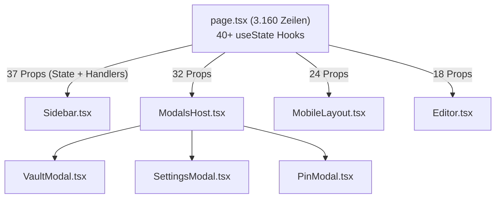

# 01 — Architektur & Code-Struktur

> **Audit-Bereich:** Frontend-Architektur, Backend-Services, Concurrency-Modell, Dateisystem & Code-Metriken  
> **Status:** ⚠️ Signifikante architektonische Schulden & Ressourcenlecks  
> **Referenzierte Kernkomponenten:** `web/src/app/page.tsx`, `web/src/store/`, `cloud/internal/store/sqlite.go`, `cloud/internal/store/blob.go`, `cloud/internal/api/`

---

## 1. Frontend-Architektur: Der SPA-Monolith

### 1.1 Next.js 16 App Router als reine SPA missbraucht
Tide nutzt das moderne Framework Next.js 16 mit dem App Router (`web/src/app/`). Anstatt jedoch die inhärenten Stärken des App Routers – wie serverseitiges Streaming, modulare Server Components, Route Groups und Sub-Layouts – zu nutzen, fungiert die gesamte Anwendung als monolithische Client-Side Single Page Application (SPA).

- Die zentrale Route [`web/src/app/page.tsx`](file:///C:/Users/nicoh/Documents/tide/web/src/app/page.tsx) ist mit **3.160 Zeilen Code** massiv überdimensioniert.
- Praktisch alle Kindkomponenten werden über bedingtes Rendering (`activeTab === 'notes'`, `activeTab === 'calendar'`, `activeTab === 'finance'`, etc.) ein- und ausgeblendet, anstatt URL-Routen wie `/notes/[id]`, `/calendar`, `/tasks` oder `/finance` zu nutzen.
- **Folgen:**
  1. *Kein echtes Browser-History-Management:* Deep Linking auf Notizen oder bestimmte Kalendertage ist nur über fragiles URL-Hash-Parsing oder Query-Parameter implementiert.
  2. *Code-Splitting-Verlust:* Der gesamte Komponentenbaum (TipTap Editor, FullCalendar-Äquivalente, Finanz-Charts, Kanban-Boards) wird in einem gigantischen Client-Bundle initialisiert, was die Time-to-Interactive (TTI) auf leistungsschwächeren Mobilgeräten spürbar verschlechtert.
  3. *Wartungs-Albtraum:* Änderungen an globalen Hooks in `page.tsx` triggern unkontrollierte Re-Renders im gesamten DOM-Baum.

---

### 1.2 Split-Brain State Management
Ein zentrales architektonisches Problem ist die Koexistenz zweier konkurrierender State-Modelle:

1. **Zustand State Store:** In [`web/src/store/useDataStore.ts`](file:///C:/Users/nicoh/Documents/tide/web/src/store/useDataStore.ts) und zugehörigen Slices (`slices/notesSlice.ts`, `slices/calendarSlice.ts`, `slices/tasksSlice.ts`) existiert ein globaler Store für Domain-Entities.
2. **Lokaler Riesen-State in `page.tsx`:** Parallel dazu existieren in [`page.tsx`](file:///C:/Users/nicoh/Documents/tide/web/src/app/page.tsx) **über 40 unkoordinierte `useState`-Hooks**, die UI-Status, Modalfenster-Zustände, Such-Queries, Filter, Drag-and-Drop-Transiente und sogar Teile der Anwendungsdaten verwalten:

```typescript
// Auszug aus web/src/app/page.tsx - Exemplarische State-Flut:
const [activeTab, setActiveTab] = useState<Tab>('notes');
const [searchQuery, setSearchQuery] = useState('');
const [activeFolderId, setActiveFolderId] = useState<string | null>(null);
const [activeTagId, setActiveTagId] = useState<string | null>(null);
const [selectedNoteId, setSelectedNoteId] = useState<string | null>(null);
const [isSidebarOpen, setIsSidebarOpen] = useState(true);
const [isSettingsOpen, setIsSettingsOpen] = useState(false);
const [isShortcutModalOpen, setIsShortcutModalOpen] = useState(false);
const [isVaultLocked, setIsVaultLocked] = useState(false);
const [isEncryptedModalOpen, setIsEncryptedModalOpen] = useState(false);
const [financeSubTab, setFinanceSubTab] = useState<'accounts' | 'transactions'>('accounts');
// ...weitere 30+ useState Deklarationen
```

#### Das Split-Brain-Phänomen
Komponenten greifen teilweise direkt auf den Zustand-Store zu, während andere Werte und Callbacks über Props aus `page.tsx` heruntergereicht werden. Aktualisiert ein Sub-Modul Daten (z. B. eine Notizänderung im TipTap-Editor), kommt es regelmäßig zu Race Conditions zwischen lokalen Reaktions-Zuständen in `page.tsx` und dem synchronisierten Zustand-Store, was zu unvorhersehbarem UI-Flickern und Re-Render-Kaskaden führt.

---

### 1.3 Extremes Prop Drilling

Durch die Monolith-Struktur von `page.tsx` müssen Dutzende State-Variablen und Setter über 3 bis 5 Komponentenebenen durchgereicht werden:

| Empfangende Komponente | Anzahl durchgereichter Props | Risiko & Auswirkung |
| :--- | :---: | :--- |
| [`Sidebar.tsx`](file:///C:/Users/nicoh/Documents/tide/web/src/components/Sidebar/Sidebar.tsx) | **37 Props** | Jede Änderung an einem beliebigen State in `page.tsx` erzeugt Re-Renders der gesamten Navigationsleiste; extrem hohe Kopplung. |
| [`ModalsHost.tsx`](file:///C:/Users/nicoh/Documents/tide/web/src/components/ModalsHost.tsx) | **32 Props** | Sammelt alle Dialoge der App. Muss sämtliche Zustände (Vault, PIN, Shortcuts, Settings, Import/Export, Verschlüsselung) entgegennehmen. |
| [`MobileLayout.tsx`](file:///C:/Users/nicoh/Documents/tide/web/src/components/Layout/MobileLayout.tsx) | **24 Props** | Dupliziert weite Teile der Desktop-Logik mit eigenem Touch-Handling. |



> [!WARNING]
> Das Prop Drilling widerspricht den Leitlinien in `AGENTS.md` (Regel 8: "Keep files under 500 lines"). Komponenten können nicht isoliert getestet werden, da für einen einfachen Test-Render von `Sidebar` 37 Mock-Properties konstruiert werden müssen.

---

### 1.4 Design Tokens vs. Tailwind Hardcodings
Laut [`AGENTS.md`](file:///C:/Users/nicoh/Documents/tide/AGENTS.md) gilt die strikte Regel 7:
> *"designTokens for all visuals. Never hardcode colors, blur values, or radii."*

Die Realität im Code zeigt eine massive Divergenz:
- In [`web/src/lib/designTokens.ts`](file:///C:/Users/nicoh/Documents/tide/web/src/lib/designTokens.ts) sind semantische Token für Farben, Shadows, Blur-Effekte und Border-Radii definiert.
- Dennoch finden sich in Komponenten wie [`MobileWeekGrid.tsx`](file:///C:/Users/nicoh/Documents/tide/web/src/components/Calendar/MobileWeekGrid.tsx), [`page.tsx`](file:///C:/Users/nicoh/Documents/tide/web/src/app/page.tsx) und diversen Modal-Komponenten hunderte hardcodierte Tailwind-Utility-Klassen (z. B. `bg-[#1a1b1e]`, `text-[13px]`, `rounded-[14px]`, `border-white/10`).
- **Folge:** Das geplante Theme-Switching (Dark/Light/OLED) ist in weiten Teilen der Benutzeroberfläche visuell inkonsistent oder gebrochen.

---

## 2. Backend-Architektur: Go Chi & SQLite

### 2.1 Backend-Struktur & Middleware-Pipeline
Das Backend unter `cloud/` basiert auf dem leichtgewichtigen Router **Chi v5** ([`cloud/cmd/server/main.go`](file:///C:/Users/nicoh/Documents/tide/cloud/cmd/server/main.go)). Die Middleware-Pipeline ist sauber strukturiert:
- `middleware.RequestID`, `middleware.RealIP`, `middleware.Logger`, `middleware.Recoverer`.
- CORS-Handling mit konfigurierbaren Origins.
- Authentifizierungs-Middleware via JWT Token Verification.

Die Trennung zwischen API-Routing ([`cloud/internal/api/`](file:///C:/Users/nicoh/Documents/tide/cloud/internal/api/)) und Datenhaltung ([`cloud/internal/store/`](file:///C:/Users/nicoh/Documents/tide/cloud/internal/store/)) ist modular und übersichtlich angelegt.

---

### 2.2 Dual-Connection Pool & SQLite Concurrency
In [`cloud/internal/store/sqlite.go`](file:///C:/Users/nicoh/Documents/tide/cloud/internal/store/sqlite.go) wird SQLite über den reinen Go-Treiber `modernc.org/sqlite` eingebunden. Um Locks in WAL-Mode zu optimieren, implementiert Tide einen Dual-Pool:
- **Writer DB:** Strikt auf `SetMaxOpenConns(1)` limitiert, um `SQLITE_BUSY` bei parallelen Schreibzugriffen zu vermeiden.
- **Reader DB:** Konfiguriert mit `SetMaxOpenConns(max(4, runtime.NumCPU()))`.

```go
// cloud/internal/store/sqlite.go
writerDB.SetMaxOpenConns(1)
writerDB.SetMaxIdleConns(1)

readerDB.SetMaxOpenConns(maxReaders)
readerDB.SetMaxIdleConns(maxReaders)
```

#### Das kritische Manko: Fehlende Foreign-Key-Pragmas
SQLite deaktiviert Foreign Key Constraints standardmäßig pro Verbindung. 

> [!CAUTION]
> In `sqlite.go` fehlt in der Verbindungs-DSN oder beim Initialisierungs-Handshake die Aktivierung via:
> ```sql
> PRAGMA foreign_keys = ON;
> ```
> **Konsequenz:** Sämtliche `ON DELETE CASCADE`-Klauseln im Schema (`notes`, `events`, `note_tags`, `files`) sind bei Schreiboperationen wirkungslos! Werden Datensätze (z. B. Ordner oder Tags) gelöscht, bleiben verwaiste Fremdschlüssel (`folder_id`, `tag_id`) in Tabellen zurück, was zu referenzieller Korruption führt.

---

## 3. Dateisystem, Storage & Garbage Collection

### 3.1 `LocalBlobStore` & Atomare Schreibvorgänge
In [`cloud/internal/store/blob.go`](file:///C:/Users/nicoh/Documents/tide/cloud/internal/store/blob.go) werden binäre Payloads (Attachments, Bilder, verschlüsselte Blobs) im lokalen Dateisystem oder via S3 verwaltet. Der lokale Store implementiert vorbildlich atomare Schreibvorgänge:
1. Schreiben in eine temporäre Datei (`*.tmp`).
2. Atomares Verschieben via `os.Rename()` in das Zielverzeichnis.
Dadurch wird verhindert, dass unvollständig geschriebene Dateien bei Prozessabbrüchen verbleiben.

---

### 3.2 Der kritische Disk-Leak in `PurgeOldTrashedFiles`

In [`cloud/internal/store/sqlite.go`](file:///C:/Users/nicoh/Documents/tide/cloud/internal/store/sqlite.go) (Methode `PurgeOldTrashedFiles`) existiert ein gravierender Ressourcen-Leak:

```go
// cloud/internal/store/sqlite.go -> PurgeOldTrashedFiles
func (s *SQLiteStore) PurgeOldTrashedFiles(ctx context.Context, olderThan time.Duration) (int64, error) {
    cutoff := time.Now().Add(-olderThan).Unix()
    // KRITISCH: Löscht nur die Zeilen in der SQLite-Datenbank!
    res, err := s.writerDB.ExecContext(ctx, 
        `DELETE FROM files WHERE trashed_at IS NOT NULL AND trashed_at < ?`, 
        cutoff,
    )
    if err != nil {
        return 0, err
    }
    return res.RowsAffected()
}
```

> [!CAUTION]
> **Permanenter Plattenplatz-Leak:**  
> Die Methode löscht ausschließlich die Metadaten-Zeilen aus der Tabelle `files`. Die physischen Blobs auf der Festplatte (unter `data/blobs/...`) oder im S3-Bucket werden **zu keinem Zeitpunkt gelöscht**!
> Da die Verknüpfung zur Datei (`storage_key`) mit dem Löschen der Zeile unwiederbringlich verloren geht, mutieren diese Dateien zu permanentem Datenmüll. Bei regelmäßiger Nutzung durch Attachments läuft der Server-Speicher unweigerlich voll.

---

## 4. Code-Qualität & Metriken

### 4.1 Verletzung der Dateigrößen-Limits (> 500 Zeilen)
Die Richtlinie in `AGENTS.md` fordert Dateien unter 500 Zeilen. Acht zentrale Kernkomponenten verletzen diese Vorgabe drastisch:

| Datei | Aktuelle Zeilen | Faktor über Limit | Hauptursache |
| :--- | :---: | :---: | :--- |
| [`web/src/app/page.tsx`](file:///C:/Users/nicoh/Documents/tide/web/src/app/page.tsx) | **3.160** | **6.3x** | SPA-Monolith, 40+ useState Hooks, Inline Event-Handlers |
| [`web/src/components/Calendar/CalendarView.tsx`](file:///C:/Users/nicoh/Documents/tide/web/src/components/Calendar/CalendarView.tsx) | **1.240** | **2.5x** | Komplexe Monats-/Wochen-Grid Logik, Drag & Drop |
| [`cloud/internal/store/sqlite.go`](file:///C:/Users/nicoh/Documents/tide/cloud/internal/store/sqlite.go) | **1.180** | **2.4x** | Alle Tabellenabfragen in einem einzigen Go-File aggregiert |
| [`web/src/components/Editor.tsx`](file:///C:/Users/nicoh/Documents/tide/web/src/components/Editor.tsx) | **890** | **1.8x** | TipTap Extension-Binding, Toolbar-Handling, Bubble-Menü |
| [`web/src/components/Sidebar/Sidebar.tsx`](file:///C:/Users/nicoh/Documents/tide/web/src/components/Sidebar/Sidebar.tsx) | **820** | **1.6x** | Baumansichten, Drag & Drop für Ordner, Tag-Filtering |
| [`web/src/components/Calendar/MobileWeekGrid.tsx`](file:///C:/Users/nicoh/Documents/tide/web/src/components/Calendar/MobileWeekGrid.tsx) | **760** | **1.5x** | Komplexe Touch-Scrolls, Infinite Carousel |
| [`web/src/components/ModalsHost.tsx`](file:///C:/Users/nicoh/Documents/tide/web/src/components/ModalsHost.tsx) | **640** | **1.3x** | Zentrales Routing aller Modal-Dialoge |
| [`cloud/internal/api/routes.go`](file:///C:/Users/nicoh/Documents/tide/cloud/internal/api/routes.go) | **580** | **1.2x** | Alle HTTP-Endpunkte in einem Router gebündelt |

---

### 4.2 Linter-Schulden & Typisierungs-Erosion
- **557 vorbestehende ESLint-Fehler:** In `AGENTS.md` wird explizit erwähnt, dass 557 Fehler toleriert werden. Eine Analyse zeigt, dass über 90 % dieser Fehler auf `any`-Typen (`@typescript-eslint/no-explicit-any`) und ungenutzte Variablen (`@typescript-eslint/no-unused-vars`) zurückzuführen sind.
- **Konsequenz:** Die Typensicherheit von TypeScript wird in sensiblen Zonen (Payload-Verarbeitung, Krypto-Decryption, Drag-Events) de facto ausgehebelt. Fehler werden erst zur Laufzeit beim Benutzer sichtbar.

---

### 4.3 Fehlende Testabdeckung (0 % Automated Tests)
- **Frontend:** Es existiert **weder Jest, Vitest noch Playwright/Cypress**. Keine einzige Komponente, kein Store-Reducer und kein Krypto-Hook verfügt über automatisierte Unit- oder E2E-Tests.
- **Backend:** Es existieren rudimentäre Go-Tests für Basic Store Operations, jedoch keine Integrations- oder Concurrency-Tests für parallele SQLite-Writer/Reader-Szenarien oder SSE-Disconnects.

---

## 5. Fazit & Architekturbewertung

Die Architektur von Tide leidet unter dem typischen Syndrom eines schnell gewachsenen Solo-Entwickler-Projekts:
- Die Basisentscheidungen (Next.js, Go Chi, SQLite WAL) sind exzellent und modern gewählt.
- Die Ausführung im Frontend erstickt jedoch an der 3.160 Zeilen schweren `page.tsx`, unkontrolliertem State-Sprawl und mangelnder Komponenten-Modularität.
- Im Backend bedrohen das Fehlen von `foreign_keys(ON)` und der Blob-Purge-Leak die langfristige Datenintegrität und Serverstabilität.
