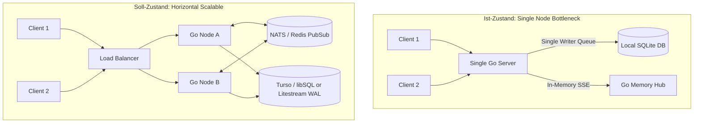

# 04 — Zukunftsvision, Skalierbarkeit & Evolution

> **Audit-Bereich:** Persistenz-Skalierung, Concurrency-Limits, Echtzeit-Kollaboration, Frontend-Moderne  
> **Status:** 💡 Strategische Roadmap zur Enterprise- & Multi-User-Reife  
> **Ziel-Architekturen:** Litestream, CRDTs (Yjs/Automerge), TanStack Query, Next.js Sub-Routing

---

## 1. Datenbank & Backend Concurrency

### 1.1 Das SQLite Single-Writer Bottleneck
Tide nutzt SQLite im WAL-Modus mit einem `SetMaxOpenConns(1)` Writer-Pool.
- **Aktuelle Eignung:** Für Single-User-Instanzen und kleine Teams (< 100 parallele Schreibende) liefert SQLite herausragende Latenzen (< 1 ms).
- **Das Bottleneck:** Bei wachsender Nutzerzahl, automatisierten Sync-Batches und Webhooks blockieren parallele HTTP-Requests in der Queue des Go-Backends (`database is locked` bzw. Latenz-Spikes über 5.000 ms).
- **In-Memory State Lock-in:** Der SSE-Broker (`cloud/internal/api/sse.go`) und der WebSocket-Hub speichern aktive Client-Connections in lokalen Go-Channels und Slices. Ein horizontales Hochskalieren auf mehrere Cloud-Instanzen (Load Balancing) ist ohne einen Message-Broker (z. B. Redis Pub/Sub oder NATS) unmöglich.



---

## 2. Sync-Evolution: Von Last-Write-Wins zu CRDTs

### 2.1 Das Problem des aktuellen Last-Write-Wins (LWW)
Aktuell synchronisiert Tide Notizen über einfache Zeitstempel (`updated_at` / Version-Counters). Wenn ein Nutzer offline auf dem Smartphone eine Notiz editiert und zeitgleich dieselbe Notiz auf dem Desktop bearbeitet:
- Überschreibt der spätere Push die früheren Änderungen vollständig.
- **Folge:** Silent Data Loss. Bei verschlüsselten Blobs kann der Server keine Drei-Wege-Merges durchführen.

### 2.2 Der 3-Stufen-Evolutionspfad

```
Stufe 1 (Status Quo)       Stufe 2 (Kurzfristig)          Stufe 3 (Zukunft)
  Last-Write-Wins      ──>  Optimistic Concurrency   ──>  CRDTs (Yjs / Automerge)
  (Datenverlust)            Control (OCC / 409 Conflict)   (Zero-Conflict P2P Sync)
```

1. **Stufe 1: Last-Write-Wins (Ist-Zustand):**
   Gefahr von Konflikten und unbeabsichtigtem Datenverlust.
2. **Stufe 2: Optimistic Concurrency Control (OCC):**
   Jedes Update erfordert die Angabe der Basis-Revision (`expected_version`). Bei Abweichung antwortet der Server mit `409 Conflict`. Das Frontend speichert die abgewiesene Version als "Konflikt-Kopie" (Fork).
3. **Stufe 3: Echte CRDTs (Conflict-free Replicated Data Types):**
   - Integration von **Yjs** oder **Automerge** in den TipTap-Editor (`@tiptap/extension-collaboration`).
   - Da die Yjs-Updates binäre Diff-Vektoren darstellen, können diese clientseitig mit dem Notiz-DEK verschlüsselt und über den Server synchronisiert werden, ohne dass der Server den Inhalt kennen muss!

---

## 3. Datenhaltungs- und Replikationspfad

Um Hochverfügbarkeit, Datensicherheit und globales Edge-Serving zu gewährleisten, empfiehlt sich folgende dreistufige Datenbank-Roadmap:

| Phase | Technologie | Zweck & Mehrwert | Migrationsaufwand |
| :--- | :--- | :--- | :---: |
| **Sofort (P1)** | **Litestream** | Kontinuierliche Streaming-Replikation der SQLite-WAL in S3/MinIO. RPO (Recovery Point Objective) < 1 Sekunde bei Serverausfall. | Minimal (Sidecar-Prozess, 0 Code-Änderungen) |
| **Mittelfristig (P2)** | **Turso / libSQL** | Ermöglicht verteilte SQLite-Read-Replikate weltweit an der Edge. Extrem geringe Latenzen für mobile Clients weltweit. | Gering (kompatibler Go-Treiber) |
| **Langfristig (P3)** | **PostgreSQL** | Option für Enterprise-Installationen mit tausenden gleichzeitigen Schreibern und komplexen Audit-Logs. | Mittel (SQL-Dialekt-Abstraktion) |

---

## 4. Frontend-Modernisierung & Entflechtung

### 4.1 Zerschlagung des Monolithen `page.tsx` in Workspace-Subrouter
Der 3.160 Zeilen umfassende SPA-Monolith muss in modulare Next.js App-Router-Routen aufgeteilt werden:

```
web/src/app/
├── layout.tsx                  # Globales Layout, ThemeProvider, VaultLockProvider
├── (workspace)/
│   ├── layout.tsx              # Sidebar, ModalsHost, Global Search
│   ├── notes/
│   │   ├── page.tsx            # Notizliste & Schnellübersicht
│   │   └── [noteId]/page.tsx   # Isolierter TipTap-Editor
│   ├── calendar/
│   │   └── page.tsx            # Desktop & Mobile Kalender
│   ├── tasks/
│   │   └── page.tsx            # Kanban Board & Aufgaben
│   └── finance/
│       └── page.tsx            # Verschlüsseltes Finanz-Dashboard
```

**Vorteile:**
- Automatisches Code-Splitting pro Modul.
- Natürliche Browser-Historie (Vor/Zurück funktioniert nahtlos).
- Reduktion des Prop Drillings um 90 %.

---

### 4.2 TanStack Query (React Query) mit Offline IndexedDB Persistence
Die handgestrickte API-Fetch-Schicht in [`web/src/lib/api.ts`](file:///C:/Users/nicoh/Documents/tide/web/src/lib/api.ts) und die 40+ useState Hooks sollten durch **TanStack Query v5** ersetzt werden:
- Automatisches Caching, Request-Deduplication und Background-Refetching.
- **Offline First:** Mittels `createSyncStoragePersister` und `IndexedDB` können Abfragen komplett offline zwischengespeichert und bei Wiederverbindung nahtlos synchronisiert werden.
- Eliminierung von 80 % des manuellen Fetch- und Error-States in den Komponenten.
