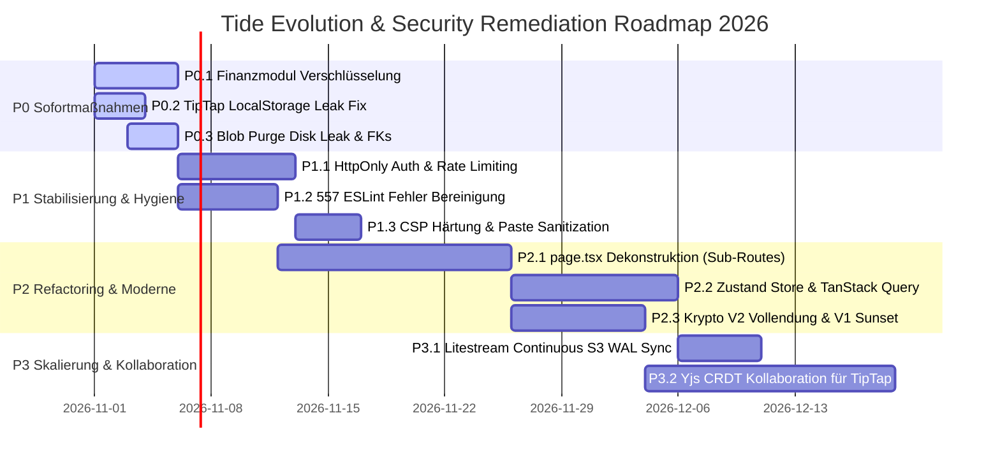

# 05 — Action Plan & Implementierungs-Roadmap

> **Audit-Bereich:** Priorisierte Maßnahmen, Aufwandsschätzungen, Datei-Zuordnung  
> **Status:** 🎯 Genehmigungsreife Roadmap  
> **Prioritätsstufen:** P0 (Notfall / Sofort), P1 (Kurzfristig), P2 (Mittelfristig), P3 (Langfristig)

---

## 1. Übersicht der Prioritätsstufen

---

## 2. Phase P0 — Sofortmaßnahmen (Woche 1–2)

> [!CAUTION]
> Diese Maßnahmen müssen unverzüglich vor jedem weiteren Feature-Rollout umgesetzt werden, da sie akute Datenverluste, Plattenüberläufe oder Zero-Knowledge-Verletzungen adressieren.

### P0.1: Clientseitige Envelope-Verschlüsselung für das Finanzmodul
- **Ziel:** Schutz aller Bankdaten, IBANs, Salden und Transaktionen nach dem V2 Envelope-Standard.
- **Betroffene Dateien:**
  - `cloud/internal/store/sqlite.go` (Schema-Migration: `ext_finance_*` Felder zu `encrypted_data BLOB`).
  - `web/src/components/Finance/` (Einbindung von `encryptData` / `decryptData` mit modulspezifischem DEK).
- **Konkrete Schritte:**
  1. Migration der Spalten `balance`, `iban`, `payee`, `description` in eine verschlüsselte JSON-Payload-Spalte (`encrypted_payload`).
  2. Implementierung eines Client-Side Key Wrapping für Finanz-Datensätze.
- **Aufwand:** 4–5 Personentage (PT).

---

### P0.2: Entfernung des unverschlüsselten LocalStorage-Backups
- **Ziel:** Beseitigung der XSS- und Shared-Device-Exposition sensibler Notizinhalte.
- **Betroffene Dateien:**
  - `web/src/hooks/useTipTapConfig.ts`
  - `web/src/components/Editor.tsx`
  - `web/src/lib/storage.ts`
- **Konkrete Schritte:**
  1. Löschen aller `localStorage.setItem('tide_backup_...', ...)` Aufrufe.
  2. Ersatz durch verschlüsseltes Caching in der non-extractable `IndexedDB` oder Speicherung rein im Memory-State.
  3. Startup-Routine zum automatischen Auskehren bestehender `tide_backup_*` Keys aus dem LocalStorage aller Bestandsnutzer.
- **Aufwand:** 2–3 PT.

---

### P0.3: Behebung des Disk-Leaks in `PurgeOldTrashedFiles` & FK-Aktivierung
- **Ziel:** Physisches Löschen verwaister Dateien und Gewährleistung referenzieller Integrität in SQLite.
- **Betroffene Dateien:**
  - `cloud/internal/store/sqlite.go`
  - `cloud/internal/store/blob.go`
- **Konkrete Schritte:**
  1. In `sqlite.go` bei Initialisierung der DB-Verbindungen `PRAGMA foreign_keys = ON;` für Reader und Writer ausführen.
  2. Vor dem Ausführen von `DELETE FROM files ...` in `PurgeOldTrashedFiles` alle betroffenen `storage_key`-Pfade selektieren und synchron/asynchron über `blobStore.Delete(ctx, key)` physisch vom Datenträger entfernen.
- **Aufwand:** 2 PT.

---

## 3. Phase P1 — Kurzfristige Stabilisierung & Hygiene (Woche 3–5)

### P1.1: Auth-Migration auf HttpOnly Cookies & Backend Rate Limiting
- **Ziel:** Schutz des JWT-Tokens vor XSS-Exfiltration und Härtung gegen Brute-Force.
- **Betroffene Dateien:**
  - `cloud/internal/api/auth.go`, `cloud/cmd/server/main.go`
  - `web/src/lib/api.ts`
- **Konkrete Schritte:**
  1. Bei erfolgreichem Login Rückgabe des Tokens als `Set-Cookie: tide_token=...; HttpOnly; Secure; SameSite=Strict`.
  2. Einbindung von `go-chi/httprate` in Chi für `/api/v1/auth/*` (z. B. max 5 Fehlversuche pro IP/Minute).
- **Aufwand:** 4 PT.

---

### P1.2: Beseitigung der 557 ESLint-Schulden & Strikte Typisierung
- **Ziel:** Wiederherstellung der Typsicherheit im Frontend.
- **Betroffene Dateien:**
  - `web/src/` (insb. `Editor.tsx`, `page.tsx`, `useDataStore.ts`)
- **Konkrete Schritte:**
  1. Systematisches Ersetzen von `any` durch konkrete TypeScript Interfaces / Discriminated Unions.
  2. Entfernen ungenutzter Imports und toter Variablen.
  3. CI-Pipeline schärfen: `npm run lint` muss künftig mit 0 Fehlern und 0 Warnungen abschließen.
- **Aufwand:** 5 PT.

---

### P1.3: Content Security Policy (CSP) Härtung & DOMPurify Sanitization
- **Ziel:** Unterdrückung von XSS-Angriffsvektoren.
- **Betroffene Dateien:**
  - `web/src/app/layout.tsx` / `web/next.config.js`
  - `web/src/components/Editor.tsx`
- **Konkrete Schritte:**
  1. Entfernung von `'unsafe-inline'` und `'unsafe-eval'` durch Nonces bzw. Next.js Static CSP Hashings.
  2. Einschränkung von `connect-src` auf die explizite Tide API-Domain und WebSocket-Endpunkte.
  3. DOMPurify-Pass beim Einfügen von HTML-Inhalten im TipTap-Editor.
- **Aufwand:** 3 PT.

---

## 4. Phase P2 — Mittelfristiges Refactoring (Woche 6–10)

### P2.1: Zerschlagung des Monolithen `page.tsx` in Next.js Sub-Routes
- **Ziel:** Senkung der Dateigröße von 3.160 auf < 400 Zeilen pro Route, Eliminierung von 37-Prop Drilling.
- **Betroffene Dateien:**
  - `web/src/app/page.tsx`
  - Aufteilung in `web/src/app/(workspace)/notes/`, `calendar/`, `tasks/`, `finance/`.
- **Konkrete Schritte:**
  1. Extraktion gemeinsamer UI-Shells in `web/src/app/(workspace)/layout.tsx`.
  2. Modul-Routen anlegen und URL-basiertes Routing etablieren.
  3. Aufteilung von `ModalsHost.tsx` in dedizierte, kontextsensitive Dialoge.
- **Aufwand:** 10–12 PT.

---

### P2.2: TanStack Query Integration & Store-Konsolidierung
- **Ziel:** Auflösung des Split-Brain-Zustands zwischen 40+ useState Hooks und Zustand.
- **Betroffene Dateien:**
  - `web/src/store/useDataStore.ts`
  - `web/src/lib/api.ts`
- **Konkrete Schritte:**
  1. Einführung von TanStack Query für alle Server-Zustände (Notizlisten, Eventlisten, Tags).
  2. Reduktion von Zustand auf rein clientseitige UI-Zustände (aktive Modals, Drawer-Status, Filter).
- **Aufwand:** 7 PT.

---

### P2.3: Vollendung der Krypto V2 Migration & Deprecation von V1
- **Ziel:** Vereinheitlichung der Krypto-Codebasis auf AES-256-GCM Envelope.
- **Betroffene Dateien:**
  - `web/src/lib/crypto.ts` (Deprecate)
  - `web/src/lib/cryptoV2.ts`
- **Konkrete Schritte:**
  1. Hintergrund-Re-Encryption: Beim Laden alter V1-Notizen werden diese automatisch in V2 umgewandelt und gespeichert.
  2. Vollständiges Entfernen von `crypto.ts` nach erfolgreicher Migration aller Bestandsdaten.
- **Aufwand:** 6 PT.

---

## 5. Phase P3 — Skalierung & Kollaboration (Woche 11–16)

### P3.1: Kontinuierliche WAL-Replikation mit Litestream
- **Ziel:** Disaster Recovery und RPO < 1s ohne Downtime.
- **Betroffene Komponenten:**
  - `cloud/Dockerfile`, Deployment-Konfigurationen
- **Konkrete Schritte:**
  1. Litestream als Sidecar oder Entrypoint-Wrapper im Backend-Container integrieren.
  2. Kontinuierliches Streaming der SQLite WAL in S3/MinIO.
- **Aufwand:** 3 PT.

---

### P3.2: Echte CRDT-Kollaboration für TipTap (Yjs via WebSocket)
- **Ziel:** Konfliktfreies, kollaboratives Editieren von Notizen über mehrere Endgeräte hinweg.
- **Betroffene Komponenten:**
  - `web/src/components/Editor.tsx` (`@tiptap/extension-collaboration`, `yjs`)
  - `cloud/internal/api/ws.go` (Binäre Yjs-Update Relays)
- **Konkrete Schritte:**
  1. TipTap auf Yjs CRDT Document-Modell umstellen.
  2. Verschlüsselung der binären CRDT-Updates mit dem Notiz-DEK vor Übertragung an den Go-WebSocket-Relay.
- **Aufwand:** 12 PT.

---

## 6. Ressourcen- und Aufwandsmatrix

| Phase | Fokus | Kritikalität | Geschätzter Gesamtaufwand |
| :--- | :--- | :---: | :---: |
| **Phase P0** | Notfall-Sicherheits- & Disk-Fixes | 🛑 Hochkritisch | **9–10 Personentage** |
| **Phase P1** | Hygiene, Auth, CSP & Linting | ⚠️ Wichtig | **12 Personentage** |
| **Phase P2** | Monolith-Zerschlagung & State-Bereinigung | 🔧 Strukturell | **23–25 Personentage** |
| **Phase P3** | Litestream, CRDTs & Skalierung | 🚀 Zukunftsfähig | **15 Personentage** |
| **Gesamt** | **Vollständige Transformation** | | **ca. 60 Personentage** |
