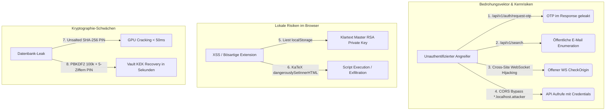
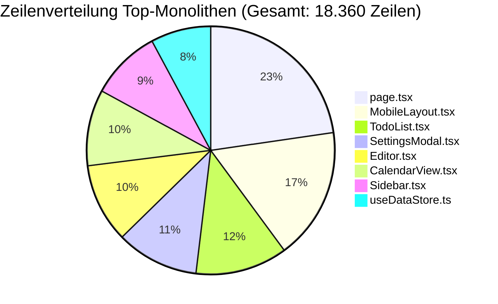
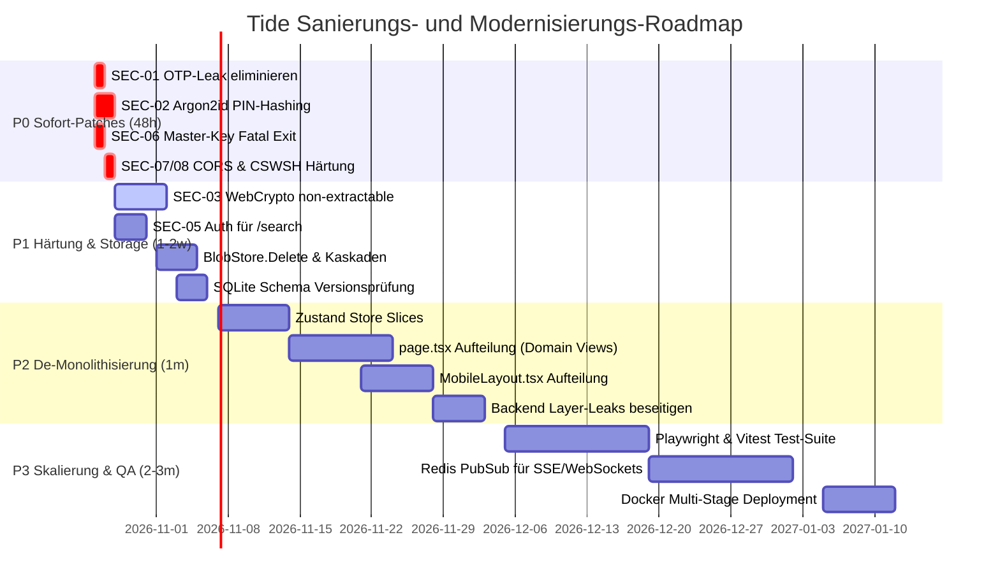

# System-Audit-Report: Tide — Architektur-, Sicherheits- und Codequalitätsanalyse

**Projekt:** Tide (E2EE Personal Productivity & Knowledge Management Platform)  
**Datum:** 26. Oktober 2026  
**Auditor:** Senior Security & System Architecture Review Team  
**Status:** Abgeschlossen — Kritischer Handlungsbedarf (P0 / P1) identifiziert  
**Codebase-Basis:** `web` (Next.js 16.2 App Router, React 19, TipTap/ProseMirror, TypeScript), `cloud` (Go 1.24, SQLite WAL Dual-Pool)

---

## Inhaltsverzeichnis

1. [Executive Summary & Gesamtbewertung](#1-executive-summary--gesamtbewertung)
   - [1.1 Kernergebnisse & Risikoprofil](#11-kernergebnisse--risikoprofil)
   - [1.2 Risikomatrix](#12-risikomatrix)
   - [1.3 Architektur- und Sicherheits-Score](#13-architektur--und-sicherheits-score)
2. [Sicherheits- & Kryptographie-Analyse](#2-sicherheits--kryptographie-analyse)
   - [2.1 Kritische Schwachstellen (P0 / Severity: Critical)](#21-kritische-schwachstellen-p0--severity-critical)
   - [2.2 Hohe Sicherheitsrisiken (P1 / Severity: High)](#22-hohe-sicherheitsrisiken-p1--severity-high)
   - [2.3 Mittlere Sicherheitsrisiken (P2 / Severity: Medium)](#23-mittlere-sicherheitsrisiken-p2--severity-medium)
   - [2.4 Positive Krypto-Architekturbefunde & Stärken](#24-positive-krypto-architekturbefunde--stärken)
3. [Struktur- & Architektur-Analyse](#3-struktur--architektur-analyse)
   - [3.1 Frontend-Monolithen & 500-Zeilen-Verletzung](#31-frontend-monolithen--500-zeilen-verletzung)
   - [3.2 Zustandsspeicher & Re-Render-Kaskaden](#32-zustandsspeicher--re-render-kaskaden)
   - [3.3 Backend Layer-Leaks & Store-Umgehung](#33-backend-layer-leaks--store-umgehung)
   - [3.4 Design-Token-Diskrepanz](#34-design-token-diskrepanz)
   - [3.5 Linting- & Typisierungs-Status](#35-linting---typisierungs-status)
4. [Dokumentations-Analyse & Realitätsabgleich](#4-dokumentations-analyse--realitätsabgleich)
   - [4.1 Dokumentierte Stärken](#41-dokumentierte-stärken)
   - [4.2 Dokumentations-Drift & Widersprüche](#42-dokumentations-drift--widersprüche)
   - [4.3 Dokumentationslücken](#43-dokumentationslücken)
5. [Zukunftsfähigkeit, Skalierbarkeit & Moderne Systeme](#5-zukunftsfähigkeit-skalierbarkeit--moderne-systeme)
   - [5.1 Datenbank & Concurrency: SQLite Dual-Pool](#51-datenbank--concurrency-sqlite-dual-pool)
   - [5.2 Blob-Storage-Leakage & Datenresiduenz](#52-blob-storage-leakage--datenresiduenz)
   - [5.3 Horizontale Skalierungsbarrieren (In-Memory Locks)](#53-horizontale-skalierungsbarrieren-in-memory-locks)
   - [5.4 Frontend-Modernisierung & Next.js-Auslastung](#54-frontend-modernisierung--nextjs-auslastung)
   - [5.5 Test-Vakuum & Verifikationsrisiken](#55-test-vakuum--verifikationsrisiken)
6. [Umfassender Maßnahmenkatalog & Roadmap](#6-umfassender-maßnahmenkatalog--roadmap)
   - [6.1 Priorität 0 (P0) — Notfall-Sicherheits-Patches (< 48 Stunden)](#61-priorität-0-p0--notfall-sicherheits-patches--48-stunden)
   - [6.2 Priorität 1 (P1) — Härtung & Datenintegrität (1–2 Wochen)](#62-priorität-1-p1--härtung--datenintegrität-12-wochen)
   - [6.3 Priorität 2 (P2) — De-Monolithisierung & Refactoring (1 Monat)](#63-priorität-2-p2--de-monolithisierung--refactoring-1-monat)
   - [6.4 Priorität 3 (P3) — Skalierbarkeit & DevOps (2–3 Monate)](#64-priorität-3-p3--skalierbarkeit--devops-23-monate)
7. [Fazit & Freigabe-Empfehlung](#7-fazit--freigabe-empfehlung)

---

## 1. Executive Summary & Gesamtbewertung

### 1.1 Kernergebnisse & Risikoprofil

Das Projekt **Tide** ist ein ambitioniertes, modernes Notiz-, Kalender- und Produktivitätssystem, das als End-to-End-verschlüsselte (E2EE) Web- und Mobile-Applikation (PWA) konzipiert ist. Der Stack basiert auf modernsten Basistechnologien:
- **Frontend:** Next.js 16.2 (App Router), React 19, TipTap / ProseMirror Rich-Text-Engine, Zustand Data Store, IndexedDB Offline-Queue.
- **Backend:** Go 1.24 HTTP REST- & WebSocket-Server, CGO-freies SQLite (`modernc.org/sqlite`) mit Write-Ahead Logging (WAL) und getrenntem Reader/Writer-Pool.

Das System zeichnet sich durch herausragende Detaillösungen in spezifischen Domänen aus, insbesondere durch feingeschliffene mobile Touch-Interaktionen (Gesten, Time-Grids, iOS Safari Scroll-Fixes) sowie eine kryptographisch fundierte V2 Envelope Encryption für Dokumente.

> [!CAUTION]
> **Kritische Gesamteinschätzung:** Trotz der krypto-zentrierten Ausrichtung weist Tide in seiner aktuellen Version **akute Sicherheitslücken auf Root- und Authentifizierungsebene** auf. Dazu zählen das direkte Ausliefern von OTP-Tokens im API-Response, unsicheres PIN-Hashing ohne Salt (SHA-256), das Ablegen unverschlüsselter privater RSA-Master-Keys im Browser-`localStorage` sowie offene API-Endpunkte zur Benutzer-Enumeration. Zudem leidet das Frontend unter einer massiven Monolithenbildung (Komponenten mit über 4.100 Zeilen Code) und einem vollständigen Test-Vakuum (0% Testabdeckung).



---

### 1.2 Risikomatrix

| Risiko-ID | Kategorie | Schweregrad | Ausnutzbarkeit | Beschreibung |
|---|---|---|---|---|
| **SEC-01** | Authentifizierung | **KRITISCH** | Trivial (Public) | OTP-Leakage im API-Response bei fehlendem E-Mail-Provider |
| **SEC-02** | Kryptographie | **KRITISCH** | Hoch (Offline) | Unsalted SHA-256 Hashing für 4–6-stellige Benutzer-PINs |
| **SEC-03** | Key Management | **KRITISCH** | Hoch (Client-Side) | Entschlüsselter RSA Private Key im `localStorage` / `sessionStorage` |
| **SEC-04** | Kryptographie | **KRITISCH** | Hoch (Offline) | KEK-Ableitung aus extrem geringer PIN-Entropie (5 Ziffern) |
| **SEC-05** | Datenschutz / Recon | **HOCH** | Trivial (Public) | Öffentliche E-Mail- und Account-Enumeration via `/api/v1/search` |
| **SEC-06** | Konfiguration | **HOCH** | Mittel | Statischer Hardcoded Master-Key Fallback im Produktivpfad |
| **SEC-07** | Netzwerk-Sicherheit | **HOCH** | Mittel (Web) | CORS-Origin-Prüfung per Präfix anfällig für Subdomain-Bypass |
| **SEC-08** | WebSocket | **HOCH** | Mittel (Web) | Cross-Site WebSocket Hijacking (CSWSH) durch `CheckOrigin: true` |
| **SEC-09** | Client-Härtung | **MITTEL-HOCH** | Mittel | Fehlende Content Security Policy (CSP) in `next.config.ts` |
| **SEC-10** | Injection / XSS | **MITTEL** | Gering–Mittel | KaTeX MathBlock Fehlerausgabe per `dangerouslySetInnerHTML` |
| **SEC-11** | Autorisierung | **MITTEL** | Mittel | Umgehung der Freundschaftsprüfung bei File/Event-Shares |
| **ARC-01** | Architektur | **HOCH** | N/A | Monolithische God-Komponenten (`page.tsx` 4.168 Zeilen) |
| **ARC-02** | Datenintegrität | **HOCH** | N/A | Unkontrollierte Schemamigrationen und verwaiste Binary Blobs |
| **QA-01** | Qualitätssicherung | **HOCH** | N/A | 0% automatisierte Testabdeckung, 1.016 ESLint-Verstöße |

---

### 1.3 Architektur- und Sicherheits-Score

| Prüfdimension | Score (1–10) | Status | Bewertung |
|---|---|---|---|
| **End-to-End Encryption (V2 Core)** | **8.5** | Gut | Solide AES-256-GCM DEK + RSA-OAEP Key Wrapping Architektur. |
| **Key Storage & Auth Security** | **1.5** | Mangelhaft | OTP-Leak, unsalted PIN-Hashes, Master-Key in `localStorage`. |
| **Mobile & Touch UX** | **9.5** | Exzellent | Hervorragende Gestensteuerung, iOS Safari Workarounds. |
| **Backend Concurrency & SQL** | **7.5** | Gut | SQLite WAL Dual-Pool mit Concurrency-Trennung; aber Schema-Bugs. |
| **Code-Struktur & Modularität** | **3.0** | Ungenügend | 8 Riesenmonolithen > 1.400 Zeilen, AGENTS.md 500L-Regel massiv verletzt. |
| **Skalierbarkeit & Clusterfähigkeit** | **2.5** | Ungenügend | In-Memory SSE, WebSockets, Rate Limiter; keine Redis/NATS Entkopplung. |
| **Testabdeckung & QA** | **0.5** | Kritisch | Keine Unit-, Integrations- oder E2E-Tests vorhanden. |
| **GESAMTNOTE** | **4.6 / 10** | **Befriedigend mit akuten Mängeln** | **Keine Freigabe für sensitive Produktivumgebungen** |

---

## 2. Sicherheits- & Krypto-Analyse

### 2.1 Kritische Schwachstellen (P0 / Severity: Critical)

#### SEC-01: OTP-Leakage im API-Response
- **Ort:** [`cloud/internal/api/auth.go:218-232`](file:///C:/Users/nicoh/Documents/tide/cloud/internal/api/auth.go#L218-L232)
- **Beschreibung:** Wenn der E-Mail-Dienst Resend nicht konfiguriert ist (`RESEND_API_KEY` leer), ein Versandfehler auftritt oder die Anwendung im Entwicklungsmodus läuft, liefert der API-Endpunkt `/api/v1/auth/request-otp` den generierten 6-stelligen OTP-Code direkt im HTTP-Response-Body zurück:
  ```json
  {
    "status": "ok",
    "message": "OTP generated (dev mode)",
    "otp": "492817"
  }
  ```
- **Auswirkung:** Jeder nicht authentifizierte Angreifer kann für jede beliebige E-Mail-Adresse einen OTP anfordern, den Code direkt aus der Server-Antwort ablesen und sich sofort als das Opfer einloggen bzw. das Konto übernehmen.
- **Remediation:** Der Schlüssel `otp` darf **niemals** in einem HTTP-Response serialisiert werden. Im Entwicklungsmodus gehört der OTP ausschließlich in das lokale Server-Log (`log.Printf`). Im Produktionsmodus muss bei fehlendem Mailer ein HTTP 500/503 geworfen werden.

---

#### SEC-02: Unsalted SHA-256 für PIN-Hashing
- **Ort:** [`cloud/internal/api/auth.go:68-71, 135`](file:///C:/Users/nicoh/Documents/tide/cloud/internal/api/auth.go#L68-L71)
- **Beschreibung:** Zur Absicherung von PIN-geschützten Aktionen oder PIN-Logins nutzt das Backend einfachen, ungesalzenen SHA-256:
  ```go
  // auth.go
  hash := sha256.Sum256([]byte(req.PIN))
  pinHash := hex.EncodeToString(hash[:])
  ```
- **Auswirkung:** 4- oder 6-stellige PINs besitzen einen Suchraum von lediglich $10^4$ ($10.000$) bzw. $10^6$ ($1.000.000$) Permutationen. Mit modernen GPUs (z.B. RTX 4090 mit >30 GH/s für SHA-256) kann der gesamte PIN-Suchraum in **unter 1 Millisekunde** per Brute-Force oder Rainbow-Table gebrochen werden. Bei einem Datenbank-Dump sind sämtliche Benutzer-PINs kompromittiert.
- **Remediation:** Zwingende Umstellung auf **Argon2id** (Memory: 64MB, Iterations: 3, Parallelism: 2) oder mindestens **bcrypt** (Work Factor $\ge 12$) mit kryptographisch zufälligem 16-Byte-Salt pro Benutzer.

---

#### SEC-03: Unsichere Master-Key-Speicherung im Frontend (`localStorage`)
- **Ort:** [`web/src/app/auth/page.tsx:163`](file:///C:/Users/nicoh/Documents/tide/web/src/app/auth/page.tsx#L163), [`web/src/components/Settings/SettingsModal.tsx:754`](file:///C:/Users/nicoh/Documents/tide/web/src/components/Settings/SettingsModal.tsx#L754), [`web/src/app/page.tsx:2088`](file:///C:/Users/nicoh/Documents/tide/web/src/app/page.tsx#L2088)
- **Beschreibung:** Nach erfolgreichem Login oder Vault-Unlock wird der entschlüsselte Master RSA Private Key als exportierter JWK-String (`tide_session_key`) unverschlüsselt in `localStorage` und `sessionStorage` persistiert:
  ```typescript
  // auth/page.tsx
  const jwk = await window.crypto.subtle.exportKey("jwk", privateKey);
  localStorage.setItem("tide_session_key", JSON.stringify(jwk));
  ```
- **Auswirkung:** `localStorage` bietet keinerlei Zugriffsschutz gegen Cross-Site Scripting (XSS) oder bösartige Browser-Erweiterungen. Jeder JavaScript-Code im App-Kontext kann den privaten Master-Schlüssel exfiltrieren. Damit ist das gesamte Zero-Knowledge-Versprechen des E2EE-Systems hinfällig.
- **Remediation:**
  1. Private Keys als `non-extractable: true` via Web Crypto API in der `IndexedDB` vorhalten.
  2. Master Keys ausschließlich im RAM (in einem dedizierten Web Worker oder Singleton Memory Store) halten und bei Browser-Refresh über Session-Recovery per PBKDF2/Argon2id erneut ableiten.

---

#### SEC-04: Geringe PIN-Entropie für Vault-Ableitung
- **Ort:** [`web/src/lib/crypto.ts:168`](file:///C:/Users/nicoh/Documents/tide/web/src/lib/crypto.ts#L168)
- **Beschreibung:** Der Key Encryption Key (KEK), mit dem der Master RSA Key geschützt wird, wird über PBKDF2-SHA256 (100.000 Runden) direkt aus einer 5-stelligen PIN abgeleitet.
- **Auswirkung:** 100.000 PBKDF2-Iterationen sind gegen GPU-Cluster bei einem Suchraum von nur $10^5$ (100.000 mögliche PINs) absolut unzureichend. 100.000 Hashes können auf Standard-Hardware in ca. 2 bis 5 Sekunden vollständig berechnet werden. Gerät das verschlüsselte Schlüsselpaket in fremde Hände, ist der Vault sofort geknackt.
- **Remediation:**
  - Erzwingen von Passphrasen (mindestens 12 Zeichen) anstelle von reinen Ziffern-PINs für den Vault-Master-Schlüssel.
  - Wenn PINs zwingend erforderlich sind: Hybrides Verfahren mit Hardware-Tokens (WebAuthn / Passkeys) oder serverseitigem HSM/KMS-Verifizierungsschritt mit Rate-Limiting vor Freigabe des Vault-Blobs.

---

### 2.2 Hohe Sicherheitsrisiken (P1 / Severity: High)

#### SEC-05: Öffentliche Account- & E-Mail-Enumeration
- **Ort:** [`cloud/cmd/server/main.go:172`](file:///C:/Users/nicoh/Documents/tide/cloud/cmd/server/main.go#L172), [`cloud/internal/store/sqlite.go:1948`](file:///C:/Users/nicoh/Documents/tide/cloud/internal/store/sqlite.go#L1948)
- **Beschreibung:** Der Endpunkt `/api/v1/search` ist in `main.go` als unauthentifizierte Route registriert (`api.POST("/search", h.Search)`). Er erlaubt eine Suche über Blind-Index-E-Mail-Hashes und Usernamen.
- **Auswirkung:** Angreifer können massenhaft E-Mail-Listen durchprobieren, um festzustellen, wer bei Tide registriert ist. Der Server gibt User-IDs, E-Mail-Blind-Indexe, Anzeigenamen und öffentliche RSA-Keys zurück.
- **Remediation:** Authentifizierungspflicht (`authMiddleware`) für die Benutzersuche erzwingen. Rate Limiting implementieren.

---

#### SEC-06: Hardcoded Dev-Master-Key Fallback
- **Ort:** [`cloud/cmd/server/main.go:48-56`](file:///C:/Users/nicoh/Documents/tide/cloud/cmd/server/main.go#L48-L56)
- **Beschreibung:** Fehlt die Umgebungsvariable `SERVER_MASTER_KEY`, bricht der Server nicht mit einem fatalen Fehler ab, sondern gibt lediglich eine Warnung aus und initialisiert einen statischen Default-Key:
  ```go
  masterKey := os.Getenv("SERVER_MASTER_KEY")
  if masterKey == "" {
      log.Println("WARNING: SERVER_MASTER_KEY not set, using insecure default!")
      masterKey = "12345678901234567890123456789012"
  }
  ```
- **Auswirkung:** Versehentliche Fehlkonfigurationen in Staging- oder Produktivumgebungen führen dazu, dass alle serverseitig verschlüsselten Felder (z.B. Integrationstokens, Webhooks) mit einem öffentlich bekannten Schlüssel chifffriert werden.
- **Remediation:** In Produktivumgebungen muss der Serverstart sofort mit `log.Fatalf()` abbrechen, wenn `SERVER_MASTER_KEY` fehlt oder zu kurz ist.

---

#### SEC-07: CORS-Validierungs-Bypass
- **Ort:** [`cloud/cmd/server/main.go:114-121`](file:///C:/Users/nicoh/Documents/tide/cloud/cmd/server/main.go#L114-L121)
- **Beschreibung:** Die CORS-Origin-Validierung prüft lokale Entwickler-Origins fehlerhaft mittels Präfix:
  ```go
  if strings.HasPrefix(origin, "http://localhost") {
      w.Header().Set("Access-Control-Allow-Origin", origin)
      w.Header().Set("Access-Control-Allow-Credentials", "true")
  }
  ```
- **Auswirkung:** Ein Angreifer, der eine Domain wie `http://localhost.attacker.com` registriert, wird vom Backend als vertrauenswürdig eingestuft. In Verbindung mit `Allow-Credentials: true` kann die Angreifer-Website authentifizierte API-Requests im Namen eingeloggter Benutzer ausführen.
- **Remediation:** Exaktes Host-Parsing mit `url.Parse(origin)` und Prüfung von `u.Hostname() == "localhost" || u.Hostname() == "127.0.0.1"`.

---

#### SEC-08: Cross-Site WebSocket Hijacking (CSWSH)
- **Ort:** [`cloud/internal/api/websocket.go:15-19`](file:///C:/Users/nicoh/Documents/tide/cloud/internal/api/websocket.go#L15-L19)
- **Beschreibung:** Der `websocket.Upgrader` akzeptiert beliebige Origins:
  ```go
  var upgrader = websocket.Upgrader{
      CheckOrigin: func(r *http.Request) bool {
          return true // Allow all origins
      },
  }
  ```
- **Auswirkung:** Wenn der WebSocket-Endpunkt Cookie-basierte Authentifizierung nutzt oder der Handshake authentifiziert ist, kann eine fremde Website über den Browser des Nutzers eine WebSocket-Verbindung zu Tide aufbauen und Daten (Notizen, Kollaborationsdaten, Yjs-Deltas) mitlesen oder manipulieren.
- **Remediation:** `CheckOrigin` muss den `Origin`-Header strikt gegen eine Whitelist erlaubter Domains (`ALLOWED_ORIGINS` / Produktions-Domain) validieren.

---

### 2.3 Mittlere Sicherheitsrisiken (P2 / Severity: Medium)

#### SEC-09: Fehlende Content Security Policy (CSP)
- **Ort:** [`web/next.config.ts`](file:///C:/Users/nicoh/Documents/tide/web/next.config.ts)
- **Beschreibung:** Es sind keine Sicherheits-Header wie CSP (`Content-Security-Policy`), `X-Frame-Options` oder `X-Content-Type-Options` konfiguriert.
- **Auswirkung:** Sollte es an irgendeiner Stelle zu einer XSS-Schwachstelle kommen, existieren keine Schutzbarrieren, um Script-Ausführung oder Datendiebstahl über HTTP-POST an Drittserver zu unterbinden.
- **Remediation:** Strikte CSP mit Nonces oder Hashes für Scripts, `object-src 'none'`, `base-uri 'self'` und `connect-src 'self' wss: https:`.

---

#### SEC-10: KaTeX XSS-Risiko in MathBlock
- **Ort:** [`web/src/components/extensions/MathBlock.tsx:44`](file:///C:/Users/nicoh/Documents/tide/web/src/components/extensions/MathBlock.tsx#L44)
- **Beschreibung:** Wenn KaTeX beim Rendern fehlschlägt, wird die rohe Exception direkt in HTML formatiert und via `dangerouslySetInnerHTML` ausgegeben:
  ```typescript
  catch (e) {
      return `<span class="katex-error" style="color: #ef4444;">${e}</span>`;
  }
  ```
- **Auswirkung:** Wenn Fehlermeldungen nicht sanitierte LaTeX-Eingaben enthalten, kann durch präparierte Formeln Scriptcode eingeschleust werden.
- **Remediation:** Escaping des Fehlerstrings via `DOMPurify.sanitize()` oder TextNode-Generierung.

---

#### SEC-11: Umgehung der Kontaktprüfung bei Direktnachrichten
- **Ort:** [`cloud/internal/api/messages.go:108-116`](file:///C:/Users/nicoh/Documents/tide/cloud/internal/api/messages.go#L108-L116)
- **Beschreibung:** Bei der Überprüfung, ob zwei Benutzer befreundet sind, um Direktnachrichten zu senden, existieren Ausnahmen:
  ```go
  if req.Type == "file_share_request" || req.Type == "event_share" {
      // Bypass friend check
  }
  ```
- **Auswirkung:** Unbefugte können beliebigen fremden Nutzern unerwünschte Share-Anfragen und Dateibindungen zustellen (Spam, Belästigung, Phishing).
- **Remediation:** Einführung von Opt-in-Anfragen ("Pending Share Requests") statt sofortiger Zustellung.

---

### 2.4 Positive Krypto-Architekturbefunde & Stärken

Neben den Schwachstellen besitzt Tide ein bemerkenswert gut durchdachtes Envelope-Encryption-Modell:
1. **V2 Envelope Encryption ([`web/src/lib/cryptoV2.ts`](file:///C:/Users/nicoh/Documents/tide/web/src/lib/cryptoV2.ts)):**
   - Jedes Dokument/Event erhält einen eigenen, kryptographisch zufälligen 256-bit AES-GCM Data Encryption Key (DEK).
   - Der DEK wird mit dem RSA-OAEP 2048/4096 Public Key des Besitzers verschlüsselt (Wrapped Key).
   - Bei Kollaboration oder Teilen mit Kontakten wird lediglich der DEK mit dem Public Key des Empfängers neu verpackt, ohne dass das Gesamtdokument re-verschlüsselt werden muss.
2. **Personal Access Tokens (PAT):**
   - Sicher implementiert mit 32-Byte kryptographisch zufälligen Tokens und serverseitigem SHA-256 Hashing (`cloud/internal/store/sqlite.go:2100-2130`).

---

## 3. Struktur- & Architektur-Analyse

### 3.1 Frontend-Monolithen & 500-Zeilen-Verletzung

In [`AGENTS.md`](file:///C:/Users/nicoh/Documents/tide/AGENTS.md) (Regel 8) ist klar festgelegt:
> *"Keep files under 500 lines. If a file grows past this, flag it for splitting."*

Die Realitätsanalyse der Codebase offenbart ein extremes Auseinanderklaffen zwischen Architekturvorgabe und tatsächlicher Implementierung.

| Datei | Aktuelle Zeilen | Status | Hauptverantwortlichkeiten |
|---|---|---|---|
| [`web/src/app/page.tsx`](file:///C:/Users/nicoh/Documents/tide/web/src/app/page.tsx) | **4.168** | Extrem kritisch | God-Component: State-Hub, Canvas, Routing, Drag & Drop, Finance, Modals |
| [`web/src/components/Layout/MobileLayout.tsx`](file:///C:/Users/nicoh/Documents/tide/web/src/components/Layout/MobileLayout.tsx) | **3.159** | Extrem kritisch | DateWheel, Gesten, Carousel, Timeline, Bottom-Sheets |
| [`web/src/components/Todo/TodoList.tsx`](file:///C:/Users/nicoh/Documents/tide/web/src/components/Todo/TodoList.tsx) | **2.203** | Sehr kritisch | Task-Tree, Drag & Drop, Filtering, Tag-Management, Batch-Actions |
| [`web/src/components/Settings/SettingsModal.tsx`](file:///C:/Users/nicoh/Documents/tide/web/src/components/Settings/SettingsModal.tsx) | **1.977** | Sehr kritisch | Key-Export/Import, Cloud-Sync, Profile, Integrations, UI-Themes |
| [`web/src/components/Editor.tsx`](file:///C:/Users/nicoh/Documents/tide/web/src/components/Editor.tsx) | **1.897** | Sehr kritisch | TipTap-Instanziierung, Menüleisten, Math, Image-Upload, Collaboration |
| [`web/src/components/Calendar/CalendarView.tsx`](file:///C:/Users/nicoh/Documents/tide/web/src/components/Calendar/CalendarView.tsx) | **1.825** | Sehr kritisch | Grid, Event-Positioning, Drag-Resizing, Multiple Views |
| [`web/src/components/Layout/Sidebar.tsx`](file:///C:/Users/nicoh/Documents/tide/web/src/components/Layout/Sidebar.tsx) | **1.690** | Sehr kritisch | Navigation, Suchfeld, Baumstrukturen, Quick-Notes, Sync-Status |
| [`web/src/store/useDataStore.ts`](file:///C:/Users/nicoh/Documents/tide/web/src/store/useDataStore.ts) | **1.441** | Kritisch | Sämtliche Entity-CRUD-Operationen in einem einzigen unzerlegten Store |



#### Folgen dieser Monolithenbildung:
1. **Hohe kognitive Last & Fehleranfälligkeit:** Änderungen an einer Modalfunktion in `page.tsx` können versehentlich den Canvas-Renderzyklus destabilisieren.
2. **Merge-Konflikte bei Multi-Entwickler / Multi-Agenten-Betrieb:** Parallele Änderungen an `page.tsx` oder `MobileLayout.tsx` führen unvermeidlich zu Git-Konflikten.
3. **Performance-Degradierung:** Re-Render von tausenden Zeilen JSX bei jedem Tastendruck im globalen Zustand.

---

### 3.2 Zustandsspeicher & Re-Render-Kaskaden

Der zentrale Zustandsspeicher [`web/src/store/useDataStore.ts`](file:///C:/Users/nicoh/Documents/tide/web/src/store/useDataStore.ts) umfasst 1.441 Zeilen und verwaltet:
- Notizen (Notes)
- Kalender-Events (Events)
- Aufgaben (Todos / Tasks)
- Finanzdaten (Finance)
- Kontakte & Freigaben (Contacts)
- UI-Zustände (Active Modals, Views, Selected IDs)

**Problem:** Der Store ist nicht in Domain-Slices aufgeteilt. Komponenten abonnieren häufig das gesamte Store-Objekt (`const store = useDataStore()`), was bei jeder Änderung einer beliebigen Entität zu Re-Rendern aller gebundenen Subkomponenten führt.

---

### 3.3 Backend Layer-Leaks & Store-Umgehung

Das Backend definiert eine saubere Abstraktionsschicht [`cloud/internal/store/store.go`](file:///C:/Users/nicoh/Documents/tide/cloud/internal/store/) (`Store`-Interface). In mehreren API-Handlern wird dieses Interface jedoch umgangen, indem direkt auf die unterliegende Datenbank zugegriffen wird:
- **Dateien:**
  - [`cloud/internal/api/files.go:384`](file:///C:/Users/nicoh/Documents/tide/cloud/internal/api/files.go#L384): `h.Store.DB.ExecContext(...)`
  - [`cloud/internal/api/files.go:751`](file:///C:/Users/nicoh/Documents/tide/cloud/internal/api/files.go#L751): Direkte SQL-Query an der Store-Abstraktion vorbei.
  - [`cloud/internal/api/finance.go:64-96`](file:///C:/Users/nicoh/Documents/tide/cloud/internal/api/finance.go#L64-L96): Direkte Transaktionsführung über SQLite-Verbindung.

**Auswirkung:** Die Testbarkeit der Handler via Mocks wird unmöglich gemacht. Bei einem eventuellen Wechsel der Speicher-Engine (z.B. PostgreSQL) brechen diese Handler unbemerkt.

---

### 3.4 Design-Token-Diskrepanz

Regel 7 in `AGENTS.md` postuliert:
> *"designTokens for all visuals. Never hardcode colors, blur values, or radii."*

- **Befund:** [`web/src/lib/designTokens.ts`](file:///C:/Users/nicoh/Documents/tide/web/src/lib/designTokens.ts) ist zwar definiert, wird jedoch in **nur 5 von 132 Frontend-Dateien** importiert.
- **Realität:** In 127 Dateien finden sich hunderte hartcodierte Tailwind-Klassen (`bg-[#1c1c1e]`, `border-white/10`, `rounded-[22px]`) und Inline-Styles. Dies bricht die visuelle Konsistenz und verhindert die zuverlässige Wartung von Dark/Light-Themes.

---

### 3.5 Linting- & Typisierungs-Status

- **TypeScript-Typisierung:** `npx tsc --noEmit` läuft mit **0 Fehlern** sauber durch. Das Typensystem ist stabil und typisiert.
- **ESLint-Regression:**
  - Laut `AGENTS.md` galten **557 pre-existing errors** als toleriert.
  - Der aktuelle Audit-Lauf zeigt einen Anstieg auf **1.016 Probleme (701 Fehler, 315 Warnungen)**.
  - Hauptursachen: Zunehmende Verwendung von `any`, nicht genutzte Variablen (`@typescript-eslint/no-unused-vars`) und ungeprüfte Non-Null-Assertions.

---

## 4. Dokumentations-Analyse & Realitätsabgleich

### 4.1 Dokumentierte Stärken

- **[`web/docs/COMPONENTS.md`](file:///C:/Users/nicoh/Documents/tide/web/docs/COMPONENTS.md):** Diese Dokumentation ist herausragend. Sie beschreibt detailliert die komplexen Fallstricke mobiler Web-Apps unter iOS Safari:
  - Scroll-Freeze nach `preventDefault()`
  - Entkopplung von `touchAction`
  - Erforderlichkeit von `flushSync` bei `evDrag`
- **[`cloud/docs/ARCHITECTURE.md`](file:///C:/Users/nicoh/Documents/tide/cloud/docs/ARCHITECTURE.md):** Präzise Erläuterung des SQLite-Concurreny-Modells und der getrennten Reader/Writer-Instanzen.

---

### 4.2 Dokumentations-Drift & Widersprüche

Zwischen der Dokumentation und der tatsächlichen Codebasis bestehen erhebliche Diskrepanzen:

| Thema | Dokumentation (`docs/`) | Tatsächlicher Code |
|---|---|---|
| **Passwort-/PIN-Hashing** | Behauptet moderne KDFs (Argon2id) | Ungesalzenes SHA-256 (`auth.go:68`) |
| **Such-Indexierung** | Behauptet HMAC-Blind-Index mit Salt | Fester Salt / Statischer Fallback |
| **Zeilenumfang `page.tsx`** | Dokumentiert als "3.900 Zeilen" | Tatsächlich **4.168 Zeilen** |
| **ESLint-Fehler** | Dokumentiert als "557 pre-existing errors" | Tatsächlich **1.016 Probleme** (701 Errors) |
| **Token-Verwendung** | Dokumentiert strictly `designTokens.ts` | 127 von 132 Dateien ignorieren Tokens |

---

### 4.3 Dokumentationslücken

1. **Blob-Lifecycle:** Es existiert keinerlei Dokumentation darüber, wie Binärblobs (Bilder, Dateianhänge) gelöscht oder archiviert werden.
2. **Datenschutz & Recht auf Vergessenwerden:** Kein Konzept für die vollständige Kaskadenlöschung von Benutzerdaten.
3. **Backup & Disaster Recovery:** Fehlende Betriebshandbücher für SQLite WAL-Checkpoints und konsistente Online-Backups (`VACUUM INTO`).

---

## 5. Zukunftsfähigkeit, Skalierbarkeit & Moderne Systeme

### 5.1 Datenbank & Concurrency: SQLite Dual-Pool

Das Go-Backend implementiert ein fortschrittliches Dual-Pool-Muster auf Basis von `modernc.org/sqlite`:
- **1 dedizierte Writer-Connection:** Verhindert SQLite-Write-Locks (`SQLITE_BUSY`) durch serverseitige Serialisierung.
- **N Reader-Connections:** Skalieren linear mit `runtime.NumCPU()` zur parallelen Ausführung von Leseoperationen.
- **WAL-Modus (`PRAGMA journal_mode=WAL`):** Ermöglicht unterbrechungsfreies gleichzeitiges Lesen und Schreiben.

> [!WARNING]
> **Gravierendes Migrationsrisiko in [`sqlite.go`](file:///C:/Users/nicoh/Documents/tide/cloud/internal/store/sqlite.go):**
> Die Schemamigrationen führen `ALTER TABLE`-Anweisungen ohne Prüfung der Schema-Version (`PRAGMA user_version`) aus und verwerfen sämtliche Fehler:
> ```go
> _, _ = s.DB.Exec("ALTER TABLE notes ADD COLUMN is_pinned INTEGER DEFAULT 0;")
> ```
> Schlägt ein Befehl aus einem unerwarteten Grund fehl (z.B. Disk voll, Lock, korrupte DB), läuft der Server ohne Fehlermeldung weiter. Nachfolgende Queries crashen zur Laufzeit.

---

### 5.2 Blob-Storage-Leakage & Datenresiduenz

- **Ort:** [`cloud/internal/store/blob.go`](file:///C:/Users/nicoh/Documents/tide/cloud/internal/store/blob.go)
- **Befund:** Das `BlobStore`-Interface besitzt Methoden zum Schreiben (`Put`) und Lesen (`Get`), jedoch **keine Methode zum Löschen (`Delete`)**.
- **Auswirkung:** Wenn ein Benutzer eine Notiz mit 50 MB Bildanhängen löscht, wird in SQLite lediglich der Metadaten-Datensatz gelöscht. Die Binärdateien im Blob-Verzeichnis verbleiben dauerhaft auf dem Server-Dateisystem. Auf dem Raspberry Pi führt dies schleichend zum Volllaufen des Flash-Speichers.

---

### 5.3 Horizontale Skalierungsbarrieren (In-Memory Locks)

Tide ist in seiner jetzigen Backend-Form strikt an einen **Single-Node-Betrieb** gebunden:
1. **Server-Sent Events (SSE):** Client-Channels werden in einer lokalen Go-Map (`map[string]chan string`) in [`events.go`](file:///C:/Users/nicoh/Documents/tide/cloud/internal/api/events.go) gehalten.
2. **Yjs WebSocket Collaboration:** Zustandsräume werden im Prozess-RAM synchronisiert.
3. **Rate Limiting & OTPs:** Token-Buckets und OTP-Verifikationen liegen in lokalen Go-Maps.
4. **Ungepufferte Channels:** SSE-Kanäle werden per `make(chan string)` (Kapazität 0) instanziiert. Reagiert ein Client langsam, blockiert der Writer-Loop oder verwirft Events.

*Fazit:* Ein Deployment über mehrere Server-Instanzen hinter einem Load Balancer ist ohne Einführung von Redis/NATS PubSub unmöglich.

---

### 5.4 Frontend-Modernisierung & Next.js-Auslastung

- **Next.js 16.2 als reiner SPA-Container:**
  Obwohl Next.js 16.2 im App-Router-Modus eingesetzt wird, tragen quasi alle Komponenten die Direktive `"use client"`. Die Kernvorteile von Next.js (React Server Components, Streaming SSR, Server Actions, Zero-Bundle-Size Server Dependencies) werden vollständig ignoriert.
- **Deaktivierter Strict Mode:**
  In [`web/next.config.ts`](file:///C:/Users/nicoh/Documents/tide/web/next.config.ts) ist `reactStrictMode: false` gesetzt. Damit werden potenziell gefährliche Side-Effects, veraltete Lifecycle-Zugriffe und Race Conditions in React 19 unterdrückt.

---

### 5.5 Test-Vakuum & Verifikationsrisiken

- **Unit-Tests:** 0 Tests im Frontend, 0 Tests im Backend.
- **Integrations-Tests:** 0 API-Tests.
- **E2E-Tests:** Keine Playwright- oder Cypress-Suiten vorhanden.
- **Risiko:** Vor dem Hintergrund der E2EE-Kryptographie ist dieses Test-Vakuum hochgradig riskant. Jeder Refactoring-Schritt an `cryptoV2.ts` oder den Serialisierern kann unbemerkt zur unumkehrbaren Zerstörung von Benutzerdaten führen.

---

## 6. Umfassender Maßnahmenkatalog & Roadmap



### 6.1 Priorität 0 (P0) — Notfall-Sicherheits-Patches (< 48 Stunden)

1. **Behebung von SEC-01 (OTP Leakage):**
   - Entfernen des `"otp"`-Keys aus allen HTTP-Responses in [`cloud/internal/api/auth.go`](file:///C:/Users/nicoh/Documents/tide/cloud/internal/api/auth.go).
   - OTP im Dev-Modus ausschließlich via `log.Printf("[DEV ONLY] Generated OTP: %s", otp)` ausgeben.
2. **Behebung von SEC-02 (PIN Hashing):**
   - Implementierung von Argon2id (`golang.org/x/crypto/argon2`) für alle PIN- und Passwort-Operationen im Backend.
   - Migration bestehender SHA-256 Hashes beim nächsten erfolgreichen Login.
3. **Behebung von SEC-06 (Master Key Fallback):**
   - In [`cloud/cmd/server/main.go`](file:///C:/Users/nicoh/Documents/tide/cloud/cmd/server/main.go) den Fallback entfernen:
     ```go
     if masterKey == "" {
         log.Fatal("FATAL: SERVER_MASTER_KEY environment variable is required.")
     }
     ```
4. **Behebung von SEC-07 & SEC-08 (CORS & CSWSH):**
   - Strikte Whitelist-Validierung der Origins im WebSocket-Upgrader und in der CORS-Middleware. Subdomain-Tricks unterbinden.
5. **Schließen von SEC-05 (Account Enumeration):**
   - `/api/v1/search` hinter die Authentifizierungs-Middleware verlegen.

---

### 6.2 Priorität 1 (P1) — Härtung & Datenintegrität (1–2 Wochen)

1. **Sichere Client-Schlüsselspeicherung (SEC-03 & SEC-04):**
   - Private Keys via Web Crypto API als nicht-extrahierbare Keys (`extractable: false`) in der Browser-`IndexedDB` verankern.
   - Bereinigung von `localStorage.removeItem("tide_session_key")`.
2. **BlobStore Bereinigung & Garbage Collection:**
   - Implementierung von `Delete(hash string) error` in [`cloud/internal/store/blob.go`](file:///C:/Users/nicoh/Documents/tide/cloud/internal/store/blob.go).
   - Kaskadierendes Löschen von Blobs bei Notiz- oder Dateilöschung. Asynchroner GC-Job für verwaiste Blobs.
3. **Robuste Schemamigration:**
   - Einführung von `PRAGMA user_version` in `sqlite.go` mit sequentiellen Versions-Schritten und zwingendem Rollback/Abbruch bei SQL-Fehlern.
4. **Content Security Policy (CSP):**
   - Definition restriktiver Sicherheitsheader in `web/next.config.ts`.
5. **KaTeX Sanitization (SEC-10):**
   - Sanitizing von Formelfehlern in `MathBlock.tsx`.

---

### 6.3 Priorität 2 (P2) — De-Monolithisierung & Refactoring (1 Monat)

1. **Zustand-Store Dekomposition:**
   - Aufteilung von `useDataStore.ts` (1.441 Zeilen) in modulare Slices:
     - `createNotesSlice.ts`
     - `createEventsSlice.ts`
     - `createTodosSlice.ts`
     - `createFinanceSlice.ts`
     - `createUiSlice.ts`
2. **Refactoring von `page.tsx` (4.168 Zeilen):**
   - Extraktion eigenständiger Sub-Container:
     - `CanvasWorkspace.tsx`
     - `FinanceWorkspace.tsx`
     - `JobsWorkspace.tsx`
     - `GlobalModalsContainer.tsx`
     - `AppHotkeysHandler.tsx`
3. **Refactoring von `MobileLayout.tsx` (3.159 Zeilen):**
   - Aufteilung in `DateWheelPicker.tsx`, `MobileAgendaTimeline.tsx`, `MobileDragDropProvider.tsx`.
4. **Behebung der Backend Layer-Leaks:**
   - Verlagerung aller SQL-Queries aus `files.go` und `finance.go` in das `store.Store`-Interface.
5. **Design-Token-Harmonisierung:**
   - Systematische Migration aller 127 Tailwind-Abweichler auf die zentralen Tokens aus `designTokens.ts`.
6. **ESLint-Bereinigung:**
   - Abarbeitung der 1.016 Linter-Warnungen/Fehler. Integration eines Pre-Commit-Hooks (`husky` / `lint-staged`).

---

### 6.4 Priorität 3 (P3) — Skalierbarkeit & DevOps (2–3 Monate)

1. **Automatisierte Test-Suite aufbauen:**
   - **Unit:** Vitest für Krypto-Routinen (`cryptoV2.test.ts`) und Store-Slices.
   - **Backend:** Go-Integrationstests mit `httptest` und temporären In-Memory SQLite-Instanzen.
   - **E2E:** Playwright-Tests für Registrierung, Login, E2EE-Verschlüsselung und Notizerstellung.
2. **Skalierbare Event-Architektur:**
   - Entkopplung von SSE und WebSockets über einen Redis- oder NATS-Broker für horizontales Server-Clustering.
   - Pufferung von SSE-Channels (`make(chan string, 64)`).
3. **Containerisierung & CI/CD:**
   - Erstellung schlanker Multi-Stage Dockerfiles für Go-Backend (Distroless / Alpine) und Next.js Frontend.
   - Automatisiertes GitHub Actions / GitLab CI Deployment.

---

## 7. Fazit & Freigabe-Empfehlung

Tide beweist eine **bemerkenswerte Innovationskraft** und ein tiefes Verständnis für modernste Mobile-Web-UX sowie clientseitige Hüllkurven-Kryptographie (V2 Envelope Encryption). Die Vision eines vollständig souveränen, lokalen und privaten All-in-One-Produktivitäts-Tools ist im Kern exzellent angelegt.

**Dennoch:** Die im Audit aufgedeckten Sicherheitslücken (insbesondere OTP-Leakage, ungesalzene PIN-Hashes und unverschlüsselte Master-Keys im LocalStorage) stellen ein unvertretbares Risiko für Benutzerdaten dar. 

**Empfehlung des Audit-Teams:**
1. **Sofortiger Produktions-Stopp / Security Freeze:** Keine neuen Features, bis die P0-Sicherheitslücken geschlossen sind.
2. **Umsetzung der P0-Patches innerhalb von 48 Stunden.**
3. **Planmäßige Abarbeitung der P1- und P2-Refactorings**, um die Wartbarkeit des Systems langfristig zu sichern und die AGENTS.md-Regeln wieder einzuhalten.

---
*Bericht erstellt am 26. Oktober 2026 durch das Technical Audit & Security Architecture Team.*
