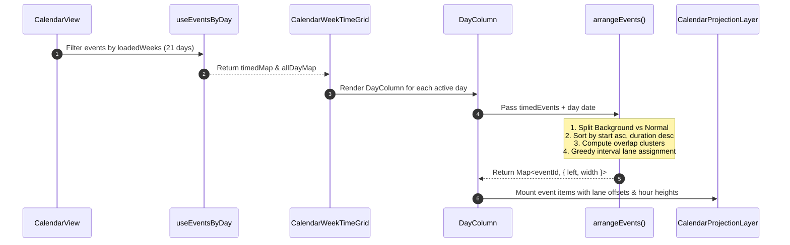
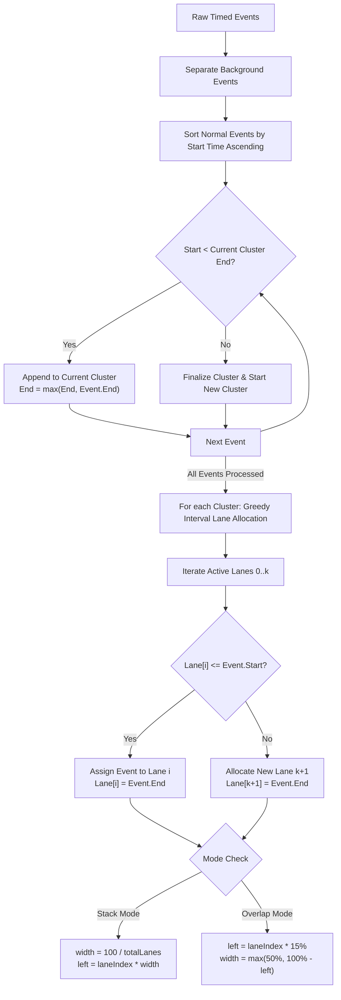

# Desktop Calendar Engine Documentation

> **File:** `web/src/components/Calendar/CalendarView.tsx`, `CalendarWeekTimeGrid.tsx`, `DayColumn.tsx`, `useCalendarDragResize.ts`  
> **Status:** Production Architecture Specification  
> **Scope:** Multi-View State Machine, Overlapping Lane Layout Algorithm, Time Grid Coordinates, Drag-and-Drop / Resize Engine, Event Dock, and RFC 5545 iCalendar Processing.

---

## 1. Multi-View Architecture

The Tide Desktop Calendar operates as a unified state machine orchestrating four distinct visual projection modes: **Week View**, **Day View**, **Month View**, and **Agenda View**.

```
                        ┌───────────────────┐
                        │   CalendarView    │
                        │  (Orchestrator)   │
                        └─────────┬─────────┘
                                  │ viewMode
          ┌───────────────┬───────┴───────┬───────────────┐
          ▼               ▼               ▼               ▼
   ┌─────────────┐ ┌─────────────┐ ┌─────────────┐ ┌─────────────┐
   │  Week View  │ │  Day View   │ │ Month View  │ │ Agenda View │
   │ (Time Grid) │ │ (Day Column)│ │(Grid Cells) │ │(Chron List) │
   └─────────────┘ └─────────────┘ └─────────────┘ └─────────────┘
```

### 1.1 State Machine & Mode Transitions
The active view mode is managed via a synchronized dual-state pattern:
- **Controlled Mode:** Prop `viewMode: CalendarViewMode` (`'week' | 'day' | 'month' | 'agenda'`).
- **Uncontrolled Mode:** Internal state `internalViewMode` initialized to `'week'`.
- **Mode Switching:** Handled by `handleViewModeChange(mode)`. When returning to `'week'` mode from any other view, `hasInitializedScroll.current` is reset to `false` to trigger automatic re-centering of the time container to the user's current time or workday morning (08:00).

### 1.2 Multi-Week Sliding Window Buffer
To ensure 60fps horizontal pagination and week switching, `CalendarView` maintains a 3-week sliding window buffer in `loadedWeeks`:
```typescript
const [loadedWeeks, setLoadedWeeks] = useState<Date[]>(() => {
    const currentStart = startOfWeek(date, { weekStartsOn: 1 });
    return [
        subWeeks(currentStart, 1), // Previous Week
        currentStart,              // Active Week
        addWeeks(currentStart, 1)  // Next Week
    ];
});
```
- In `CalendarWeekTimeGrid`, `loadedWeeks` is flattened into 21 discrete day keys (`yyyy-MM-dd`) using `date-fns/addDays`.
- Event queries are pre-indexed into two discrete hash maps using `useEventsByDay`:
  - `timedMap: Map<string, CalendarEvent[]>` — Events with explicit start/end hour boundaries.
  - `allDayMap: Map<string, CalendarEvent[]>` — All-day events, deadlines, and linked task milestones.

---

## 2. Overlapping Event Lane Layout Algorithm

The overlapping layout engine resides in `DayColumn.tsx` (`arrangeEvents`). It maps arbitrarily overlapping event intervals within a single day column into distinct visual columns (lanes) without temporal collisions.

### 2.1 Background Event Segregation
Before collision detection begins, "Background Events" are extracted and exempted from the lane-partitioning algorithm:
1. **Group Parent Events:** Events whose IDs appear in other events' `parent_id` attribute.
2. **Multi-Day Spanning Intermediates:** Events where `!isSameDay(start, end)` and current column date is neither start nor end day.

These events bypass cluster allocation and are assigned full column geometry:
$$\text{left} = 0\%, \quad \text{width} = 100\%$$
They render behind all normal events in the z-stack.

### 2.2 Event Sorting and Cluster Detection
All normal timed events are sorted with a primary key of start time and a secondary key of duration (descending):

```typescript
const sorted = [...normalEvents].sort((a, b) => {
    if (a.start === b.start) {
        return new Date(b.end).getTime() - new Date(a.end).getTime();
    }
    return new Date(a.start).getTime() - new Date(b.start).getTime();
});
```

A cluster is defined as a contiguous set of mutually or transitively overlapping events:
1. Initialize `currentCluster = [evt[0]]`, `clusterEnd = evt[0].end`.
2. For each subsequent event $E_i$:
   - If $\text{start}(E_i) < \text{clusterEnd}$:
     $$\text{currentCluster.push}(E_i), \quad \text{clusterEnd} = \max(\text{clusterEnd}, \text{end}(E_i))$$
   - Else:
     Push `currentCluster` to `clusters`, start new cluster with $E_i$, and set $\text{clusterEnd} = \text{end}(E_i)$.

### 2.3 Greedy Lane Assignment (Graph Interval Coloring)
Each cluster is solved independently using greedy interval coloring:

```typescript
clusters.forEach(cluster => {
    const lanes: number[] = []; // Stores the latest end timestamp for each column
    const eventLanes = new Map<string, number>();

    cluster.forEach(evt => {
        const start = new Date(evt.start).getTime();
        const end = new Date(evt.end).getTime();

        let placed = false;
        for (let i = 0; i < lanes.length; i++) {
            if (lanes[i] <= start) {
                lanes[i] = end;
                eventLanes.set(evt.id, i);
                placed = true;
                break;
            }
        }
        if (!placed) {
            lanes.push(end);
            eventLanes.set(evt.id, lanes.length - 1);
        }
    });
    // ...
});
```

### 2.4 Horizontal Width and Offset Calculation
The layout engine supports two visual positioning strategies:

#### Mode 1: Stack Mode (`overlapMode = 'stack'`)
Even column division across the total number of lanes in the cluster:
$$\text{widthPercent} = \frac{100}{\text{lanes.length}}$$
$$\text{left} = \text{laneIndex} \times \text{widthPercent}$$
$$\text{width} = \text{widthPercent}$$

#### Mode 2: Cascade / Shingle Mode (`overlapMode = 'overlap'`)
Staggered offset with fixed progressive left shifts:
$$\text{left} = \text{laneIndex} \times 15\%$$
$$\text{width} = \max(50\%, 100\% - (\text{laneIndex} \times 15\%))$$

### 2.5 Layout Equality Memoization (`areLayoutsEqual`)
To avoid triggering unnecessary React DOM layout recalculations, `areLayoutsEqual` verifies coordinate maps:
```typescript
function areLayoutsEqual(
    a: Map<string, { left: number; width: number }>,
    b: Map<string, { left: number; width: number }>
): boolean {
    if (a === b) return true;
    if (a.size !== b.size) return false;
    for (const [id, posA] of a) {
        const posB = b.get(id);
        if (!posB || posA.left !== posB.left || posA.width !== posB.width) return false;
    }
    return true;
}
```

---

## 3. Time Grid Coordinate System

### 3.1 Minute-to-Pixel Mapping
The vertical coordinate system translates fractional 24-hour time to absolute pixel heights:
- Standard hour row height: $H_{\text{hour}} = 48\text{px}$ (configurable via `hourHeight`).
- Scale factor:
  $$S_{\text{min}} = \frac{H_{\text{hour}}}{60} = \frac{48}{60} = 0.8\text{ px/minute}$$
- Given an event starting at hour $h \in [0, 23]$ and minute $m \in [0, 59]$:
  $$Y_{\text{top}} = (h \times 60 + m) \times S_{\text{min}}$$
- Given duration in minutes $\Delta m = \frac{\text{End} - \text{Start}}{60000}$:
  $$H_{\text{event}} = \max(15 \times S_{\text{min}}, \Delta m \times S_{\text{min}})$$
  *(Minimum rendered height is clamped to 15 minutes of visual height to guarantee text readability)*.

### 3.2 Snapping Resolution
- **Standard Mode:** 10-minute or 15-minute grid snapping:
  $$\text{snappedMinute} = \text{round}\left(\frac{\text{rawMinute}}{\Delta_{\text{snap}}}\right) \times \Delta_{\text{snap}} \quad (\Delta_{\text{snap}} \in \{10, 15\})$$
- **Precise Mode:** 1-minute snapping (`Alt` or `Shift` held down):
  $$\Delta_{\text{snap}} = 1\text{ minute}$$

---

## 4. Drag-and-Drop & Resizing Engine

Managed across `useCalendarDragResize.ts`, `useCalendarDragState.ts`, and `useCalendarTouch.ts`.

### 4.1 Pointer Gesture State Machine
```
[ MouseDown ] ──> [ Pending Drag (>3px delta?) ]
                         │
         ┌───────────────┴───────────────┐
         ▼ (Yes: delta > 3px)            ▼ (No: MouseUp within 3px)
  [ Drag State Active ]           [ Event Click Triggered ]
         │
         ├── Pointer Move ──> Recalculate Y + Delta + ScrollDelta
         │                    Clamped to [0, 1440 - duration]
         │                    Snap to 10m (Normal) or 1m (Precise)
         │                    Drive Framer MotionValue (dragOverlayY)
         │
         └── Mouse Up ──────> Check Sidebar Drop Intersection
                              ├── If Over Note: Fire CustomEvent & Consume
                              └── Else: Commit onEventUpdate(id, newStart, newEnd)
```

### 4.2 Precise Mode Physics & Speed Gearing
When `Alt` or `Shift` is depressed:
1. `isPreciseModeRef.current = true`.
2. Horizontal drift is completely locked: `gearedMouseRef.current.x = anchor.gearX`.
3. Vertical displacement is geared down to **30% speed**:
   $$\Delta Y_{\text{geared}} = \Delta Y_{\text{physical}} \times 0.3$$
4. Loupe ruler edge anchoring: `activeEventEdgeRef.current` dynamically reflects the exact minute being targeted, driving the screen-space Loupe magnification overlay without jitter.

### 4.3 Midnight Boundary Clamping
To prevent multi-day event corruption during vertical drags and creations:
- **Move Clamping:**
  $$0 \le Y_{\text{new}} \le 1440 - \text{duration}$$
- **Resize Clamping:**
  $$15\text{ min} \le \text{height} \le 1440 - \text{originalTop}$$
- **Creation Drag:**
  Clamps delta so dragged duration cannot extend backwards before 00:00 or forwards past 23:59:
  $$\text{maxForwardPx} = (1440 - \text{startMins}) \times S_{\text{min}}$$
  $$\text{maxBackwardPx} = -\text{startMins} \times S_{\text{min}}$$

### 4.4 High-Performance Motion Layer
To prevent React re-render cycles during rapid mouse moves, positions are piped directly into Framer Motion `MotionValue` objects:
- `dragOverlayY.set(newTop)`
- `dragOverlayX.set(dragState.initialX + deltaX)`
- `resizeHeightMV.set(newHeight)`
- `creationEndYMV.set(clampedY)`

The DOM transforms react directly on the compositor thread via `CalendarProjectionLayer.tsx`.

### 4.5 Inter-Component Drag Events
When dragging events outside the grid (e.g. into the notes sidebar or task lists):
- Emits window custom event `tide:event-drag-move` with pointer coordinates.
- On mouse release, emits `tide:event-drag-drop`. If a receiver consumes the event (`detail.consumed = true`), the calendar aborts the grid update and preserves original event timing.

---

## 5. Event Dock (Floating Drawer)

Implemented in `EventDock.tsx` and `EventPreview.tsx`.

```
┌─────────────────────────────────────────────────────────────┐
│  Desktop Viewport Bottom                                    │
│                                                             │
│       ┌───────────────┐ ┌───────────────┐                   │
│       │ Pinned Event  │ │ Active Event  │   (Floating Dock) │
│       │ (Min / Max)   │ │ (Fly-in Card) │                   │
│       └───────────────┘ └───────────────┘                   │
└─────────────────────────────────────────────────────────────┘
```

- **Dock Eligibility:** Displays events referenced in `pinnedEventIds` plus the currently selected `activeEventId` (if not already pinned).
- **Z-Index Layering:** Placed at `z-[50]` with pointer-events pass-through on the parent container (`pointer-events-none`) and selective activation on event cards (`pointer-events-auto`).
- **State Controls:**
  - Minimize (`onMinimize`): Collapses card to an icon strip.
  - Pin / Unpin (`onPin`): Keeps card persisted in dock across page navigation.
  - Theme Lookup: Correlates `event.id` with `files.parent_id` to determine color themes and tags.

---

## 6. RFC 5545 iCalendar (ICS) Processing

Full compliance with RFC 5545 is implemented in `web/src/lib/icsParser.ts` and `CalendarImportModal.tsx`.

### 6.1 Parser Engine Pipeline
```
[ Raw .ics String ]
       │
       ▼
[ Line Unfolding ] (Remove CRLF + Linear Whitespace per RFC 5545 §3.1)
       │
       ▼
[ Component Tokenizer ] (Tracks BEGIN:VEVENT -> END:VEVENT depth)
       │ (Skips nested VALARM, VTIMEZONE subcomponents)
       ▼
[ Property & Param Extraction ] (Parses TZID, VALUE=DATE, RRULE)
       │
       ▼
[ Timezone Normalization ] (Matches Windows & Olson IDs against Intl)
       │
       ▼
[ Output: ParsedIcsEvent[] ]
```

### 6.2 Timezone Mapping & Offsets
Handles both IANA standard names and legacy Windows registry names:
```typescript
const WINDOWS_TZ_MAP: Record<string, string> = {
    'W. Europe Standard Time': 'Europe/Berlin',
    'Central Europe Standard Time': 'Europe/Prague',
    'Romance Standard Time': 'Europe/Paris',
    'GMT Standard Time': 'Europe/London',
    'Eastern Standard Time': 'America/New_York',
    'Pacific Standard Time': 'America/Los_Angeles',
    // ...
};
```
UTC millisecond offsets are dynamically calculated using `Intl.DateTimeFormat.formatToParts(date)`.

### 6.3 Duration and Recurrence Rules
- **Duration Parsing (`parseIcsDuration`):** Parses ISO durations (e.g. `PT1H30M`, `P1D`, `PT45M`) into exact millisecond offsets:
  $$\text{durationMs} = (\text{days} \times 86400 + \text{hours} \times 3600 + \text{minutes} \times 60 + \text{seconds}) \times 1000$$
- **Recurrence (`RRULE`):** Extracted as raw string (e.g. `FREQ=WEEKLY;BYDAY=MO,WE,FR;UNTIL=...`) and attached to `ParsedIcsEvent.recurrenceRule`.
- **Cancellation Detection:** Checks `STATUS:CANCELLED` to flag `isCancelled: true`, triggering strike-through and visual muting in `DayColumn`.

### 6.4 Export Generator Format
Export serialization formats internal events into compliant RFC 5545 streams:
```text
BEGIN:VCALENDAR
VERSION:2.0
PRODID:-//Tide//Tide Calendar Engine//EN
CALSCALE:GREGORIAN
BEGIN:VEVENT
UID:evt_983f2a@tide.app
DTSTAMP:20261115T190000Z
DTSTART:20261115T090000Z
DTEND:20261115T100000Z
SUMMARY:Architecture Sync
DESCRIPTION:Desktop Calendar Engine Review
STATUS:CONFIRMED
END:VEVENT
END:VCALENDAR
```

---

## 7. Mermaid Lifecycle & Collision Diagrams

### 7.1 Calendar Event Rendering Lifecycle


### 7.2 Collision Detection & Greedy Lane Coloring Flowchart

