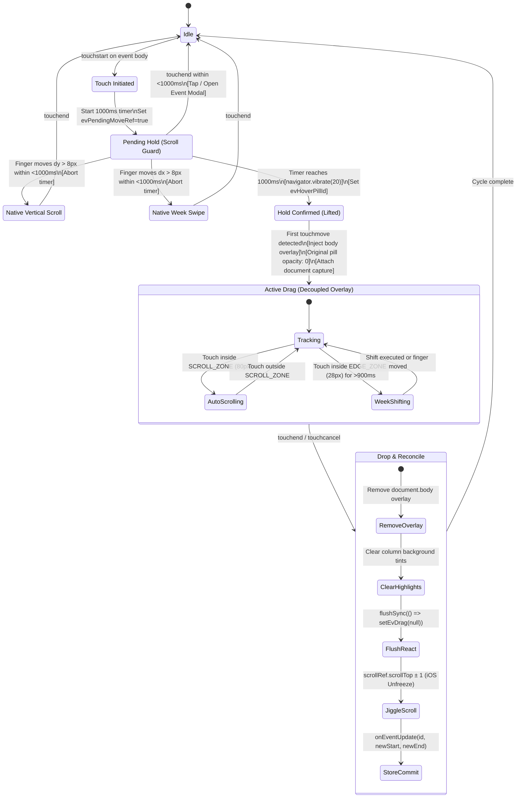

# Mobile Touch Gestures & Calendar Drag Architecture

This document provides an exhaustive technical deep-dive into the mobile touch calendar architecture in Tide, specifically detailing the interaction models, gesture orchestration, coordinate mathematics, and browser-level workarounds implemented in `web/src/components/Layout/MobileLayout.tsx`, `MobileWeekGrid.tsx`, and `mobile/useMobileSwipeGestures.ts`.

---

## 1. Mobile Calendar Overview

Mobile calendar interfaces present unique ergonomic challenges: dense time-slot information must coexist with touch navigation in a constrained viewport. Tide resolves this tension through a multi-tiered touch interaction hierarchy.

### High-Density Touch UI
The mobile scheduling interface provides:
- **Vertical Time Strip & Hour Grid**: 24-hour vertical timeline with configurable and persisted slot heights (`hourH` between `24px` and `120px`, stored in `tide_mobile_hour_h`). Time lines are rendered via memoized CSS linear gradients (`HourGridLines`) to avoid DOM layout recalculations during drag movements.
- **Overnight & Multi-Day Spans**: Multi-day events are split and clamped across day boundaries with directional indicators (`↑` / `↓`) and dashed boundary borders.
- **Cascaded Cluster Packing**: Overlapping events in single columns are grouped into temporal clusters and offset horizontally using a cascading lane algorithm (`Math.min(30, 55 / (lanes - 1))%` per lane), ensuring all overlapping appointments remain touch-accessible.

### Horizontal DateWheel & View Modes
- **DateWheel (`MobileDateWheel.tsx`)**: An Apple-style horizontal scroll container allowing one-touch day switching. Highlights the active day, marks the current day with a signature indicator, and syncs bidirectionally with the active calendar viewport.
- **Single-Day (`day`) vs Multi-Day / Week (`week`) Views**:
  - In `day` view, the grid focuses on a single day column with larger touch targets.
  - In `week` view (or 3-day mode on compact screens), columns sit side-by-side inside a horizontally swipeable container managed by `useMobileSwipeGestures`.
- **Swipe Navigation**:
  - Horizontal swipe gestures across the viewport transition days or weeks.
  - Direct DOM transforms (`translateX(${dx * 0.4}px)`) are applied via `requestAnimationFrame` to maintain 60/120fps fluid tracking without causing React component re-renders.

---

## 2. The 1-Second Hold Drag System

### The Touch Ambiguity Problem
On touch screens, a single finger contact (`touchstart`) can represent multiple conflicting user intentions:
1. **Vertical page scrolling** through the 24-hour grid.
2. **Horizontal week swiping** across dates.
3. **Event moving** to reschedule an existing appointment.
4. **Event resizing** by dragging top or bottom edge handles.
5. **New event creation** by pressing and sweeping over an empty time slot.

If event dragging starts immediately on `touchstart`, vertical scrolling becomes impossible whenever the user touches down on an event card.

```
                  ┌──────────────────────┐
                  │ touchstart on Event  │
                  └──────────┬───────────┘
                             │
            ┌────────────────┴────────────────┐
            ▼                                 ▼
   Move > 8px within < 1000ms        Hold >= 1000ms with dx,dy <= 8px
            │                                 │
            ▼                                 ▼
   [Abort Hold Timer]               [Haptic Feedback: 20ms]
   [Delega te to Scroll/Swipe]      [Visual Lift: evHoverPillId]
                                              │
                                              ▼
                                    First Movement (dx/dy)
                                              │
                                              ▼
                                    [Spawn Decoupled Overlay]
                                    [Activate Document Capture]
```

### The 1000ms Hold Timer Threshold
To eliminate conflicts between vertical scrolling and event moving:
- **Non-blocking `touchstart`**: When touching an event body (`evTouchStart` with `type: 'move'`), `e.preventDefault()` and `e.stopPropagation()` are **deliberately NOT called**.
- **Pending Flag**: An internal flag `evPendingMoveRef.current = true` is set immediately. This blocks background column creation (`colTouchStart`) while the event hold is pending.
- **Early Movement Detection**: Listeners for `touchmove` and `touchend` are attached with `{ passive: true }`:
  ```ts
  const onEarlyMove = (evt: TouchEvent) => {
    if (!evt.touches.length) return;
    const dx = Math.abs(evt.touches[0].clientX - startX);
    const dy = Math.abs(evt.touches[0].clientY - startY);
    if (dx > 8 || dy > 8) {
      cancelPending(); // Clears timer & sets evPendingMoveRef = false
      document.removeEventListener('touchmove', onEarlyMove);
      document.removeEventListener('touchend', onEarlyEnd);
    }
  };
  ```
  If the user moves their finger more than `8px` in any direction before the timer elapses, the gesture is identified as a scroll or swipe. The hold timer is cancelled, and native browser scrolling continues uninterrupted.

### Haptic Feedback & Visual Pulse
Once the hold duration threshold (1000ms hold timer) is satisfied without exceeding the 8px movement threshold:
1. **Haptic Vibration**: `navigator.vibrate?.(20)` is triggered, delivering tactile confirmation to the user that the event has detached from the scroll surface.
2. **Visual Lift Cue**: `setEvHoverPillId(eventId)` is invoked, applying a subtle elevation pulse to the pill in place.
3. **Global Drag Attribute**: `document.body.setAttribute('data-ev-drag', '1')` is set to notify peripheral layout components (such as swipe navigators and bottom navigation sheets) to disable gesture capture.

### State Transitions
| State | Trigger | DOM & Visual Behavior | Event Propagation |
|---|---|---|---|
| `IDLE` | Default state | Normal event card inside column DOM | Native touch flow |
| `HOLDING` | `touchstart` on event | Pill untouched, `evPendingMoveRef = true` | Passive pass-through (scrolling allowed) |
| `LIFTED` | Hold threshold met | `evHoverPillId` set; haptic pulse `20ms` | Native scroll blocked; awaiting move |
| `DRAGGING` | First `touchmove` post-hold | Original pill `opacity: 0`; viewport DOM overlay created; capture listeners active | `e.preventDefault()` on all movements |
| `DROPPED` | `touchend` / `touchcancel` | Overlay unmounted; `flushSync` resets drag state; store updated; scroll jiggled | Cleaned up |

---

## 3. Decoupled DOM Overlay Architecture

### Why In-Grid Dragging Fails on Mobile Browsers
Earlier iterations of mobile calendar dragging attempted to update React state during `touchmove` to re-render the event pill in the target column. This approach consistently failed on mobile WebKit and Blink engines due to the **Target Detachment Failure**:

```
[Touch Sequence on Target Element]
  Finger touches <div id="pill-col-0">
  User moves finger into Column 1
  React state updates: event moves to Column 1
  React unmounts <div id="pill-col-0"> and mounts <div id="pill-col-1">
  🚨 BROWSER QUIRK: Touch event stream is bound to the original DOM node.
  Because the original node was detached from the document tree,
  subsequent touchmove and touchend events stop firing or fail to bubble!
  Result: Drag locks up after crossing the first column boundary.
```

#### Historical Failed Approaches

| Approach | Result | Root Cause of Failure |
|---|---|---|
| `colFromX` with bounding rect cached at drag start | Only adjacent columns worked | Week-swipe container applied CSS transforms mid-drag; cached rect coordinates became stale. |
| `elementFromPoint(x, y)` + `flushSync` in `touchmove` | Frozen touch pipeline | Synchronous DOM flushes inside native high-frequency touch callbacks blocked the compositor thread. |
| React state update (`setEvDrag({ colIdx })`) | Drag halted at column boundary | Target element was removed from Column A and recreated in Column B, breaking the browser touch event stream. |

### The Decoupled DOM Overlay Solution
To achieve butter-smooth multi-column dragging without losing touch events:

1. **Keep Original Pill Mounted**: The original event element remains in its original column DOM position throughout the entire drag. Its CSS is simply set to `opacity: 0` so it remains invisible while preserving the active touch target and layout flow.
2. **Direct DOM Viewport Overlay**:
   A dedicated clone of the event card is appended directly to `document.body`:
   ```ts
   const overlay = document.createElement('div');
   overlay.style.cssText = `
     position: fixed;
     left: ${pillRect.left}px;
     top: ${pillRect.top}px;
     width: ${pillRect.width}px;
     height: ${pillRect.height}px;
     background: ${color}EE;
     border-radius: 7px;
     border: 2px solid ${color};
     box-shadow: 0 8px 28px ${color}55;
     z-index: 9999;
     pointer-events: none;
     will-change: transform;
   `;
   document.body.appendChild(overlay);
   dragOverlayRef.current = overlay;
   ```
3. **GPU-Accelerated Movement**: During `touchmove`, the overlay is translated using direct DOM style mutation:
   ```ts
   dragOverlayRef.current.style.transform = `translate(${dx}px, ${dy}px)`;
   ```
   **Zero React re-renders are triggered during position tracking.**
4. **Direct Column Highlighting**: The drop target column is highlighted by setting `targetEl.style.background = 'rgba(59,130,246,0.08)'` directly on the column DOM nodes, bypassing React's reconciliation engine entirely.

### Real-Time Touch Coordinate Translation

#### Time Snapping Mathematics
Tide enforces a 15-minute snapping interval (`SNAP_MINS = 15`) across all time calculations:

$$\text{pxToMins}(px, hh) = \frac{px}{hh} \times 60$$

$$\text{snapMins}(m) = \left\lfloor \frac{m + 7.5}{15} \right\rfloor \times 15$$

$$\text{minsToPx}(m, hh) = \frac{m}{60} \times hh$$

When moving an event:
```ts
const deltaMins = snapMins(pxToMins(touch.clientY - d.startTouchY, hourHRef.current));
const newTotalMins = Math.max(0, Math.min(23 * 60 + 45, originalStartMins + deltaMins));

const previewStart = new Date(targetDay);
previewStart.setHours(Math.floor(newTotalMins / 60), newTotalMins % 60, 0, 0);
const previewEnd = new Date(previewStart.getTime() + eventDuration);
```

#### Auto-Scrolling and Boundary Snapping
- **Vertical Auto-Scroll Zone (`SCROLL_ZONE = 80px`)**:
  When the dragged finger moves within 80px of the top or bottom viewport edge, an auto-scrolling loop is kicked off via `requestAnimationFrame`:
  ```ts
  const speed = relY < SCROLL_ZONE
    ? (SCROLL_ZONE - relY) / 8
    : (relY - (viewportHeight - SCROLL_ZONE)) / 8;
  scrollRef.current.scrollTop += dir * Math.max(2, speed);
  ```
- **Horizontal Edge Week Shifting (`EDGE_ZONE = 28px`)**:
  Holding the drag overlay within 28px of the screen's left or right edge for `900ms` triggers a week or multi-day shift (`onWeekShiftRef.current?.(dir)`), allowing events to be moved across week boundaries.

---

## 4. iOS UIScrollView Conflict Resolution & Touch Quirks

Developing high-performance touch applications for iOS Safari requires dealing with several deeply rooted WebKit quirks.

### 1. iOS Rubber-Banding and Scroll Freeze: The Jiggle Hack
#### The Problem
When dragging an event or resizing, `evt.preventDefault()` is called on `touchmove` to stop iOS Safari from panning the page or rubber-banding the scroll container.
However, WebKit has a notorious bug: calling `preventDefault()` on touch events inside a scrollable container can permanently freeze the underlying `UIScrollView`. Once the finger lifts (`touchend`), the container will not respond to normal scroll flicks until the page is reloaded or the scroll position is forcefully modified.

#### The Jiggle Hack Solution
Tide resolves this using the synchronous scrollTop jiggle in every `onEnd` touch handler:
```ts
// iOS: preventDefault() during drag can freeze UIScrollView.
// Jiggling scrollTop forces WebKit to unfreeze and re-evaluate the scroll context.
if (scrollRef.current) {
  const st = scrollRef.current.scrollTop;
  scrollRef.current.scrollTop = st + 1;
  scrollRef.current.scrollTop = st;
}
```
By imperatively altering `scrollTop` by $+1\text{px}$ and immediately reverting it within the same JavaScript execution frame, the browser's native compositing layer is forced to invalidate its gesture lock and re-arm UIScrollView touch event processing.

### 2. `touchAction: none` WebKit Caveats
#### The Problem
CSS `touch-action: none` informs the browser that JavaScript will handle all gestures on an element. However:
> **WebKit evaluates `touch-action` strictly at the moment `touchstart` occurs.**

Changing an element's CSS `touchAction` property dynamically from `pan-y` to `none` while a touch gesture is already in progress has **zero effect** on the active touch stream in Safari.

#### Tide's Handling
- The main grid container sets `touchAction: 'pan-y'` permanently, ensuring vertical scrolling always feels native.
- Individual event cards specify `touchAction: 'pan-y'` by default.
- To intercept the touch stream once the 1-second hold completes, Tide bypasses CSS `touch-action` entirely: it attaches **document-level capture-phase listeners** with `{ passive: false, capture: true }`:
  ```ts
  document.addEventListener('touchmove', onMove, { passive: false, capture: true });
  document.addEventListener('touchend', onEnd, { capture: true });
  document.addEventListener('touchcancel', onEnd, { capture: true });
  ```
  The capture-phase listener intercepts the event at the root of the DOM hierarchy before any element-level handlers can run, executing `evt.preventDefault()` directly.

### 3. React 19 / Concurrent Mode `flushSync` Requirement
#### The Problem
In modern React (React 18 and React 19), state updates are batched asynchronously by default. When an event is dropped on `touchend`:
1. `setEvDrag(null)` is called.
2. `onEventUpdate(...)` is invoked.
3. Zustand / DataStore updates the event state optimistically.

If `setEvDrag(null)` is batched and delayed until the next microtask while the store update fires immediately, the calendar re-renders with both the newly updated event AND the stale `evDrag` preview active. This produces an unsightly visual artifact known as a **ghost event** (the event appears duplicated at both the old and new slots for several frames).

#### The Fix
Tide wraps all terminal drag state resets in `flushSync`:
```ts
// Enforce synchronous DOM and state reconciliation before dispatching store update
flushSync(() => setEvDrag(null));
onEventDragChange?.(false);

// Safe to notify parent and persist updates
if (d && (d.previewStart.getTime() !== d.originalStart.getTime() || ...)) {
  onEventUpdateRef.current?.(d.eventId, d.previewStart, d.previewEnd);
}
```
This guarantees that the drag preview state is completely purged from the virtual and physical DOM before any external listeners receive the updated coordinates.

---

## 5. Touch Gesture Lifecycle State Diagram

The following Mermaid state diagram illustrates the end-to-end lifecycle of touch gestures on the mobile calendar grid:



---

## 6. Implementation Checklist & Maintenance Rules

When editing or extending `MobileLayout.tsx`, `MobileWeekGrid.tsx`, or any mobile gesture handlers, adhere to these non-negotiable architectural rules:

1. **Never Remove the Jiggle Hack**: The `scrollRef.scrollTop = st + 1; scrollRef.scrollTop = st;` snippet in `onEnd` prevents iOS Safari from permanently freezing scrolling after `preventDefault()`.
2. **Never Move Event Elements Across Columns in React State During Drag**: Keep the original pill mounted at `opacity: 0` in its initial column. Move only the decoupled `fixed` DOM overlay.
3. **Always Use `flushSync` When Dropping**: Wrap `setEvDrag(null)` in `flushSync` before calling `onEventUpdate` to prevent visual ghost duplicates.
4. **Always Clean Up Capture Listeners in Both `touchend` and `touchcancel`**: Mobile operating systems emit `touchcancel` whenever a system popup, call banner, or app switch occurs. Failing to remove listeners on `touchcancel` will permanently break grid interactions.
5. **Keep `touchmove` Throttled**: Live drag tracking must update direct DOM attributes (`style.transform` and `style.background`) or run inside `requestAnimationFrame`. Never call `setState` on raw touchmove events.
6. **Preserve `evPendingMoveRef`**: Column creation (`colTouchStart`) must always verify that `evPendingMoveRef.current === false` before starting a new event drag.

---

## 7. Tagesliste: Halten und Doppeltipp

Gilt nur für die Tagesansicht der mobilen Liste (`DbTimelineDay` mit `proportional` und `onQuickEdit`/`onDraftAt`). Monats- und Agenda-Liste bleiben unverändert und bekommen keine Handler. Code: `mobile/listGestures.ts` (reiner Detektor), `mobile/useDayListGestures.ts` (DOM-Anbindung), `mobile/timelineMath.ts`, `mobile/quickEditMath.ts`, `mobile/QuickEditGrid.tsx`, `mobile/quickEditState.ts`.

### Erkennung

| Geste | Schwelle | Wirkung |
|-------|----------|---------|
| Halten | 450 ms ohne Bewegung | `onQuickEdit(ev)` für die Terminkarte unter dem Finger |
| Doppeltipp | zweiter Tipp binnen 300 ms, höchstens 24 px vom ersten entfernt | `onDraftAt(start, end)` |
| Abbruch | mehr als 10 px Bewegung | beendet Halten und Tipp-Verfolgung; Scrollen und Tages-Swipe laufen ungestört weiter |

Der Detektor beobachtet nur: er ruft nie `preventDefault` auf `touchstart`/`touchmove` und blockiert deshalb weder vertikales Scrollen noch den horizontalen Tageswechsel. Mehr als ein Finger bricht ab.

**Ignoriert** werden Touches auf Bedienelementen (`button, a, input, textarea, [role=button]`), also Löschen, Erledigt-Haken, Bearbeiten usw. Ausnahme: der Kartenkörper ist selbst ein Button, trägt aber `data-card-body` und zählt mit. Todos und Ganztags-Pills sind keine `events` für den Hook; Halten auf ihnen öffnet nichts (der Treffer wird über `[id^="ev-"]` gegen die echten Termine geprüft).

### Klick-Unterdrückung und Expand-Rückgängig

- Nach einer ausgelösten Geste ruft `onTouchEnd` `preventDefault()` auf (kein synthetischer Klick, kein Doppeltipp-Zoom) und setzt zusätzlich eine 600-ms-Sperre: `onClickCapture` verschluckt den nächsten Klick einmalig (`preventDefault` + `stopPropagation`), falls der Browser trotzdem einen erzeugt.
- Ein einzelner Tipp klappt eine Karte sofort auf. Der Doppeltipp merkt sich den Expand-Zustand vom Beginn des vorherigen Touches und stellt ihn wieder her, sodass der erste Tipp des Paars keine Karte offen lässt.

### Zeit aus der Tipp-Position

1. Alle `[data-seg]`-Elemente (Block- und Lücken-Segmente) liefern Rechteck und `data-seg-start`/`data-seg-end` (ms); Positionen relativ zur Liste, nach `top` sortiert (`collectSegRects`).
2. `timeFromTap(segs, y, DAY_PX_PER_MIN)`: im Segment linear interpoliert; über/unter allen Segmenten mit 0,8 px/min extrapoliert; in einem Loch zwischen Segmenten die nächstliegende Kante.
3. `draftRangeFromTime(raw, dayStart)`: auf 10 min gerundet, 60 min Dauer, Start in `[Tagesbeginn, Tagesende - 60 min]` geklemmt.
4. **Leerer Tag** (keine Segmente): `emptyDayDraft`, 09:00; heute die nächste volle Stunde, höchstens 23:00.

### Schnellbearbeitungs-Raster (`QuickEditGrid`)

- Portal mit `fixed inset-0`, Tagesraster mit 56 px pro Stunde, scrollt zum aktiven Block. Verschieben über den Körper, Größe über 44-px-Griffe oben/unten, Raster 10 min, Mindestlänge 10 min.
- **Wahre Spanne im State:** Start/Ende bleiben unverändert (auch über Mitternacht); `visibleRange` schneidet nur fürs Zeichnen zu. So behält z. B. 22:00-02:00 seine Länge.
- 6 px Totzone vor dem ersten Ziehen; verfolgt wird der Finger über `touches[].identifier` (erster Finger), weitere Finger werden ignoriert.
- `touchend` übernimmt die Spanne, `touchcancel` (Systemunterbrechung) setzt auf den Ausgangswert zurück.
- Am Ende: `flushSync(() => { setRange; setDragging(false) })` und der iOS-Scroll-Jiggle (`scrollTop ± 1`, siehe Abschnitt 4), damit UIScrollView nach `preventDefault` nicht einfriert.
- ✓ ruft `onConfirm(start, end)`, ✕ ruft `onCancel`; das Raster speichert selbst nichts.

### Proportionale Tagesliste

- Nur die Tagesansicht übergibt `proportional`; Monat und Agenda nutzen die alte Liste.
- Konstanten (`timelineMath.ts`): `DAY_PX_PER_MIN` 0,8, `DAY_MIN_BLOCK_PX` 68, `GAP_PX` 34. Blockhöhe = `max(68, Minuten * 0,8)`.
- Lücken sind 34 px hoch; nur die Lücke, in der gerade "jetzt" liegt (`gapHeightPx`), wächst auf `Minuten * 0,8` (animiert).
- Die Jetzt-Linie wird über `nowPlacement` im passenden Segment (Block oder Lücke, Anteil) platziert, vor dem ersten bzw. nach dem letzten Termin am Rand.

### Entwurfs-Ablauf

Doppeltipp → `onDraftAt` → `quickEditForDraft` → `QuickEditGrid` (gestrichelter Block) → ✓ `confirmQuickEdit` → vorhandenes Bearbeiten-Sheet (`MobileEditEventSheet`) mit Event `id: ''` → Speichern ruft `onNewEvent(start, end, meta)` (leerer Titel wird zu "Neuer Termin"; kein Löschen, kein Store-Update). Beim Halten auf einen echten Termin: ✓ ruft `onEventUpdate(id, start, end)`, nur wenn sich die Spanne geändert hat.

### Bekannte Grenzen / noch am Gerät zu prüfen

- Noch kein Test auf echten Geräten: iOS-Textauswahl/Callout beim langen Halten, die Klick-Unterdrückung und das Gefühl von Swipe/Scroll sind nur per Unit-Tests abgedeckt.
- Maßstab (`DAY_PX_PER_MIN`) und Mindesthöhe (`DAY_MIN_BLOCK_PX`) sind Tuning-Werte.
- `quickEdit` wird bei externem Ansichts- oder Datumswechsel nicht zurückgesetzt.
- Ganztägig wird bei Entwürfen nicht als ganztägig gespeichert.
