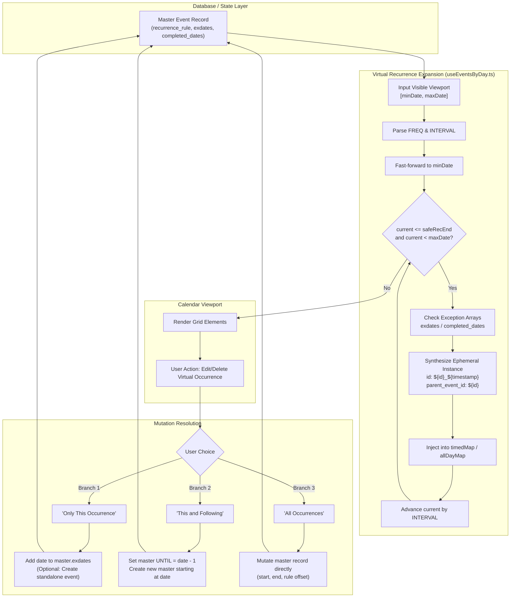

# Calendar Recurrence Evaluation and RFC 5545 iCalendar Engine

> **File:** `web/src/lib/icsParser.ts`, `web/src/components/Calendar/useEventsByDay.ts`, `web/src/store/slices/createEventsSlice.ts`  
> **Status:** Production Technical Specification  
> **Scope:** RFC 5545 iCalendar (`.ics`) Ingestion, Timezone Resolution, Recurrence Rules Evaluation, Ephemeral Virtual Instance Expansion, Exception Overrides, and RFC-Compliant `.ics` Serialization.

---

## 1. Architectural Overview

Tide separates calendar event persistence from recurrence presentation. Rather than materializing infinite recurring events into SQLite storage or encrypted sync payloads, recurring schedules are stored as a **single canonical master record** carrying an RFC 5545 recurrence rule. 

The client runtime dynamically evaluates recurrence rules against the active viewport window (e.g., loaded week buffers) and produces **ephemeral virtual instances** in memory.

```
                          ┌────────────────────────────────┐
                          │   Encrypted Sync / SQLite DB   │
                          │     (Single Master Event)      │
                          └───────────────┬────────────────┘
                                          │
                                          ▼
                          ┌────────────────────────────────┐
                          │       useDataStore.events      │
                          │   (Master record with RRULE)   │
                          └───────────────┬────────────────┘
                                          │
                     ┌────────────────────┴────────────────────┐
                     │                                         │
                     ▼                                         ▼
         ┌───────────────────────┐                 ┌───────────────────────┐
         │ RFC 5545 .ics Import  │                 │ Viewport Expansion    │
         │ (icsParser.ts)        │                 │ (useEventsByDay.ts)   │
         │ • Line unfolding      │                 │ • Visible window clip │
         │ • TZ normalization    │                 │ • Ephemeral instances │
         │ • VEVENT extraction   │                 │ • EXDATE filtering    │
         └───────────────────────┘                 └───────────┬───────────┘
                                                               │
                                                               ▼
                                                   ┌───────────────────────┐
                                                   │ Timed & All-Day Grids │
                                                   │ (Virtual Projection)  │
                                                   └───────────────────────┘
```

---

## 2. Recurrence Architecture & Rule Schema

### 2.1 Schema Definition

Calendar events in Tide store recurrence configurations across metadata fields adhering to RFC 5545 RRULE syntax:

```typescript
export interface CalendarEventRecurrence {
    // RFC 5545 RRULE string
    recurrence_rule?: string; 
    // Legacy fallback frequency indicator
    recurrence?: 'none' | 'daily' | 'weekly' | 'monthly' | 'yearly';
    // Optional recurrence expiration timestamp (ISO-8601 or YYYYMMDDTHHMMSSZ)
    recurrence_end?: string;
    // Exception dates: ISO date strings ('YYYY-MM-DD') excluded from recurrence
    exdates?: string[];
    // Alias / explicit tracking for deleted occurrence instances
    deleted_dates?: string[];
    // Per-occurrence completion tracking for task-linked events
    completed_dates?: string[];
    // Master cancellation flag
    is_cancelled?: boolean;
    // Master completion flag
    is_completed?: boolean;
}
```

### 2.2 Recurrence Rule Syntax (`recurrence_rule`)

The `recurrence_rule` string follows RFC 5545 Section 3.3.10 format:

```text
FREQ=(DAILY|WEEKLY|MONTHLY|YEARLY)[;INTERVAL=n][;BYDAY=MO,TU,WE,TH,FR,SA,SU][;UNTIL=YYYYMMDDTHHMMSSZ][;COUNT=n]
```

- **`FREQ` (Mandatory):** Defines base repeat period (`DAILY`, `WEEKLY`, `MONTHLY`, `YEARLY`).
- **`INTERVAL` (Optional):** Integer step size (e.g. `INTERVAL=2` with `FREQ=WEEKLY` indicates bi-weekly recurrence). Defaults to `1`.
- **`BYDAY` (Optional):** Restricts recurrence to specific days of the week (e.g., `BYDAY=MO,WE,FR`).
- **`UNTIL` (Optional):** Upper temporal boundary in UTC format (`YYYYMMDDTHHMMSSZ`). Occurrences strictly after this timestamp are not generated.
- **`COUNT` (Optional):** Maximum count of total occurrences generated since `DTSTART`.

### 2.3 Exception Handling Architecture

Exceptions allow individual occurrences of an infinite recurring series to be cancelled, rescheduled, completed, or altered without mutating the master rule:

1. **Deletion / Cancellation (`exdates` & `deleted_dates`):**
   - Contains keys formatted as `yyyy-MM-dd` (in user local calendar time).
   - When an occurrence falls on an excluded date, `useEventsByDay` suppresses rendering or sets `is_cancelled = true`.
2. **Completion (`completed_dates`):**
   - For recurring tasks or habit-linked calendar events, marking a single instance as "Done" records its local `yyyy-MM-dd` key into `completed_dates`.
   - The master record maintains `is_completed = false`, while the virtual instance renders with completed strike-through styling.

---

## 3. Virtual Recurring Instance Expansion

### 3.1 Ephemeral On-The-Fly Generation (`useEventsByDay.ts`)

Instead of pre-generating rows into the database, `useEventsByDay` computes occurrences lazily for the active date range (`range`, the rendered weeks; end exclusive).

```typescript
// Active window bounding box (range comes from useWeekWindow or weeksForViewMode):
const minDate = startOfDay(range.start);
const maxDate = startOfDay(range.end);
```

#### The Expansion Algorithm

1. **Base Event Parsing:** Extract `start` and `end`. Compute duration `durationMs = end.getTime() - start.getTime()`.
2. **RRULE Evaluation:** Parse `FREQ` and `INTERVAL`:
   ```typescript
   const rule = (e as any).recurrence_rule;
   const rrule = rule || `FREQ=${(e.recurrence && e.recurrence !== 'none') ? e.recurrence.toUpperCase() : 'NONE'};INTERVAL=1`;
   
   let freq = 'none';
   let interval = 1;
   const matchFreq = rrule.match(/FREQ=(DAILY|WEEKLY|MONTHLY|YEARLY|NONE)/i);
   if (matchFreq) freq = matchFreq[1].toLowerCase();
   const matchInterval = rrule.match(/INTERVAL=(\d+)/i);
   if (matchInterval) interval = Math.max(1, parseInt(matchInterval[1], 10));
   ```
3. **Fast-Forward Phase:** Advance the recurrence pointer `current` until reaching `minDate` to avoid evaluating past historical dates:
   ```typescript
   while (current < minDate && current < safeRecEnd) {
       if (freq === 'daily') current.setDate(current.getDate() + interval);
       else if (freq === 'weekly') current.setDate(current.getDate() + (interval * 7));
       else if (freq === 'monthly') current.setMonth(current.getMonth() + interval);
       else if (freq === 'yearly') current.setFullYear(current.getFullYear() + interval);
       else break;
   }
   ```
4. **Viewport Iteration & Synthetic ID Allocation:** Generate ephemeral instances within `[minDate, maxDate]`:
   - If `current.getTime() === start.getTime()`, preserve master `id`.
   - Otherwise, synthesize a virtual ID: `${e.id}_${current.getTime()}`.
   - Tag with `parent_event_id: e.id` to establish lineage.
5. **Exception Application:**
   ```typescript
   const occDateKey = format(occurrenceStart, "yyyy-MM-dd");
   const isCancelled = (Array.isArray(e.exdates) && e.exdates.includes(occDateKey)) || !!e.is_cancelled;
   const isCompleted = e.completed_dates?.includes(occDateKey) || !!e.is_completed;
   ```
6. **Multi-Day & Midnight Projection:**
   - All-day events span each calendar day in `allDayMap`.
   - Timed events spanning across midnight are apportioned to each day column in `timedMap`. Events ending at exactly `00:00:00` are capped at the previous day column to prevent visual bleed.

### 3.2 Instance Splitting & Mutation Semantics

When a user modifies or deletes a virtual instance (`id = ${parent_id}_${timestamp}`), the UI prompts with a 3-way branching dialog:

```
                          User Edits Occurrence
                                    │
           ┌────────────────────────┼────────────────────────┐
           ▼                        ▼                        ▼
     "Only This"           "This and Following"        "All Occurrences"
  (Single Instance)          (Series Truncation)        (Master Mutate)
           │                        │                        │
  • Add date to             • Update master          • Mutate master
    master `exdates`          `UNTIL = date - 1`       record fields
  • Create discrete         • Create new master        directly
    standalone event          starting at date         (`start`, `end`,
    with new props            with remainder rule       `recurrence_rule`)
```

#### Mutation Strategies

1. **"Only this occurrence":**
   - **Delete:** Append `occDateKey` to master event `exdates` (or `deleted_dates`).
   - **Edit:** Append `occDateKey` to master event `exdates`. Insert a new standalone event with `parent_event_id = null`, `start = newStart`, `end = newEnd`, and no recurrence rule.
2. **"This and following":**
   - Compute split timestamp `cutoffDate`.
   - Truncate master event: Set master `recurrence_rule` `UNTIL` parameter (or `recurrence_end`) to `cutoffDate - 1ms`.
   - Spawn new master event: Starting at `newStart`, carrying the remaining recurrence rule with updated attributes.
3. **"All occurrences":**
   - Compute delta difference between original occurrence time and updated time (`deltaMs = newStart - occurrenceStart`).
   - Shift master event's `start` and `end` by `deltaMs`.
   - Update `recurrence_rule` or metadata globally.

---

## 4. RFC 5545 iCalendar (`.ics`) Parser Engine

Located in `web/src/lib/icsParser.ts`, the parser implements RFC 5545 specification compliance for Google Calendar, Apple Calendar, and Microsoft Outlook exports.

### 4.1 Parser Architecture

```typescript
export interface ParsedIcsEvent {
    uid?: string;
    title: string;
    description?: string;
    location?: string;
    start: string; // ISO-8601 string
    end: string;   // ISO-8601 string
    allDay: boolean;
    recurrenceRule?: string;
    status?: string;
    isCancelled?: boolean;
}
```

### 4.2 RFC 5545 Section 3.1 Line Unfolding

Per RFC 5545, lines longer than 75 octets are split with CRLF followed by a linear whitespace character (space or tab). The parser unrolls folded lines before parsing properties:

```typescript
const unfolded = rawContent.replace(/(?:\r\n|\r|\n)[ \t]/g, '');
const lines = unfolded.split(/\r\n|\r|\n/);
```

### 4.3 Component Scoping & `VALARM` Filtering

The parser enforces strict block boundaries (`BEGIN:VEVENT` / `END:VEVENT`). Nested subcomponents (such as `BEGIN:VALARM` / `END:VALARM`) are isolated using a depth counter:

```typescript
if (upperLine.startsWith('BEGIN:')) {
    subComponentDepth++;
    continue;
}
if (upperLine.startsWith('END:')) {
    if (upperLine === 'END:VEVENT') {
        const event = buildEventFromProps(currentProps);
        if (event) events.push(event);
        insideVEvent = false;
        continue;
    }
    if (subComponentDepth > 0) subComponentDepth--;
    continue;
}
// Skip properties belonging to nested components (e.g. VALARM)
if (subComponentDepth > 0) continue;
```

### 4.4 Parameterized Property Extraction

Property lines follow the RFC format `NAME;KEY1=VAL1;KEY2="VAL2":VALUE`. The tokenizer respects double quotes to prevent splitting on semicolons or colons embedded within parameter values:

```typescript
function parsePropertyLine(line: string): IcsProperty | null {
    let colonIdx = -1, inQuotes = false;
    for (let i = 0; i < line.length; i++) {
        if (line[i] === '"') inQuotes = !inQuotes;
        else if (line[i] === ':' && !inQuotes) { colonIdx = i; break; }
    }
    // Extracts parameter dictionary and raw unescaped value
}
```

Text fields (`SUMMARY`, `DESCRIPTION`, `LOCATION`) are unescaped using `unescapeIcsText`:
- `\n` or `\N` $\rightarrow$ newline (`\n`)
- `\,` $\rightarrow$ `,`
- `\;` $\rightarrow$ `;`
- `\\` $\rightarrow$ `\`

### 4.5 Timezone Normalization & Olson Mapping

The parser supports three iCalendar date formats:
1. **All-Day (`VALUE=DATE`):** `YYYYMMDD` (e.g., `20261115`).
2. **UTC Timestamp:** `YYYYMMDDTHHMMSSZ` (e.g., `20261115T180000Z`).
3. **Timezone Reference (`TZID`):** `DTSTART;TZID=Europe/Berlin:20261115T190000`.

#### Windows Legacy Olson Timezone Map
Outlook exports frequently emit non-standard Windows registry timezone IDs. The parser provides a zero-dependency normalization lookup:

```typescript
const WINDOWS_TZ_MAP: Record<string, string> = {
    'W. Europe Standard Time': 'Europe/Berlin',
    'Central Europe Standard Time': 'Europe/Prague',
    'Romance Standard Time': 'Europe/Paris',
    'GMT Standard Time': 'Europe/London',
    'Greenwich Standard Time': 'Atlantic/Reykjavik',
    'Eastern Standard Time': 'America/New_York',
    'Central Standard Time': 'America/Chicago',
    'Mountain Standard Time': 'America/Denver',
    'Pacific Standard Time': 'America/Los_Angeles',
    'Tokyo Standard Time': 'Asia/Tokyo',
    'China Standard Time': 'Asia/Shanghai',
    'India Standard Time': 'Asia/Kolkata',
    'UTC': 'UTC',
};
```

#### Native Dynamic DST Offset Calculation
Rather than loading third-party timezone databases, `getTimezoneOffset` employs `Intl.DateTimeFormat` with `formatToParts`:

```typescript
function getTimezoneOffset(date: Date, timeZone: string): number | null {
    try {
        const cleanTz = timeZone.replace(/^\//, '').trim();
        const resolvedTz = WINDOWS_TZ_MAP[cleanTz] || cleanTz;
        const formatter = new Intl.DateTimeFormat('en-US', {
            timeZone: resolvedTz,
            year: 'numeric', month: '2-digit', day: '2-digit',
            hour: '2-digit', minute: '2-digit', second: '2-digit',
            hour12: false,
        });
        const p: Record<string, number> = {};
        for (const { type, value } of formatter.formatToParts(date)) {
            if (type !== 'literal') p[type] = parseInt(value, 10);
        }
        const localInUtc = Date.UTC(p.year, (p.month || 1) - 1, p.day, (p.hour || 0) % 24, p.minute || 0, p.second || 0);
        return localInUtc - date.getTime();
    } catch {
        return null;
    }
}
```

### 4.6 Duration & End Date Evaluation

- **RFC 5545 DURATION:** Parsed via regex `^([+-])?P(?:(\d+)W)?(?:(\d+)D)?(?:T(?:(\d+)H)?(?:(\d+)M)?(?:(\d+)S)?)?$`.
- **All-Day DTEND Exclusivity:** In RFC 5545, all-day `DTEND` is exclusive (e.g., an event on Nov 15 has `DTSTART=20261115` and `DTEND=20261116`). The parser converts this to Tide's internal inclusive/timestamp representation:
  ```typescript
  if (allDay) {
      endIso = endParsed.date.getTime() <= startParsed.date.getTime() ? startIso : endParsed.iso;
  }
  ```
- **Fallback Calculation:** If `DTEND` and `DURATION` are both absent, timed events default to `DTSTART + 1 hour`, and all-day events default to `startIso`.

---

## 5. iCalendar Export Engine

The export engine serializes Tide's in-memory calendar events into RFC 5545 `.ics` strings compatible with Google Calendar, Apple Calendar, and Outlook.

### 5.1 Export Serialization Specification

```typescript
/** Serializes Tide events into an RFC 5545 VCALENDAR payload */
export function exportEventsToIcs(events: CalendarEvent[]): string {
    const lines: string[] = [
        'BEGIN:VCALENDAR',
        'VERSION:2.0',
        'PRODID:-//Tide//Tide Calendar v1.0//EN',
        'CALSCALE:GREGORIAN',
        'METHOD:PUBLISH'
    ];

    const nowUtc = formatIcsDateTime(new Date());

    for (const ev of events) {
        // Skip ephemeral occurrences; only export canonical parent records
        if (ev.parent_event_id) continue;

        lines.push('BEGIN:VEVENT');
        lines.push(`UID:${ev.id || crypto.randomUUID()}@tide.app`);
        lines.push(`DTSTAMP:${nowUtc}`);

        if (ev.allDay) {
            lines.push(`DTSTART;VALUE=DATE:${formatIcsDateOnly(new Date(ev.start))}`);
            // RFC 5545 requires exclusive end date for all-day events
            const nextDay = new Date(new Date(ev.end).getTime() + 86400000);
            lines.push(`DTEND;VALUE=DATE:${formatIcsDateOnly(nextDay)}`);
        } else {
            lines.push(`DTSTART:${formatIcsDateTime(new Date(ev.start))}`);
            lines.push(`DTEND:${formatIcsDateTime(new Date(ev.end))}`);
        }

        lines.push(`SUMMARY:${escapeIcsText(ev.title || 'Untitled Event')}`);

        if (ev.description) {
            lines.push(`DESCRIPTION:${escapeIcsText(ev.description)}`);
        }
        if (ev.location) {
            lines.push(`LOCATION:${escapeIcsText(ev.location)}`);
        }
        if (ev.recurrence_rule) {
            lines.push(`RRULE:${ev.recurrence_rule}`);
        }
        if (Array.isArray(ev.exdates) && ev.exdates.length > 0) {
            lines.push(`EXDATE:${ev.exdates.map(formatIcsExdate).join(',')}`);
        }
        if (ev.is_cancelled) {
            lines.push('STATUS:CANCELLED');
        } else {
            lines.push('STATUS:CONFIRMED');
        }

        lines.push('END:VEVENT');
    }

    lines.push('END:VCALENDAR');
    return foldIcsLines(lines).join('\r\n') + '\r\n';
}
```

### 5.2 Formatting & Line Folding Helpers

Per RFC 5545 Section 3.1, lines exceeding 75 octets must be folded:

```typescript
function foldIcsLines(lines: string[]): string[] {
    const result: string[] = [];
    for (const line of lines) {
        if (line.length <= 75) {
            result.push(line);
            continue;
        }
        let remaining = line;
        let isFirst = true;
        while (remaining.length > 0) {
            const limit = isFirst ? 75 : 74;
            const chunk = remaining.slice(0, limit);
            result.push(isFirst ? chunk : ` ${chunk}`);
            remaining = remaining.slice(limit);
            isFirst = false;
        }
    }
    return result;
}

function escapeIcsText(text: string): string {
    return text
        .replace(/\\/g, '\\\\')
        .replace(/;/g, '\\;')
        .replace(/,/g, '\\,')
        .replace(/\n/g, '\\n');
}

function formatIcsDateTime(d: Date): string {
    return d.toISOString().replace(/[-:]/g, '').replace(/\.\d{3}/, '');
}

function formatIcsDateOnly(d: Date): string {
    return d.toISOString().slice(0, 10).replace(/-/g, '');
}
```

---

## 6. End-to-End Workflow Diagram

The following Mermaid diagram maps the end-to-end lifecycle of recurring events, virtual expansions, and single-instance overrides:



---

## 7. Performance & Optimization Invariants

1. **Memory Ceiling:** Ephemeral instances are capped at 1,000 iterations per master event per viewport render (`count < 1000` in `useEventsByDay.ts`) to prevent infinite loop locking from malformed recurrence rules.
2. **Zero-DB Leakage:** Virtual instances (`${id}_${timestamp}`) are never passed to the persistence layer (`apiFetch` / `sqlite.go`). Any update to a virtual instance is translated by `page.tsx` into an `exdates` mutation or a new detached master event before network dispatch.
3. **Memoization:** Recurrence expansion is guarded by `useMemo([events, range start/end, selectedGroupId])`. Panning the time grid without changing the set of rendered weeks avoids re-evaluating the recurrence engine.
4. **Timezone Resilience:** All internal timestamps persist in UTC ISO-8601 strings. Timezone resolution occurs deterministically at the display or import boundary.
