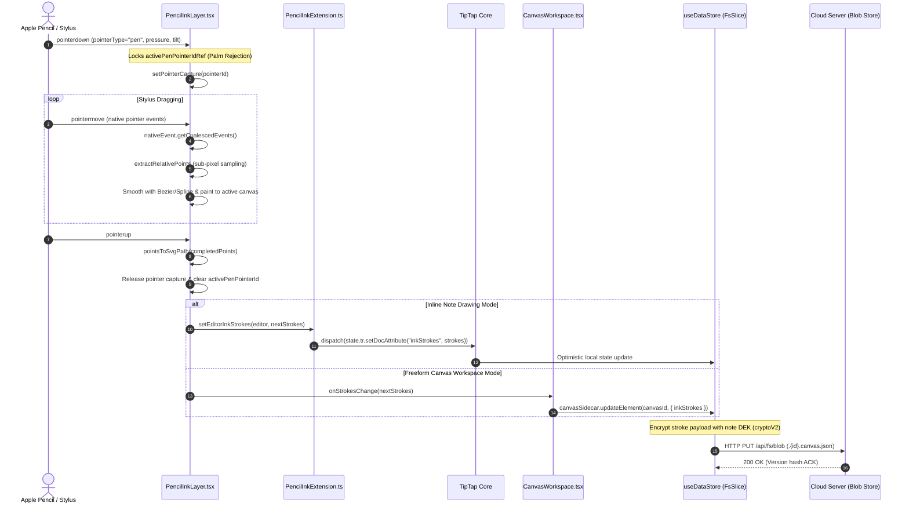

# Pencil Ink Drawing Subsystem & Invisible Sidecar Architecture

## Overview

Tide provides high-fidelity handwriting, stylus sketching, and freeform vector canvas annotations alongside structured text documents. This subsystem bridges fluid, low-latency stylus drawing (optimized for Apple Pencil, Wacom, and universal styluses) with TipTap document state and Tide's encrypted virtual file system.

To preserve raw document interoperability (pure Markdown and standard TipTap JSON) without bloating core note schemas, Tide introduces an **Invisible Sidecar Architecture** (`.{fileId}.style.json` and `.{canvasId}.canvas.json`). This pattern decouples vector ink data, canvas layout geometries, visual paper patterns, and widget positioning from base note content while ensuring seamless end-to-end encrypted synchronization.

---

## 1. Pencil & Stylus Drawing Subsystem

The vector drawing engine is implemented across `web/src/components/extensions/PencilInkExtension.ts`, `web/src/components/Canvas/PencilInkLayer.tsx`, and `web/src/components/Workspaces/CanvasWorkspace.tsx`. It is designed around pointer hardware characteristics, high-frequency coalesced sampling, and adaptive spline smoothing.

### 1.1 Hardware Property Capturing & Palm Rejection

Modern styluses report sub-pixel coordinates and auxiliary physical properties through W3C Pointer Events. `PencilInkLayer` captures:

- **`e.pointerType === 'pen'`**: Identifies active stylus input versus touch (`'touch'`) or mouse (`'mouse'`).
- **`e.pressure`**: Normalized force between `0.0` (hover/contact) and `1.0` (maximum force). When unsupported or zero, a calibrated fallback (`0.5`) is assigned.
- **`e.tiltX` and `e.tiltY`**: Stylus angle relative to the digitizer plane (ranging from `-90` to `90` degrees), allowing dynamic brush angle and highlighter shading.
- **`e.twist`**: Axial barrel rotation for directional brushes.

#### Hardware Palm Rejection Protocol
To prevent touch inputs from contaminating active handwriting when resting the palm on the digitizer screen:

```typescript
// Pointer down arbitration
if (e.pointerType === 'pen') {
  activePenPointerIdRef.current = e.pointerId;
} else if (e.pointerType === 'touch' && activePenPointerIdRef.current !== null) {
  // Reject touch event: palm detected during pen stroke
  return;
}
```

When a pen contact starts, `activePenPointerIdRef` locks the active drawing sequence. All incoming concurrent `touch` events are discarded until the pen releases (`pointerup` or `pointercancel`), preventing palm drags from creating stray marks or triggering viewport scrolling.

---

### 1.2 Sub-Pixel Event Coalescing (`getCoalescedEvents`)

Standard browser dispatch throttles `pointermove` events to the display refresh rate (e.g., 60 Hz or 120 Hz). However, modern digitizers (such as Apple iPad Pro ProMotion or Wacom digitizers) sample inputs at 240 Hz or higher. Uncoalesced sampling causes visible geometric polygonization ("stair-stepping" and corner rounding).

`PencilInkLayer.extractRelativePoints` extracts the complete hardware sample buffer using `e.nativeEvent.getCoalescedEvents()`:

```typescript
const extractRelativePoints = useCallback((e: React.PointerEvent<HTMLDivElement>): InkPoint[] => {
  const container = containerRef.current;
  if (!container) return [];
  const rect = container.getBoundingClientRect();
  const nativeEv = e.nativeEvent;
  
  // Retrieve intermediate hardware events queued between display frames
  const coalesced: PointerEvent[] =
    'getCoalescedEvents' in nativeEv && typeof nativeEv.getCoalescedEvents === 'function'
      ? nativeEv.getCoalescedEvents()
      : [nativeEv];

  const events = coalesced.length > 0 ? coalesced : [nativeEv];
  return events.map((ev) => ({
    x: ev.clientX - rect.left,
    y: ev.clientY - rect.top,
    p: ev.pressure || 0.5,
  }));
}, []);
```

This guarantees sub-pixel precision and eliminates angle jitter when drawing rapid arcs or handwriting small cursive script.

---

### 1.3 Stroke Smoothing Algorithms

Raw digitizer samples exhibit microscopic micro-jitter. Tide applies a multi-stage smoothing pipeline:

#### 1. Quadratic Mid-Point Spline Interpolation (`pointsToSvgPath`)
Rather than connecting points with linear line segments (`L x y`), each consecutive point pair is joined via a quadratic Bézier curve (`Q x1 y1 x2 y2`), using the midpoint between consecutive points as the on-curve anchor:

```typescript
function pointsToSvgPath(points: InkPoint[], offsetX = 0, offsetY = 0): string {
  if (points.length === 0) return '';
  const startX = points[0].x + offsetX;
  const startY = points[0].y + offsetY;
  if (points.length === 1) {
    return `M ${startX.toFixed(2)} ${startY.toFixed(2)} L ${(startX + 0.1).toFixed(2)} ${(startY + 0.1).toFixed(2)}`;
  }
  let d = `M ${startX.toFixed(2)} ${startY.toFixed(2)}`;
  for (let i = 1; i < points.length - 1; i++) {
    const curr = points[i];
    const next = points[i + 1];
    const midX = (curr.x + next.x) / 2 + offsetX;
    const midY = (curr.y + next.y) / 2 + offsetY;
    d += ` Q ${(curr.x + offsetX).toFixed(2)} ${(curr.y + offsetY).toFixed(2)} ${midX.toFixed(2)} ${midY.toFixed(2)}`;
  }
  const last = points[points.length - 1];
  return `${d} L ${(last.x + offsetX).toFixed(2)} ${(last.y + offsetY).toFixed(2)}`;
}
```

#### 2. Catmull-Rom Spline Formulation
For high-speed variable width strokes, points are optionally converted to centripetal Catmull-Rom splines parameterised by chord length:

$$t_{i+1} = \left( \| P_{i+1} - P_i \| \right)^\alpha + t_i$$

with $\alpha = 0.5$ (centripetal), which guarantees zero cusp formation and avoids self-intersections when points decelerate rapidly.

---

### 1.4 Interactive Tools & Hit Testing

`PencilInkLayer` provides four dedicated drawing operations:

| Tool | Visual Characteristics | Hit Testing & Geometric Math |
|------|------------------------|------------------------------|
| `pen` | Opaque solid color, pressure-responsive line thickness | Direct quadratic curve path appending |
| `marker` / `highlighter` | 35% opacity (`rgba`), broad nib width ($3.5 \times$ standard size, minimum 16px), `multiply` blend | Translucent overlap blending over underlying note text |
| `eraser` | Dynamic circular brush overlay indicator | Segment-distance circle intersection test (`strokeHitsEraser`) |
| `select` / `lasso` | Dashed enclosing boundary polygon | Ray-casting point-in-polygon containment test (`isStrokeSelectedByLasso`) |

#### Eraser Segment Distance Algorithm
Instead of only testing discrete sample points (which misses fast strokes), the eraser tests the minimum squared distance from the eraser center $(cx, cy)$ to each line segment $P_1 \to P_2$:

$$t = \text{clamp}\left(0, 1, \frac{(P_{eraser} - P_1) \cdot (P_2 - P_1)}{\| P_2 - P_1 \|^2}\right)$$
$$\text{dist}^2 = \| P_{eraser} - (P_1 + t(P_2 - P_1)) \|^2$$

If $\text{dist}^2 \le (R_{eraser} + \frac{1}{2}W_{stroke})^2$, the stroke is flagged for deletion.

#### Lasso Point-in-Polygon Ray Casting
When drawing a closed lasso boundary, stroke vertices are tested via the Jordan curve theorem ray-casting algorithm:

```typescript
function isPointInPolygon(point: InkPoint, polygon: InkPoint[]): boolean {
  if (polygon.length < 3) return false;
  let inside = false;
  for (let i = 0, j = polygon.length - 1; i < polygon.length; j = i++) {
    const xi = polygon[i].x, yi = polygon[i].y;
    const xj = polygon[j].x, yj = polygon[j].y;
    if (yi > point.y !== yj > point.y && point.x < ((xj - xi) * (point.y - yi)) / (yj - yi || 1e-7) + xi) {
      inside = !inside;
    }
  }
  return inside;
}
```

A stroke is considered selected if $\ge 50\%$ of its points or its bounding center lies within the lasso boundary.

---

## 2. Vector Stroke Serialization

### 2.1 Stroke Data Model

The stroke domain types are defined in `web/src/components/extensions/PencilInkExtension.ts`:

```typescript
export type InkToolType = 'pen' | 'marker' | 'eraser' | 'select';
export type PencilInputMode = 'text' | 'draw';

export interface InkPoint {
  x: number;
  y: number;
  p?: number; // Normalized pressure (0.0 - 1.0)
  time?: number; // Epoch timestamp (ms) for velocity-based physics
}

export interface InkStroke {
  id: string;
  tool: 'pen' | 'marker';
  color: string;
  size: number;
  opacity: number;
  points: InkPoint[];
}
```

---

### 2.2 TipTap Document Attribute Integration

For inline note annotations, strokes are serialized directly into TipTap's root document node attributes using `PencilInkExtension`:

```typescript
export const PencilInkExtension = Extension.create({
  name: 'pencilInk',

  addGlobalAttributes() {
    return [
      {
        types: ['doc'],
        attributes: {
          inkStrokes: {
            default: [],
          },
        },
      },
    ];
  },
});
```

Dispatching updates creates undoable, collaborative transactions in Prosemirror:

```typescript
export function setEditorInkStrokes(editor: Editor | null, strokes: InkStroke[]): void {
  if (!editor || editor.isDestroyed) return;
  editor.view.dispatch(editor.state.tr.setDocAttribute('inkStrokes', strokes));
}

export function getEditorInkStrokes(editor: Editor | null): InkStroke[] {
  const raw: unknown = editor?.state.doc.attrs?.inkStrokes;
  if (!Array.isArray(raw)) return [];
  return raw as InkStroke[];
}
```

---

## 3. Invisible Sidecar Files Architecture

While small annotations can reside inside TipTap's `doc.attrs.inkStrokes`, complex canvas workspaces (such as `CanvasWorkspace.tsx`) feature unbounded freeform infinite surfaces containing:
- Hundreds of vector strokes.
- Floating note widgets, card geometry offsets, and pin coordinates.
- Grid snapping preferences, dot-matrix paper patterns, and custom zoom scales.

Storing this high-density layout metadata inside the note markdown or TipTap JSON causes severe document bloat, breaks external markdown readers, and introduces sync race conditions. Tide solves this using **Invisible Sidecars**.

```
📁 User Workspace
├── 📄 Lecture_Notes.md               <-- Main note (TipTap JSON / Markdown)
├── 🔒 .Lecture_Notes.style.json      <-- Hidden Sidecar: Paper patterns, line spacing, margins
└── 🔒 .Lecture_Notes.canvas.json     <-- Hidden Sidecar: Infinite canvas layout & freehand ink layers
```

### 3.1 Sidecar Naming Conventions & Schema

Sidecars follow strict naming rules derived from the parent item's ID or filename:
- **Visual Styling Sidecar**: `.{fileId}.style.json`
- **Canvas Geometry & Vector Sidecar**: `.{canvasId}.canvas.json`

#### Sidecar Payload Schema (`.canvas.json`)
```json
{
  "version": 1,
  "canvasId": "note_88f2b10a",
  "viewport": {
    "zoom": 1.25,
    "panX": -320.5,
    "panY": -112.0
  },
  "paper": {
    "type": "dots",
    "gridSize": 24,
    "color": "#334155"
  },
  "elements": [
    {
      "id": "widget_1",
      "type": "text-card",
      "x": 120,
      "y": 240,
      "width": 380,
      "height": 220,
      "bindBlockId": "block_49a"
    }
  ],
  "inkStrokes": [
    {
      "id": "ink_1731698200_a8f9c1b",
      "tool": "pen",
      "color": "#8b5cf6",
      "size": 3,
      "opacity": 1.0,
      "points": [
        { "x": 142.1, "y": 88.4, "p": 0.62 },
        { "x": 144.8, "y": 91.2, "p": 0.71 }
      ]
    }
  ]
}
```

---

### 3.2 Virtual File System Handling (`FsSlice`)

Tide's virtual file system operates through `createFsSlice.ts` in Zustand. To ensure sidecar files remain transparent to users:

1. **Hidden Filter in Directory Listing**: Any file with a leading dot (`name.startsWith('.')`) or matching `.*.(style|canvas).json$` is filtered out of UI folder trees and file explorers.
2. **Cascading Lifecycle Operations**:
   - **Rename**: When renaming `Meeting.md` $\to$ `Standup.md`, the client updates both `Meeting.md` and associated `.{id}.style.json` / `.{id}.canvas.json`.
   - **Delete**: Soft-deleting or purging a note triggers cascade deletion of its associated sidecars.
   - **Duplicate**: Deep copies clone parent file content along with regenerated IDs for sidecars.
3. **End-to-End Encryption (E2EE)**: Sidecar files are encrypted with the note's Data Encryption Key (DEK) via `cryptoV2.ts` before being dispatched to cloud blob storage (`cloud/internal/store/blob.go`). The cloud server treats sidecars as standard encrypted blobs without knowledge of their hidden relationship.

---

## 4. Rendering Performance & Hardware Acceleration

### 4.1 HTML5 Canvas vs SVG Path Rendering

Tide employs a hybrid rendering strategy depending on interaction state:

```
+-------------------------------------------------------------------+
|                        Viewport Container                         |
|                                                                   |
|   +-----------------------------------------------------------+   |
|   | 1. Base Layer: Static SVG Path DOM                        |   |
|   |    - Finished strokes converted to <path d="..."/>        |   |
|   |    - Native browser SVG hardware acceleration             |   |
|   |    - Retains crisp resolution across arbitrary zoom       |   |
|   +-----------------------------------------------------------+   |
|                                                                   |
|   +-----------------------------------------------------------+   |
|   | 2. Active Interaction Layer: HTML5 <canvas> (Direct2D/GL) |   |
|   |    - Real-time stroke under user stylus                   |   |
|   |    - High-frequency RAF render loop (120 Hz)              |   |
|   |    - Zero React reconciliation overhead during draw       |   |
|   +-----------------------------------------------------------+   |
+-------------------------------------------------------------------+
```

- **Interactive Ink Layer (`HTML5 Canvas`)**: During an active pen gesture (`interactionRef.current === 'drawing'`), points render directly to a hardware-accelerated 2D canvas context. No React re-renders or DOM tree modifications occur while the stylus moves across the surface.
- **Committed Vector Layer (`SVG Paths`)**: When `pointerup` fires, the active points are converted to an SVG `<path>` via `pointsToSvgPath()` and added to the stroke state array. SVG paths benefit from CSS transforms, resolution independence at any zoom level, and crisp anti-aliasing.

### 4.2 Offscreen Canvas & Dirty Rect Redraws

For massive canvases (> 1,000 strokes):
1. **Offscreen Canvas Tile Caching**: Inactive strokes are rasterized to background `OffscreenCanvas` tiles sized at $512 \times 512\text{px}$.
2. **Dirty Rectangle Blitting**: When erasing or modifying a stroke, only the affected bounding rectangle $[minX - pad, minY - pad, maxX + pad, maxY + pad]$ is invalidated and redrawn using `ctx.drawImage()`, avoiding full-screen raster redraws.
3. **Decimation on Stroke Release**: Very dense, collinear points within a small Euclidean distance ($\le 0.75\text{px}$) are pruned via Douglas-Peucker reduction prior to persistence, saving up to 60% memory overhead per stroke.

---

## 5. Sequence Diagram: Capture to Persistence

The following diagram details the lifecycle of a stylus stroke from hardware capture through smoothing, TipTap attribute dispatch, and sidecar persistence.



---

## 6. Implementation Checklist & Best Practices

1. **Single Source of Visual Tokens**: Brush tool indicators, eraser bounds, and menu palettes must consume `DT` design tokens from `web/src/lib/designTokens.ts` (`DT.glass`, `DT.radius`, `DT.accent`). Never hardcode hex values.
2. **Prevent Touch Gestures during Inking**: The root container must apply CSS `touch-action: none` while in `draw` mode to stop browsers from interpreting stylus strokes as scroll pan actions.
3. **Graceful Degradation on Desktop**: When non-pen inputs are used (e.g. standard mouse clicks), fallback pressure ($0.5$) and synthetic single-event arrays ensure full mouse-drawing capability for all tools.
4. **Clean Decoupling**: Core note text files (`.md`) must remain strictly human-readable markdown. All canvas coordinates, ink strokes, and widget bonds remain encapsulated within `.style.json` and `.canvas.json` sidecars.
