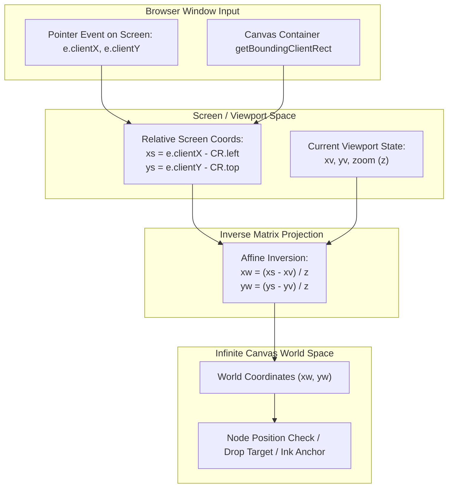
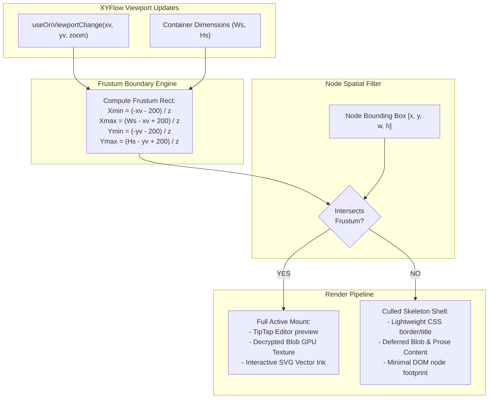
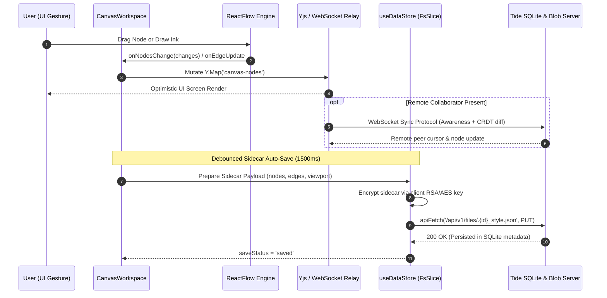

# XYFlow Infinite Canvas Architecture

Technical Specification for the Infinite Spatial Canvas Workspace in Tide (`CanvasWorkspace.tsx`).

---

## 1. Executive Overview & System Context

Tide's spatial infinite canvas delivers an unbounded, two-dimensional workspace where notes, images, vector ink annotations, and structural groupings exist side by side. Instead of confining knowledge to linear hierarchies or isolated documents, the canvas workspace allows users to model non-linear relationships, perform spatial note-taking, and manipulate visual cards in a continuous coordinate space.

The canvas engine is built upon **XYFlow (`@xyflow/react` v12.10.1)** and integrates directly into Tide's **Next.js 16** App Router architecture. It operates alongside the TipTap document editor inside [`CanvasWorkspace.tsx`](file:///C:/Users/nicoh/projects/tide/web/src/components/Workspaces/CanvasWorkspace.tsx), supporting real-time collaborative state synchronization via Yjs (`yjs`, `y-websocket`) and zero-knowledge end-to-end encrypted sidecar persistence via [`useDataStore.FsSlice`](file:///C:/Users/nicoh/projects/tide/web/src/store/slices/createFsSlice.ts).

### Key Architectural Tenets
1. **Zero-Knowledge Encryption First**: All node coordinates, dimensions, edges, and card payloads persist through encrypted sidecar metadata or encrypted blob storage. The cloud backend acts strictly as an untrusted blob and state relay.
2. **Deterministic Coordinate Space**: Single source of mathematical truth between DOM client coordinates, screen pixels, and infinite canvas world coordinates.
3. **Frustum-Aware Lazy Hydration**: Only nodes visible within the calculated camera frustum (plus an overscan margin) allocate heavy memory structures like TipTap editors or decoded image canvases.
4. **Non-Destructive File Separation**: Canvas layout topologies are decoupled from note text payloads by storing visual topology in invisible dotfile sidecars (`.{fileId}_style.json` / `.{canvasId}_canvas.json`), ensuring TipTap prose documents remain clean and standard-compliant.

---

## 2. Framework & Core: `@xyflow/react` in Next.js 16

### 2.1 Next.js 16 Client Component Boundary & Dynamic SSR Bypass

`@xyflow/react` interacts heavily with the browser DOM matrix (`DOMMatrix`, `ResizeObserver`, pointer events, window dimensions). To ensure compatibility with Next.js 16 Server Components and eliminate hydration mismatches:

```tsx
// Inside CanvasWorkspace.tsx or parent workspace manager
const CanvasWorkspace = dynamic(
    () => import('@/components/Workspaces/CanvasWorkspace'),
    {
        ssr: false,
        loading: () => <CanvasLoadingSkeleton />
    }
);
```

Within the canvas workspace component tree, the core layout wraps the flow surface in a `<ReactFlowProvider>` to grant children access to the flow instance, coordinate calculators, and zoom dispatchers:

```tsx
import {
    ReactFlow,
    ReactFlowProvider,
    useNodesState,
    useEdgesState,
    useReactFlow,
    Background,
    Controls,
    MiniMap,
    SelectionMode,
    type NodeTypes,
    type EdgeTypes,
    type Viewport
} from '@xyflow/react';
import '@xyflow/react/dist/style.css';
```

### 2.2 Memoized Node and Edge Registries

To prevent infinite re-rendering loops and component thrashing when state updates occur within individual cards, `nodeTypes` and `edgeTypes` dictionaries are instantiated statically outside the React component lifecycle:

```tsx
// Static node definition to preserve stable references across renders
const nodeTypes: NodeTypes = {
    noteCard: NoteCardNode,
    imageCard: ImageNode,
    inkSurface: InkNode,
    groupContainer: GroupNode,
};

const edgeTypes: EdgeTypes = {
    smoothBezier: CustomBezierEdge,
};
```

---

## 3. The Infinite Canvas Coordinate System & Mathematics

The infinite canvas decouples the user's display hardware resolution from the logical placement of information.

```
+-------------------------------------------------------------------------+
| Screen / Viewport Space (Client Pixels)                                 |
| Window Origin: (0, 0)                                                   |
|                                                                         |
|         +----------------------------------------------------+          |
|         | Camera Frustum (x_viewport, y_viewport, zoom)      |          |
|         |                                                    |          |
|         |        +-------------------------+                 |          |
|         |        | World Space (x_w, y_w)  |                 |          |
|         |        | Node Logical Center     |                 |          |
|         |        +-------------------------+                 |          |
|         |                                                    |          |
|         +----------------------------------------------------+          |
+-------------------------------------------------------------------------+
```

### 3.1 Viewport State

The camera viewport is defined as a tuple:

$$\mathbf{V} = \begin{pmatrix} x_v \\ y_v \\ z \end{pmatrix}$$

- $x_v \in \mathbb{R}$: Horizontal screen translation of the world origin $(0, 0)$ in pixels.
- $y_v \in \mathbb{R}$: Vertical screen translation of the world origin $(0, 0)$ in pixels.
- $z \in [z_{\min}, z_{\max}]$: Dimensionless scale factor (zoom level), where $z_{\min} = 0.1$ and $z_{\max} = 3.0$.

### 3.2 Transformation Matrices

Converting between Screen Space $\mathbf{P}_{\text{screen}} = (x_s, y_s)^T$ and World Space $\mathbf{P}_{\text{world}} = (x_w, y_w)^T$ uses an affine transformation matrix:

#### World to Screen Projection
$$\begin{pmatrix} x_s \\ y_s \\ 1 \end{pmatrix} = \begin{pmatrix} z & 0 & x_v \\ 0 & z & y_v \\ 0 & 0 & 1 \end{pmatrix} \begin{pmatrix} x_w \\ y_w \\ 1 \end{pmatrix}$$

Expanded scalar equations:
$$x_s = x_w \cdot z + x_v$$
$$y_s = y_w \cdot z + y_v$$

#### Screen to World Inversion
$$\begin{pmatrix} x_w \\ y_w \\ 1 \end{pmatrix} = \begin{pmatrix} \frac{1}{z} & 0 & -\frac{x_v}{z} \\ 0 & \frac{1}{z} & -\frac{y_v}{z} \\ 0 & 0 & 1 \end{pmatrix} \begin{pmatrix} x_s \\ y_s \\ 1 \end{pmatrix}$$

Expanded scalar equations:
$$x_w = \frac{x_s - x_v}{z}$$
$$y_w = \frac{y_s - y_v}{z}$$

In code via XYFlow's internal helper or custom implementation:
```ts
export function screenToWorldCoords(
    screenPos: { x: number; y: number },
    viewport: { x: number; y: number; zoom: number },
    containerBounds: DOMRect
): { x: number; y: number } {
    const relX = screenPos.x - containerBounds.left;
    const relY = screenPos.y - containerBounds.top;
    return {
        x: (relX - viewport.x) / viewport.zoom,
        y: (relY - viewport.y) / viewport.zoom,
    };
}
```

### 3.3 Zoom-to-Fit (`fitView`) Calculation

When triggering **Zoom to Fit** (`Ctrl + 0` / `Cmd + 0` or double-clicking the zoom badge):

1. Compute the axis-aligned bounding box (AABB) enclosing all target nodes $\mathcal{N}$:
   $$x_{\min} = \min_{n \in \mathcal{N}} (n.x), \quad x_{\max} = \max_{n \in \mathcal{N}} (n.x + n.width)$$
   $$y_{\min} = \min_{n \in \mathcal{N}} (n.y), \quad y_{\max} = \max_{n \in \mathcal{N}} (n.y + n.height)$$
   $$W_{\text{box}} = x_{\max} - x_{\min}, \quad H_{\text{box}} = y_{\max} - y_{\min}$$

2. Account for viewport padding $P$ (default $48\text{px}$) against viewport dimensions $W_{\text{vp}}, H_{\text{vp}}$:
   $$z_{\text{raw}} = \min\left( \frac{W_{\text{vp}} - 2P}{W_{\text{box}}}, \frac{H_{\text{vp}} - 2P}{H_{\text{box}}} \right)$$
   $$z_{\text{target}} = \max\left(z_{\min}, \min\left(z_{\max}, z_{\text{raw}}\right)\right)$$

3. Center the camera over the AABB centroid $(\bar{x}_w, \bar{y}_w)$:
   $$\bar{x}_w = x_{\min} + \frac{W_{\text{box}}}{2}, \quad \bar{y}_w = y_{\min} + \frac{H_{\text{box}}}{2}$$
   $$x_{v,\text{target}} = \frac{W_{\text{vp}}}{2} - (\bar{x}_w \cdot z_{\text{target}})$$
   $$y_{v,\text{target}} = \frac{H_{\text{vp}}}{2} - (\bar{y}_w \cdot z_{\text{target}})$$

---

## 4. Custom Node Types

All custom nodes implement `@xyflow/react`'s `NodeProps` interface and integrate into Tide's styling and theme system via [`designTokens.ts`](file:///C:/Users/nicoh/projects/tide/web/src/lib/designTokens.ts).

### 4.1 `NoteCardNode`

The `NoteCardNode` represents an interactive note embedded within the canvas.

```
+-----------------------------------------------------------+
| [drag-handle]  Physics Lecture 04           [focus-editor]|
+-----------------------------------------------------------+
| (T) Target Handle                                         |
|                                                           |
|   # Kinematics in Two Dimensions                          |
|   Let \vec{r}(t) be the position vector. Velocity is      |
|   defined as \vec{v} = \frac{d\vec{r}}{dt}...             |
|                                                           |
|                                            Source Handle (S)
+-----------------------------------------------------------+
| [Resize Corner]                                           |
+-----------------------------------------------------------+
```

- **Node Data Schema**:
  ```ts
  export interface NoteCardNodeData {
      noteId: string;
      title: string;
      contentExcerpt?: string;
      color?: string;
      updatedAt?: number;
      tags?: string[];
      isCollapsed?: boolean;
  }
  ```
- **Features**:
  - **`NodeResizer`**: Uses `@xyflow/react`'s built-in `NodeResizer` with minimum dimensions ($260\text{px} \times 180\text{px}$) and dynamic snap grid ($12\text{px}$).
  - **Live Content Preview**: Renders formatted markdown/HTML snippets using TipTap's JSON Content generator without mounting full heavy editor instances unless focused.
  - **Double Click to Focus**: Double-clicking the card header dispatches `useDataStore.getState().setActiveNoteId(noteId)` and transitions the layout into the full document editor tab.
  - **Handles**: 4 perimeter connection handles (`Handle` component) styled with `DT.accent` and magnetized snapping.

### 4.2 `ImageNode`

The `ImageNode` renders resizable media objects with local end-to-end decryption.

- **Node Data Schema**:
  ```ts
  export interface ImageNodeData {
      blobId: string;
      encryptedKey: string;
      iv: string;
      mimeType: string;
      originalWidth: number;
      originalHeight: number;
      aspectRatioLocked: boolean;
      caption?: string;
  }
  ```
- **Features**:
  - **Aspect Ratio Locking**: When dragging corner resize handles, aspect ratio is preserved unless holding the `Shift` modifier key.
  - **Local Decryption & Caching**:
    1. Checks IndexedDB (`idb-keyval`) for a cached decrypted object URL.
    2. If missing, requests the ciphertext chunk from `/api/v1/blobs/{blobId}` using [`apiFetch`](file:///C:/Users/nicoh/projects/tide/web/src/lib/api.ts).
    3. Unwraps the AES-GCM DEK using the client's private RSA key via [`cryptoV2.ts`](file:///C:/Users/nicoh/projects/tide/web/src/lib/cryptoV2.ts).
    4. Decrypts ciphertext, instantiates `new Blob([plaintext], { type: mimeType })`, and binds `URL.createObjectURL(blob)`.
    5. Calls `URL.revokeObjectURL` on unmount to prevent browser memory leaks.

### 4.3 `InkNode`

The `InkNode` embeds an Apple Pencil / stylus vector drawing surface directly onto the canvas.

- **Node Data Schema**:
  ```ts
  export interface InkStrokePoint {
      x: number;
      y: number;
      pressure: number;
      time: number;
  }

  export interface InkStroke {
      id: string;
      color: string;
      width: number;
      points: InkStrokePoint[];
  }

  export interface InkNodeData {
      strokes: InkStroke[];
      isDrawingActive: boolean;
      backgroundColor?: string;
  }
  ```
- **Vector Engine**:
  - Coordinates collected via `PointerEvent` with `pointerType === 'pen' | 'touch'`.
  - Spline smoothing: Raw point streams are smoothed into cubic Bezier curves (`Catmull-Rom` interpolation) to generate SVG path descriptors (`<path d="..." />`).
  - Pass-through interaction: When drawing mode is inactive, pointer events pass through to canvas panning and node selection.

### 4.4 `GroupNode`

The `GroupNode` acts as a spatial container that encloses other nodes into visual clusters, chapters, or functional zones.

- **Node Data Schema**:
  ```ts
  export interface GroupNodeData {
      title: string;
      colorVariant: 'glass' | 'subtle' | 'solid';
      borderStyle: 'solid' | 'dashed' | 'transparent';
      isLocked: boolean;
  }
  ```
- **Hierarchical Mechanics**:
  - Member nodes specify `parentId: groupNode.id` and `extent: 'parent'` in their XYFlow node descriptor.
  - Moving the group container calculates a delta vector $(\Delta x, \Delta y)$ applied synchronously to all child positions.
  - Group nodes have a negative base `zIndex` (e.g. `-10`) so child cards always stack above the container surface.

---

## 5. Canvas State Persistence & Architecture

### 5.1 Invisible Sidecar Storage (`useDataStore.FsSlice`)

To preserve note clean separation, visual canvas metadata is never stored inside Markdown or TipTap JSON files. Instead, it is written to sidecar files managed by [`createFsSlice.ts`](file:///C:/Users/nicoh/projects/tide/web/src/store/slices/createFsSlice.ts):

- **Sidecar Filename**: `.{noteId}_style.json` (for notes with canvas layers) or `.{canvasId}_canvas.json` (for standalone canvas files).
- **Dotfile Convention**: Files beginning with `.` are filtered out from standard folder tree listings in the sidebar.

```json
{
  "version": 2,
  "viewport": {
    "x": 120.5,
    "y": -45.0,
    "zoom": 0.85
  },
  "nodes": [
    {
      "id": "node-101",
      "type": "noteCard",
      "position": { "x": 400, "y": 250 },
      "width": 320,
      "height": 240,
      "zIndex": 1,
      "data": {
        "noteId": "f9b8c2d1-44aa-43e8-9640-52f20d0f507b",
        "title": "Wave Equations"
      }
    }
  ],
  "edges": [
    {
      "id": "edge-e1",
      "source": "node-101",
      "target": "node-102",
      "sourceHandle": "right",
      "targetHandle": "left",
      "type": "smoothBezier"
    }
  ]
}
```

### 5.2 Frustum Culling & Viewport Lazy Loading

Rendering hundreds of heavy TipTap nodes and 4K images simultaneously causes excessive GPU memory allocation and DOM frame drops. The canvas uses **Frustum Culling**:

```
+--------------------------------------------------------------------------+
| Infinite Canvas Space                                                    |
|                                                                          |
|       [Off-Screen Card]                                                  |
|       (Metadata Only)                                                    |
|                                                                          |
|               +-------------------------------------------+              |
|               | Viewport Camera Frustum + 200px Overscan  |              |
|               |                                           |              |
|               |     [Active Note Card]   [Decrypted Image]|              |
|               |     (Full TipTap Render) (GPU Texture)    |              |
|               |                                           |              |
|               +-------------------------------------------+              |
|                                                                          |
|                                         [Off-Screen Ink]                 |
|                                         (Lightweight Path)               |
+--------------------------------------------------------------------------+
```

#### Frustum Bounds Formula
Given screen dimensions $W_s, H_s$, overscan padding $O = 200\text{px}$, and viewport $\mathbf{V} = (x_v, y_v, z)$:
$$X_{\text{frustum, min}} = \frac{-x_v - O}{z}, \quad X_{\text{frustum, max}} = \frac{W_s - x_v + O}{z}$$
$$Y_{\text{frustum, min}} = \frac{-y_v - O}{z}, \quad Y_{\text{frustum, max}} = \frac{H_s - y_v + O}{z}$$

A node with bounding box $[n_x, n_y, n_w, n_h]$ is rendered as active if and only if:
$$(n_x + n_w \ge X_{\text{frustum, min}}) \land (n_x \le X_{\text{frustum, max}}) \land (n_y + n_h \ge Y_{\text{frustum, min}}) \land (n_y \le Y_{\text{frustum, max}})$$

Cards falling outside this rectangle unmount their inner rich-text editors and high-resolution textures, maintaining a lightweight placeholder card DOM shell.

---

## 6. Interactive Gestures & Input Handling

| Gesture / Shortcut | Target | Action | Implementation Detail |
| :--- | :--- | :--- | :--- |
| **Left Click + Drag** (on Canvas background) | Canvas Surface | Pan camera | Translates $(x_v, y_v)$ by drag delta $(\Delta x_s, \Delta y_s)$. |
| **Left Click + Drag** (on Node) | Node | Translate node(s) | Updates $(x_w, y_w)$ for selected node set. Snap-to-grid at $12\text{px}$ intervals. |
| **Shift + Drag** / **Marquee Box** | Canvas Surface | Multi-selection | Triggers rectangular marquee selection (`selectionMode={SelectionMode.Partial}`). |
| **Handle Drag to Handle** | Node Handles | Create Edge | Spawns smooth Bezier connection edge. Enforces no self-loops and DAG validation. |
| **Pinch-to-Zoom / Wheel** | Cursor Position | Zoom centered at cursor | Adjusts zoom factor $z$ with focal invariant at cursor world point $\mathbf{P}_w$. |
| **`Space` + Drag** | Canvas Surface | Temporary Hand Tool | Overrides cursor to `grab`/`grabbing` and forces canvas panning even over nodes. |
| **`Delete` / `Backspace`** | Selection | Delete items | Removes active selection of nodes and edges, pushing tombstone to Yjs/Sidecar. |
| **`Ctrl+C` / `Cmd+C`** | Selected Nodes | Copy to Clipboard | Serializes node records with relative coordinate offsets to session clipboard. |
| **`Ctrl+V` / `Cmd+V`** | Canvas Surface | Paste Nodes | Re-inserts serialized nodes with new UUIDs offset by $+24\text{px}$ toward cursor. |
| **`Ctrl+A` / `Cmd+A`** | Active Canvas | Select All | Sets all nodes and edges to `selected: true`. |
| **`Ctrl+0` / `Cmd+0`** | Active Canvas | Zoom to Fit | Dispatches `fitView({ padding: 0.2, duration: 400 })`. |

---

## 7. Architectural Diagrams

### 7.1 Coordinate Transformation & Projection Flow



### 7.2 Viewport Frustum Culling & Node Rendering Pipeline



### 7.3 Complete Canvas State Synchronization & Persistence



---

## 8. Summary Register

| Artifact / Interface | Location | Responsibility |
| :--- | :--- | :--- |
| `CanvasWorkspace` | [`CanvasWorkspace.tsx`](file:///C:/Users/nicoh/projects/tide/web/src/components/Workspaces/CanvasWorkspace.tsx) | Host container, collaborative presence, toolbars, modal routing. |
| `CanvasNoteEditor` | [`CanvasNoteEditor.tsx`](file:///C:/Users/nicoh/projects/tide/web/src/components/Canvas/CanvasNoteEditor.tsx) | Legacy & modern canvas item orchestrator with Yjs integration. |
| `CanvasSidecar` | [`canvas.ts`](file:///C:/Users/nicoh/projects/tide/web/src/types/canvas.ts) | Sidecar JSON data definitions for invisible `.{noteId}_style.json`. |
| `FsSlice` | [`createFsSlice.ts`](file:///C:/Users/nicoh/projects/tide/web/src/store/slices/createFsSlice.ts) | File system state management, encrypted sidecar save and load routines. |
| `DesignTokens` | [`designTokens.ts`](file:///C:/Users/nicoh/projects/tide/web/src/lib/designTokens.ts) | Visual constants, glassmorphism filters, theme palettes. |
