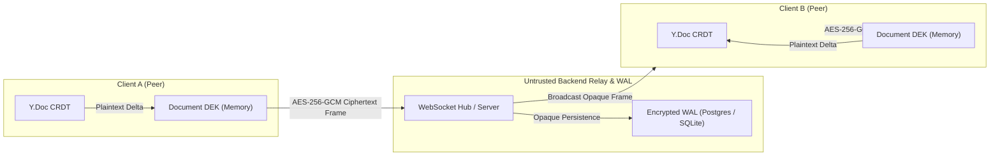
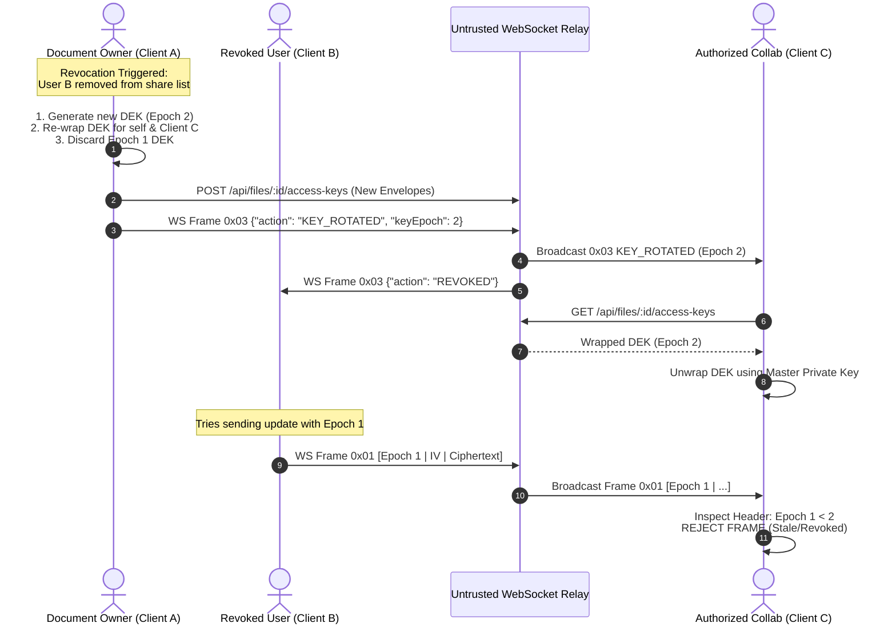
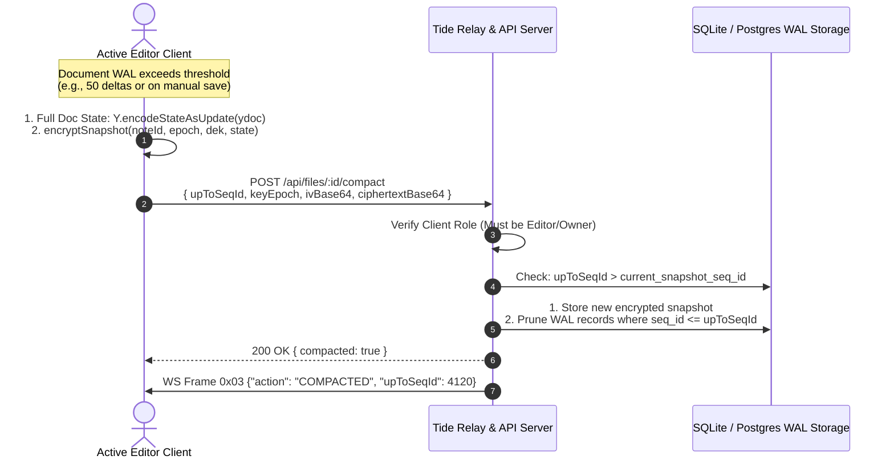

# Collaborative CRDT End-to-End Encryption (E2EE) Specification

> **Status:** Canonical Architecture Specification  
> **Target Files:** [`web/src/lib/yjsE2EEProvider.ts`](file:///C:/Users/nicoh/projects/tide/web/src/lib/yjsE2EEProvider.ts), [`web/src/lib/e2eeFraming.ts`](file:///C:/Users/nicoh/projects/tide/web/src/lib/e2eeFraming.ts)  
> **Compliance:** Zero-Knowledge, AEAD (AES-256-GCM), Yjs State Vectors, W3C Web Crypto API

---

## 1. The E2EE Collaboration Challenge

Real-time collaborative editing relies on Conflict-free Replicated Data Types (CRDTs), specifically [Yjs](https://github.com/yjs/yjs), to guarantee eventual consistency across distributed peers without central coordination. In standard architectures, a WebSocket server acts as an intelligent intermediary: it parses CRDT update vectors, computes diffs, manages cursor awareness states, and merges changes into an authoritative state document.

In Tide's **Zero-Knowledge (ZK)** paradigm, this traditional relay model presents a severe security challenge:
1. **Zero Central Trust:** The central server, relay routers, and database persistence layers must remain completely blind to all document content, keystrokes, and diffs.
2. **Real-Time Latency vs. Cryptographic Overhead:** Every concurrent keystroke, insertion, deletion, and cursor movement emits granular binary updates. Encryption and decryption cannot introduce perceptible typing lag (sub-16ms target).
3. **Out-of-Order Delta Delivery & Replay Attacks:** Network reordering, transient disconnections, and rogue relay injections must not decrypt invalid or tampered updates.
4. **Metadata & Cursor Leakage:** In traditional tools, collaborator names, active selections, and cursor positions leak in plaintext awareness packets. In Tide, cursor coordinates and ephemeral selection ranges reveal document layout and user activity, and must be protected under the same cryptographic guarantees as document content.



---

## 2. Binary Wire Framing Protocol

All real-time communication between collaborating clients and the Tide relay server is transmitted over a single WebSocket connection using a lightweight, packed binary wire format implemented in [`web/src/lib/e2eeFraming.ts`](file:///C:/Users/nicoh/projects/tide/web/src/lib/e2eeFraming.ts).

### 2.1 Frame Types
The first byte (`Offset 0`) of every frame designates its protocol role:

| Byte Value | Constant Name | Description | Encryption Scope |
| :--- | :--- | :--- | :--- |
| `0x01` | `FRAME_TYPE_CRDT` | Encrypted Yjs document update delta (`Y.encodeStateAsUpdate` or incremental delta). | AES-256-GCM Encrypted |
| `0x02` | `FRAME_TYPE_AWARENESS` | Encrypted user presence, transient cursor selections, and collaborator styles. | AES-256-GCM Encrypted |
| `0x03` | `FRAME_TYPE_CONTROL` | Unencrypted / envelope control signals (membership join/part, role updates, key rotation signals, compaction commands). | UTF-8 JSON Payload |

### 2.2 Binary Wire Frame Layout

For encrypted frames (`0x01` and `0x02`), the binary layout guarantees zero-overhead parsing and authenticates the protocol header using AEAD Additional Authenticated Data (AAD):

```
+----------------+---------------------+--------------------+------------------------------------------+-----------------------+
|  Type (1 Byte) | Key Epoch (4 Bytes) |   IV (12 Bytes)    |          Ciphertext (Variable)           |  Auth Tag (16 Bytes)  |
|     Uint8      |   Uint32 (Big-End)  |   Crypto-Random    |                AES-GCM                   | Included in GCM Tag   |
+----------------+---------------------+--------------------+------------------------------------------+-----------------------+
| Byte 0         | Byte 1 - 4          | Byte 5 - 16        | Byte 17 ................................ | End of Frame          |
```

- **Type (`Uint8`, 1 byte):** Protocol discriminator (`0x01` or `0x02`).
- **Key Epoch (`Uint32BE`, 4 bytes):** Identifies the cryptographic generation of the Document Encryption Key (DEK). Stored in network byte order (Big-Endian).
- **IV / Nonce (`Uint8Array`, 12 bytes):** Cryptographically secure pseudo-random vector generated via `window.crypto.getRandomValues(new Uint8Array(12))` uniquely per frame. **Nonces are never reused.**
- **Ciphertext (`Uint8Array`, variable length):** AES-GCM encrypted payload (Yjs update bytes or awareness update bytes).
- **Authentication Tag (`16 bytes`):** Native GCM tag appended automatically to the ciphertext by Web Crypto API (`window.crypto.subtle.encrypt`).
- **Minimum Length:** `1 + 4 + 12 + 16 = 33 bytes` (`MIN_ENCRYPTED_FRAME_LEN`). Any frame below 33 bytes is dropped as malformed.

### 2.3 Additional Authenticated Data (AAD) Binding

To prevent **Cross-Document Injection Attacks** or **Frame Downgrade Attacks** (e.g., an attacker replaying a frame from document `X` into document `Y`, or swapping an awareness frame for a CRDT update), Tide binds cryptographic metadata directly into the AES-GCM authentication tag:

$$\text{AAD} = \text{UTF8Encode}(\text{fileId}) \mathbin{\Vert} \text{msgType (1 Byte)} \mathbin{\Vert} \text{keyEpoch (4 Bytes Big-Endian)}$$

Implemented via `buildFrameAAD(fileId, msgType, keyEpoch)`:
```typescript
export function buildFrameAAD(fileId: string, msgType: number, keyEpoch: number): Uint8Array {
    const enc = new TextEncoder();
    const fileIdBytes = enc.encode(fileId);
    const aad = new Uint8Array(fileIdBytes.length + 5);
    aad.set(fileIdBytes, 0);
    const view = new DataView(aad.buffer, aad.byteOffset, aad.byteLength);
    view.setUint8(fileIdBytes.length, msgType);
    view.setUint32(fileIdBytes.length + 1, keyEpoch, false); // Big-Endian uint32
    return aad;
}
```

If an adversary attempts to modify the `keyEpoch` header, change the frame type, or redirect the packet to another document ID, the AEAD decryption call (`window.crypto.subtle.decrypt`) fails with an authentication error, dropping the packet before it touches the Yjs engine.

---

## 3. Key Epochs & Ratchet Rotation

### 3.1 Why Static Keys Fail in Dynamic Collaboration
Document collaboration is rarely static:
- Collaborators are added (read/write access granted).
- Collaborators are revoked or removed.
- User permission levels downgrade from `edit` to `view`.
- Shared links expire or passwords change.

In a naive E2EE model with a static Document Encryption Key (DEK), a revoked collaborator who retains the DEK could continue decrypting real-time WebSocket traffic indefinitely, or replay malicious updates.

### 3.2 The Key Epoch Counter
Tide introduces a monotonic **Key Epoch** counter ($E \in \mathbb{N}_{\ge 1}$):
1. **Initial Epoch ($E = 1$):** Document creation initiates epoch 1 with the initial DEK.
2. **Access Revocation & Re-encryption:** When a user is removed or revoked:
   - The document owner generates a fresh random 256-bit AES-GCM DEK: $\text{DEK}_{E+1}$.
   - The owner increments the epoch counter: $E_{\text{new}} = E + 1$.
   - The owner re-wraps $\text{DEK}_{E+1}$ exclusively for the remaining authorized participants using their RSA-OAEP Master Public Keys.
   - The owner broadcasts a `FRAME_TYPE_CONTROL` frame with action `KEY_ROTATED`.
3. **Epoch Enforcement on Inbound Frames:**
   - When a peer receives a frame, it inspects the epoch in the frame header.
   - If `frame.keyEpoch < local.keyEpoch`: The frame is encrypted with an obsolete/revoked key and is discarded.
   - If `frame.keyEpoch > local.keyEpoch`: The client requests updated wrapped access envelopes from `/api/files/{noteId}/access-keys` to unwrap the newest DEK.
   - If decryption fails due to MAC mismatch, the packet is safely skipped without throwing unhandled exceptions.



---

## 4. Awareness & Cursor Privacy

### 4.1 Awareness Data Structure
In collaborative text and canvas editing, ephemeral awareness data includes:
- Active cursor index and anchor coordinates.
- Selected text ranges (e.g., character index 142 to 198).
- Collaborator display name, avatar, and assigned UI color.
- Device status (active, idle, tab suspended).

### 4.2 End-to-End Encryption of Awareness
Tide treats cursor awareness as sensitive document data. Rather than sending awareness in plaintext:
1. `Y.encodeAwarenessUpdate(awareness, [clientID])` serializes local presence into a binary buffer.
2. The buffer is encrypted with the document's active DEK and tagged with `FRAME_TYPE_AWARENESS` (`0x02`) and the current `keyEpoch`.
3. The untrusted server relays the opaque binary blob to connected peers.
4. Receiving clients verify the AAD, decrypt with the DEK, and feed the plaintext into `y-protocols/awareness`: `applyAwarenessUpdate(this.awareness, plaintext, 'remote')`.
5. **Instant Ghost Cursor Removal:** When a peer disconnects, the relay server emits a lightweight control frame:
   ```json
   { "action": "PEER_LEFT", "yClientId": 184920482 }
   ```
   Connected clients immediately invoke `removeAwarenessStates(this.awareness, [msg.yClientId], 'server')`, extinguishing ghost cursors in 0ms without waiting for a timeout.

---

## 5. Snapshot Compaction Handshake

Over time, long-lived collaborative documents accumulate hundreds of incremental CRDT deltas in the server's Write-Ahead Log (WAL). Without compaction, new clients joining the session would experience severe download and bootstrap latency.

### 5.1 The Zero-Knowledge Compaction Dilemma
In a traditional server-managed system, the server merges Yjs deltas into a consolidated snapshot document. In Tide, **the server cannot read the CRDT deltas** and therefore cannot compute or verify document snapshots.

### 5.2 Compaction Protocol Flow
Tide delegates snapshot creation to authorized editor clients (`permission !== 'view'`) via a zero-knowledge compaction handshake:

1. **State Consolidation:** The active editing client captures the full Yjs state vector via `Y.encodeStateAsUpdate(this.ydoc)`.
2. **Encrypted Snapshot Generation:**
   The client invokes `encryptSnapshot(noteId, keyEpoch, dek, yjsState)`:
   - Generates a fresh 12-byte IV.
   - Encrypts the snapshot bytes using AES-256-GCM with frame AAD (`fileId || 0x01 || keyEpoch`).
   - Produces Base64-encoded `ivBase64` and `ciphertextBase64`.
3. **Atomic Compaction Request:**
   The client posts the encrypted snapshot alongside the highest sequential WAL ID merged:
   ```json
   POST /api/files/:noteId/compact
   {
       "upToSeqId": 4120,
       "keyEpoch": 2,
       "ivBase64": "A4b+...",
       "ciphertextBase64": "v9X8..."
   }
   ```
4. **Server Validation Without Decryption:**
   The backend verifies:
   - The user possesses valid `edit` or `owner` permissions on the file.
   - `upToSeqId` is strictly monotonically greater than the existing stored snapshot sequence ID (`upToSeqId > current_snapshot.seq_id`).
   - `keyEpoch` matches or exceeds the known document epoch.
   - The server atomically commits the new encrypted snapshot blob and prunes WAL records with `seq_id <= upToSeqId`.



---

## 6. End-to-End Collaboration Sequence

The following diagram illustrates the complete real-time lifecycle between two peer clients collaborating through an untrusted relay server:

```mermaid
sequenceDiagram
    autonumber
    actor Alice as Alice (Peer A)
    participant Server as Untrusted Relay Server
    actor Bob as Bob (Peer B)

    Note over Alice,Bob: Both peers authenticated; DEK unwrapped in local memory

    %% Alice connects
    Alice->>Server: WSS Connect /api/ws/notes/:id?yClientId=101
    Server-->>Alice: Connection Accepted

    %% Bob connects
    Bob->>Server: WSS Connect /api/ws/notes/:id?yClientId=202
    Server-->>Bob: Connection Accepted

    %% Awareness Broadcast
    Alice->>Alice: Local cursor moves to index 42<br/>encryptWSFrame(0x02, epoch, DEK, awarenessData)
    Alice->>Server: Binary Frame [0x02 | Epoch | IV | Ciphertext | Tag]
    Server->>Server: Log sequence & route to note room (No Decryption)
    Server->>Bob: Forward Binary Frame [0x02 | ...]
    Bob->>Bob: decryptWSFrame(frame, DEK)<br/>applyAwarenessUpdate() -> Render Alice cursor

    %% CRDT Edit
    Bob->>Bob: Types text "Hello Tide"<br/>ydoc.on('update') -> delta<br/>encryptWSFrame(0x01, epoch, DEK, delta)
    Bob->>Server: Binary Frame [0x01 | Epoch | IV | Ciphertext | Tag]
    Server->>Server: Append to encrypted WAL (seq_id: 105)
    Server->>Alice: Forward Binary Frame [0x01 | ...]
    Alice->>Alice: decryptWSFrame(frame, DEK)<br/>Y.applyUpdate(ydoc, plaintext, 'remote')<br/>Editor view updates smoothly

    %% Peer Disconnection
    Bob->>Server: TCP Disconnect / Tab Close
    Server->>Server: Detect socket termination for yClientId=202
    Server->>Alice: Binary Frame 0x03 [JSON: {"action": "PEER_LEFT", "yClientId": 202}]
    Alice->>Alice: removeAwarenessStates([202])<br/>Instant 0ms ghost cursor removal
```

---

## 7. Security Invariants & Audit Checklist

1. **Zero Plaintext CRDT on Server:** Neither document snapshots nor individual keystroke deltas ever transit or persist unencrypted.
2. **Deterministic AAD Integrity:** All frames are cryptographically bound to the document ID, frame type, and key epoch. Modifying any wire header causes instant AEAD authentication failure.
3. **Cryptographic Forward Secrecy on Revocation:** Revoking a member triggers a Key Epoch bump, new DEK generation, and re-encryption, isolating past history from future updates.
4. **Transient Memory Only:** Unwrapped DEKs and CRDT plaintexts reside strictly in active memory. Browser tabs clearing state purge all keys.
