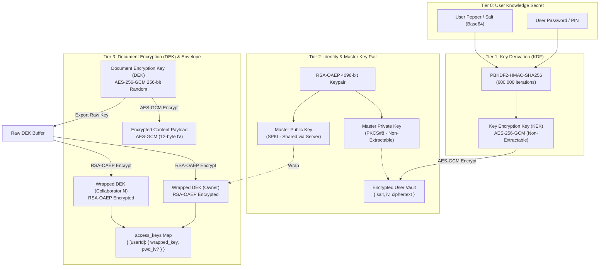

# Tide End-to-End Encryption (E2EE) & Key Hierarchy Specification

> **Status:** Canonical Architecture Specification  
> **Target Files:** [`web/src/lib/crypto.ts`](file:///C:/Users/nicoh/projects/tide/web/src/lib/crypto.ts), [`web/src/lib/cryptoV2.ts`](file:///C:/Users/nicoh/projects/tide/web/src/lib/cryptoV2.ts)  
> **Compliance:** Zero-Knowledge, Web Crypto API (`window.crypto.subtle`) Standard

---

## 1. Zero-Knowledge Philosophy & Security Boundaries

Tide enforces a strict **Zero-Knowledge (ZK)** security model. The central server, database, and blob storage providers are treated as completely untrusted entities operating outside the client's cryptographic trust boundary.

### Core Cryptographic Invariants
1. **Client-Exclusive Key Possession:** All raw cryptographic keys, derived keys, and plaintext records exist solely within volatile browser client memory during an active, authenticated session.
2. **Server Blindness:** The backend server stores and synchronizes ciphertexts, public keys, initialization vectors (IVs), cryptographic salts, and envelope access control lists. The server **never** receives, generates, stores, or processes:
   - User Master Passwords or PINs.
   - Raw Master Private Keys (PKCS#8).
   - Derived Key Encryption Keys (KEKs).
   - Document Encryption Keys (DEKs).
   - Unencrypted note contents, canvas states, or file blobs.
   - Sensitive metadata (titles, tags, user annotations contained in `secured_meta`).
3. **Hardware & Engine Standard:** All cryptographic operations rely directly on the native W3C **Web Crypto API** (`window.crypto.subtle`), ensuring constant-time primitives executed at the browser engine level without third-party JavaScript crypto dependencies.

---

## 2. Key Hierarchy Breakdown

The cryptographic hierarchy in Tide organizes keys into distinct tiers. Each tier isolates specific responsibilities, decoupling user identity, vault storage, and individual document lifecycle management.



---

### Layer-by-Layer Cryptographic Specifications

#### Tier 0 & 1: Authentication & Key Encryption Key (KEK)
- **Secret Input:** The user provides a master passphrase or PIN.
- **Salt / Pepper:** A unique cryptographic salt (`pepperBase64`) stored on the server or generated during account setup.
- **Key Derivation Function:** `PBKDF2` using `HMAC-SHA-256`.
  - **Standard Iterations (`DEFAULT_PBKDF2_ITERATIONS`):** `600,000` (conforming to modern OWASP recommendations).
  - **Legacy Iterations (`LEGACY_PBKDF2_ITERATIONS`):** `100,000` (supported automatically via fallback during vault unlock).
- **Derived Output (KEK):** An `AES-GCM` 256-bit symmetric key (`deriveKeyFromPassword`), flagged as `extractable: false` with usages `["encrypt", "decrypt", "wrapKey", "unwrapKey"]`.

#### Tier 2: Master Key Pair (Identity & Vault Storage)
- **Algorithm:** `RSA-OAEP` with a 4096-bit modulus, `65537` (`[1, 0, 1]`) public exponent, and `SHA-256` hashing (`generateMasterKeys`).
- **Master Public Key:**
  - Exported as `spki` (SubjectPublicKeyInfo) Base64 string (`exportPublicKey`).
  - Stored unencrypted on the server to allow other users to share notes/files with this identity.
- **Master Private Key:**
  - Exported in `pkcs8` format inside browser memory.
  - Symmetrically encrypted with the KEK using `AES-GCM` and a fresh 12-byte random IV (`encryptPrivateKey`).
  - Stored on the server as an `EncryptedPrivateKey` object:
    ```typescript
    export interface EncryptedPrivateKey {
        salt: string;       // Base64-encoded PBKDF2 salt
        iv: string;         // Base64-encoded 12-byte AES-GCM IV
        ciphertext: string; // Base64-encoded encrypted PKCS#8 private key
    }
    ```
  - Upon unlocking (`unlockVault`), the private key is decrypted and imported back into SubtleCrypto with `extractable: false`, preventing any runtime script or extension from extracting raw key bytes.

#### Tier 3: Document Encryption Keys (DEKs) & Envelope Encryption
- **Key Generation:** A unique 256-bit `AES-GCM` key (`generateDEK` / `generateFileKey`) is generated randomly for each document, note, or file.
- **Payload Encryption:** The document body or binary payload is encrypted with this DEK using `AES-GCM` and a dedicated 12-byte random IV (`encryptFileV2` / `encryptFile`).
- **Envelope Wrapping:** The raw DEK buffer is exported (`raw`) and individually encrypted for every authorized collaborator using that collaborator's RSA-OAEP public key (`wrapDEKData`):
  ```typescript
  export interface AccessKeysMap {
      [userID: string]: {
          wrapped_key: string; // Base64 RSA-OAEP ciphertext of the DEK
          pwd_iv?: string;     // Base64 IV (used if double-wrapped)
      };
  }
  ```
- **Collaborator Rotation:** When revoking access or removing a user from a shared document, `generateAndWrapRotatedDEK` generates a new DEK, re-encrypts the document payload, and wraps the new DEK only for the remaining authorized public keys. The revoked user cannot decrypt future revisions.
- **Optional Custom Password (Double-Wrapping):**
  - If a user sets a document-specific password, the raw DEK is first wrapped using an `AES-GCM` key derived from the custom password + random salt (`pwd_salt`).
  - The resulting ciphertext is then wrapped again with the user's RSA-OAEP Master Key.
  - Decryption requires both the user's Master Private Key and the custom password (`ERR_CUSTOM_PASSWORD_REQUIRED` thrown if missing).
- **Deterministic Public DEK:** For intentionally unencrypted or public collaborative notes, `derivePublicNoteDEK(noteId)` computes `SHA-256("tide-public-note-v1:" + noteId)` to yield a deterministic AES-GCM key. This allows real-time Yjs CRDT synchronization across clients without asymmetric key exchange.

---

## 3. Web Crypto API (`window.crypto.subtle`) Implementation Matrix

| Component | SubtleCrypto Operation | Algorithm Parameters | Usages | Extractable |
|---|---|---|---|---|
| **PBKDF2 Base Key** | `importKey("raw", ...)` | `{ name: "PBKDF2" }` | `["deriveKey"]` | `false` |
| **Derived KEK** | `deriveKey(...)` | `{ name: "PBKDF2", salt, iterations, hash: "SHA-256" }` → `{ name: "AES-GCM", length: 256 }` | `["encrypt", "decrypt", "wrapKey", "unwrapKey"]` | `false` |
| **Master Keypair** | `generateKey(...)` | `{ name: "RSA-OAEP", modulusLength: 4096, publicExponent: Uint8Array([1, 0, 1]), hash: "SHA-256" }` | `["encrypt", "decrypt"]` | `true` (generated), then `false` on import |
| **Master Private Key** | `importKey("pkcs8", ...)` | `{ name: "RSA-OAEP", hash: "SHA-256" }` | `["decrypt"]` | `false` (enforced by default) |
| **Document Key (DEK)** | `generateKey(...)` | `{ name: "AES-GCM", length: 256 }` | `["encrypt", "decrypt"]` | `true` (to allow raw export for wrapping) |
| **Imported DEK** | `importKey("raw", ...)` | `{ name: "AES-GCM" }` | `["encrypt", "decrypt"]` | `true` |
| **Metadata Encryption** | `encrypt(...)` / `decrypt(...)` | `{ name: "RSA-OAEP" }` | Via Master Keys | N/A |

### Security Flag Protections
- **Non-Extractable Master Private Key:** In [`web/src/lib/crypto.ts`](file:///C:/Users/nicoh/projects/tide/web/src/lib/crypto.ts#L125-L139), `importPrivateKey` defaults `extractable` to `false`. Once imported into the Web Crypto subsystem, the raw RSA private key bytes cannot be read back by application code, third-party libraries, or injected scripts via `subtle.exportKey`.
- **Safe Key Fingerprinting:** The `getKeyFingerprint(key)` utility inspects non-sensitive properties or exports JWK representations solely when `key.extractable` is explicitly true, producing a truncated hash slice (`${str.slice(0, 10)}...${str.slice(-10)}`) for audit logging without leaking the key material.

---

## 4. Binary Encoding Standards & Integrity Verification

All cryptographic primitives exchange binary buffers (`ArrayBuffer`, `Uint8Array`). Tide standardizes binary-to-text transitions and framing using the following conventions:

### ArrayBuffer and Base64 Encoding
Standardized in [`web/src/lib/crypto.ts`](file:///C:/Users/nicoh/projects/tide/web/src/lib/crypto.ts#L24-L42):
- **Encoding (`arrayBufferToBase64`):** Iterates over a `Uint8Array`, accumulating characters via `String.fromCharCode`, converted to ASCII Base64 via `window.btoa`.
- **Decoding (`base64ToArrayBuffer`):** Decodes via `window.atob`, allocating an exact `Uint8Array` of length `len` and extracting byte codes via `charCodeAt(i)`.

### Initialization Vector (IV) Handling
- **Generation:** Every AES-GCM encryption step MUST generate a fresh, cryptographically secure 12-byte (96-bit) IV via `window.crypto.getRandomValues(new Uint8Array(12))`.
- **Zero IV Reuse:** A new IV is produced per operation (`encryptFile`, `encryptFileV2`, `encryptPrivateKey`, and `wrapDEKData`).
- **Framing:**
  - In `crypto.ts` (`EncryptedFile`), the IV is encoded as a Base64 string companion alongside the blob: `{ iv: string, ciphertext: Blob }`.
  - In `cryptoV2.ts` (`EncryptedFileV2Result`), the content payload embeds the IV inside the JSON string:
    ```json
    {
      "data": "<Base64-encoded AES-GCM ciphertext + auth tag>",
      "iv": "<Base64-encoded 12-byte IV>"
    }
    ```

### Authentication Tag Validation (AEAD)
- **AES-GCM Authenticated Encryption:** The Web Crypto API standard appends the 128-bit (16-byte) authentication tag directly to the end of the ciphertext output returned by `subtle.encrypt()`.
- **Atomic Integrity Verification:** When calling `subtle.decrypt()`, the browser engine automatically verifies the authentication tag against the ciphertext and IV before returning decrypted plaintext. Any bit flip, truncating, or unauthorized modification immediately throws an `OperationError` DOMException, aborting decryption and preventing chosen-ciphertext or padding attacks.

---

## 5. Dual Crypto Library Coexistence: `crypto.ts` vs `cryptoV2.ts`

Tide maintains two cryptographic library files in [`web/src/lib/`](file:///C:/Users/nicoh/projects/tide/web/src/lib/):
1. [`web/src/lib/crypto.ts`](file:///C:/Users/nicoh/projects/tide/web/src/lib/crypto.ts) (V1 Primitives & Foundation)
2. [`web/src/lib/cryptoV2.ts`](file:///C:/Users/nicoh/projects/tide/web/src/lib/cryptoV2.ts) (V2 Envelope Encryption & Migrations)

### Architectural Comparison

| Dimension | Legacy V1 (`crypto.ts`) | Modern V2 (`cryptoV2.ts`) |
|---|---|---|
| **Architecture** | Direct encryption or file key embedded in `secured_meta` | Pure Envelope Encryption with multi-recipient `access_keys` |
| **Document Keys** | Direct AES-GCM file keys; metadata encrypted via RSA-OAEP | Random 256-bit AES-GCM DEK wrapped per recipient public key |
| **Multi-User Sharing** | Limited; required re-encrypting or sharing `secured_meta` | Granular per-user `AccessKeysMap` supporting atomic key rotation |
| **Password Protection** | Account PIN / Vault level only | Optional file-level custom password double-wrapping |
| **Payload Structure** | Independent `ciphertext` Blob + `iv` string + `secured_meta` | Unified `content_ciphertext` JSON string + `access_keys` map + `metadata` |

### Why Both Files Must Be Preserved (Strict Non-Deletion Policy)
1. **Foundational Shared Utilities:** `cryptoV2.ts` imports essential primitives directly from `crypto.ts`, including `arrayBufferToBase64`, `base64ToArrayBuffer`, `deriveKeyFromPassword`, `decryptFile`, `decryptMetadata`, `encryptMetadata`, and the `MasterKeys` interface.
2. **Account Vault Lifecycle:** User registration, PIN verification, vault generation (`generateUserVault`), and vault unlock (`unlockVault`) are defined and managed within `crypto.ts`.
3. **Data Continuity & Transparent Migration:** Existing user notes created under V1 schema contain legacy fields (`secured_meta`, `iv`, raw `ciphertext`). The migration engine in `cryptoV2.ts` (`isV1Payload`, `migrateV1ToV2IfNeeded`, `loadAndMigrateFile`) decodes legacy entities using `crypto.ts` primitives before upgrading them to V2 envelope format on save.
4. **Safety & Zero Data Corruption:** Modifying or deleting either library poses immediate risks of permanently locking users out of historical encrypted vaults or rendering shared notes unreadable.

---

## 6. Transparent Migration Protocol (V1 to V2)

When an entity is loaded, Tide evaluates its cryptographic version:
```mermaid
flowchart TD
    Entity[Document / Note Entity] --> Check{isV1Payload?}
    Check -->|No (version >= 2)| DirectV2[Decrypt with decryptFileV2]
    Check -->|Yes (version 1 or legacy fields)| Migrate[migrateV1ToV2IfNeeded]
    
    Migrate --> DecryptV1Meta[Decrypt secured_meta via userPrivateKey]
    DecryptV1Meta --> ExtractLegacyKey[Extract legacy fileKey & legacy IV]
    ExtractLegacyKey --> DecryptV1Blob[Decrypt legacy ciphertext via decryptFile]
    DecryptV1Blob --> EncryptV2[Re-encrypt payload via encryptFileV2]
    EncryptV2 --> AssembleV2[Build V2 Entity: version=2, access_keys, content_ciphertext]
    AssembleV2 --> SaveV2[Save upgraded V2 payload to backend]
```

### Self-Diagnostic & Test Suite
Both libraries expose automated verification suites. Developers and CI pipelines can invoke `testCryptoV2()` from [`web/src/lib/cryptoV2.ts`](file:///C:/Users/nicoh/projects/tide/web/src/lib/cryptoV2.ts#L578-L709) to validate:
- Standard E2EE file encryption and decryption.
- Custom password double-wrapping and error handling (`ERR_CUSTOM_PASSWORD_REQUIRED`).
- Transparent V1-to-V2 entity migration and integrity preservation.
