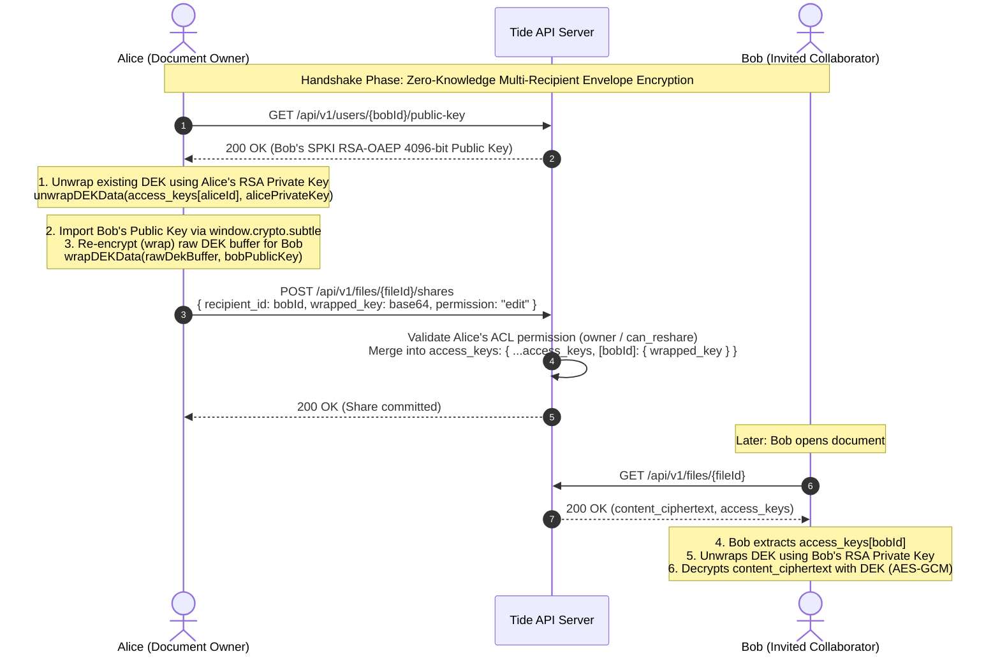
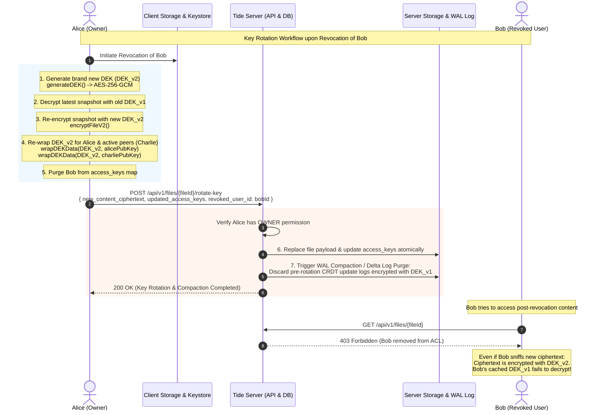

# Tide Multi-User Sharing, DEK Re-Encryption & Access Delegation Specification

> **Status:** Canonical Architecture Specification  
> **Target Files:** [`web/src/lib/cryptoV2.ts`](file:///C:/Users/nicoh/projects/tide/web/src/lib/cryptoV2.ts), [`web/src/store/slices/createFsSlice.ts`](file:///C:/Users/nicoh/projects/tide/web/src/store/slices/createFsSlice.ts), [`web/src/lib/crypto.ts`](file:///C:/Users/nicoh/projects/tide/web/src/lib/crypto.ts)  
> **Compliance:** Zero-Knowledge, Multi-Recipient Envelope Encryption, Web Crypto API (`window.crypto.subtle`)

---

## 1. Sharing Architecture: Zero-Knowledge Multi-User Trust Model

In traditional cloud storage systems, sharing a file involves granting read/write ACL entries on a central server, which stores the file either in plaintext or encrypted under a server-managed key. In Tide's **Zero-Knowledge (ZK)** paradigm, the central server, relational database, and blob storage providers are strictly untrusted relays.

```
       ┌────────────────────────────────────────────────────────┐
       │                   UNTURSTED SERVER                     │
       │  - Blind storage of content_ciphertext                 │
       │  - Relays access_keys dictionary                       │
       │  - Stores public keys in directory                     │
       │  - CANNOT decrypt DEK or payload                       │
       └────────────────────────┬───────────────────────────────┘
                                │
               ┌────────────────┴────────────────┐
               ▼                                 ▼
       ┌───────────────┐                 ┌───────────────┐
       │  User A       │                 │  User B       │
       │  (Owner)      │                 │ (Collaborator)│
       │  Master Priv  │                 │  Master Priv  │
       │  Key (RSA)    │                 │  Key (RSA)    │
       └───────────────┘                 └───────────────┘
```

### Core Cryptographic Principles
1. **Zero Master Password Sharing:** Users never disclose their master passphrases, PINs, or private identity keys to collaborators or the server.
2. **Dual-Layer Envelope Encryption:**
   - **Payload Layer:** Document contents (Markdown, TipTap schema, Yjs CRDT update vectors, canvas geometry, attachments) are encrypted with a fast, symmetric **Document Encryption Key (DEK)** using `AES-256-GCM`.
   - **Key Distribution Layer:** The raw 256-bit DEK is individually encrypted (wrapped) for each authorized recipient using their unique `RSA-OAEP-4096` identity public key.
3. **Decoupled Data and Key Metadata:**
   The document structure stores encrypted data once (`content_ciphertext`), accompanied by an `access_keys` mapping:
   ```typescript
   export interface AccessKeysMap {
       [userID: string]: {
           wrapped_key: string; // Base64-encoded RSA-OAEP ciphertext of raw DEK
           pwd_iv?: string;     // Base64-encoded IV if double-wrapped with secondary password
       };
   }
   ```
4. **Client-Side Cryptographic Enforcement:**
   Access authorization is fundamentally enforced by cryptography rather than server-side flag checking. A user omitted from `access_keys` cannot unwrap the DEK and cannot decrypt the payload, even if they bypass API access gates or sniff raw network traffic.

---

## 2. The Sharing Handshake (Collaborator Invitation)

When an owner or authorized collaborator invites a new peer to a document, the client executes a 4-step cryptographic handshake.



### Detailed Handshake Stages

#### Stage 1: Collaborator Discovery & Public Key Retrieval
The inviter queries the Tide public directory endpoint:
```http
GET /api/v1/users/{bob_user_id}/public-key
```
The response returns Bob's public key in SubjectPublicKeyInfo (SPKI) Base64 format. The client imports the key using `window.crypto.subtle.importKey`:
```typescript
const bobPublicKey = await window.crypto.subtle.importKey(
    "spki",
    base64ToArrayBuffer(bobPublicKeyBase64),
    {
        name: "RSA-OAEP",
        hash: "SHA-256",
    },
    true,
    ["encrypt"]
);
```

#### Stage 2: DEK Unwrapping
The current user locates their own wrapped key in the document's `access_keys` mapping and unwraps the raw 256-bit symmetric DEK using their RSA private key:
```typescript
// Look up user's own entry
const myAccess = fileRecord.access_keys[myUserId];
if (!myAccess || !myAccess.wrapped_key) {
    throw new Error("No cryptographic access key found for the current identity.");
}

// Unwrap RSA-OAEP layer
const rawDekBuffer = await unwrapDEKData(
    myAccess.wrapped_key,
    myPrivateKey // RSA-OAEP Private Key from Session Keystore
);
```
*Note on Double-Wrapped Notes:* If the document is additionally protected by a custom secondary password (`metadata.has_custom_password === true`), the inner key remains wrapped by the password-derived AES key. The owner unwraps the secondary layer using the passphrase KEK before distributing to collaborators, or delegates the encrypted inner DEK if the passphrase is to be shared out-of-band.

#### Stage 3: Re-Encryption (DEK Wrapping)
The inviter encrypts the raw DEK buffer directly under the recipient's RSA-OAEP public key:
```typescript
const wrappedForBob = await wrapDEKData(rawDekBuffer, bobPublicKey);
// Result: { ciphertext: "<base64-encoded RSA ciphertext>" }
```
Because `RSA-OAEP` with `SHA-256` hashing uses optimal asymmetric encryption padding with a randomized seed, the resulting ciphertext is non-deterministic and secure against chosen-plaintext attacks (IND-CCA2).

#### Stage 4: Access Keys Propagation
The client posts the new wrapped key entry to the server:
```typescript
await apiFetch(`/api/v1/files/${fileId}/shares`, {
    method: "POST",
    body: JSON.stringify({
        recipient_id: bobUserId,
        wrapped_key: wrappedForBob.ciphertext,
        permission: permissionLevel, // "view" | "edit" | "share"
    }),
});
```
The server atomically merges Bob's entry into the file's `access_keys` column in SQLite/PostgreSQL:
```json
{
    "access_keys": {
        "alice-uuid-0001": { "wrapped_key": "MIIB...==" },
        "bob-uuid-0002":   { "wrapped_key": "MIIC...==" }
    }
}
```

---

## 3. Permission Granularity & Capability Matrix

Tide separates access into **cryptographic capabilities** (possession of the DEK) and **protocol-level authority** (enforced by cryptographic signing and API access tokens).

| Permission Level | Cryptographic Rights | CRDT / Yjs Rights | Reshare Rights | Server Enforcement |
|:---|:---|:---|:---|:---|
| **`view`** | Unwraps DEK to decrypt content snapshot and listen to incoming live updates. | Read-only. Ephemeral presence broadcasts permitted; update deltas rejected. | Denied. Cannot post new keys to `/shares`. | Server rejects `PUT /files/{id}`, rejects CRDT push, drops unauthorized Yjs sync step 2 frames. |
| **`edit`** | Unwraps DEK, encrypts new content snapshots with DEK. | Read-Write. Can construct, sign, and push encrypted Yjs updates. | Denied. Cannot invite other users or re-wrap keys. | Server accepts content mutations and WebSocket CRDT frames with valid collaborator token. |
| **`share`** (`can_reshare`) | Unwraps DEK, re-encrypts DEK for new collaborators. | Read-Write. Full editor capabilities. | Permitted. Can query collaborator public keys and append entries to `access_keys`. | Server allows invocation of `/api/v1/files/{id}/shares` additions and role adjustments. |
| **`owner`** | Unwraps DEK, can initiate Key Rotation and document destruction. | Full Read-Write and administration. | Full delegation rights and revocation authority. | Server enforces that only the owner can delete document, purge history, or revoke collaborators. |

### Defense-in-Depth Enforcement
1. **Client Layer:** The UI disables editing inputs, TipTap editor instances are placed in read-only mode, and canvas mutation handles are hidden.
2. **Transport Layer:** WebSocket connections and HTTP delta pushes include HMAC / session tokens encoding the permission level. The server discards edits from `view` role connections.
3. **Cryptographic Sealing:** For tamper-proof audit trails, each snapshot commit can be signed using the author's Ed25519 or RSA signing identity key.

---

## 4. Public "Lehrseiten" & Public Link Sharing

Tide distinguishes between authenticated user-to-user sharing and public link sharing (e.g. published notes, educational portals, and anonymous collaboration).

### Deterministic Public DEKs (`derivePublicNoteDEK`)
For public documents (Lehrseiten) where anyone possessing the link or UUID can view or edit, Tide eliminates out-of-band asymmetric key exchanges via a deterministic key derivation function implemented in `web/src/lib/cryptoV2.ts`:

```typescript
/**
 * Derives a deterministic public DEK for unencrypted/public notes from the noteId.
 * Allows all sessions and clients to read/write Yjs CRDT frames without key mismatches.
 */
export async function derivePublicNoteDEK(noteId: string): Promise<CryptoKey> {
    const rawKey = await window.crypto.subtle.digest(
        'SHA-256',
        new TextEncoder().encode(`tide-public-note-v1:${noteId}`)
    );
    return window.crypto.subtle.importKey(
        'raw',
        rawKey,
        { name: 'AES-GCM' },
        false, // Non-extractable for runtime security
        ['encrypt', 'decrypt']
    );
}
```

### Deterministic vs Passphrase Link Models

```
                     ┌───────────────────────────────────────┐
                     │           Public Share Mode           │
                     └──────────────────┬────────────────────┘
                                        │
                 ┌──────────────────────┴──────────────────────┐
                 ▼                                             ▼
       ┌───────────────────┐                         ┌───────────────────┐
       │ Open Public Note  │                         │ Passphrase Link   │
       │ (Lehrseite)       │                         │ (Protected Link)  │
       └─────────┬─────────┘                         └─────────┬─────────┘
                 │                                             │
      derivePublicNoteDEK(uuid)                       PBKDF2(passphrase, salt)
                 │                                             │
                 ▼                                             ▼
       AES-256-GCM DEK                               AES-256-GCM KEK
   (All clients derive locally)                      (Unwraps file DEK)
```

1. **Open Public Note (No Password):**
   - The URL contains the document UUID (`/share/{noteId}`).
   - The client invokes `derivePublicNoteDEK(noteId)`.
   - The resulting AES-GCM key decrypts the latest server snapshot and encrypts/decrypts real-time Yjs CRDT WebSocket frames.
   - **Advantage:** Instant zero-friction collaboration without user accounts or server decryption.
2. **Passphrase-Protected Public Link:**
   - The URL includes an ephemeral link identifier, while the password is held by the recipient or encoded in the URL hash fragment (`/share/{id}#key=<secret>`).
   - The hash fragment never reaches the server (per RFC 3986).
   - The client derives a KEK using `PBKDF2-HMAC-SHA256` from the secret passphrase, which unwraps the document DEK provided in the public envelope.

---

## 5. Share Revocation & Forward Secrecy (Key Rotation)

### The Naive Revocation Vulnerability
A common flaw in naive envelope encryption implementations is simply deleting the revoked user's entry from the `access_keys` mapping on the server:

```
[VULNERABLE SCENARIO]
1. Owner deletes Bob from access_keys.
2. Bob retains the old DEK in local memory or offline cache.
3. Alice continues writing updates encrypted with the old DEK.
4. Bob intercepts or downloads new snapshots and decrypts them effortlessly!
```

Because Bob possessed the plaintext DEK while authorized, removing his RSA wrapped key does **not** take away his ability to decrypt content encrypted under that same DEK. Furthermore, Bob could decrypt any future edits, violating **Forward Secrecy**.

### The Full Key Rotation & Forward Secrecy Workflow
To achieve true forward secrecy upon collaborator revocation, Tide executes complete **Key Rotation** combined with server-side **Write-Ahead Log (WAL) Compaction**.



### Detailed Steps for Key Rotation

#### 1. Fresh DEK Generation
The owner's browser client generates an entirely independent 256-bit AES-GCM key:
```typescript
const newDek = await generateDEK();
const rawNewDek = await window.crypto.subtle.exportKey("raw", newDek);
```

#### 2. Snapshot Decryption and Re-Encryption
The document's current state (or active TipTap JSON / Yjs state vector) is decrypted using the previous DEK (`DEK_old`), and re-encrypted under `newDek`:
```typescript
const contentIv = window.crypto.getRandomValues(new Uint8Array(12));
const encryptedContent = await window.crypto.subtle.encrypt(
    { name: "AES-GCM", iv: contentIv },
    newDek,
    plaintextBuffer
);
```

#### 3. Selective Re-Wrapping for Remaining Collaborators
The client retrieves public keys for all remaining valid members (including the owner), and generates new wrapped key entries:
```typescript
const updatedAccessKeys: AccessKeysMap = {};

for (const collaborator of activeCollaborators) {
    if (collaborator.id === revokedUserId) {
        continue; // OMIT REVOKED COLLABORATOR
    }
    const wrapped = await wrapDEKData(rawNewDek, collaborator.publicKey);
    updatedAccessKeys[collaborator.id] = {
        wrapped_key: wrapped.ciphertext,
        pwd_iv: wrapped.iv,
    };
}
```

#### 4. Server-Side Atomic Commit & WAL Compaction
The payload is posted to the rotation endpoint:
```http
POST /api/v1/files/{id}/rotate-key
Content-Type: application/json

{
    "content_ciphertext": "...",
    "access_keys": { ... },
    "key_epoch": 2,
    "revoked_user_id": "bob-uuid-0002"
}
```

The server executes an atomic database transaction:
1. **Metadata & Snapshot Update:** The file record's `content_ciphertext` is overwritten with the re-encrypted snapshot, and `access_keys` is updated to contain only authorized active members.
2. **Access Control Mutation:** The revoked collaborator's record in `file_shares` is marked as revoked/deleted.
3. **CRDT Delta Log / WAL Compaction:** In collaborative Yjs editing, operations are logged as sequential binary deltas in the database Write-Ahead Log. If these historical deltas remained on the server, a revoked member who retained `DEK_old` could inspect historical frames. The server purges or squashes all delta log entries prior to the rotation epoch into the newly encrypted snapshot base:
   $$\text{WAL}_{\text{compacted}} \leftarrow \text{Flatten}(\Delta_{0 \dots T}) \xrightarrow{\text{Encrypt}(\text{DEK}_{\text{new}})} \text{Snapshot}_{\text{epoch+1}}$$
4. **Session Eviction:** The server terminates any active WebSocket subscriptions or collaboration channels belonging to the revoked user for that document ID.

---

## 6. Implementation Reference: `cryptoV2.ts` Integration

The following code demonstrates the integrated sharing and rotation methods complementing `cryptoV2.ts`:

```typescript
// web/src/lib/cryptoV2.ts (Sharing & Rotation Reference)

/**
 * Creates an access key entry for a new collaborator by wrapping an existing DEK.
 */
export async function shareFileWithUser(
    rawDek: ArrayBuffer,
    recipientPublicKeySpkiBase64: string
): Promise<{ wrapped_key: string; pwd_iv?: string }> {
    const recipientKey = await window.crypto.subtle.importKey(
        "spki",
        base64ToArrayBuffer(recipientPublicKeySpkiBase64),
        { name: "RSA-OAEP", hash: "SHA-256" },
        true,
        ["encrypt"]
    );

    const wrapped = await wrapDEKData(rawDek, recipientKey);
    return {
        wrapped_key: wrapped.ciphertext,
        pwd_iv: wrapped.iv,
    };
}

/**
 * Rotates the DEK of a document upon collaborator revocation.
 * Re-encrypts the latest plaintext buffer and re-wraps the new DEK for remaining peers.
 */
export async function rotateFileDEK(
    latestPlaintext: ArrayBuffer,
    activeRecipients: Array<{ userId: string; publicKey: CryptoKey }>
): Promise<{
    newContentCiphertext: string;
    newAccessKeys: AccessKeysMap;
}> {
    // 1. Generate new DEK
    const newDek = await generateDEK();
    const rawNewDek = await window.crypto.subtle.exportKey("raw", newDek);

    // 2. Encrypt document content under new DEK
    const iv = window.crypto.getRandomValues(new Uint8Array(12));
    const encrypted = await window.crypto.subtle.encrypt(
        { name: "AES-GCM", iv },
        newDek,
        latestPlaintext
    );

    const newContentCiphertext = JSON.stringify({
        data: arrayBufferToBase64(encrypted),
        iv: arrayBufferToBase64(iv.buffer),
    });

    // 3. Wrap new DEK for all active members
    const newAccessKeys: AccessKeysMap = {};
    for (const recipient of activeRecipients) {
        const wrapped = await wrapDEKData(rawNewDek, recipient.publicKey);
        newAccessKeys[recipient.userId] = {
            wrapped_key: wrapped.ciphertext,
            pwd_iv: wrapped.iv,
        };
    }

    return {
        newContentCiphertext,
        newAccessKeys,
    };
}
```

---

## 7. Security Verification Checklist

- [x] **Zero Knowledge Maintained:** Passwords and private identity keys are never communicated across peers or transmitted to the server.
- [x] **Asymmetric Key Strength:** Master identity key pairs use `RSA-OAEP-4096` with `SHA-256` hashing.
- [x] **Symmetric Payload Strength:** Content and CRDT frames are secured with `AES-256-GCM` using cryptographically random 12-byte IVs (`crypto.getRandomValues`).
- [x] **No Static DEK Derivation for Private Files:** DEKs for private and multi-user files are generated from secure random entropy; deterministic generation is strictly reserved for public notes (`derivePublicNoteDEK`).
- [x] **Forward Secrecy Guaranteed:** Revoking a collaborator triggers DEK generation, snapshot re-encryption, selective re-wrapping, and server-side WAL log compaction.
- [x] **Constant-Time Native Primitives:** All cryptographic logic runs within `window.crypto.subtle` without third-party JS library overhead.
