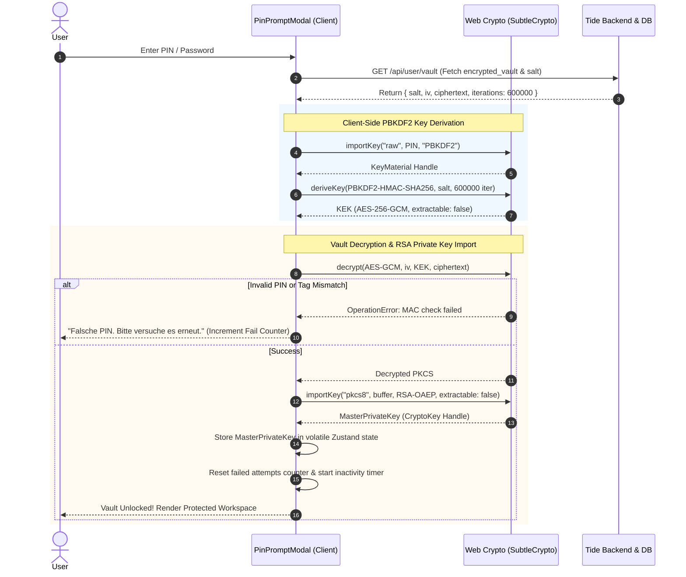
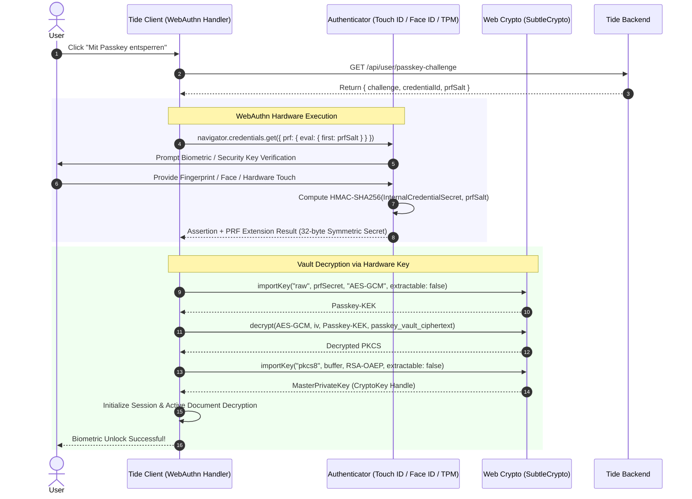

# Tide Vault, PIN & Passkey Security Architecture Specification

> **Status:** Canonical Security Architecture Specification  
> **Target Files:**  
> - [`web/src/lib/crypto.ts`](file:///C:/Users/nicoh/projects/tide/web/src/lib/crypto.ts) (Master KDF, Key Wrapping, RSA Primitives)  
> - [`web/src/lib/cryptoV2.ts`](file:///C:/Users/nicoh/projects/tide/web/src/lib/cryptoV2.ts) (Envelope Encryption & DEK Unwrap Engine)  
> - [`web/src/lib/pinSecurity.ts`](file:///C:/Users/nicoh/projects/tide/web/src/lib/pinSecurity.ts) (PIN Hash, Salt, Frequency & Cache Management)  
> - [`web/src/components/Security/PinPromptModal.tsx`](file:///C:/Users/nicoh/projects/tide/web/src/components/Security/PinPromptModal.tsx) (PIN Verification & Recovery UI)  
> - [`web/src/components/Security/SecuritySettingsModal.tsx`](file:///C:/Users/nicoh/projects/tide/web/src/components/Security/SecuritySettingsModal.tsx) (Security Policy Configuration UI)  
> **Compliance:** Zero-Knowledge, Web Crypto API (`window.crypto.subtle`), FIDO2 / WebAuthn Level 3 (PRF Extension), BIP-39 Standard

---

## 1. Vault Philosophy & Threat Model

Tide enforces a strict **Zero-Knowledge (ZK) Client-Side Vault Architecture**. The application operates under the assumption that the backend server, network transport layer, database, and cloud storage providers are potentially hostile, compromised, or untrusted.

### 1.1 Core Principles
1. **Client-Exclusive Secret Custody:** Plaintext passwords, PINs, BIP-39 recovery phrases, derived Key Encryption Keys (KEKs), and raw asymmetric private keys reside exclusively in transient browser client memory (`window.crypto.subtle` memory heap). They are never transmitted over the wire or stored in unencrypted persistent storage.
2. **Server-Blind Storage:** The central server acts exclusively as a blind synchronization and storage relay for:
   - User public identity keys (SPKI 4096-bit RSA).
   - Encrypted Master Vault envelopes (`{ salt, iv, ciphertext }`).
   - Per-user cryptographic salt values.
   - Encrypted Document Encryption Keys (`access_keys` envelopes).
3. **Hardware & Engine Isolation:** Cryptographic transformations are delegated directly to the browser runtime's native C++ implementation via the W3C Web Crypto API. Private keys are instantiated as **non-extractable** `CryptoKey` handles, mitigating arbitrary memory leakage from client-side scripts.

---

## 2. Vault Unlock Flow: PIN / Password Derivation

The primary gate to the user's encrypted identity is their Master PIN or Password. The vault unlock process transforms low-entropy human credentials into a cryptographically hardened 256-bit symmetric Key Encryption Key (KEK) using high-iteration PBKDF2.

### 2.1 Cryptographic Parameters

| Parameter | Specification | Purpose / Standard |
| :--- | :--- | :--- |
| **KDF Algorithm** | `PBKDF2` (W3C Web Crypto) | Password-Based Key Derivation Function 2 |
| **Pseudo-Random Function (PRF)** | `HMAC-SHA-256` | Cryptographic hash primitive |
| **Iteration Count** | `600,000` (`DEFAULT_PBKDF2_ITERATIONS`) | OWASP 2024+ recommendation against GPU attacks |
| **Legacy Iterations** | `100,000` (`LEGACY_PBKDF2_ITERATIONS`) | Backward compatibility for legacy vaults |
| **Salt Size** | 16 bytes (128 bits) CSPRNG | Per-user cryptographic salt |
| **Derived Key Type** | `AES-GCM` 256-bit | Key Encryption Key (KEK) |
| **KEK Extractability** | `extractable: false` | Key cannot be exported from Web Crypto memory |
| **Vault Cipher** | `AES-256-GCM` (12-byte IV, 128-bit Tag) | Authenticated encryption of Master Private Key |
| **Unwrapped Identity Key** | `RSA-OAEP` 4096-bit (PKCS#8) | Master asymmetric decryption and unwrap key |

### 2.2 Step-by-Step Derivation and Unlock Sequence

1. **Secret Ingestion:** The user inputs their Master PIN or Password into the authentication interface (`PinPromptModal.tsx`).
2. **Envelope Retrieval:** The client fetches the user's encrypted vault record from the server:
   ```json
   {
     "salt": "u+Vz...Base64==",
     "iv": "3aF9...Base64==",
     "ciphertext": "0kLm...Base64=="
   }
   ```
3. **Key Material Import:** The user's input string is converted to UTF-8 bytes and imported into the Web Crypto engine:
   ```typescript
   const keyMaterial = await window.crypto.subtle.importKey(
     "raw",
     new TextEncoder().encode(pinOrPassword),
     { name: "PBKDF2" },
     false,
     ["deriveKey"]
   );
   ```
4. **KEK Derivation:** PBKDF2 executes 600,000 iterations of HMAC-SHA-256 with the user's specific 16-byte salt:
   ```typescript
   const kek = await window.crypto.subtle.deriveKey(
     {
       name: "PBKDF2",
       salt: base64ToArrayBuffer(vault.salt),
       iterations: 600000,
       hash: "SHA-256"
     },
     keyMaterial,
     { name: "AES-GCM", length: 256 },
     false, // Non-extractable
     ["decrypt"]
   );
   ```
5. **Vault Decryption (AES-256-GCM):** The KEK decrypts the encrypted private key payload:
   ```typescript
   const pkcs8Buffer = await window.crypto.subtle.decrypt(
     { name: "AES-GCM", iv: base64ToArrayBuffer(vault.iv) },
     kek,
     base64ToArrayBuffer(vault.ciphertext)
   );
   ```
   *Failure Handling:* If the PIN is incorrect or ciphertext has been tampered with, AES-GCM tag verification fails, rejecting the operation before any private key material is instantiated.
6. **Master Private Key Import:** The decrypted PKCS#8 buffer is imported as a non-extractable 4096-bit RSA-OAEP private key:
   ```typescript
   const masterPrivateKey = await window.crypto.subtle.importKey(
     "pkcs8",
     pkcs8Buffer,
     { name: "RSA-OAEP", hash: "SHA-256" },
     false, // Non-extractable
     ["decrypt"]
   );
   ```
7. **Session Memory Initialization:** The resulting `masterPrivateKey` is cached in active session memory (`useDataStore`), ready to unwrap document DEKs via `unwrapDEKData()` in [`web/src/lib/cryptoV2.ts`](file:///C:/Users/nicoh/projects/tide/web/src/lib/cryptoV2.ts).

---

## 3. WebAuthn & Passkey Integration (PRF Extension)

To provide biometric and hardware-bound unlocking (Face ID, Touch ID, Windows Hello, YubiKey) without sacrificing Zero-Knowledge guarantees, Tide leverages the **FIDO2 WebAuthn Pseudo-Random Function (PRF) extension** (`hmac-secret` / `prf`).

### 3.1 The Zero-Knowledge Passkey Dilemma
Traditional WebAuthn authenticates a user to a remote server using asymmetric signatures (`navigator.credentials.get`). While secure for authentication, signature assertions alone cannot decrypt client-side data without exposing keys to the server.

The **PRF Extension** solves this by instructing the authenticator hardware's secure element (SE/TPM/Secure Enclave) to evaluate an HMAC over a client-provided salt using an internal, hardware-fused credential secret. This produces a deterministic, 256-bit symmetric output known only to the client hardware.

### 3.2 Registration Flow (Hardware Credential Creation)

During Passkey setup in [`SecuritySettingsModal.tsx`](file:///C:/Users/nicoh/projects/tide/web/src/components/Security/SecuritySettingsModal.tsx):
1. **Client Generation of PRF Salt:** A 32-byte CSPRNG salt (`prf_salt`) is generated on the client.
2. **Credential Creation with PRF Extension:**
   ```typescript
   const credential = await navigator.credentials.create({
     publicKey: {
       challenge: window.crypto.getRandomValues(new Uint8Array(32)),
       rp: { name: "Tide Zero-Knowledge Cloud", id: window.location.hostname },
       user: {
         id: new TextEncoder().encode(userId),
         name: userEmail,
         displayName: userDisplayName
       },
       pubKeyCredParams: [
         { type: "public-key", alg: -7 },  // ES256
         { type: "public-key", alg: -257 } // RS256
       ],
       authenticatorSelection: {
         authenticatorAttachment: "platform", // Face ID / Touch ID / Windows Hello
         residentKey: "required",
         userVerification: "required"
       },
       extensions: {
         prf: {
           eval: {
             first: prfSaltBuffer // 32-byte salt
           }
         }
       }
     }
   }) as PublicKeyCredential;
   ```
3. **Hardware Symmetric Secret Extraction:**
   The browser returns the PRF extension result:
   ```typescript
   const extensionResults = credential.getClientExtensionResults();
   const prfOutput = extensionResults.prf?.results?.first; // 32-byte raw symmetric output
   ```
4. **Passkey Vault Wrap:** The `prfOutput` is imported as an AES-GCM 256-bit key (`Passkey-KEK`). The user's Master Private Key (PKCS#8) is encrypted with this `Passkey-KEK` and stored locally or on the server alongside the `credentialId` and `prf_salt`.

### 3.3 Passkey Unlock Flow

1. When accessing Tide, the client requests biometric assertion:
   ```typescript
   const assertion = await navigator.credentials.get({
     publicKey: {
       challenge: window.crypto.getRandomValues(new Uint8Array(32)),
       rpId: window.location.hostname,
       allowCredentials: [{ id: credentialId, type: "public-key" }],
       userVerification: "required",
       extensions: {
         prf: {
           eval: {
             first: prfSaltBuffer
           }
         }
       }
     }
   }) as PublicKeyCredential;
   ```
2. The hardware authenticator verifies biometric presence (Touch ID/Face ID) locally.
3. The secure enclave reproduces the exact 32-byte PRF symmetric secret.
4. The client uses this secret to unwrap the Master Private Key instantly, bypassing manual PIN entry while preserving end-to-end zero-knowledge security.

---

## 4. Vault Lockout & Brute-Force Defense

Because PINs typically possess lower entropy than full cryptographic passphrases, client-side brute-force defense is enforced via a hybrid model of **computational delay (PBKDF2)**, **local state lockout tracking**, and **progressive throttle penalties**.

### 4.1 Threat Context: Offline vs. Online Attacks
- **Offline Server Compromise:** If an attacker dumps the server database, the 600,000 PBKDF2-HMAC-SHA256 iterations impose a high computational barrier (approx. 300ms–800ms per attempt on modern hardware, millions of USD in GPU cluster runtime to crack complex PINs).
- **Online Client Interface Attacks:** Local scripts or malicious browser extensions attempting rapid iteration against the client interface are halted by local lockout thresholds.

### 4.2 Progressive Delay & Lockout Matrix

Local attempt tracking is maintained across [`pinSecurity.ts`](file:///C:/Users/nicoh/projects/tide/web/src/lib/pinSecurity.ts) and [`PinPromptModal.tsx`](file:///C:/Users/nicoh/projects/tide/web/src/components/Security/PinPromptModal.tsx):

| Failed Consecutive Attempts | Enforced Action / Penalty | Client State Behavior |
| :--- | :--- | :--- |
| **1 – 2** | Standard error feedback (`Falsche PIN`) | Instant retry permitted |
| **3** | Progressive delay penalty | 5-second mandatory cooldown timer |
| **4** | Progressive delay penalty | 30-second mandatory cooldown timer |
| **5** | Exponential backoff | 5-minute cooldown timer |
| **10** | **Temporary Vault Lockout** | 1-hour total lock; recovery phrase prompt triggered |

### 4.3 Anti-Tamper Local State
- Lockout counters and timestamps are recorded in `sessionStorage` and `localStorage` with monotonic checks.
- If system time manipulation is detected (e.g., negative elapsed time), the client immediately enforces the maximum lockout period.
- Repeated failures trigger an automatic offer to initiate the BIP-39 Seed Phrase Recovery Flow.

---

## 5. Key Recovery & BIP-39 Seed Phrase

To guard against permanent data loss resulting from forgotten PINs or lost authenticators, Tide provides a deterministic **BIP-39 Mnemonic Seed Phrase Recovery System**.

### 5.1 Entropy and Mnemonic Generation
1. **Entropy Source:** 256 bits of high-quality entropy from `window.crypto.getRandomValues(new Uint8Array(32))`.
2. **BIP-39 Wordlist:** Derives a 24-word recovery phrase (or 128-bit for 12 words) compliant with the standard BIP-39 English wordlist.
3. **Checksum Verification:** Appends SHA-256 checksum bits (8 bits for 24 words) prior to mnemonic formatting.

### 5.2 Recovery Envelope Architecture
The Master Private Key is dual-wrapped at account creation:
1. **Primary Envelope:** Wrapped with the user's PIN-derived KEK (`encrypted_vault`).
2. **Recovery Envelope:** Wrapped with a 256-bit symmetric key derived from the BIP-39 Seed Phrase (`recovery_vault`):
   ```
   Seed Phrase (24 words)
       │
       ▼
   PBKDF2-HMAC-SHA512 (2048 iterations, salt="mnemonic" + optional passphrase)
       │
       ▼
   512-bit Root Seed
       │
       ▼ (First 256 bits)
   Recovery-KEK (AES-256-GCM)
       │
       ▼
   Recovery Envelope: AES-GCM Encrypt(Master Private Key PKCS#8)
   ```

### 5.3 Resetting Forgotten PINs
When a user forgets their PIN:
1. The user inputs their 24-word recovery phrase into the recovery modal.
2. The client calculates the Recovery-KEK and decrypts the `recovery_vault` to extract the Master Private Key.
3. The user establishes a new PIN.
4. A new PBKDF2 salt is generated; the Master Private Key is re-wrapped with the new PIN's KEK.
5. The updated primary envelope (`encrypted_vault`) and new salt are committed to the backend server.
6. The underlying RSA master keypair remains identical, meaning **all existing document DEKs (`access_keys`) and shared files remain fully accessible without re-encrypting the user's entire library**.

---

## 6. In-Memory Key Security & Auto-Locking

Once unlocked, sensitive keys must be insulated from potential browser execution hazards (XSS, rogue extensions, accidental object serialization, or device abandonment).

### 6.1 Non-Extractable CryptoKey Objects
All keys imported into the session use Web Crypto's native security perimeter:
```typescript
await window.crypto.subtle.importKey(
  "pkcs8",
  privateKeyData,
  { name: "RSA-OAEP", hash: "SHA-256" },
  false, // extractable = FALSE (SEC-04 Compliance)
  ["decrypt"]
);
```
- **Heap Immutability:** When `extractable: false` is configured, calling `window.crypto.subtle.exportKey()` throws a DOMException `InvalidAccessError`. Malicious scripts executing inside the application context cannot dump the raw private key bytes to an exfiltration server.
- **Reference Scrubbing:** Key references in volatile memory are assigned to closed-scope closures or encapsulated within reactive store state (`useDataStore`), never exposed on `window` or global objects.

### 6.2 Auto-Locking Inactivity Engine
To prevent unauthorized access when a user leaves their computer unlocked:
1. **Activity Listeners:** Global event listeners monitor user interaction (`pointermove`, `keydown`, `touchstart`, `scroll`).
2. **Inactivity Timer:** Configurable timeout (default: 15 minutes; range: 1 min to 8 hours).
3. **Lock Execution:**
   - Clears the Master Private Key reference from the Zustand store.
   - Flushes `sessionPinCache` in [`pinSecurity.ts`](file:///C:/Users/nicoh/projects/tide/web/src/lib/pinSecurity.ts).
   - Clears transient document DEK decryption caches.
   - Removes session unlock flags (`sessionStorage.removeItem('tide_unlocked_*')`).
   - Replaces the current application view with the `PinPromptModal` or Passkey unlock overlay.

---

## 7. Cryptographic Sequence Workflows

### 7.1 Master Vault Unlock via PIN (PBKDF2 + AES-GCM)



---

### 7.2 Biometric Vault Unlock via WebAuthn PRF Extension



---

## 8. Component & Implementation Reference

| Component / Function | File Location | Cryptographic Responsibility |
| :--- | :--- | :--- |
| `PinPromptModal` | [`web/src/components/Security/PinPromptModal.tsx`](file:///C:/Users/nicoh/projects/tide/web/src/components/Security/PinPromptModal.tsx) | PIN UI, lockout throttling, email OTP fallback, input masking |
| `SecuritySettingsModal` | [`web/src/components/Security/SecuritySettingsModal.tsx`](file:///C:/Users/nicoh/projects/tide/web/src/components/Security/SecuritySettingsModal.tsx) | Frequency policy, recovery phrase generator, Passkey enrollment |
| `deriveKeyFromPassword` | [`web/src/lib/crypto.ts`](file:///C:/Users/nicoh/projects/tide/web/src/lib/crypto.ts) | PBKDF2 600k derivation of 256-bit AES-GCM KEK |
| `encryptPrivateKey` | [`web/src/lib/crypto.ts`](file:///C:/Users/nicoh/projects/tide/web/src/lib/crypto.ts) | Encrypts RSA-OAEP private key into user vault envelope |
| `decryptPrivateKey` | [`web/src/lib/crypto.ts`](file:///C:/Users/nicoh/projects/tide/web/src/lib/crypto.ts) | Decrypts and imports non-extractable Master Private Key |
| `unwrapDEKData` | [`web/src/lib/cryptoV2.ts`](file:///C:/Users/nicoh/projects/tide/web/src/lib/cryptoV2.ts) | Uses unwrapped Master Private Key to decrypt document DEKs |
| `hashPin` / `verifyPin` | [`web/src/lib/pinSecurity.ts`](file:///C:/Users/nicoh/projects/tide/web/src/lib/pinSecurity.ts) | Item-level PIN verification and frequency caching |
| `isItemUnlocked` | [`web/src/lib/pinSecurity.ts`](file:///C:/Users/nicoh/projects/tide/web/src/lib/pinSecurity.ts) | Evaluates session, timeout, count, or once unlock states |
