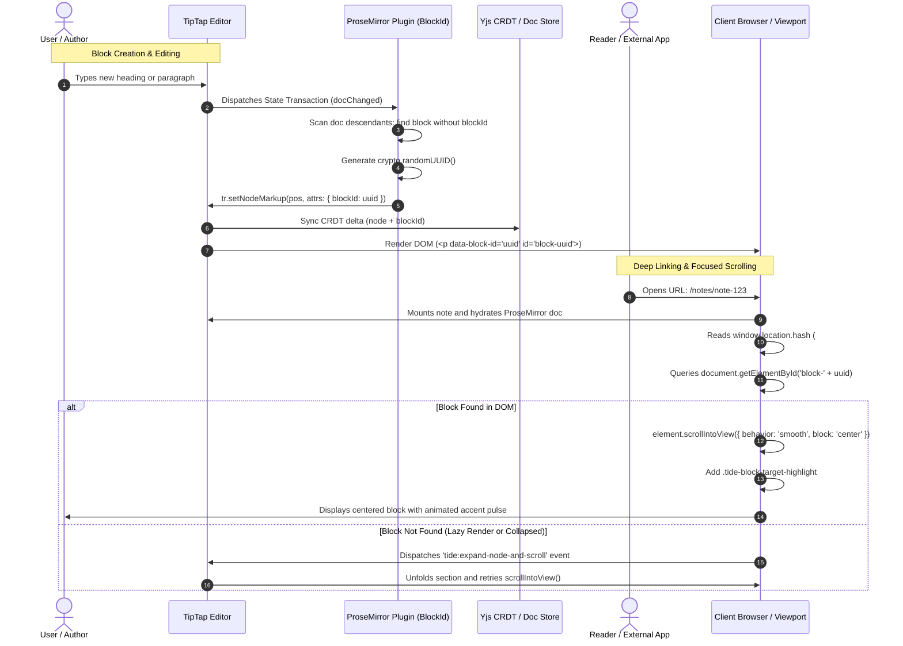

# Block-ID Architecture & Deep Linking Specification

This document provides the exhaustive technical specification for block-level UUID anchoring, deep linking, and surgical AI manipulation within TIDE's TipTap editor (`web/src/components/extensions/BlockId.ts`, `Editor.tsx`, and associated extensions).

---

## 1. The Block-ID Architecture

### 1.1 The Need for Block-Level Addressability
Traditional rich-text editors and markdown processors treat documents as a monolithic stream of characters or a flat syntax tree without persistent node identities. While suitable for simple word processing, this model falls short in collaborative knowledge workspaces, modern multi-agent systems, and spatial canvas interfaces:

1. **AI Agent Surgical Edits**:
   When an AI assistant (or MCP server agent) is tasked with updating, summarizing, or correcting a specific point, rewriting the entire document incurs massive token overhead, loses undo/redo granularity, and frequently introduces merge conflicts in collaborative CRDT sessions. Block addressability allows atomic mutations targeting specific block UUIDs.
2. **Deep Linking & Permanent References**:
   Users and external systems need to link directly to specific paragraphs, headings, list items, or code snippets (e.g., `https://tide.app/notes/note-456#block-8f24a1b0-9c2b-4fa6-8472-520e576be78a`), with automatic viewport centering and visual highlighting.
3. **Spatial & Infinite Canvas Anchoring**:
   In TIDE, handwriting strokes (`PencilInkExtension`), sticky notes, comments (`InlineCommentNode`), and mind-map connections (`CanvasLayer`) can visually attach to text blocks. Stable block UUIDs ensure that attachments stay visually tethered even as the document above expands, contracts, or reflows.
4. **Backlink Graph Accuracy**:
   Inter-note bidirectional references require granularity beyond note-level links. Block-level IDs enable backlink engines to resolve references to the exact paragraph or list item where a concept was discussed.

---

## 2. `BlockIdExtension` Implementation

The block identifier system is implemented as a TipTap extension (`BlockId` in `web/src/components/extensions/BlockId.ts`) configured inside `useTipTapConfig.ts`.

### 2.1 Targeted Node Types
`BlockId` attaches global attributes to all standard block-level node types supported by TipTap:
* `paragraph`
* `heading`
* `bulletList`
* `orderedList`
* `listItem`
* `blockquote`
* `codeBlock`
* `horizontalRule`
* `image`

### 2.2 Attribute Schema & Split Semantics
```typescript
addGlobalAttributes() {
  return [
    {
      types: [
        'paragraph', 'heading', 'bulletList', 'orderedList',
        'listItem', 'blockquote', 'codeBlock', 'horizontalRule', 'image',
      ],
      attributes: {
        blockId: {
          default: null,
          keepOnSplit: false, // Critical: Splitting a block forces the new block to generate a new UUID
          parseHTML: (element) => element.getAttribute('data-block-id'),
          renderHTML: (attrs) => {
            if (!attrs.blockId) return {};
            return {
              'data-block-id': attrs.blockId,
              'id': `block-${attrs.blockId}`,
            };
          },
        },
      },
    },
  ];
}
```

* **`keepOnSplit: false`**:
  When a user presses `Enter` inside a paragraph or list item, ProseMirror splits the node into two. Setting `keepOnSplit: false` clears the attribute on the newly created half. The plugin's transaction listener then detects the missing attribute and assigns a fresh, unique UUID.
* **HTML Parsing & Serialization**:
  Preserves `data-block-id` when loading saved HTML or pasting content serialized within TIDE.

### 2.3 Automatic UUID Assignment & Duplicate Resolution
The core logic resides in a ProseMirror plugin hooked into `appendTransaction`:

```typescript
appendTransaction(transactions, oldState, newState) {
  const docChanged = transactions.some((tr) => tr.docChanged);
  if (!docChanged) return null;

  // CRDT Blank Document Guard:
  // If the document contains only a single empty paragraph, do not assign a UUID blockId
  // to an unedited blank default paragraph (prevents empty line prepended during CRDT sync)
  if (
    newState.doc.childCount === 1 &&
    newState.doc.firstChild?.isTextblock &&
    newState.doc.firstChild.content.size === 0
  ) {
    return null;
  }

  const tr = newState.tr;
  let modified = false;
  const usedIds = new Set<string>();

  newState.doc.descendants((node, pos) => {
    if (!node.isBlock) return;

    const id = node.attrs.blockId;
    if (id && !usedIds.has(id)) {
      usedIds.add(id);
      return; // ID is valid and unique in this document
    }

    // Missing ID (new block) or Duplicate ID (copy-pasted content)
    const newId = crypto.randomUUID();
    tr.setNodeMarkup(pos, undefined, {
      ...node.attrs,
      blockId: newId,
    });
    usedIds.add(newId);
    modified = true;
  });

  return modified ? tr : null;
}
```

#### Key Mechanics:
1. **Deterministic Assignment**: Every block is guaranteed to possess a valid RFC 4122 v4 UUID (`crypto.randomUUID()`).
2. **De-duplication**: When an entire block or paragraph is duplicated via copy-paste, the pasted node initially shares the original node's `blockId`. The scanner tracks `usedIds` in a single document pass. If a duplicate is encountered, `tr.setNodeMarkup` stamps a brand new UUID onto the duplicate.
3. **Single Blank Document Guard**: During collaborative session initialization (Yjs CRDT sync), an empty document starts with a single empty paragraph `<p></p>`. Injecting a UUID immediately would register a change in Yjs, creating a phantom initial line on remote clients. The guard suppresses UUID generation until content is typed or added.

### 2.4 Deleted Block Tracking (`onBlocksDeleted`)
When blocks are deleted, merged into other blocks, or cut from the document, external systems (such as `CanvasLayer` or backlink indices) need to clean up orphaned references or re-anchor floating canvas annotations.

The extension monitors document transitions in the plugin `view.update()` hook:

```typescript
view() {
  return {
    update(view, prevState) {
      if (!view.state.doc.eq(prevState.doc)) {
        const before = collectIds(prevState.doc);
        const after = collectIds(view.state.doc);

        const removed: string[] = [];
        before.forEach((id) => {
          if (!after.has(id)) removed.push(id);
        });

        if (removed.length > 0 && options.onBlocksDeleted) {
          // Defer to microtask queue so React state updates do not conflict with ProseMirror's synchronous DOM render loop
          queueMicrotask(() => options.onBlocksDeleted!(removed));
        }
      }
    },
  };
}
```

---

## 3. DOM Anchoring & Deep Linking

### 3.1 DOM Output
Every block node rendered in the DOM receives:
1. `data-block-id="{uuid}"`: Data attribute queried by canvas layers, hover menus, and event dispatchers.
2. `id="block-{uuid}"`: Standard HTML element ID queried by URL hash navigation.

Example rendered HTML:
```html
<p data-block-id="e2a84d28-7651-419b-a083-d3d6dfb8d2b7" id="block-e2a84d28-7651-419b-a083-d3d6dfb8d2b7">
  This is a deep-linkable paragraph in TIDE.
</p>
```

### 3.2 Deep Link URL Schema
Deep link URLs follow standard hash fragment routing:
```
/notes/{noteId}#block-{blockId}
```
Example:
```
https://tide.app/notes/3a6f44f9-5438-410a-b58f-fb4cf4e259b1#block-e2a84d28-7651-419b-a083-d3d6dfb8d2b7
```

### 3.3 Scroll & Highlight Execution
When an editor tab mounts or a hash navigation event occurs, the editor executes a smooth focus routine:

1. **Resolution**: Detect `#block-{uuid}` from `window.location.hash` or active deep link props.
2. **DOM Query**: Locate `document.getElementById('block-' + uuid)` or `document.querySelector('[data-block-id="' + uuid + '"]')`.
3. **Smooth Scroll**:
   ```typescript
   element.scrollIntoView({
     behavior: 'smooth',
     block: 'center',
     inline: 'nearest',
   });
   ```
4. **Visual Pulse / Highlight**:
   Add a temporary CSS class (e.g., `tide-block-target-highlight`) that plays an accent glow animation before fading out over 2 seconds:
   ```css
   @keyframes blockTargetPulse {
     0% { background-color: rgba(99, 102, 241, 0.25); border-radius: 4px; box-shadow: 0 0 0 4px rgba(99, 102, 241, 0.2); }
     70% { background-color: rgba(99, 102, 241, 0.15); box-shadow: 0 0 0 2px rgba(99, 102, 241, 0.1); }
     100% { background-color: transparent; box-shadow: none; }
   }
   .tide-block-target-highlight {
     animation: blockTargetPulse 2s cubic-bezier(0.16, 1, 0.3, 1) forwards;
   }
   ```

---

## 4. AI Agent & MCP Integration

Block UUIDs form the foundation of TIDE's programmatic MCP interface, allowing AI agents to read and modify documents with pinpoint precision without risking document corruption or high latency.

### 4.1 MCP Tool: `tide_get_block`
Allows an AI agent to inspect a specific section of a note without retrieving the entire multi-megabyte document.

* **Parameters**:
  * `note_id` (string, required): Note identifier.
  * `block_id` (string, required): Block UUID.
* **Return Value**:
  ```json
  {
    "block_id": "e2a84d28-7651-419b-a083-d3d6dfb8d2b7",
    "type": "paragraph",
    "text": "The quarterly financial forecast indicates a 14% growth in Q3.",
    "json": {
      "type": "paragraph",
      "attrs": { "blockId": "e2a84d28-7651-419b-a083-d3d6dfb8d2b7" },
      "content": [{ "type": "text", "text": "The quarterly financial forecast indicates a 14% growth in Q3." }]
    }
  }
  ```

### 4.2 MCP Tool: `tide_patch_block`
Enables surgical in-place modification or replacement of an existing block.

* **Parameters**:
  * `note_id` (string, required): Note identifier.
  * `block_id` (string, required): Target block UUID.
  * `content` (string | object, required): Updated text or ProseMirror JSON node.
  * `action` (`"replace"` | `"insert_after"` | `"insert_before"` | `"delete"`): Operation mode.
* **Benefits over Document Rewriting**:
  1. **Zero Conflict**: Does not conflict with concurrent keystrokes from other users elsewhere in the doc.
  2. **Preserved Canvas Bindings**: Does not inadvertently change adjacent block IDs, preserving spatial canvas links and handwriting positions.
  3. **CRDT Delta Minimization**: Generates a minimal Yjs delta containing only the modified character run.

---

## 5. Architectural Flow & Sequence Diagram

The following diagram illustrates the complete lifecycle: block creation, automatic UUID generation via ProseMirror transaction, deep linking through a URL, and browser scrolling with highlight focus.



---

## 6. Edge Cases & Safety Protocols

1. **Copy-Pasting Content Across Documents**:
   When content with existing `data-block-id` attributes is pasted into another note (or within the same note), duplicate IDs are detected on the first `appendTransaction` run. The duplicate instance is reassigned a new UUID while the original retains its ID.
2. **Undo / Redo Safety**:
   ProseMirror's undo history restores previous node attributes naturally. Because `blockId` changes are part of the transaction, undoing a deletion or re-typing properly re-attaches the original UUID rather than creating a fragmented ID.
3. **Empty Paragraph Cleanup**:
   TIDE suppresses UUID injection on bare initial paragraphs in empty documents to prevent unintended CRDT merge pollution across peers during initial WebSocket negotiation.
4. **Orphan Backlink Prevention**:
   The `onBlocksDeleted` callback fires via `queueMicrotask`, notifying Zustand stores (`useLinkStore`, `useReferenceStore`) to update their graphs without interrupting the active ProseMirror transaction cycle.
