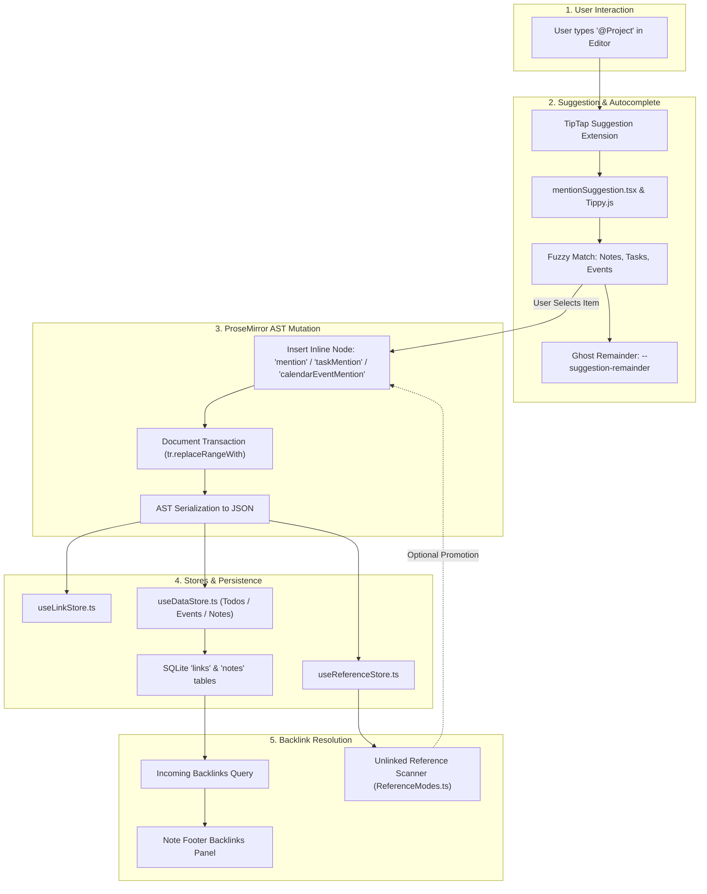

# Mentions & Bidirectional Reference Subsystem Architecture

> **Status:** Canonical Architecture Specification  
> **Target Files:**  
> - [`web/src/components/extensions/mentionSuggestion.tsx`](file:///C:/Users/nicoh/projects/tide/web/src/components/extensions/mentionSuggestion.tsx)  
> - [`web/src/components/extensions/ReferenceMark.ts`](file:///C:/Users/nicoh/projects/tide/web/src/components/extensions/ReferenceMark.ts)  
> - [`web/src/components/extensions/ReferenceModes.ts`](file:///C:/Users/nicoh/projects/tide/web/src/components/extensions/ReferenceModes.ts)  
> - [`web/src/components/extensions/TaskMentionExtension.tsx`](file:///C:/Users/nicoh/projects/tide/web/src/components/extensions/TaskMentionExtension.tsx)  
> - [`web/src/components/extensions/CalendarEventMentionExtension.tsx`](file:///C:/Users/nicoh/projects/tide/web/src/components/extensions/CalendarEventMentionExtension.tsx)  
> - [`web/src/components/extensions/DateMentionExtension.tsx`](file:///C:/Users/nicoh/projects/tide/web/src/components/extensions/DateMentionExtension.tsx)  
> - [`web/src/components/Editor/MentionNodeView.tsx`](file:///C:/Users/nicoh/projects/tide/web/src/components/Editor/MentionNodeView.tsx)  
> - [`web/src/store/useReferenceStore.ts`](file:///C:/Users/nicoh/projects/tide/web/src/store/useReferenceStore.ts)  
> - [`web/src/store/useLinkStore.ts`](file:///C:/Users/nicoh/projects/tide/web/src/store/useLinkStore.ts)  
> - [`web/src/store/useDataStore.ts`](file:///C:/Users/nicoh/projects/tide/web/src/store/useDataStore.ts)  
> **Key Technologies:** TipTap 3, ProseMirror Plugins, Tippy.js, Zustand Reactive State, SQLite Links Schema

---

## 1. Unified Mentions Architecture

Tide implements an integrated **Mentions & References Subsystem** providing interconnected knowledge management, task orchestration, and calendar interoperability directly within ProseMirror prose.

The system bifurcates references into two core mechanisms:
1. **Explicit Mentions (Inline Nodes):** Discrete, atomic ProseMirror inline nodes inserted via user triggers (`@`, `--`, natural date typing) that embed metadata (IDs, labels, types) into the persistent document schema.
2. **Implicit References (Reference Marks & Decorations):** Automatic text-scanning mechanisms that identify occurrences of terms tracked across the workspace and render non-destructive visual anchors, backlinks, or tooltips (`ReferenceMark`, `ReferenceModes`).

```
ProseMirror Document (AST)
  │
  ├── Explicit Inline Nodes (Atomic, Non-Text)
  │    ├── 'mention'                     ─── Note & File Reference Pill
  │    ├── 'taskMention'                 ─── Interactive Task Widget (Sync with TodosSlice)
  │    ├── 'calendarEventMention'        ─── Schedule Pill (Sync with EventsSlice)
  │    └── 'dateMention'                 ─── Natural Date Chip + Event Counter
  │
  └── Marks & Autopilot Scanners
       ├── 'reference' (ReferenceMark)   ─── Persisted manual reference link mark
       └── Autopilot Prosemirror Plugin  ─── Ephemeral dynamic decoration highlights
```

---

## 2. Mention Types & Extension Implementations

### 2.1 Note Mentions (`NoteMentionExtension` / `MentionNodeView`)
Note mentions create explicit bidirectional pointers between documents in the workspace.
- **Trigger:** `@` followed by search characters, or `--` (magic cross-linking shortcut handled by `useLinkStore`).
- **AST Node Representation:**
  ```json
  {
    "type": "mention",
    "attrs": {
      "id": "note-64f3a1-9b2c",
      "label": "Sprint Retrospective Q4",
      "type": "note",
      "safe": "work"
    }
  }
  ```
- **Component Lifecycle (`MentionNodeView.tsx`):**
  - Rendered via TipTap's `ReactNodeViewRenderer`.
  - **Dynamic Title Resolution:** Subscribes to `useDataStore.getState().notes`. If the target note's title changes elsewhere, the pill immediately updates its visual representation without requiring dirtying or re-saving the host document.
  - **Cross-Safe Isolation & Badges:** Automatically checks if the referenced note resides in a different encrypted safe (e.g., `main` vs. `work` vs. `finance`). Displays a distinctive safe tag or warns if the user lacks the active safe context.
  - **Click-to-Navigate:** Emits `editor:mention-click` via `window.dispatchEvent`, prompting the navigation router to load the target note in the active editor panel or side-by-side view.
  - **Ghost References:** If a referenced note does not yet exist, typing an unconfirmed title creates a "ghost mention" (`isGhost: true`). Clicking a ghost note triggers on-demand note instantiation with pre-populated title and backlinks.

### 2.2 Task Mentions (`TaskMentionExtension`)
Embeds actionable task widgets inline into standard paragraph prose.
- **Trigger:** Suggestion list category selection or converted task ID.
- **AST Node Representation:**
  ```json
  {
    "type": "taskMention",
    "attrs": {
      "id": "task-883a-44d1",
      "label": "Review security audit logs"
    }
  }
  ```
- **Component Architecture (`TaskMentionNodeView`):**
  - **Direct Store Binding:** Subscribes to `useDataStore(s => s.tasks.find(t => t.id === id))`.
  - **Interactive Checkbox:** Renders an interactive SVG checkbox directly in the text flow. Clicking the checkbox dispatches `useDataStore.getState().toggleTask(id)`.
  - **Priority Accents:** Automatically reads `task.priority` (`high` = `#ef4444`, `medium` = `#f59e0b`, `low` = `#3b82f6`) and styles a left accent border and hover glow.
  - **Event Isolation:** Handlers call `e.preventDefault()`, `e.stopPropagation()`, and `e.nativeEvent?.stopImmediatePropagation?.()` to prevent ProseMirror cursor positioning or accidental node selection when checking off tasks.
  - **Due Date Indicator:** Formats and renders `task.dueDate` or `task.scheduledDate` using `formatEventTime`.

### 2.3 Calendar Event Mentions (`CalendarEventMentionExtension`)
Provides contextual calendar references embedded within project specs and daily agendas.
- **Trigger:** `@` query matching calendar event titles or via `--` link mode selection in calendar views.
- **AST Node Representation:**
  ```json
  {
    "type": "calendarEventMention",
    "attrs": {
      "eventId": "evt-771c-33b2",
      "title": "Architecture Sync",
      "start": "2026-11-16T10:00:00.000Z",
      "end": "2026-11-16T11:00:00.000Z",
      "color": "#6366f1"
    }
  }
  ```
- **Component Behavior (`CalendarEventNodeView`):**
  - **Live State Synchronization:** Connects to `useDataStore((s) => s.events.find(e => e.id === eventId))`.
  - **Schedule Pill:** Displays compact timestamp badge (`dd.MM HH:mm`) alongside event title and color-coded status bar.
  - **Tombstone Handling:** If an event is deleted from the calendar, the node dynamically transitions to a muted gray tombstone (`#94a3b8`) without crashing the editor.
  - **Interactive Preview:** Clicking dispatches `calendarEventMention:click` containing the event payload, opening the event details drawer or calendar flyout.

### 2.4 Date Mentions (`DateMentionExtension`)
Enables intelligent natural-language date parsing and contextual time awareness directly in prose.
- **Trigger & Input Rules:** Regex input rules monitor typing patterns such as:
  - Natural words: `today`, `heute`, `tomorrow`, `morgen`, `yesterday`, `gestern`, `next Monday`, `nächsten Montag`.
  - Formatted dates: `15.11.`, `15.11.2026`, `15. November 2026`, `2026-11-15`.
- **AST Node Representation:**
  ```json
  {
    "type": "dateMention",
    "attrs": {
      "date": "2026-11-15",
      "label": "Heute"
    }
  }
  ```
- **Live Tooltip & Event Counter (`DateMentionNodeView`):**
  - Reads events from `useDataStore.getState().events` via `getEventsForDate(events, targetDate)`.
  - Displays a pill highlighting the localized date, relative distance (e.g., "In 2 Tagen", "Gestern"), and an event counter chip if calendar entries coincide with that date.
  - Hovering renders a floating popup detailing all scheduled appointments on that specific calendar day.

---

## 3. The Suggestion Engine & Popup Lifecycle

The autocomplete suggestion engine (`mentionSuggestion.tsx`) is powered by `@tiptap/suggestion` backed by **Tippy.js** and React portal rendering.

```
User types "@" + query
       │
       ▼
TipTap Suggestion Plugin detects char trigger
       │
       ▼
`onStart`: Instantiate ReactRenderer(MentionList)
       │
       ├── Query Fuzzy Search across Data Store:
       │    ├── Notes (title match)
       │    ├── Tasks (title & safe match)
       │    ├── Events (title match)
       │    └── Quick Actions ("+ Create new note", "+ Add to safe")
       │
       ▼
Tippy.js mounts popup at cursor client rect (`props.clientRect()`)
       │
       ├── User navigates (ArrowUp / ArrowDown)
       ├── User confirms (Enter / Tab)
       └── User aborts (Esc or cursor exits trigger range)
       │
       ▼
`command({ id, label, type, ... })` executed
       │
       ▼
AST Node inserted; Tippy instance destroyed; focus restored
```

### 3.1 Keystroke Tracking & Ghost Remainder
When typing a query after `@`, the engine computes the top fuzzy match. If the top item's label starts with the user's typed characters, `mentionSuggestion.tsx` calculates the string delta and dynamically injects a CSS custom property:
```typescript
document.documentElement.style.setProperty(
  '--suggestion-remainder', 
  `"${label.slice(q.length)}"`
);
```
This renders an inline, non-intrusive gray ghost completion directly inside the editor text flow, mirroring terminal tab-completion.

### 3.2 Keyboard Navigation Contract
The `MentionList` imperative handle processes keyboard events intercepted by ProseMirror:
- **`ArrowDown` / `ArrowUp`:** Increments/decrements selected item index with cyclic wrapping.
- **`Enter` / `Tab`:** Commits the current active suggestion, deletes the trigger query range, and inserts the target AST node.
- **`Escape`:** Dismisses the suggestion menu, cancels pending link targets in `useLinkStore`, destroys the Tippy popup, and restores focus to `editor.commands.focus()`.

---

## 4. Bidirectional Backlink Graph & Storage Architecture

Tide maintains a real-time bidirectional reference graph connecting notes, blocks, tasks, and events.

```mermaid
sequenceDiagram
    autonumber
    actor User as User / Editor
    participant Editor as TipTap / ProseMirror
    participant Store as useReferenceStore
    participant Links as useLinkStore / SQLite DB
    participant Graph as Backlink Index View

    User->>Editor: Inserts Mention (@TargetNote)
    Editor->>Editor: Serializes AST with Mention Node
    Editor->>Store: Scan AST for Outgoing References
    Store->>Links: Index Reference (sourceId -> targetId)
    Links->>Links: Write to SQLite `links` (source, target, type)
    Links-->>Graph: Notify Backlink Subscriptions
    Graph->>User: Display Incoming Link in Target Note Panel
```

### 4.1 Mention Extraction During Serialization
When a note document is modified, the editor AST is serialized to JSON. A walker traverses the document tree to extract all outgoing references:
1. **Node Mentions:** All nodes where `type === 'mention'` extract `attrs.id` as target note references.
2. **Task & Event Mentions:** Nodes with `type === 'taskMention'` or `type === 'calendarEventMention'` register cross-domain links.
3. **Reference Marks:** Text nodes decorated with `reference` marks containing `attrs.referenceId`.

### 4.2 SQLite Links Table & Persistence
Outgoing links extracted from AST traversal are persisted to the database layer to power instant graph querying without deserializing note content on every query:

```sql
CREATE TABLE IF NOT EXISTS links (
    id TEXT PRIMARY KEY,
    source_note_id TEXT NOT NULL,
    target_note_id TEXT NOT NULL,
    target_block_id TEXT,
    reference_type TEXT NOT NULL, -- 'explicit_mention', 'autopilot_term', 'transclusion'
    created_at INTEGER NOT NULL,
    FOREIGN KEY(source_note_id) REFERENCES notes(id) ON DELETE CASCADE
);

CREATE INDEX IF NOT EXISTS idx_links_target ON links(target_note_id);
CREATE INDEX IF NOT EXISTS idx_links_source ON links(source_note_id);
```

### 4.3 Reference Scanning & Unlinked Mentions (`ReferenceModes.ts`)
In addition to explicit mentions, `useReferenceStore` manages a collection of known workspace reference terms (`ReferenceItem`).
- **Cached Compiled Regex:** `ReferenceModes.ts` sorts all defined reference terms by descending length to prevent sub-string shadowing and compiles an optimized regex:
  ```typescript
  const pattern = escapedTerms.join('|');
  const regex = new RegExp(`(?<=^|[^\\wäöüÄÖÜß])(${pattern})(?=[^\\wäöüÄÖÜß]|$)`, 'gi');
  ```
- **Autopilot Decorator Plugin:** Scans the visible ProseMirror document and overlays ephemeral decoration spans (`ReferenceDisplayMode`: `'magic'`, `'underline-black'`, `'underline-color'`, `'icon'`, `'emoji'`).
- **Promoting Unlinked References:** Clicking an autopilot term decoration offers an instant conversion to a permanent `ReferenceMark` or explicit `mention` node, registering it permanently in the backlink database.

### 4.4 Backlink Visualization UI
Target notes query incoming backlinks using `useReferenceStore` and the links index:
- **Footnote / Backlink Panel:** Rendered at the bottom of the active note. Displays all documents that reference the current note ID.
- **Contextual Preview Snippet:** Displays the surrounding sentence or paragraph where the mention occurs.
- **Transcluded Previews:** Allows hovering over backlink items to view an encrypted preview card without switching notes.

---

## 5. Transclusion Rendering (Live Block References)

**Transclusion** allows embedding live, reactive blocks of content from a source note directly into one or more host notes.

### 5.1 Block Addressing Scheme (`BlockId.ts`)
Tide assigns immutable unique IDs to structural block nodes in the ProseMirror schema:
```json
{
  "type": "paragraph",
  "attrs": {
    "blockId": "blk-e7a2-9901"
  },
  "content": [...]
}
```
A transclusion URI references both the document and block coordinate:
```
tide://note/note-64f3a1-9b2c#blk-e7a2-9901
```

### 5.2 Transclusion Execution Model
When an editor encounters a transcluded block node (`TransclusionBlock`):
1. **Isolation Boundary:** The host editor instantiates a nested, read-only or bi-directionally synchronized sub-view.
2. **Store Subscription:** The sub-view binds to the source note's AST in `useDataStore`. When edits occur in the source note (either locally or via Yjs CRDT remote sync), the transcluded block updates instantly in the host note.
3. **Cycle Prevention:** Before rendering a transclusion chain, the renderer validates the reference graph against an acyclic directed graph (DAG) detector to prevent recursive transclusion loops (`Note A` embeds `Note B` which embeds `Note A`).
4. **Read-Only / Edit Toggle:** Transcluded blocks default to an isolated read-only preview container with a direct "Jump to Source" button. In collaborative sessions with write privileges, changes within the transcluded block dispatch patch mutations directly to the source note's block ID.

---

## 6. End-to-End System Data Flow



---

## 7. Troubleshooting & Best Practices

1. **Stale Node Attributes:**
   - Always resolve display labels and status dynamically through `useDataStore` inside NodeViews (`node.attrs.label` serves merely as fallback text).
2. **Propagation Leakage in Custom NodeViews:**
   - Checkbox clicks and interactive elements inside mention pills must halt native event propagation to prevent cursor misplacement in the surrounding ProseMirror text node.
3. **Cross-Safe Reference Security:**
   - When a note in Safe A references Safe B, verify that Safe B's encryption key is currently unlocked in memory before decrypting preview transclusions or titles.
4. **Regex Scanner Memory Limits:**
   - In `ReferenceModes.ts`, maintain the reference pattern cache (`cachedReferences` vs `cachedCompiledPattern`) to prevent re-compiling large regular expressions on consecutive typing transactions.
