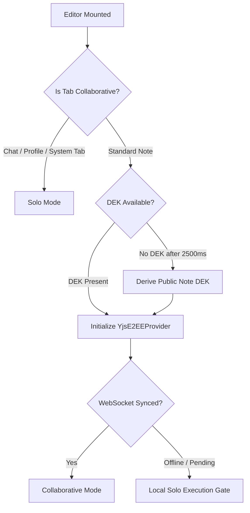
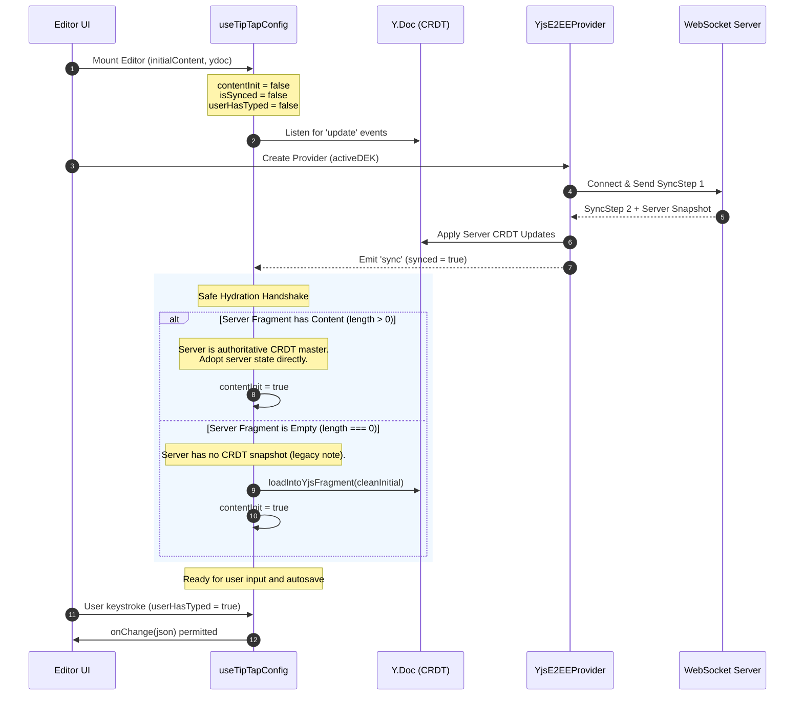
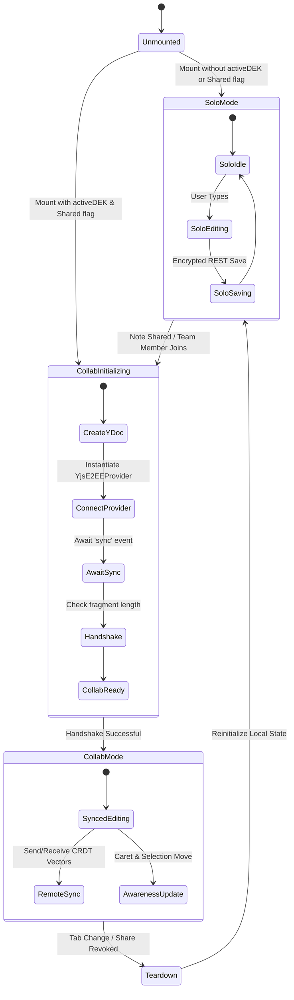

# TipTap Execution Modes & Document Synchronization Architecture

> **Status:** Canonical Architecture Specification  
> **Target Files:** [`web/src/components/Editor.tsx`](file:///C:/Users/nicoh/projects/tide/web/src/components/Editor.tsx), [`web/src/components/Editor/useTipTapConfig.ts`](file:///C:/Users/nicoh/projects/tide/web/src/components/Editor/useTipTapConfig.ts), [`web/src/lib/yjsE2EEProvider.ts`](file:///C:/Users/nicoh/projects/tide/web/src/lib/yjsE2EEProvider.ts)  
> **Key Libraries:** TipTap 3, ProseMirror, Yjs CRDT, y-prosemirror, Web Crypto API

---

## 1. Core Architecture: TipTap 3 & ProseMirror Document Model

Tide's rich text editing engine is built on **TipTap 3**, an abstraction layer over **ProseMirror**. Unlike standard browser `contenteditable` implementations that mutate arbitrary HTML DOM trees directly, ProseMirror operates on a strictly typed, immutable Abstract Syntax Tree (AST).

### 1.1 AST Structure & Document Hierarchy

The document exists as a hierarchical tree of nodes and marks defined by a rigid schema:

```
Document (Node: 'doc')
 ├── Block Nodes ('paragraph', 'heading', 'bulletList', 'taskItem', 'mathBlock', etc.)
 │    ├── Attributes ('blockId', 'level', 'checked', etc.)
 │    └── Inline Content
 │         ├── Text Nodes ('text')
 │         │    └── Marks ('bold', 'italic', 'strike', 'highlight', 'referenceMark', etc.)
 │         └── Inline Nodes ('mention', 'inlineMath', 'dateMention', 'taskMention')
 └── Top-Level Attributes ('inkStrokes', etc.)
```

#### JSON Representation
The persistent AST format serialized to storage is clean JSON conformant to the ProseMirror schema:

```json
{
  "type": "doc",
  "attrs": {
    "inkStrokes": []
  },
  "content": [
    {
      "type": "paragraph",
      "attrs": {
        "blockId": "blk-9a3b8c-12f0"
      },
      "content": [
        {
          "type": "text",
          "text": "Meeting notes for "
        },
        {
          "type": "dateMention",
          "attrs": {
            "date": "2026-11-15",
            "label": "Today"
          }
        },
        {
          "type": "text",
          "marks": [{ "type": "bold" }],
          "text": " urgent items"
        }
      ]
    }
  ]
}
```

### 1.2 State Mutation & Transaction Cycle

ProseMirror enforces unidirectional data flow:
1. **State Immobility:** The `EditorState` (containing `doc`, `selection`, and plugin state) is strictly immutable.
2. **Transactions (`tr`):** All document changes are recorded as a sequence of steps in a transaction (`editor.state.tr`).
3. **Step Inversion & Rebasing:** Steps can be inverted (for undo) or rebased over concurrent transactions (for collaborative CRDT operations).
4. **Dispatch:** The transaction is dispatched to produce a new `EditorState`, updating the DOM projection efficiently via virtual DOM diffing.

---

## 2. Dual Execution Mode Strategy

Tide supports two distinct operational modes: **Solo Mode** and **Collaborative Mode**. The engine switches execution strategies based on tab properties, session authentication, sharing states, and Document Encryption Key (DEK) availability.



### 2.1 Solo Mode (Single-User Local Editing)

Solo Mode is optimized for private, isolated notes, system tabs (`chat-*`, `profile:*`, `calendar`, `messages`), and offline environments where real-time synchronization overhead is unnecessary.

| Dimension | Specification |
|---|---|
| **Underlying Engine** | Native ProseMirror State & Dispatch |
| **Network Overhead** | Zero WebSockets; pure REST / encrypted blob persistence |
| **Undo / Redo** | Standard ProseMirror `history` plugin (via `StarterKit`) |
| **Document Seeding** | Direct hydration via `editor.commands.setContent(cleanInitial)` |
| **Input Latency** | Sub-millisecond synchronous dispatch |
| **Storage Pipeline** | `editor.getJSON()` &rarr; encrypted via active DEK &rarr; `useDataStore` |

In Solo Mode:
- The editor does not attach Yjs binding plugins (`Collaboration`, `CollaborationCaret`).
- ProseMirror manages undo and redo stacks locally through step histories in memory.
- Content updates immediately propagate to the parent component via `onChange(content)`.

### 2.2 Collaborative Mode (Real-Time Multi-User CRDT)

Collaborative Mode turns the document into a distributed Conflict-Free Replicated Data Type (CRDT) backed by **Yjs** and synchronized over secure WebSockets with End-to-End Encryption (`yjsE2EEProvider.ts`).

| Dimension | Specification |
|---|---|
| **CRDT Data Structure** | `Y.Doc` containing `Y.XmlFragment('prosemirror')` |
| **Network Protocol** | Binary WebSocket carrying AES-256-GCM encrypted CRDT update vectors |
| **Remote Presence** | Yjs Awareness protocol broadcasting cursors, selections, names, and avatars |
| **Undo / Redo** | Synchronized CRDT UndoManager (`y-prosemirror`); native history **disabled** |
| **Conflict Resolution** | Mathematical convergence without central operational transformation (OT) |
| **Security Layer** | Ephemeral or envelope DEK with cryptographic epoch validation |

#### Yjs Binding & Caret Management
When `provider`, `ydoc`, and `isSynced` are all active, `useTipTapConfig` injects:
- `Collaboration.configure({ document: ydoc, field: 'prosemirror' })`: Intercepts ProseMirror transactions, converts them to Yjs delta operations, and applies remote CRDT updates back to the ProseMirror AST.
- `CollaborationCaret.configure({ provider, user, render })`: Manages remote user selections, color tags, and user avatars (rendered with `@dicebear/collection` Notionists avatars).
- **ProseMirror History Disabling:** `StarterKit.configure({ undoRedo: (provider && ydoc && isSynced) ? false : undefined })`. Native undo/redo is strictly turned off in Collaborative Mode to prevent corrupting the distributed CRDT history.

---

## 3. Empty-Doc Overwrite Prevention (Critical Invariant)

A catastrophic hazard in collaborative rich-text editors is the **Empty-Doc Race Condition**.

### 3.1 The Vulnerability Scenario

```
Client A (Editor Mounts)
  │  Initial state: Default empty AST ({ type: 'doc', content: [{ type: 'paragraph' }] })
  │  WebSocket connection begins in background...
  │
  ├── [RACE HAZARD] If Client A fires onUpdate() before server sync completes:
  │     Empty document is saved to local store and broadcast to server.
  │
  └── [RESULT] Existing multi-page remote note is wiped out across all clients.
```

### 3.2 Multi-Tiered Protective Safeguards

Tide implements a multi-stage hydration handshake and content readiness gates to guarantee zero data loss.



### 3.3 Protective Invariant Rules

1. **The `contentInitialized` Gate:**
   `onUpdate` short-circuits immediately if `!contentInit.current`:
   ```typescript
   if (!editor || editor.isDestroyed || !transaction.docChanged || !contentInit.current) return;
   ```
2. **The Empty-Doc Filter:**
   Even after initialization, `onUpdate` rejects transmitting an empty doc if existing content was expected and the user has not explicitly typed:
   ```typescript
   const content = editor.getJSON();
   if (isDocEmpty(content) && !isDocEmpty(initialContentRef.current) && !userHasTyped.current) {
       return; // Abort wipeout
   }
   ```
3. **The `isSynced` Synchronization Gate:**
   Content hydration does not execute until `isSynced === true`. If the server already contains CRDT history (`fragment.length > 0`), the server's state is authoritative, and `initialContent` is discarded.
4. **Non-Destructive Seeding (`loadIntoYjsFragment`):**
   When seeding initial JSON content into an empty Yjs document, the transaction is tagged with `'initial-seed'` and avoids overwriting if the provider already holds remote elements.
5. **Absolute Ban on Collaborative `setContent()` Overwrites:**
   Calling `editor.commands.setContent()` on an active collaborative session clears remote CRDT peer histories. Tide strictly confines direct `setContent` calls to non-collaborative sessions or explicit version restore events (`editor:restore-content`).

---

## 4. Mode Switching Lifecycle

Notes in Tide can dynamically transition between Solo and Collaborative modes—for example, when an author shares a private note with a team member, revokes collaboration permissions, or switches active tabs.

### 4.1 Transition Flowchart



### 4.2 Teardown & Reinitialization Steps

When `activeTabId` changes or collaboration is torn down:
1. **Provider Destruction:** `providerRef.current.destroy()` is invoked, disconnecting the WebSocket and broadcasting presence termination.
2. **Y.Doc Disposal:** The active `ydocRef.current.destroy()` releases CRDT vector memory and cleans up ProseMirror transaction listeners.
3. **Global Registration Cleanup:** `useActiveNoteStore.getState().setActiveYDoc(null)` and `window.__tideActiveYDoc = null` ensure that external tools and MCP servers do not interact with stale CRDT contexts.
4. **State Reset:** `contentInitialized.current = false`, `setIsSynced(false)`, and `userHasTypedRef.current = false` guarantee that the subsequent note begins with clean hydration guards.
5. **Extension Re-evaluation:** `useTipTapConfig` recalculates its extension list, conditionally enabling or disabling `Collaboration`, `CollaborationCaret`, and `StarterKit`'s undo/redo plugin.

---

## 5. Custom Extension Registry

Tide extends standard TipTap with domain-specific extensions that seamlessly operate across both Solo and Collaborative modes.

```
TipTap Extension Ecosystem
 ├── Core Formats (StarterKit, Bold, Italic, Strike, TextStyle, Color, FontSize)
 ├── Block Identification (BlockId)
 ├── Linking & Mentions
 │    ├── Note Mention (Mention + MentionNodeView)
 │    ├── Date Mention (DateMentionExtension)
 │    ├── Task Mention (TaskMentionExtension)
 │    └── Calendar Event Mention (CalendarEventMentionExtension)
 ├── Mathematical Expressions (MathBlock, InlineMath)
 ├── Structural Embeds (Table, ResizableImage, Anchor)
 └── Freehand Drawing (PencilInkExtension + PencilInkLayer)
```

### 5.1 BlockIdExtension (`BlockId.ts`)

- **Purpose:** Injects a deterministic `blockId` (e.g. `blk-xxxxxxxx`) into every block node (`paragraph`, `heading`, `taskItem`, `codeBlock`, etc.).
- **Functionality:**
  - Enables deep linking to specific sections within notes.
  - Monitors deleted blocks via `onBlocksDeleted` to purge obsolete relational references and backlinks.
  - Preserves persistent IDs across both ProseMirror transactions and Yjs CRDT synchronizations.

### 5.2 Mentions System

Tide features four specialized mention extensions:
1. **Note Mentions (`Mention.extend`):**
   - Syntax: `@note-title`.
   - NodeView: `MentionNodeView.tsx` renders rich badges with status indicators.
   - Ghost Notes: Handles references to unborn notes (`data-is-ghost="true"`), displaying distinct dashed outlines. Clicking creates the note on-the-fly.
2. **Date Mention (`DateMentionExtension.ts`):**
   - Embeds interactive ISO date chips (`@today`, `@tomorrow`, `@2026-11-20`).
   - Clicking navigates the calendar view directly to the referenced day.
3. **Task Mention (`TaskMentionExtension.ts`):**
   - Links inline text to tasks from the global task list.
   - Reflects completion state (`checked: true/false`) reactively inside the editor.
4. **Calendar Event Mention (`CalendarEventMentionExtension.ts`):**
   - Embeds calendar event tokens with date, time, and title badges.
   - Drag-and-drop support: Dragging an event card from the calendar view inserts an interactive calendar event mention into the editor.

### 5.3 KaTeX Mathematical Blocks (`MathBlock.ts`)

- **Nodes:** `MathBlock` (display mode, block level) and `InlineMath` (inline formulas).
- **Rendering:** Renders LaTeX markup using KaTeX.
- **Editing Mode:** Clicking toggles an interactive LaTeX code textarea; unfocusing re-renders the mathematical notation.

### 5.4 Pencil Ink Canvas Layer (`PencilInkExtension.ts`)

- **Dual-Layer Architecture:** Combines rich text with vector ink annotations on top of the document.
- **Storage:** Vector strokes (`InkStroke[]`) are stored inside top-level document attributes (`attrs.inkStrokes`) and synced with `PencilInkLayer.tsx`.
- **CRDT Synchronization:** Stroke updates are broadcast either via document attribute transactions or collaborative state sharing, ensuring drawing annotations persist alongside text.

---

## 6. Summary of Architectural Invariants

| Invariant | Enforcement Mechanism | Failure Mode Prevented |
|---|---|---|
| **Zero Server Plaintext** | AES-256-GCM client-side encryption via `YjsE2EEProvider` | Server snooping or data leak during sync |
| **No Overwrite on Mount** | `contentInitialized` flag + `isSynced` check | Blank editor overwriting populated remote notes |
| **Clean History Partition** | `undoRedo: false` in Collaborative Mode | Local undo reverting remote concurrent edits |
| **Deterministic Reference ID** | `BlockId` assigned to all blocks | Broken cross-note backlinks and anchor targets |
| **Graceful Teardown** | Provider & YDoc destruction on tab unmount | WebSocket leaks, ghost carets, and memory growth |
