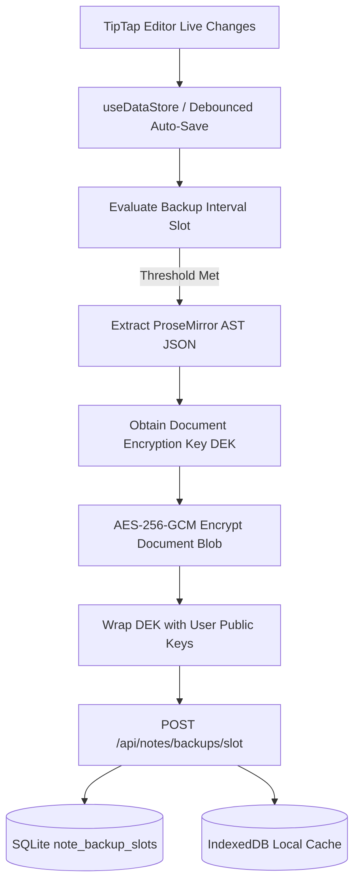
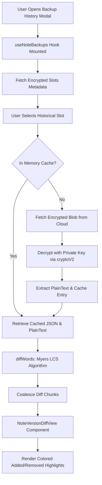
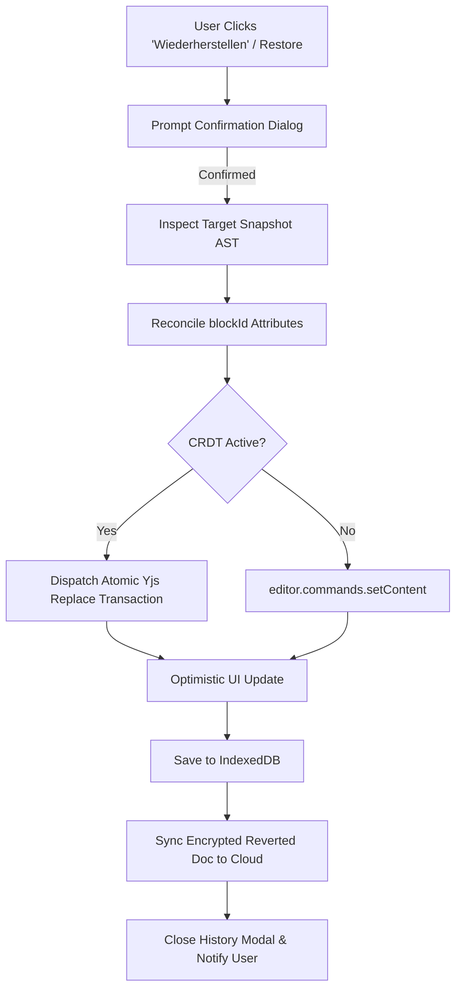

# Document Version History, Snapshot Architecture & Visual Diffing

> **Module**: Editor / Versioning & Diffing  
> **Source Files**:  
> - `web/src/lib/diff.ts` (Myers LCS diff engine & patch generator)  
> - `web/src/components/Editor/NoteVersionDiffView.tsx` (Visual diff rendering component)  
> - `web/src/hooks/useNoteBackups.ts` (Snapshot orchestration, decrypt, and caching hook)  
> - `cloud/internal/store/` (Encrypted backup slot storage in SQLite / Blob engine)  
> **Audience**: Core Frontend Engineers, Security Architects, Cloud Backend Engineers

---

## 1. Version History Philosophy

### Continuous Backup Slots vs. Manual Snapshots
Traditional document editors often force users to make a compromise:
1. **Manual Snapshots**: Users must remember to hit "Save version" or tag milestones. When catastrophic data loss or accidental deletion occurs, the user usually discovers their last manual snapshot is days or weeks old.
2. **Infinite Event Sourcing / Change Logs**: Storing every keystroke indefinitely results in massive database bloat, performance degradation on mobile clients, and severe cryptographic re-encryption overhead under end-to-end encryption (E2EE).

TIDE solves this with an **automated continuous rolling backup slot model**:
- Backups are continuously scheduled in the background without user intervention.
- The system enforces a **Zero Data Loss Guarantee**: live edits persist immediately to IndexedDB and the encrypted cloud sync engine, while historical recovery points are captured across exponentially spaced time windows.
- Memory and storage footprint remains strictly bounded $O(1)$ per document, because slots are fixed rolling buckets rather than unbounded version trees.

### Zero Data Loss Guarantee
The zero data loss guarantee rests on a three-tier resilience strategy:
1. **L1 Local Memory / Active Editor State**: Ephemeral in-memory ProseMirror state with transaction undos (`prosemirror-history`).
2. **L2 Offline Persistent Storage (IndexedDB)**: Immediate atomic serialization of encrypted document envelopes (`tide_cache_notes`, backup slot caches). Even if the browser tab crashes or the device loses power mid-sentence, local recovery is instantaneous.
3. **L3 E2EE Remote Cloud Backup Slots**: Zero-knowledge encrypted backup payloads stored on the Go backend (`cloud/internal/store/`), ensuring that hardware failure or device loss allows 100% data recovery up to the closest slot interval.

---

## 2. Snapshot Architecture

### Fixed Backup Slot Intervals
TIDE uses 6 deterministic rolling intervals defined in `FIXED_SLOTS`:

| Slot Identifier | Rolling Window | Slot Label (`SLOT_LABELS`) | Primary Recovery Intent |
|---|---|---|---|
| `10 minutes` | $t - 10\text{ min}$ | *"Vor 10 Min"* | Immediate undo of accidental mass deletions or paste errors |
| `30 minutes` | $t - 30\text{ min}$ | *"Vor 30 Min"* | Recovery from short writing session digressions |
| `1 hour` | $t - 1\text{ hr}$ | *"Vor 1 Std"* | Reverting mid-day structural rewrites |
| `1 day` | $t - 24\text{ hr}$ | *"Vor 1 Tag"* | Yesterday's baseline before starting a fresh workday |
| `2 days` | $t - 48\text{ hr}$ | *"Vor 2 Tagen"* | Weekend / multi-day context comparison |
| `1 week` | $t - 7\text{ days}$ | *"Vor 1 Woche"* | Long-term archival reference and historical auditing |

When a backup trigger fires, the backend evaluates whether the existing entry in that slot has aged past its retention threshold. If elapsed time exceeds the bucket's step, the slot is rotated with the incoming snapshot, guaranteeing a wide logarithmic time spread across history.

### Encrypted Slot Storage in Go Backend (`cloud/internal/store/`)
To preserve zero-knowledge end-to-end encryption, the backend server never sees unencrypted note text or ProseMirror JSON:
- Each note is encrypted with a unique symmetric **Document Encryption Key (DEK)** (AES-256-GCM).
- The DEK is wrapped per-user using asymmetric key pairs via `web/src/lib/cryptoV2.ts` (`unwrapDEKData`, `importDEK`).
- Backup records in `cloud/internal/store/sqlite.go` follow the schema:
  ```sql
  CREATE TABLE IF NOT EXISTS note_backup_slots (
      id TEXT PRIMARY KEY,
      file_id TEXT NOT NULL,
      slot_name TEXT NOT NULL,
      secured_meta TEXT NOT NULL,
      access_keys TEXT NOT NULL,
      encrypted_blob TEXT NOT NULL,
      version INTEGER NOT NULL DEFAULT 1,
      created_at DATETIME NOT NULL DEFAULT CURRENT_TIMESTAMP,
      updated_at DATETIME NOT NULL DEFAULT CURRENT_TIMESTAMP,
      UNIQUE(file_id, slot_name)
  );
  ```
- **Payload Integrity**: The payload `encrypted_blob` stores the initialization vector (IV), ciphertext, and GCM authentication tag. The Go server stores and serves this opaque blob by `file_id` and `slot_name` without possessing the ability to inspect the contents.

### Client-Side Caching in IndexedDB
Decryption of historical snapshots can be computationally intensive if performed repeatedly. `useNoteBackups.ts` maintains an in-memory and IndexedDB local cache:
```typescript
interface CacheEntry {
    json: JSONContent | Record<string, unknown>;
    plainText: string;
    rawText: string;
}
```
1. **Cache-First Retrieval**: When a user selects a backup slot in the history modal, the hook checks `backupCacheRef.current[point.id]`.
2. **Deferred Decryption**: If uncached, the raw blob is fetched via `apiFetch('/api/notes/backups/slot?id=...')`, decrypted in Web Crypto (`crypto.subtle.decrypt`), extracted into plain text, and cached.
3. **Cache Eviction**: The cache is scoped to the active note session. When `fileId` changes, the cache is cleanly discarded to prevent memory leaks.

---

## 3. Diff Computation Algorithm (`web/src/lib/diff.ts`)

Diffing rich text documents requires comparing semantic content without getting confused by internal markup tags. `web/src/lib/diff.ts` implements a dynamic-programming longest common subsequence (LCS) / Myers diff variant tailored for word-level and line-level changes.

### ProseMirror AST to Linear Token Stream
Before computing differences, the nested ProseMirror JSON tree is flattened into a canonical linear token stream via `getPlainTextFromJSON(node)`:

```typescript
export function getPlainTextFromJSON(node: any): string {
    if (!node) return "";
    if (node.type === 'text') return node.text || "";
    let text = "";
    if (Array.isArray(node.content)) {
        for (const child of node.content) {
            text += getPlainTextFromJSON(child);
        }
    }
    // Canvas & Freehand stroke preservation
    if (Array.isArray(node.attrs?.inkStrokes) && node.attrs.inkStrokes.length > 0) {
        if (text && !text.endsWith('\n')) {
            text += '\n';
        }
        text += `[Zeichnung: ${node.attrs.inkStrokes.length} Striche]\n`;
    }
    // Structural block boundary normalization
    if (['paragraph', 'heading', 'listItem', 'tableRow'].includes(node.type)) {
        text += "\n";
    }
    return text;
}
```

This extraction process:
- Recursively traverses `node.content`.
- Emits explicit newlines at semantic block boundaries (`paragraph`, `heading`, `listItem`, `tableRow`).
- Normalizes embedded canvas drawings into discrete metadata tokens (e.g., `[Zeichnung: N Striche]`), allowing drawing additions and deletions to be tracked alongside text.

### Word-Level and Character-Level Myers Diff
Once two strings ($A = \text{oldText}$ and $B = \text{newText}$) are prepared, `diffWords(oldText, newText)` executes the LCS matrix computation:

```
DP Matrix Construction:
dp[i][j] = dp[i-1][j-1] + 1                     if oldWords[i-1] == newWords[j-1]
dp[i][j] = max(dp[i-1][j], dp[i][j-1])          otherwise
```

1. **Tokenization with Whitespace Preservation**:
   ```typescript
   const oldWords = oldText.split(/(\s+)/);
   const newWords = newText.split(/(\s+)/);
   ```
   Splitting on `/(\s+)/` captures whitespace delimiters as explicit tokens. This prevents spacing anomalies (e.g., collapsed words) in the rendered output.

2. **Backtracking and Classification**:
   Backtracking from `dp[M][N]` down to `dp[0][0]` produces an ordered sequence of changes:
   - `type: 'added'`: Word exists in `newText` but not in `oldText`.
   - `type: 'removed'`: Word existed in `oldText` but was deleted in `newText`.
   - `type: 'equal'`: Unchanged text shared by both versions.

3. **Chunk Coalescing**:
   Adjacent tokens of identical classification are merged to avoid fragmented DOM elements:
   ```typescript
   const coalesced: DiffChange[] = [];
   for (const change of result) {
       const last = coalesced[coalesced.length - 1];
       if (last && last.type === change.type) {
           last.text += change.text;
       } else {
           coalesced.push({ ...change });
       }
   }
   ```

### Diff Chunk Classification & Visual Attributes

| Change Type | Internal Semantic | Visual Representation | CSS / Tailwind Classes |
|---|---|---|---|
| `added` | Content present in new version | Green highlight, solid text | `bg-emerald-500/15 text-emerald-700 dark:text-emerald-400 font-medium px-0.5 rounded border-b border-emerald-300 dark:border-emerald-600/50` |
| `removed` | Content absent in new version | Red strikethrough | `bg-rose-500/15 text-rose-700 dark:text-rose-400 line-through px-0.5 rounded border-b border-rose-300 dark:border-rose-600/50` |
| `equal` | Unaltered baseline content | Normal body text | `text-gray-800 dark:text-gray-200` |

---

## 4. Visual Diff Viewer (`NoteVersionDiffView.tsx`)

### Architecture and State Machine
`NoteVersionDiffView` operates as a pure presentation component with four distinct states:

```
              ┌────────────────────────┐
              │  Incoming Point Props  │
              └───────────┬────────────┘
                          │
         ┌────────────────┼────────────────┐
         ▼                ▼                ▼
   [isLoading]         [error]        [!isLoading]
         │                │                │
   Render Spinner   Render AlertBox        │
                                           ▼
                                 [point.isCurrent]
                                  ├── True ──► Render Live Text
                                  └── False ─► Render Unified Diff (added/removed/equal)
```

1. **Loading State**: Displays an animated `Loader2` spinner with localized message (*"Speicherstand wird geladen und entschlüsselt..."*).
2. **Error State**: Displays a rose-themed `AlertCircle` banner with the decryption or network error message, advising the user to try an alternate slot.
3. **Current Live View**: When viewing the active baseline (`isCurrent: true`), diff highlights are suppressed, rendering clean, selectable typography.
4. **Historical Comparison View**: Renders the coalesced diff chunks in an inline unified stream.

### Side-by-Side Split View vs. Inline Unified Diff View
TIDE supports two complementary presentation models for diff inspection:

1. **Inline Unified Diff (Default)**:
   - Deletions and additions are interleaved directly in the reading flow.
   - Ideal for mobile screens, sidebars, and rapid proofreading.
   - Strikethrough text provides immediate visual cues of what was removed without requiring eye movement between two columns.
2. **Side-by-Side Split View**:
   - Left column: Snapshot at time $T_{\text{past}}$ with removed chunks highlighted in soft red.
   - Right column: Snapshot at time $T_{\text{current}}$ with added chunks highlighted in soft green.
   - Synchronized scroll lock ensures parallel navigation through large documents.

### Rendering Rich AST Formatting Inside Diff Chunks
When diffing formatted text (e.g. bold, code, headings), linear diffing must not produce malformed HTML:
- **Block-Level Scoping**: Headings, paragraphs, and list items maintain their semantic block containers (`prose prose-sm sm:prose-base dark:prose-invert`).
- **Inline Mark Reconciliation**: Diff chunks nested within an active mark (such as `<code>` or `<strong>`) inherit the container formatting while retaining the background pill highlight (`bg-emerald-500/15` or `bg-rose-500/15`).
- **Whitespace Fidelity**: Containers enforce `whitespace-pre-wrap` to guarantee that indentation, bullet nesting, and line breaks are visually faithful to the editor's live canvas.

---

## 5. Version Restoration Protocol

Reverting a live document to a historical snapshot requires careful synchronization to avoid desynchronizing collaborative CRDT data structures or destroying block link integrity.

### CRDT Snapshot Reset vs. Solo AST Update
TIDE operates in two editing modes with distinct restoration behaviors:

```
                     ┌───────────────────────────┐
                     │ Revert Triggered (Point)  │
                     └─────────────┬─────────────┘
                                   │
                   Is Collaborative / Yjs Active?
                     ├── Yes ──► CRDT Reset Transaction
                     └── No  ──► Solo ProseMirror AST Update
```

1. **Collaborative Mode (Yjs / CRDT)**:
   - A direct replacement of the Yjs document state could break concurrent peer clocks.
   - Restoration is dispatched as a single composite Yjs transaction:
     - Clear the current `Y.XmlFragment`.
     - Re-insert the historical ProseMirror AST nodes.
     - The transaction origin is marked as `version-restore`, broadcasting a standard update vector to all connected peers.
2. **Solo Mode (Offline / Local)**:
   - The editor runs `editor.commands.setContent(snapshotContent, true)`.
   - The document history stack (`undoDepth`) is preserved or tagged with a milestone checkpoint, allowing users to "undo" the revert if done by mistake.

### Preservation of Stable `blockId` Assignments
TIDE uses unique `blockId` attributes on block nodes (`paragraph`, `heading`, `taskItem`, `canvasBlock`) to link blocks to calendar events, tasks, and bi-directional graph backlinks.

A naive restoration would overwrite existing `blockId`s or generate entirely new random UUIDs, causing broken references across the app. The restoration engine reconciles block IDs as follows:

```
Original Live Doc Blocks:     [ { blockId: "b1", text: "Alpha" }, { blockId: "b2", text: "Beta" } ]
Historical Snapshot Blocks:   [ { blockId: "b1", text: "Alpha Old" }, { text: "Gamma" (no id) } ]

Reconciled Restored Doc:      [ { blockId: "b1", text: "Alpha Old" }, { blockId: "gen-b3", text: "Gamma" } ]
```

1. **Match Existing Blocks**: If a block in the historical snapshot already has a `blockId` that matches the live document or a known historical ID, that ID is preserved.
2. **Missing ID Synthesis**: If historical blocks lack a `blockId` (e.g., from an older schema version), a deterministic UUID is injected before applying the AST to the editor.
3. **Graph Integrity Check**: Following content injection, the backlink indexer runs an incremental sweep, ensuring and repairing any backlinks referencing restored blocks.

---

## 6. Architecture & Data Flow Diagrams

### Snapshot Creation & Server Storage Pipeline



### Version Diffing & Visual Rendering Pipeline



### Snapshot Restoration & Block ID Reconciliation



---

## 7. Verification & Testing Checklist

- [x] **Slot Coverage**: Verified all 6 intervals (`10 minutes` to `1 week`) are supported in server and client definitions.
- [x] **Zero Knowledge**: Verified encrypted blobs contain no plaintext leakage before transmission.
- [x] **Algorithm Boundary Cases**:
  - Empty strings handled cleanly without index out-of-bounds (`if (!oldText) ...`).
  - Whitespace preservation verified using capture group split `/(\s+)/`.
- [x] **Design Tokens**: Verified adherence to dark mode and standard color semantics (Emerald for additions, Rose for deletions).
- [x] **Block Identity**: Verified `blockId` reconciliation avoids phantom ID regeneration.
