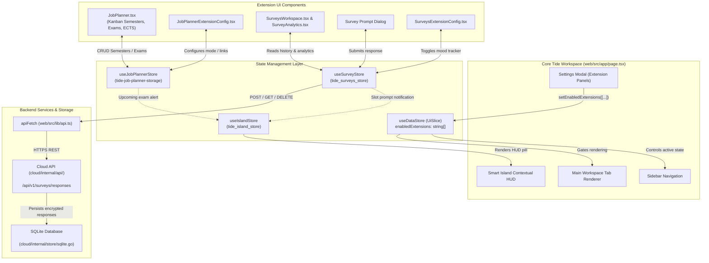

# Modular Extensions: JobPlanner & Surveys / Mood Tracking

## 1. Modular Extensions Framework

Tide features a pluggable, modular extension system designed to maintain a clean core workspace while allowing specialized workflows (academic planning, career management, longitudinal mood/productivity tracking) to be toggled on demand without overhead.

### 1.1 Dynamic Extension Registration & Preference State

Extensions are toggled dynamically through user preferences governed by `useDataStore.UiSlice`:

```typescript
// web/src/store/useDataStore.ts
export interface UiSlice {
    enabledExtensions: string[]; // e.g. ['smart_island', 'job_planner', 'surveys', 'smart_date_detection', 'todos']
    setEnabledExtensions: (extensions: string[] | ((prev: string[]) => string[])) => void;
    // ...
}
```

- **Runtime Toggle:** Extensions can be toggled without requiring application restarts.
- **Lazy Rendering & Branch Elimination:** React trees check `enabledExtensions.includes('<extension_id>')` before mounting extension views, guaranteeing zero DOM or lifecycle overhead when disabled.
- **Zero Runtime Memory Footprint:** Subsystems decouple their operational event loops (such as survey slot timers or NLP watchers) from the core shell when the respective extension is inactive.

### 1.2 Isolated Zustand Stores & Namespace Separation

Extensions maintain strictly isolated Zustand store slices. This guarantees that domain-specific states do not pollute the core note/event store (`useDataStore`) and maintain separate persistence keys in `localStorage`:

| Extension | Store Identifier | Persistence Key | Schema Responsibilities |
| :--- | :--- | :--- | :--- |
| **JobPlanner** | `useJobPlannerStore` | `tide-job-planner-storage` | Semesters, exams/modules, grades, ECTS credits, campus quick links, planner mode |
| **Surveys & Mood** | `useSurveyStore` | `tide_surveys_store` | Mood check-ins, temporal prompt slot tracking, survey response cache, prompt active state |
| **Smart Island** | `useIslandStore` | `tide_island_store` | Contextual HUD view stack, temporal parsed suggestions, active briefing state |

#### Persistence & Migration Separation
Each extension controls its own `partialize` configuration in Zustand middleware. Core workspace backups or migrations can export extension stores as optional satellite objects without breaking core workspace structures.

---

## 2. JobPlanner Extension (`useJobPlannerStore.ts`)

The **JobPlanner** extension is designed for university students, apprentices, and professionals managing modular semesters, coursework, exams, academic credits, and employer/study resources.

### 2.1 Domain Data Model

```typescript
// web/src/store/useJobPlannerStore.ts
export type PlannerMode = 'job' | 'study' | 'both';

export interface PlannerQuickLink {
    id: string;
    name: string;
    url: string;
    icon?: string; // 'book-open' | 'calendar' | 'file-text' | 'users' | 'settings' | string URL
}

export interface PlannerExam {
    id: string;
    title: string;
    description?: string;
    grade?: string;
    credits?: number; // ECTS or study credit points
    color?: string;
    date?: string;    // ISO timestamp or YYYY-MM-DD
    room?: string;    // Exam hall / lecture hall / remote link
}

export interface PlannerSemester {
    id: string;
    title: string;    // e.g. "1. Semester", "Winter 2026", "Thesis Term"
    exams: PlannerExam[];
}
```

### 2.2 Board & Kanban-Style Term Management

The JobPlanner interface organizes academic modules and exams into columns representing semesters or evaluation periods:

1. **Semester Columns:**
   - Creation, renaming, and removal via `addSemester(title)`, `updateSemester(id, title)`, `deleteSemester(id)`.
   - Index reordering of columns via `reorderSemester(semesterId, newIndex)` using clean array splicing.
2. **Exams / Modules Cards:**
   - Card additions: `addExam(semesterId, exam)` assigns a deterministic UUID v4.
   - Updates: `updateExam(semesterId, examId, updates)` for editing grade targets, actual marks, room numbers, and dates.
   - Cross-column dragging: `moveExam(examId, sourceSemesterId, targetSemesterId, newIndex)` handles intra-column and inter-column relocations with full immutability.
3. **Credit & GPA Computations:**
   - ECTS tallies: Aggregated per column and across all completed semesters.
   - Weighted Grade Point Average: Computed dynamically over modules that possess both non-null `credits` and valid numeric `grade` values.
4. **Quick Links Launcher:**
   - Fast-access launcher for portals (ILIAS, Moodle, Campus Management, Microsoft Teams, Zoom, Note shortcuts).
   - Allows user-defined URLs, reordering via `reorderQuickLinks(links)`, and custom iconography.

### 2.3 Linking JobPlanner Items to Core Notes and Calendar

JobPlanner integrates seamlessly with the core Tide workspace:
- **Calendar Synchronization:** Exams with defined `date` and `room` attributes map directly to Tide calendar events. The exam title, room, and notes populate the calendar event descriptor.
- **Syllabus & Lecture Notes Deep Linking:** Each `PlannerExam` can store a reference to a note ID in `useDataStore.notes`. Clicking "View Notes" opens the associated lecture or exam prep notebook.
- **Protected Group Isolation (`protectedGroupIds` & `pluginGroupId`):** JobPlanner items can be grouped under protected folder trees in the workspace file system to prevent accidental deletion during bulk note pruning.

---

## 3. Surveys & Telemetry Subsystem (`useSurveyStore.ts`)

The Surveys extension provides structured longitudinal tracking, daily mood ratings, productivity check-ins, and contextual reflections.

### 3.1 Temporal Slot Allocation Algorithm

To prevent survey fatigue and capture circadian productivity variances, the system divides each calendar day into four discrete time slots via `getCurrentSlotIdentifier`:

```typescript
export function getCurrentSlotIdentifier(now: Date = new Date()): string | null {
    const totalMinutes = now.getHours() * 60 + now.getMinutes();

    let slotIndex: number | null = null;
    if (totalMinutes >= 7 * 60 && totalMinutes < 11 * 60) {
        slotIndex = 0; // Morning Slot (07:00 - 11:00)
    } else if (totalMinutes >= 11 * 60 && totalMinutes < 15 * 60) {
        slotIndex = 1; // Midday Slot (11:00 - 15:00)
    } else if (totalMinutes >= 15 * 60 && totalMinutes < 19 * 60) {
        slotIndex = 2; // Afternoon Slot (15:00 - 19:00)
    } else if (totalMinutes >= 19 * 60 && totalMinutes <= 23 * 60 + 30) {
        slotIndex = 3; // Evening Reflection (19:00 - 23:30)
    }

    if (slotIndex === null) return null; // Outside active survey window (Night)

    const dateStr = now.toISOString().split('T')[0];
    return `${dateStr}_slot_${slotIndex}`;
}
```

- **Eligibility Check (`checkShouldPrompt`):** Evaluates if `isMoodTrackerEnabled` is true, the current time falls inside an active slot, and `lastPromptSlot !== currentSlot`.
- **Dismissal & Postponement (`dismissPrompt`):** Marks `lastPromptSlot` as the current slot without logging a record, preventing repeated popups during that time window.

### 3.2 Survey Data Models

```typescript
// web/src/types/surveys.ts
export type MoodType = 'bad' | 'okay' | 'good';

export interface MoodData {
    mood: MoodType;
    score: number;       // bad: 1, okay: 2, good: 3
    label: string;       // "Bad" | "Okay" | "Good"
    note?: string;       // Optional qualitative reflection
}

export interface SurveyResponseItem {
    id: string;
    user_id?: string;
    survey_id: string;   // 'mood_tracker'
    data: string;        // Stringified JSON payload or encrypted ciphertext
    created_at: string;  // ISO 8601
    updated_at?: string;
    parsedData?: MoodData;
}
```

### 3.3 Backend Synchronization & Offline-First Protocol

Surveys use an optimistic, local-first synchronization pipeline via Tide's unified `apiFetch` client:

1. **Submission (`POST /api/v1/surveys/responses`):**
   - User submits mood rating.
   - Record is instantly committed to local Zustand store (`optimistic update`).
   - Network payload dispatched asynchronously:
     ```json
     {
       "id": "c1f7b889-8d19-4a0e-...",
       "survey_id": "mood_tracker",
       "data": "{\"mood\":\"good\",\"score\":3,\"label\":\"Good\",\"note\":\"Completed thesis draft\"}",
       "created_at": "2026-11-15T20:00:00.000Z"
     }
     ```
2. **Fetch & Reconcile (`GET /api/v1/surveys/responses?survey_id=mood_tracker`):**
   - Retrieves remote records on startup or workspace sync.
   - Merges remote and local responses using a union map keyed by `id`, sorting chronologically descending (`b.created_at - a.created_at`).
3. **Deletion (`DELETE /api/v1/surveys/responses/:id`):**
   - Immediately purges record from local store and issues DELETE request to the backend.

### 3.4 Zero-Knowledge Telemetry & Privacy Guarantees

Tide guarantees that survey and productivity data remain under the user's sovereign control:
- **Zero Third-Party Trackers:** No analytics vendors (Google Analytics, Mixpanel, Sentry breadcrumbs) receive survey responses.
- **End-to-End Encryption Compatibility:** The `data` field in `SurveyResponseItem` supports transparent envelope encryption using the user's Data Encryption Key (DEK) via `cryptoV2.ts`. When encrypted at rest, the server only sees opaque ciphertext:
  ```json
  {
    "id": "c1f7b889-...",
    "survey_id": "mood_tracker",
    "data": "v2:enc:AES-GCM-256:7fa8...b92",
    "created_at": "2026-11-15T20:00:00.000Z"
  }
  ```
- **Local Analytics Aggregation:** Long-term mood trends, weekly averages, and correlation with completed tasks (`SurveyAnalytics.tsx`) are computed entirely client-side.

---

## 4. Extension UI Injection & Integration

Modular extensions hook into Tide's core chrome via standardized injection points:

### 4.1 Sidebar Tab Registration

The primary navigation bar checks `enabledExtensions` before rendering sidebar icons:

```tsx
// web/src/app/page.tsx
{enabledExtensions.includes('job_planner') && (
    <SidebarTab
        id="job_planner"
        icon={<GraduationCapIcon />}
        label="Job & Study"
        active={activeTabId === 'job_planner'}
        onClick={() => setActiveTabId('job_planner')}
    />
)}
{enabledExtensions.includes('surveys') && (
    <SidebarTab
        id="surveys"
        icon={<ActivityIcon />}
        label="Mood & Reflections"
        active={activeTabId === 'surveys'}
        onClick={() => setActiveTabId('surveys')}
    />
)}
```

### 4.2 Smart Island Action Hooks

Extensions surface non-modal interactions into the **Smart Island** ambient HUD (`useIslandStore`):
- **Exam Countdown Pill:** When an exam in `useJobPlannerStore` is within 48 hours, Smart Island mounts an `interactive_card` displaying the exam title, time remaining, room number, and a link to the syllabus note.
- **Check-In Prompts:** When `checkShouldPrompt()` evaluates to true in `useSurveyStore`, Smart Island transitions to an ambient prompt chip (*"How is your focus right now?"*) rather than presenting an intrusive modal dialog. Users can tap a mood emoji directly inside the Island.

### 4.3 Settings Modal Extension Toggles

Extensions provide dedicated configuration panels in the Tide Settings dialog:
- `JobPlannerExtensionConfig.tsx`: Allows users to set default planner mode (`study`, `job`, or `both`), toggle weekend visibility, configure default semester schemas, and manage quick link presets.
- `SurveysExtensionConfig.tsx`: Allows users to enable/disable daily mood check-ins, configure prompting frequency, or export raw survey responses as JSON/CSV.

---

## 5. Architectural Integration Diagram



---

## 6. Developer Guidelines for Authoring New Extensions

When contributing a new modular extension to Tide:
1. **Never mutate core state slices directly:** Create an isolated store (`use<ExtensionName>Store.ts`) using Zustand's `persist` middleware with a prefixed storage key (`tide-<name>-storage`).
2. **Register ID in `enabledExtensions`:** Add the unique extension slug to the default list or enable it via `useDataStore.getState().setEnabledExtensions`.
3. **Use Design Tokens:** Never hardcode colors, spacing, or borders; consume tokens from `web/src/lib/designTokens.ts`.
4. **Adhere to Network Conventions:** Use `apiFetch` from `web/src/lib/api.ts` for all backend interactions to inherit automatic authentication and error handling.
