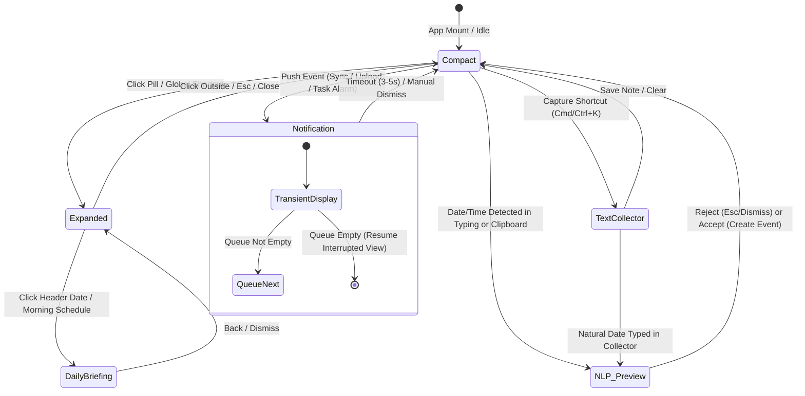

# Smart Island Contextual HUD Engine

## 1. Concept & Overview

The **Smart Island** is a floating contextual Heads-Up Display (HUD) integrated into the Tide workspace (`web/src/components/extensions/smart_island/` and `web/src/store/useIslandStore.ts`). Inspired by dynamic display surfaces and reactive action palettes, the Smart Island functions as an ambient intelligence layer that stays persistently accessible without disrupting user workflow.

Key responsibilities:
- **Dynamic Status & Presence:** Displays real-time sync indicators, upload progress, background worker states, and active meeting indicators.
- **Natural Language Temporal Parsing (NLP Preview):** Automatically parses typed editor text, quick collector input, or clipboard events to recognize date, time, and temporal spans.
- **Proactive Action Palette:** Provides one-click action chips (such as event creation, task scheduling, or note appending) with inline keyboard-driven editing.
- **Daily Briefing & Summaries:** Offers morning and evening digests showcasing upcoming calendar events, overdue tasks, word counts, and daily productivity stats.
- **Text Collector & Quick Capture:** Allows rapid snippet and scratchpad capture from anywhere in the interface via global shortcuts or passive keystroke streaming.

---

## 2. Architecture & State Machine

### 2.1 State Store (`useIslandStore.ts`)

The island state is managed centrally via a reducer pattern providing priority queuing, focus mode filtering, and duplicate suppression.

```typescript
export type IslandViewType = 
    | 'calendar' 
    | 'message' 
    | 'morning' 
    | 'task_reminder' 
    | 'finance_alert' 
    | 'welcome' 
    | 'timeline' 
    | 'next_event' 
    | 'upload_progress' 
    | 'interactive_card' 
    | 'event_preview' 
    | 'event_suggestion' 
    | 'reminder' 
    | 'in_meeting' 
    | 'text_collector' 
    | 'loading';

export type IslandPriority = 'LOW' | 'DEFAULT' | 'CRITICAL';
export type IslandFocusMode = 'ALL' | 'IMPORTANT' | 'DND';
```

#### Queue & Interruption Mechanics
- **Priority Gating:** In `DND` (Do Not Disturb) mode, only `CRITICAL` priority views are admitted. In `IMPORTANT` mode, `LOW` priority views are dropped.
- **Deduplication:** Suggestions are fingerprinted by signature (`suggestionSignature = blockId|title|date|start|end`). Duplicate proposals preserve in-progress user input without clearing state.
- **Transient Interruption:** When a persistent view (e.g. `timeline` or `welcome`) is displayed and a transient notification arrives, the persistent view is safely paused and stashed in `interruptedView: { view, remainingMs }`. Once the transient notification is dismissed, the interrupted view resumes with its exact remaining duration.

### 2.2 Core Visual Modes

| Mode | Visual Representation | Target View Types | Dimensions & Geometry |
| :--- | :--- | :--- | :--- |
| `compact` | Minimal floating pill / mini-strip | Calendar status, idle time, sync badge, meeting badge | Width ~180px–360px, Height ~36px–40px, rounded-full pill |
| `expanded` | Action palette / month calendar / full agenda | `welcome`, `timeline`, `morning`, full calendar grid | Width ~380px–460px, Height ~220px–380px, rounded-3xl sheet |
| `nlp_preview` | Action chip / event suggestion card | `event_suggestion`, `event_preview` | Dynamic auto-height (min ~188px), rounded-2xl with field highlights |
| `notification` | Sync status toast / upload progress / alert | `message`, `upload_progress`, `task_reminder` | Width ~280px–340px, Height auto (~44px–60px), pill to rounded card |

### 2.3 Spring Physics & Animation Transitions

The Island uses **Framer Motion** for state transitions. Changes in dimensions use layout animations with high-stiffness, low-damping springs for snappy, tactile interaction:

```typescript
const islandSpring = {
    type: "spring",
    stiffness: 450,
    damping: 35,
    mass: 0.8
};
```

- **Expansion & Collapse:** Expanding from pill to full palette animates `width`, `height`, and `borderRadius` concurrently.
- **Field Flash Animation:** When incoming parser updates change specific fields (e.g., date vs. time range) while the user is looking at an `event_suggestion`, the changed field triggers a 700ms soft accent flash (`flashFields`), preventing disorientation.
- **Stage Stacking & Portals:** Rendered through a React Portal (`#smart-island-portal` or fixed-coordinate root) with CSS hardware acceleration (`transform: translate3d(...)`, `will-change: transform`).

---

## 3. Natural Language Date/Time Parsing (NLP Engine)

### 3.1 Tokenizer & Pattern Detection (`dateParser.ts` & `timeParser.ts`)

The NLP subsystem scans text input using modular regular expressions and deterministic linguistic tokenizers:

```
[User Input / Keystrokes] ──► Regex Lexer ──► Token Stream ──► Temporal Resolver ──► ParseResult
```

#### Supported Expressions
1. **Relative Days:**
   - German: `heute`, `morgen`, `übermorgen`, `in N Tagen`, `nächste Woche`
   - English / International: `today`, `tomorrow`, `in 2 hours`, `next Friday`
2. **Weekdays & Modifiers:**
   - `Montag` – `Sonntag` (`Mo`, `Di`, `Mi`, `Do`, `Fr`, `Sa`, `So`)
   - Modifiers: `nächster Freitag`, `kommenden Montag`, `am Freitag um 14 Uhr`
3. **Explicit Dates:**
   - Dot notation: `1.5.`, `01.05.2026`, `15.03.`
   - Month names: `1. Mai`, `15. Oktober 2026`
4. **Time & Time Ranges:**
   - Single point: `15 Uhr`, `15:00`, `15:30`, `3pm`
   - Spans & Ranges: `15-17 Uhr`, `15:00-17:00`, `von 15 bis 17 Uhr`, `10:00 to 11:30`
5. **Contextual Title Heuristics:**
   - Capitalized nouns immediately preceding or succeeding temporal tokens are extracted as candidate `titleHint`s (e.g., `"Team sync morgen 14 Uhr"` yields `titleHint: "Team sync"`).

### 3.2 Output Schema (`ParseResult`)

```typescript
export interface ParseResult {
    /** Character offset span covering the matched expression */
    span: [number, number];
    /** Normalized calendar date (00:00:00) */
    proposedDate: Date;
    /** Start timestamp with time resolved (ISO 8601 compatible) */
    proposedStart: Date;
    /** End timestamp (defaults to start + 60 minutes if single time detected) */
    proposedEnd: Date;
    /** All detected tokens for smart cycling */
    allTokens: DetectedToken[];
    /** Extracted event title suggestion */
    titleHint: string;
}
```

### 3.3 One-Click Action Chip & Smart Cycling

When text in an active editor block or the quick collector matches a temporal pattern:
1. An `event_suggestion` view is pushed to `useIslandStore`.
2. The Island transforms into an **NLP Preview Card**.
3. **Smart Cycling:** If multiple date or time candidates are found in a single text segment (e.g., `"Montag oder Dienstag um 14:00"`), clicking the date/time chip cycles through `allTokens` without manual typing.
4. **One-Click Acceptance:** Pressing Enter or clicking the checkmark chip triggers `onAccept`, dispatching `createEvent()` via `useDataStore` with ISO 8601 timestamps and dismissing the card.

---

## 4. Daily Briefing & Proactive Summaries

The Island acts as an executive assistant at day boundaries via `DailySummaryView.tsx`.

### 4.1 Morning Briefing
- **Trigger:** First workspace mount between 05:00 and 12:00, or manual trigger from the Island date pill.
- **Data Ingestion:**
  - Queries `useDataStore.getState().events` for events where `start` matches `format(new Date(), 'yyyy-MM-dd')` and `start >= now`.
  - Queries `useDataStore.getState().tasks` for incomplete items (`!task.isCompleted`).
- **Digest Display:**
  - Dynamic greeting based on current time and user profile name.
  - Interactive `WeekStrip` showing week-at-a-glance occupancy.
  - Ordered chronological timeline of next 3–5 appointments with direct deep links.
  - Count of pending tasks due today.

### 4.2 Evening Review
- **Trigger:** Active after 17:00 or user request.
- **Productivity Metrics:**
  - Read from local telemetry cache (`tide_stats_edited_notes`, `tide_stats_words_written`, `tide_stats_completed_tasks`, `tide_stats_active_minutes`).
  - Summarizes completed items, newly created notes, and focus duration.
  - Provides a prompt to capture closing thoughts into the daily scratchpad.

---

## 5. Text Collector & Quick Capture

The **Text Collector** (`TextCollectorView` in `SmartIsland.tsx`) enables fast, interruption-free note capture directly from the Island without requiring navigation away from the current view.

### 5.1 Architecture & Event Bus
- **Global Key Listener:** Global keystroke listener dispatches `tide:collector-update` with streaming keystrokes.
- **Auto-Expanding Input:** The Island dynamically expands its textarea (`Math.min(scrollHeight, 160)px`) as text overflows.
- **Parallel NLP Analysis:** Every keystroke streams through `parseGermanDate()` in real-time. If the captured text contains a schedule directive, the `EventSuggestion` sub-card seamlessly surfaces below the note textarea.
- **Destination Routing:**
  - **Create Note:** Flushes text into a new note or appends to today's daily log (`useDataStore.addNote`).
  - **Create Event:** Converts parsed natural language tokens into a calendar event, retaining the remaining text as event notes/description.
  - **Dismiss / Clear:** Dispatches `tide:collector-clear` to reset the input buffer and collapse the Island back to `compact`.

---

## 6. State Machine Diagram



---

## 7. Integration Guidelines

- **Mount Point:** Instantiated at the root app shell (`web/src/app/page.tsx`).
- **Design Tokens:** Always utilize visual variables from `web/src/lib/designTokens.ts` (`glassBg`, `borderSubtle`, `radiusIsland`).
- **Encryption Safe:** Note content captured via the Island passes through standard client-side encryption handlers in `useDataStore` before syncing to the cloud SQLite store.
