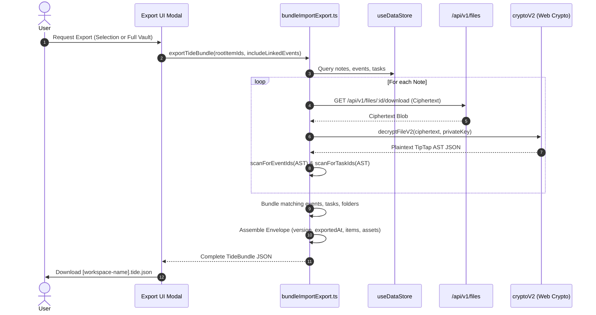
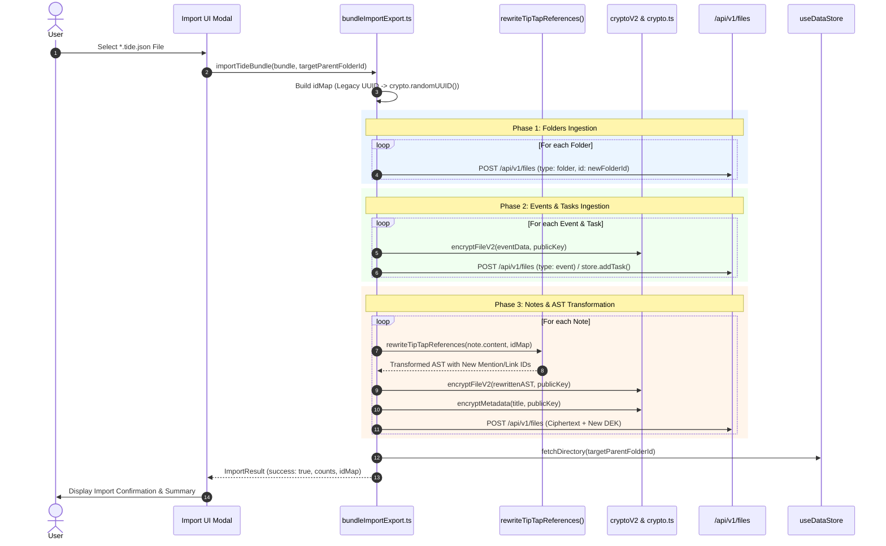

# TIDE Portable Bundle Specification (`.tide.json`)

**Document Version:** 1.0.0  
**Status:** Living Standard / Active Specification  
**Canonical Implementation:** [`web/src/lib/bundleImportExport.ts`](file:///C:/Users/nicoh/projects/tide/web/src/lib/bundleImportExport.ts)  
**File Extension:** `.tide.json`  
**MIME Type:** `application/vnd.tide.bundle+json` (or standard `application/json`)

---

## 1. Overview & Purpose

The **TIDE Portable Bundle format** (`.tide.json`) provides a platform-agnostic, self-contained interchange medium for notes, folders, tasks, calendar events, and embedded binary assets.

### Core Objectives
- **Zero Cloud Lock-in:** Users retain complete sovereignty over their data. Bundles can be exported locally at any time without server intervention.
- **Self-Contained Portability:** An exported bundle contains all necessary data—including ProseMirror/TipTap abstract syntax trees (ASTs), relational metadata, and embedded media assets—to recreate complete document workspaces.
- **Cryptographic Independence:** While TIDE stores documents end-to-end encrypted (E2EE) at rest using recipient-wrapped Data Encryption Keys (DEK), exported `.tide.json` bundles are decrypted client-side prior to packaging. This allows bundles to be stored as personal backups, parsed by third-party markdown tooling, or imported into an entirely separate TIDE vault having distinct cryptographic keys.
- **Graph & Reference Integrity:** Preserves rich bidirectional relationships (node mentions, backlink marks, and task/event linkages) through an automated UUID translation engine during ingestion.

---

## 2. Format Architecture & Envelope Model

A TIDE bundle is represented as a single UTF-8 encoded JSON object. It provides envelope metadata, workspace descriptors, content arrays, and an embedded asset registry.

```
┌────────────────────────────────────────────────────────┐
│               TIDE Bundle Envelope                     │
├────────────────────────────────────────────────────────┤
│  • version: "1.0.0" | 1                                │
│  • bundle_id: UUID                                     │
│  • title / description / author                        │
│  • exportedAt / created_at: ISO 8601 UTC               │
│  • vaultInfo: { vaultName, exportScope, origin }       │
├────────────────────────────────────────────────────────┤
│  • notes[]:   Array of notes (Decrypted TipTap AST)    │
│  • tasks[]:   Array of tasks (Status, Priority, Date)  │
│  • events[]:  Array of calendar events (Time, Loc)     │
│  • folders[]: Array of folder hierarchy nodes          │
│  • assets{}:  Embedded binary map (SHA-256, Base64)    │
│  • items[]:   Unified legacy/flat item interchange     │
└────────────────────────────────────────────────────────┘
```

The runtime implementation supports both:
1. **Unified Interchange Format (`items[]`)**: As implemented in `bundleImportExport.ts`, combining notes, folders, tasks, and events into an polymorphic `TideBundleItem` array with item types.
2. **Normalized Collection Format**: Explicitly partitioned collections (`notes`, `tasks`, `events`, `folders`, `assets`) with typed payloads for programmatic export and import tooling.

---

## 3. Data Schema Breakdown

### 3.1. Envelope Metadata

| Field | Type | Description | Required |
|---|---|---|---|
| `version` | `string` \| `number` | Schema specification version (e.g. `"1.0.0"` or `1`). | Yes |
| `bundle_id` | `string` (UUID v4) | Unique identifier for this export archive. | No |
| `title` | `string` | Human-readable title of the bundle or exported workspace. | Yes |
| `description` | `string` | Optional summary or export note. | No |
| `exportedAt` | `string` (ISO 8601) | Canonical export timestamp in UTC format. | Yes |
| `created_at` | `string` (ISO 8601) | Timestamp of generation (interchangeable with `exportedAt`). | No |
| `author` | `string` | Display name or identifier of exporting user. | No |
| `vaultInfo` | `object` | Source vault telemetry for lineage and provenance tracking. | No |

#### `vaultInfo` Structure
```typescript
interface VaultInfo {
  vaultName: string;          // Name of the source vault (e.g. "Personal Workspace")
  exportScope: 'full' | 'folder' | 'selection'; // Scope of exported items
  originHost?: string;        // Client origin (e.g. "app.tide.dev" or "localhost")
  sourceVersion?: string;     // TIDE client release version
}
```

---

### 3.2. Notes (`notes` / `TideBundleItem.type = 'note'`)

Represents rich-text notes with ProseMirror/TipTap AST structures.

| Field | Type | Description |
|---|---|---|
| `id` | `string` (UUID v4) | Source document UUID (mapped to fresh UUID on import). |
| `title` | `string` | Plaintext note heading/title. |
| `parent_id` | `string` \| `null` | UUID of the parent folder, or `null` for root workspace. |
| `content` | `object` \| `string` | TipTap ProseMirror AST (`type: "doc"`) or Markdown string fallback. |
| `tags` | `string[]` | User tags associated with the note. |
| `createdAt` | `string` (ISO 8601) | Original document creation timestamp. |
| `updatedAt` | `string` (ISO 8601) | Last modification timestamp. |
| `metadata` | `Record<string, any>` | Extended attributes (e.g., pinned status, custom icons, layout). |

#### ProseMirror AST Format
The note body is represented as a structured JSON tree:
```json
{
  "type": "doc",
  "content": [
    {
      "type": "heading",
      "attrs": { "level": 1, "blockId": "550e8400-e29b-41d4-a716-446655440000" },
      "content": [{ "type": "text", "text": "Project Architecture" }]
    },
    {
      "type": "paragraph",
      "attrs": { "blockId": "6ba7b810-9dad-11d1-80b4-00c04fd430c8" },
      "content": [
        { "type": "text", "text": "Refer to the task " },
        {
          "type": "taskMention",
          "attrs": {
            "taskId": "7c9e6679-7425-40de-944b-e07fc1f90ae7",
            "title": "Configure E2EE Vault"
          }
        }
      ]
    }
  ]
}
```

---

### 3.3. Tasks (`tasks` / `TideBundleItem.type = 'task'`)

Represents tasks that can exist independently or be embedded within specific notes.

| Field | Type | Description |
|---|---|---|
| `id` | `string` (UUID v4) | Task identifier inside the bundle. |
| `title` | `string` | Task title or action label. |
| `parent_id` | `string` \| `null` | UUID of the parent note (`linkedNoteId`) if note-bound. |
| `status` | `'todo'` \| `'in_progress'` \| `'completed'` | Task lifecycle state. |
| `priority` | `'low'` \| `'medium'` \| `'high'` \| `'urgent'` | Task urgency rank. |
| `scheduledDate` | `string` (ISO 8601 date) | Target execution or due date (`YYYY-MM-DD`). |
| `isCompleted` | `boolean` | Binary completion flag for backward compatibility. |
| `task_meta` | `object` | Extended attributes (`description`, `color`, `tags`). |

---

### 3.4. Folders (`folders` / `TideBundleItem.type = 'folder'`)

Represents organizational hierarchical nodes.

| Field | Type | Description |
|---|---|---|
| `id` | `string` (UUID v4) | Folder identifier. |
| `title` | `string` | Folder display name. |
| `parent_id` | `string` \| `null` | UUID of parent folder for nested directory trees. |

---

### 3.5. Calendar Events (`events` / `TideBundleItem.type = 'event'`)

Represents temporal appointments linked or referenced from documents.

| Field | Type | Description |
|---|---|---|
| `id` | `string` (UUID v4) | Event identifier. |
| `title` | `string` | Event summary. |
| `event_meta.start` | `string` (ISO 8601) | Event start time. |
| `event_meta.end` | `string` (ISO 8601) | Event end time. |
| `event_meta.allDay`| `boolean` | Flag for all-day duration. |
| `event_meta.color` | `string` (HEX/CSS) | Color chip or accent identifier. |
| `event_meta.location` | `string` | Physical or virtual location URI. |

---

### 3.6. Embedded Media Assets (`assets`)

Media attachments (images, drawings, voice notes, PDFs) are bundled directly inside the archive to ensure full autonomy without external network dependencies.

```typescript
interface BundleAsset {
  mimeType: string;    // MIME type (e.g. "image/png", "application/pdf")
  sha256: string;      // Cryptographic SHA-256 digest of binary content
  data: string;        // Base64-encoded binary payload or RFC 2397 Data URI
  size: number;        // Uncompressed byte size
  fileName?: string;   // Optional original file name
}

type BundleAssetMap = Record<string, BundleAsset>; // Keyed by asset ID or content hash
```

In TipTap nodes, assets are referenced via custom URI protocols:
- `tide-asset://<assetId>`
- `data:<mimeType>;base64,<data>`

---

## 4. Import Engine Invariants

The ingestion engine in [`web/src/lib/bundleImportExport.ts`](file:///C:/Users/nicoh/projects/tide/web/src/lib/bundleImportExport.ts) is strictly bound to three fundamental architectural invariants.

```
 ┌────────────────────────────────────────────────────────────────────────┐
 │                      THREE IMPORT INVARIANTS                           │
 ├────────────────────────────────┬───────────────────────────────────────┤
 │ Invariant 1:                   │ All item IDs are regenerated on       │
 │ UUID Collision Prevention      │ import; zero foreign keys collide.    │
 ├────────────────────────────────┼───────────────────────────────────────┤
 │ Invariant 2:                   │ ProseMirror AST is deep-scanned and   │
 │ AST Reference Rewriting        │ all internal IDs are re-linked.       │
 ├────────────────────────────────┼───────────────────────────────────────┤
 │ Invariant 3:                   │ Bundles are plain AST; content is     │
 │ Decrypt-on-Export / Re-Encrypt │ encrypted with target DEK on import.  │
 └────────────────────────────────┴───────────────────────────────────────┘
```

### Invariant 1: UUID Collision Prevention

#### The Problem
Directly inserting IDs from foreign bundles risks catastrophic collision with existing items in the destination vault, potentially overwriting user files or causing foreign key corruption.

#### Implementation
1. The import engine initializes an `idMap: Map<string, string>`.
2. Before any database insertion or API call, a cryptographically secure random UUID (`crypto.randomUUID()`) is generated for every item in the bundle:
   ```typescript
   const idMap = new Map<string, string>();
   for (const item of bundle.items) {
       idMap.set(item.id, crypto.randomUUID());
   }
   ```
3. Parent folder references (`parent_id`) are mapped through `idMap`:
   - If `item.parent_id` is present in `idMap`, it resolves to `idMap.get(item.parent_id)`.
   - If `item.parent_id` is absent, it defaults to the user's selected `targetParentFolderId` or root `null`.

---

### Invariant 2: AST Reference Rewriting & Backlink Integrity

#### The Problem
Documents in TIDE frequently reference other documents, tasks, and calendar events through TipTap nodes and marks:
- Mention nodes: `calendarEventMention`, `taskMention`
- Attributes: `linkedNoteId`, `blockId`
- Inline marks: `referenceMark` (`[[Note Title]]` backlinks)
- Custom protocol links: `[Anchor](event:<id>)`, `[Anchor](task:<id>)`, `[Anchor](tide://notes/<id>)`

When IDs are regenerated under Invariant 1, un-rewritten ASTs would break, creating dead hyperlinks and dangling mention chips.

#### Recursive Traversal Algorithm (`rewriteTipTapReferences`)
The engine recursively descends through the ProseMirror AST tree without mutating inputs:

```typescript
export function rewriteTipTapReferences(node: any, idMap: Map<string, string>): any {
    if (!node || typeof node !== 'object') return node;
    const cloned = Array.isArray(node) ? [...node] : { ...node };

    // 1. Rewrite Node Attributes
    if (cloned.attrs) {
        cloned.attrs = { ...cloned.attrs };
        
        if (cloned.type === 'calendarEventMention' && cloned.attrs.eventId) {
            const mapped = idMap.get(cloned.attrs.eventId);
            if (mapped) cloned.attrs.eventId = mapped;
        }

        if (cloned.type === 'taskMention' && cloned.attrs.taskId) {
            const mapped = idMap.get(cloned.attrs.taskId);
            if (mapped) cloned.attrs.taskId = mapped;
        }

        if (cloned.attrs.linkedNoteId && idMap.has(cloned.attrs.linkedNoteId)) {
            cloned.attrs.linkedNoteId = idMap.get(cloned.attrs.linkedNoteId);
        }
    }

    // 2. Rewrite Inline Marks (ReferenceMarks, Links)
    if (Array.isArray(cloned.marks)) {
        cloned.marks = cloned.marks.map((mark: any) => {
            if (!mark || typeof mark !== 'object') return mark;
            const clonedMark = { ...mark, attrs: { ...(mark.attrs || {}) } };

            if (clonedMark.type === 'referenceMark' && clonedMark.attrs.targetId) {
                const mapped = idMap.get(clonedMark.attrs.targetId);
                if (mapped) clonedMark.attrs.targetId = mapped;
            }

            if (clonedMark.type === 'link' && typeof clonedMark.attrs.href === 'string') {
                let href = clonedMark.attrs.href;
                for (const [oldId, newId] of idMap.entries()) {
                    if (href.includes(oldId)) {
                        href = href.replaceAll(oldId, newId);
                    }
                }
                clonedMark.attrs.href = href;
            }
            return clonedMark;
        });
    }

    // 3. Recurse down content children
    if (Array.isArray(cloned.content)) {
        cloned.content = cloned.content.map((child: any) => 
            rewriteTipTapReferences(child, idMap)
        );
    }

    return cloned;
}
```

---

### Invariant 3: Decryption on Export / Encryption on Import

TIDE uses zero-knowledge client-side encryption. The cloud backend only receives and stores encrypted blobs with wrapped DEKs.

#### 1. Export Phase (Local Decryption)
1. The client retrieves the ciphertext file blob from `/api/v1/files/:id/download`.
2. The user's asymmetric private key un-wraps the note's DEK from `access_keys[myId]`.
3. The AES-GCM DEK decrypts the file payload into plaintext TipTap JSON AST.
4. Plaintext AST is packed into `.tide.json`. **No private keys or wrapped DEKs are stored in the bundle.**

#### 2. Import Phase (Target Vault Re-Encryption)
1. The client reads plaintext AST from the `.tide.json` bundle.
2. The import engine generates a fresh symmetric DEK (Data Encryption Key).
3. The content is encrypted via `encryptFileV2(contentString, targetVaultPublicKey)`:
   - Generates initialization vector (IV) and AES-256-GCM ciphertext.
   - Encrypts the fresh DEK with the importing user's RSA/ECDH public key.
4. Metadata (e.g. title) is secured via `encryptMetadata({ title }, publicKey)`.
5. The freshly encrypted payload is pushed to `/api/v1/files` with the new UUID.

```
[Export Vault (Old Key)] ──> Decrypt with Old PrivKey ──> [Plaintext .tide.json]
                                                                  │
                                                                  ▼
[Import Vault (New Key)] <── Encrypt with New PubKey  <── Rewrite AST IDs
```

---

### 3.4. Topological Import Ordering

To guarantee referential integrity and avoid orphaned records during ingestion, the import engine executes in strict topological phases:

```
  Phase 1: Folders
  ─────────────────────────────────────────────────────────────
  Create directory tree hierarchy first; register new folder IDs.

  Phase 2: Events & Tasks
  ─────────────────────────────────────────────────────────────
  Create calendar appointments and task records; register event & task IDs.

  Phase 3: Notes (AST Rewriting)
  ─────────────────────────────────────────────────────────────
  Traverse TipTap AST, rewrite all mentions/links with registered IDs,
  encrypt content with target DEK, and save notes.

  Phase 4: Workspace Index Refresh
  ─────────────────────────────────────────────────────────────
  Invoke `fetchDirectory()` to invalidate caches and trigger UI reactivity.
```

---

## 5. Architectural Workflows (Mermaid Diagrams)

### 5.1. Export Pipeline



### 5.2. Import & AST Rewriting Pipeline



---

## 6. Formal JSON Schema Definition

Below is the standard JSON Schema (Draft 2020-12 compatible) defining valid `.tide.json` archive files.

```json
{
  "$schema": "https://json-schema.org/draft/2020-12/schema",
  "$id": "https://tide.dev/schemas/tide-bundle.v1.json",
  "title": "TideBundle",
  "description": "Portable interchange format for TIDE notes, tasks, events, and assets.",
  "type": "object",
  "required": ["version", "title", "items"],
  "properties": {
    "version": {
      "description": "Bundle format version",
      "oneOf": [{ "type": "string" }, { "type": "number" }]
    },
    "bundle_id": {
      "type": "string",
      "format": "uuid"
    },
    "title": {
      "type": "string"
    },
    "description": {
      "type": "string"
    },
    "exportedAt": {
      "type": "string",
      "format": "date-time"
    },
    "created_at": {
      "type": "string",
      "format": "date-time"
    },
    "author": {
      "type": "string"
    },
    "vaultInfo": {
      "type": "object",
      "properties": {
        "vaultName": { "type": "string" },
        "exportScope": { "type": "string", "enum": ["full", "folder", "selection"] },
        "originHost": { "type": "string" },
        "sourceVersion": { "type": "string" }
      }
    },
    "assets": {
      "type": "object",
      "additionalProperties": {
        "type": "object",
        "required": ["mimeType", "sha256", "data"],
        "properties": {
          "mimeType": { "type": "string" },
          "sha256": { "type": "string", "pattern": "^[a-fA-F0-9]{64}$" },
          "data": { "type": "string" },
          "size": { "type": "integer", "minimum": 0 },
          "fileName": { "type": "string" }
        }
      }
    },
    "items": {
      "type": "array",
      "items": {
        "type": "object",
        "required": ["id", "type", "title"],
        "properties": {
          "id": { "type": "string" },
          "type": { "type": "string", "enum": ["note", "event", "folder", "task"] },
          "title": { "type": "string" },
          "parent_id": { "type": ["string", "null"] },
          "content": {
            "description": "TipTap ProseMirror AST or Markdown string"
          },
          "event_meta": {
            "type": "object",
            "properties": {
              "start": { "type": "string" },
              "end": { "type": "string" },
              "allDay": { "type": "boolean" },
              "color": { "type": "string" },
              "location": { "type": "string" },
              "description": { "type": "string" }
            }
          },
          "task_meta": {
            "type": "object",
            "properties": {
              "description": { "type": "string" },
              "color": { "type": "string" },
              "isCompleted": { "type": "boolean" },
              "status": { "type": "string", "enum": ["todo", "in_progress", "completed"] },
              "priority": { "type": "string", "enum": ["low", "medium", "high", "urgent"] },
              "scheduledDate": { "type": "string" }
            }
          },
          "metadata": { "type": "object" }
        }
      }
    }
  }
}
```

---

## 7. Sample Payload Example (`workspace-export.tide.json`)

```json
{
  "version": "1.0.0",
  "bundle_id": "a9018fa0-6893-4a67-b508-41ecbe22dd3a",
  "title": "Engineering Sprint Planning",
  "description": "Full export of Sprint 24 architecture notes and task tracking.",
  "exportedAt": "2026-11-15T20:00:00.000Z",
  "author": "Nico",
  "vaultInfo": {
    "vaultName": "Primary Dev Vault",
    "exportScope": "folder",
    "originHost": "app.tide.dev",
    "sourceVersion": "2.4.0"
  },
  "assets": {
    "arch-diagram-png": {
      "mimeType": "image/png",
      "sha256": "e3b0c44298fc1c149afbf4c8996fb92427ae41e4649b934ca495991b7852b855",
      "data": "data:image/png;base64,iVBORw0KGgoAAAANSUhEUgAAAAEAAAABCAYAAAAfFcSJAAAADUlEQVR42mNk+M9QDwADhgGAWjR9awAAAABJRU5ErkJggg==",
      "size": 68,
      "fileName": "system_architecture.png"
    }
  },
  "items": [
    {
      "id": "f0011223-0000-0000-0000-000000000001",
      "type": "folder",
      "title": "Sprint 24",
      "parent_id": null
    },
    {
      "id": "t0011223-0000-0000-0000-000000000002",
      "type": "task",
      "title": "Deploy API Gateway V2",
      "parent_id": "n0011223-0000-0000-0000-000000000004",
      "task_meta": {
        "description": "Configure reverse proxy routing and DEK validation",
        "color": "purple",
        "status": "in_progress",
        "isCompleted": false,
        "scheduledDate": "2026-11-18"
      }
    },
    {
      "id": "e0011223-0000-0000-0000-000000000003",
      "type": "event",
      "title": "Sprint Demo & Retrospective",
      "event_meta": {
        "start": "2026-11-20T14:00:00.000Z",
        "end": "2026-11-20T15:30:00.000Z",
        "allDay": false,
        "color": "#8B5CF6",
        "location": "Virtual Conference Room A"
      }
    },
    {
      "id": "n0011223-0000-0000-0000-000000000004",
      "type": "note",
      "title": "Sprint 24 Architecture & Alignment",
      "parent_id": "f0011223-0000-0000-0000-000000000001",
      "content": {
        "type": "doc",
        "content": [
          {
            "type": "heading",
            "attrs": { "level": 1, "blockId": "b1001-001" },
            "content": [{ "type": "text", "text": "Sprint 24 Architecture & Alignment" }]
          },
          {
            "type": "paragraph",
            "attrs": { "blockId": "b1001-002" },
            "content": [
              { "type": "text", "text": "Active task being tracked: " },
              {
                "type": "taskMention",
                "attrs": {
                  "taskId": "t0011223-0000-0000-0000-000000000002",
                  "title": "Deploy API Gateway V2"
                }
              },
              { "type": "text", "text": ". Scheduled review meeting: " },
              {
                "type": "calendarEventMention",
                "attrs": {
                  "eventId": "e0011223-0000-0000-0000-000000000003",
                  "title": "Sprint Demo & Retrospective"
                }
              }
            ]
          },
          {
            "type": "paragraph",
            "attrs": { "blockId": "b1001-003" },
            "content": [
              {
                "type": "text",
                "text": "Link to documentation: "
              },
              {
                "type": "text",
                "marks": [
                  {
                    "type": "referenceMark",
                    "attrs": { "targetId": "n0011223-0000-0000-0000-000000000004" }
                  }
                ],
                "text": "Self Reference Backlink"
              }
            ]
          }
        ]
      }
    }
  ]
}
```

---

## 8. Error Handling & Edge Cases

| Scenario | Engine Behavior |
|---|---|
| **Corrupted Note Ciphertext** | If an individual note fails DEK decryption on export, a warning is logged and a fallback plain text note node is exported (`{ type: 'doc', content: [...] }`) to guarantee non-blocking export completion. |
| **Missing Mention Targets** | If an AST references a `taskId` or `eventId` not present in the bundle, `idMap.get(...)` returns `undefined`. The rewriter preserves the node without crashing, leaving non-colliding foreign IDs intact. |
| **Missing Parent Folder** | If `parent_id` is specified but cannot be resolved in `idMap`, the imported item is automatically reparented to `targetParentFolderId` (or the vault root if `targetParentFolderId` is null). |
| **Legacy String Markdown** | If `note.content` is plain string Markdown rather than ProseMirror JSON, `markdownToTipTap()` parses it into a valid TipTap AST prior to AST rewriting and DEK encryption. |
| **Session Invalidation** | If user keys (`publicKey`, `privateKey`, `myId`) are missing during import, `importTideBundle` rejects early with `{ success: false, error: 'Benutzer ist nicht authentifiziert oder Krypto-Schlüssel fehlen.' }`. |

---

## 9. Security & Privacy Considerations

1. **Zero Private Key Leakage:** Export files must **never** contain master private keys, passphrases, or identity credentials.
2. **Ephemeral In-Memory Decryption:** During export, decrypted note ASTs reside solely in browser memory until downloaded as `.tide.json`.
3. **Target Vault Cryptographic Isolation:** Upon import, notes receive freshly generated symmetric DEKs and are re-encrypted under the destination user's public key. Even if an attacker intercepts an old export, they cannot read subsequent revisions created in the destination vault.
4. **Sanitized Hyperlinks:** `rewriteTipTapReferences` only substitutes recognized UUID substrings in `href` properties, preventing arbitrary URI injection.
