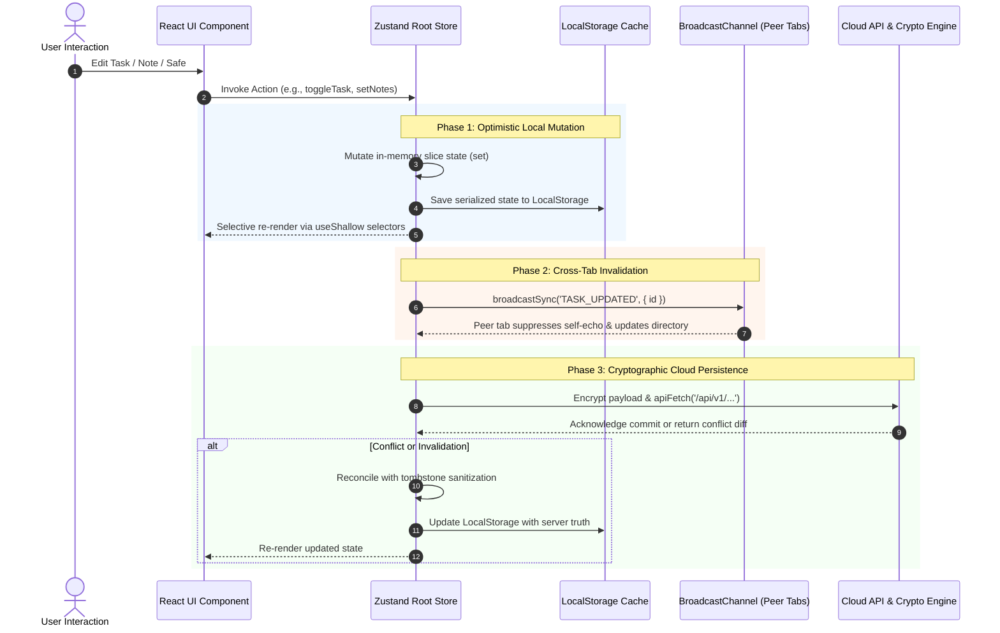

# DataStore Architecture: State Management & Slices

This document provides a deep dive into the state management layer of Tide Web (`web/src/store/useDataStore.ts`), exploring the modular Zustand slice pattern, offline hydration lifecycle, multi-vault isolation, cryptographic filesystem caches, and cross-tab synchronization.

---

## 1. Modular Store Architecture

Tide uses **[Zustand](https://github.com/pmndrs/zustand)** with a modular **Slice Pattern**. Instead of managing a monolithic store in a single file, the application decomposes state into isolated, strongly-typed domain slices.

```
web/src/store/
├── useDataStore.ts              # Root store orchestrator & selector hooks
├── sync/
│   └── broadcast.ts             # BroadcastChannel cross-tab synchronization
└── slices/
    ├── types.ts                 # Store-wide type definitions & slice interfaces
    ├── fsHelpers.ts             # Tombstones, offline storage, crypto decryption
    ├── createNotesSlice.ts      # Note items, ordering, layouts, carets, folders
    ├── createEventsSlice.ts     # Calendar events, overlap modes, holiday packs
    ├── createTodosSlice.ts      # Hierarchical task tree, recurrence, status
    ├── createUiSlice.ts         # Theme, SmartIsland HUD, paper styles, modals
    ├── createFsSlice.ts         # Virtual file system, metadata cache, directories
    ├── createSafesSlice.ts      # Multi-vault isolation & safe filtering
    └── createContactsSlice.ts   # P2P / user contacts & social sharing
```

### Root Store Composition

The root store `useDataStore` implements `DataStoreState` by merging all domain slice creators:

```typescript
export const useDataStore = create<DataStoreState>()((...a) => ({
    ...createNotesSlice(...a),
    ...createEventsSlice(...a),
    ...createTodosSlice(...a),
    ...createUiSlice(...a),
    ...createFsSlice(...a),
    ...createContactsSlice(...a),
    ...createSafesSlice(...a),
}));
```

Every slice adheres to the generic type:

```typescript
export type DataStoreSlice<T> = StateCreator<DataStoreState, [], [], T>;
```

This gives every individual slice full type-safe read access (`get()`) to other slices while restricting its direct mutation surface to its declared interface (`set()`).

### Selector Hooks & Reactivity Optimization

Direct subscriptions to `useDataStore((state) => state)` would cause full component tree re-renders on any state mutation. To guarantee fine-grained rendering, `useDataStore.ts` provides specialized domain selector hooks wrapped with `useShallow`:

* `useNotes()`: Note list, active note, caret positions, layouts, folder navigation.
* `useCalendarEvents()`: Event items, range filtering, overlap resolution, holiday settings.
* `useTasks()`: Task items, hierarchical tree updates, status toggling.
* `useUiActions()`: Theme toggles, paper styles, SmartIsland HUD, modal controls.
* `useFileSystem()`: Crypto keys, metadata cache, open folder IDs, raw file mutators.
* `useSafes()`: Multi-vault access, active safe toggles, safe assignment.

---

## 2. Domain Slices Breakdown

### 2.1 NotesSlice (`createNotesSlice.ts`)

Manages document items, canvas notes, folder organization, and editor persistence:

* **Data Model (`DataItem`):**
  * `id`: Unique identifier (UUID or backend file ID).
  * `title`: Note title or heading.
  * `type`: `'note'`, `'canvas'`, `'folder'`, etc.
  * `safe` & `linkedSafes`: Multi-vault categorization.
  * `parentId`: Hierarchical folder nesting.
* **Layout Modes (`NoteLayout`):**
  * Options: `'thin'`, `'normal'`, `'wide'`, `'extra-wide'`, `'a4'`.
  * Persisted in `localStorage` key `'tide_note_layout'`. Defaults to `'a4'`.
* **Caret Retention:**
  * Tracks precise cursor selections per note via `noteCaretPositions: Record<string, { from: number; to: number }>`.
  * When switching between notes or views, cursor positions are restored smoothly without resetting to line 0.
* **Folder Hierarchy:**
  * Supports creating hierarchical folders (`createFolder(name, parentId)`).
  * Tracks `activeParentId` to constrain note listing inside nested folders.
* **Mention Integration:**
  * `insertMentionIntoNote(noteId, targetId, title)`: Generates internal cross-references to other notes, events, or tasks.

### 2.2 EventsSlice (`createEventsSlice.ts`)

Handles temporal schedule items and calendar rendering configurations:

* **Event Storage:**
  * Stored as `events: DataItem[]`, synced with `tide_offline_events` in `localStorage`.
* **Overlap Modes (`CalendarOverlapMode`):**
  * `'overlap'`: Visual columns side-by-side.
  * `'stack'`: Vertical cascading layers.
  * Controlled via `setCalendarOverlapMode` with `groupOverlappingEvents(parentId)`.
* **Color Palettes (`CalendarColorPalette`):**
  * Options: `'modern-dark'`, `'soft-pastels'`, `'classic-tide'`.
  * Saved in `'tide_calendar_color_palette'`.
* **Holiday Packages (`CalendarHolidayPackage`):**
  * Regional national holidays: `'DE'` (Germany), `'AT'` (Austria), `'CH'` (Switzerland), `'US'` (United States).
  * Toggleable with `calendarHolidaysEnabled`.
* **Mentions & Previews:**
  * `eventMentionStyle`: `'blue'` or `'calendar'`.
  * `eventMentionPreview`: `'always'`, `'hover'`, or `'off'`.

### 2.3 TodosSlice (`createTodosSlice.ts`)

Provides a comprehensive task management engine:

* **Task Model (`TaskItem`):**
  * `id`: Task UUID.
  * `title`, `description`, `color`.
  * `status`: `'todo'` | `'in_progress'` | `'completed'`.
  * `priority`: `'low'` | `'medium'` | `'high'`.
  * `scheduledDate`, `dueDate`.
  * `recurrence`: `'none'` | `'daily'` | `'weekly'` | `'monthly'` | `'yearly'`.
  * `recurrence_rule`, `recurrence_end`, `completed_dates`.
  * `parentId`, `order`: Supports arbitrary depth hierarchical subtasks.
  * `showInCalendar`: Controls projection into calendar grids.
* **Tombstone Tracking (`deletedTaskIds`):**
  * Employs an in-memory `Set<string>` of recently deleted task IDs (`recordDeletedTaskId`) to prevent resurrection during asynchronous cloud reconciliation (`reconcileTasksWithLocal`).
* **Optimistic Local Execution:**
  * `addTask`, `updateTask`, `toggleTask`, `toggleTaskInProgress`, `setTaskStatus`, `deleteTask` apply immediate state mutations, rewrite `localStorage ('tide_offline_tasks')`, and broadcast state before dispatching encrypted API requests.

### 2.4 UiSlice (`createUiSlice.ts`)

Governs user interface presentation, viewport cosmetics, and HUDs:

* **Theme Engine:**
  * Preference: `'light'` | `'dark'` | `'system'`.
  * Resolved theme (`'light'` | `'dark'`) dynamically toggles `.dark` and `.light-override` classes on `document.documentElement` to align with CSS design tokens.
* **Settings Modal:**
  * Modal tab state: `'account'`, `'calendar'`, `'appearance'`, `'extensions'`, `'access'`, `'info'`, `'debug'`.
* **Paper Textures & Viewport:**
  * `paperPattern`: `'blanko'`, `'ruled'`, `'grid'`.
  * `showPageBreaks`: Toggles simulated page breaks for A4/print viewports.
* **SmartIsland HUD (`SmartIslandState`):**
  * Contextual floating island for AI parsing, date detection, and smart suggestions:
  ```typescript
  interface SmartIslandState {
      show: boolean;
      parsedData?: any;
      text?: string;
      sourceNodePos?: number;
      anchorElement?: HTMLElement | null;
  }
  ```
* **Extension Flags:**
  * Manages active module features (`smart_island`, `summary`, `smart_date_detection`, `job_planner`, `todos`, `file_support`).

### 2.5 FsSlice (`createFsSlice.ts`)

Acts as the client-side virtual file system and encryption gateway:

* **Cryptographic Identity:**
  * Holds `privateKey: CryptoKey | null`, `publicKey: CryptoKey | null`, and `myId: string | null`.
  * Initialized upon user authentication unlock.
* **Directory Caching & Lazy Loading:**
  * `loadedDirectories: Set<string>` & `fetchingDirectories: Set<string>`.
  * Folders are fetched on demand via `fetchDirectory(parentId, forceRefresh)`.
  * Tracks folder tree expansion state via `openFolderIds` (persisted to `localStorage ('tide_open_folders')`).
* **Metadata Cache (`metadataCache`):**
  * Stores decrypted file headers, sizes, hashes, and encryption IVs.
  * Offers targeted mutation helpers: `updateSpecificMetadataCache(id, updates)` and `updateFileRaw(id, updates)`.

### 2.6 SafesSlice (`createSafesSlice.ts`) & ContactsSlice (`createContactsSlice.ts`)

* **Safes (Multi-Vault Isolation):**
  * Manages multiple distinct encryption envelopes / data partitions (defaulting to `main` and `Archiv`).
  * `activeSafes`: Filter array controlling which items appear in the active UI views.
  * `toggleSafe(safe)`: Dynamically adds or removes safes from the active filter.
  * `setNoteSafe(noteId, safeName)` / `linkNoteToSafe(noteId, targetSafe)`: Reassigns or multi-links items between vaults.
* **Contacts (P2P Social Sharing):**
  * `ContactItem`: Manages user contacts (`username`, `avatar_seed`, `avatar_salt`, `avatar_style`, `status`).
  * Normalizes server responses from `/api/v1/contacts` and supports sharing encrypted file permissions with peers.

---

## 3. Cross-Tab Synchronization (`sync/broadcast.ts`)

Tide coordinates open browser tabs using the standard **BroadcastChannel API** (`tide_state_sync`).

### Message Protocol

```typescript
export interface SyncMessage<T = unknown> {
    type: string;
    payload?: T;
    senderId?: string;
    timestamp: number;
}
```

### Self-Echo Suppression & Deduplication

Each browser tab creates a persistent, unique client identifier at startup:

```typescript
const tabInstanceId: string = (() => {
    if (typeof crypto !== 'undefined' && typeof crypto.randomUUID === 'function') {
        return crypto.randomUUID();
    }
    return Math.random().toString(36).substring(2, 10);
})();
```

When receiving incoming messages:

```typescript
const handler = (event: MessageEvent<SyncMessage<T>>) => {
    const data = event.data;
    if (!data || typeof data !== 'object') return;
    if (data.senderId === tabInstanceId) return; // Ignore own echo
    callback(data);
};
```

### Invalidation Pipeline

In `useDataStore.ts`, the root store listens to sync events:

```typescript
if (typeof window !== 'undefined') {
    subscribeToSync((msg) => {
        const type = (msg?.type || '').toLowerCase();
        if (!type || type.includes('sync') || type.includes('invalidate') || type.includes('dir')) {
            const state = useDataStore.getState();
            if (typeof state.fetchDirectory === 'function') {
                void state.fetchDirectory(null, true);
            }
        }
    });
}
```

If user actions modify notes, events, or files in Tab A, an invalidation message triggers Tab B to refresh its local metadata cache and directory tree.

---

## 4. Hydration and Persistence Lifecycle

Tide uses a tiered 3-stage persistence architecture:

```
[ Tier 1: LocalStorage ]  ---> Instant synchronous initial paint (< 10ms)
            │
[ Tier 2: IndexedDB Cache ] -> Offline blob & document attachment payload storage
            │
[ Tier 3: Cloud / Backend ] -> Authenticated sync, cryptographic DEK wrap/unwrap
```

### 1. Synchronous Bootstrap (Local Storage)
During slice initialization, slices execute synchronous loaders (`loadCachedNotes`, `loadCachedEvents`, `loadCachedTasks`, `loadCachedSafes`, `loadOpenFoldersFromCache`). This eliminates flash-of-empty-content (FOEC) and allows the application to render full UI structures immediately even when offline.

### 2. Cryptographic Initialization & Directory Fetch
Once the user's master key is derived:
1. `setKeys(privateKey, publicKey, myId)` is invoked on `FsSlice`.
2. All directories previously recorded in `openFolderIds` are re-fetched.
3. Encrypted items are fetched via `apiFetch('/api/v1/vault/...')`.

### 3. Asynchronous Cloud Reconciliation
When cloud directory payloads arrive:
1. **Decryption:** Note titles and task blobs are decrypted using client-side CryptoKey DEKs.
2. **Tombstone Sanitization:** Items matching `deletedTaskIds` are pruned to avoid resurfacing locally deleted items.
3. **Cache Sync:** Offline caches (`saveNotesToOfflineCache`, `saveTasksToOfflineCache`, etc.) are updated with the freshly reconciled state.

---

## 5. State Flow Diagram



---

## 6. Summary Checklist for Contributors

1. **New State Attributes:** Add attributes to `DataStoreState` in `web/src/store/slices/types.ts` before implementing slice logic.
2. **Avoid Monolithic Reads:** Always consume the store through granular selector hooks (`useNotes`, `useTasks`, `useUiActions`, etc.) with `useShallow`.
3. **Offline Caching:** Whenever introducing a persistent preference or collection, provide a `loadCached...` initializer and a `save...ToOfflineCache` helper.
4. **Cross-Tab Awareness:** For actions modifying shared filesystem data or vault assignments, trigger `broadcastSync` to notify concurrent tabs.
5. **Tombstones for Deletions:** Always record deleted IDs in tombstone sets (`recordDeletedTaskId`) during offline operations to prevent cloud sync resurrection.
