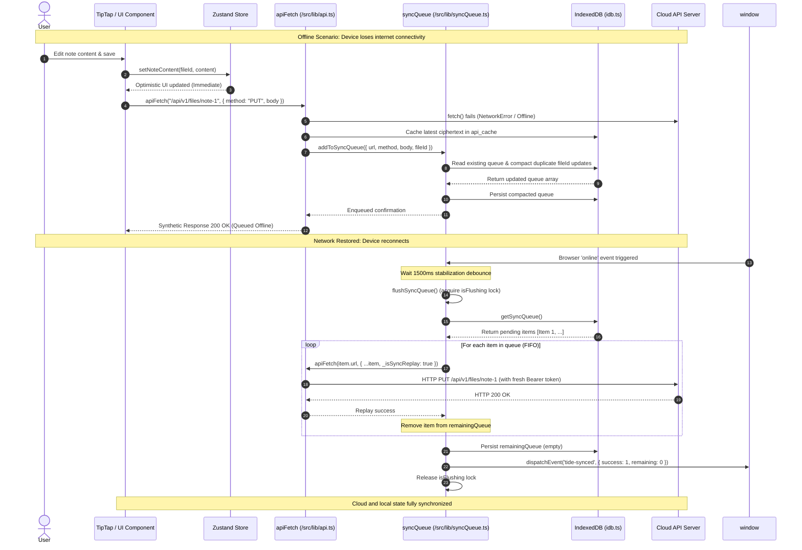

# Offline-First Architecture & Persistent Sync Queue

This document specifies the offline capabilities, local storage engine (`idb.ts`), resilient mutation queuing (`syncQueue.ts`), and network lifecycle orchestration in Tide Web.

---

## 1. Offline-First Architecture Philosophy

Tide is architected around an **offline-first, zero-latency local mutation model**. User operations—creating notes, updating Markdown content, reorganizing file trees, and checking off tasks—must never block on network round-trips or fail due to spotty connectivity.

```
┌────────────────────────────────────────────────────────┐
│                   User Interaction                     │
└──────────────────────────┬─────────────────────────────┘
                           │ (Immediate)
                           ▼
┌────────────────────────────────────────────────────────┐
│             Optimistic Zustand Store State             │
│        (Instant UI feedback, zero-frame lag)           │
└──────────────────────────┬─────────────────────────────┘
                           │
             ┌─────────────┴─────────────┐
             ▼                           ▼
┌───────────────────────────┐ ┌──────────────────────────┐
│   IndexedDB Local Cache   │ │     Network Request      │
│  (idb-keyval fast storage)│ │  (apiFetch HTTP client)  │
└───────────────────────────┘ └──────────┬───────────────┘
                                         │
                         ┌───────────────┴───────────────┐
                     Online OK                       Network Fail
                         │                               │
                         ▼                               ▼
                 ┌───────────────┐              ┌─────────────────┐
                 │ Cloud Updated │              │ Persistent Sync │
                 └───────────────┘              │ Queue (idb.ts)  │
                                                └────────┬────────┘
                                                         │ (Reconnection)
                                                         ▼
                                                ┌─────────────────┐
                                                │ Sequential FIFO │
                                                │ Flusher / Drain │
                                                └─────────────────┘
```

### Core Design Principles

1. **Zero-Latency Execution:** Local state updates are applied optimistically and synchronously in the Zustand data store. The user interface updates instantaneously.
2. **Network Resilience & Degradation:** Network drops, airplane mode, high-latency 3G/4G connections, and cloud server outages do not cause data loss or application crashes.
3. **Local Store as Source of Truth:** The client's local storage holds the active working state. The cloud acts as a durable synchronization target, backup repository, and multi-device relay.
4. **Transparent Replay & Convergence:** Queued mutations are persisted to durable browser storage, compacted to eliminate redundant writes, and replayed in FIFO order once connectivity is restored.
5. **Cryptographic Integrity:** Stored offline drafts, cached note responses, and queued payloads maintain zero-knowledge encryption guarantees. Ciphertexts remain encrypted at rest within IndexedDB.

---

## 2. IndexedDB Storage Engine (`idb.ts`)

Tide utilizes **IndexedDB** as its local persistent database rather than `localStorage`. IndexedDB offers:
* **Asynchronous I/O:** Prevents blocking the JavaScript main thread during large payload serialization.
* **Storage Capacity:** Bypasses `localStorage`'s strict 5MB quota, enabling caching of large encrypted notes, attachments, and historical sync logs (typically hundreds of megabytes).
* **Structured Data:** Native support for binary Buffers, Blobs, and JSON objects.

### Implementation Abstraction

Tide encapsulates IndexedDB through `idb-keyval` in `web/src/lib/idb.ts`:

```typescript
// web/src/lib/idb.ts
import { get, set, del, keys } from 'idb-keyval';

export const idb = {
    get: async <T>(key: string): Promise<T | undefined> => {
        try {
            return await get(key);
        } catch (e) {
            console.error('[IDB] Get error', e);
            return undefined;
        }
    },
    set: async (key: string, value: any): Promise<void> => {
        try {
            await set(key, value);
        } catch (e) {
            console.error('[IDB] Set error', e);
        }
    },
    del: async (key: string): Promise<void> => {
        try {
            await del(key);
        } catch (e) {
            console.error('[IDB] Del error', e);
        }
    },
    keys: async (): Promise<IDBValidKey[]> => {
        try {
            return await keys();
        } catch (e) {
            console.error('[IDB] Keys error', e);
            return [];
        }
    }
};
```

### Stored Entity Types & Namespaces

The key-value namespace in IndexedDB is partitioned by entity purpose:

| Key Pattern | Data Type | Description |
| :--- | :--- | :--- |
| `tide_offline_sync_queue` | `QueueItem[]` | Durable array of offline mutations awaiting cloud transmission. |
| `api_cache_/api/v1/files` | `string` (JSON) | Cached response for the file tree and metadata directory. |
| `api_cache_/api/v1/files/${fileId}/download` | `string` (Ciphertext) | Cached encrypted note content, allowing instant offline note opens. |
| `api_cache_${endpoint}` | `string` | Read-through response cache for any successful `GET` request. |
| `offline_draft_${fileId}` | `string` / `Object` | Emergency working drafts captured during active editing sessions. |
| `attachment_buffer_${id}` | `Blob` / `ArrayBuffer` | Binary media and attachment data pending background upload. |

---

## 3. The Persistent Sync Queue (`syncQueue.ts`)

When a mutation (`POST`, `PUT`, `DELETE`, `PATCH`) cannot reach the server, it is intercepted by `apiFetch` and appended to the persistent sync queue managed by `web/src/lib/syncQueue.ts`.

### Queue Item Data Model

```typescript
export interface QueueItem {
    id: string;               // Unique UUID identifying this queue entry
    url: string;              // Target API endpoint relative path (/api/v1/files/:id)
    method: string;           // HTTP verb (PUT, POST, DELETE, PATCH)
    headers?: Record<string, string>; // Request headers
    body?: any;               // Serialized JSON payload or mutation data
    timestamp: number;        // Epoch timestamp (ms) when mutation occurred
    description?: string;     // Human-readable summary for status UI and logs
    fileId?: string;          // Target file identifier used for mutation compaction
    retryCount?: number;      // Replay attempt counter (for backoff calculation)
}
```

### Automatic Interception & Offline Enqueueing (`apiFetch`)

In `web/src/lib/api.ts`, outgoing requests automatically branch based on network status and endpoint rules:

```typescript
// Excerpt from web/src/lib/api.ts
try {
    const res = await fetch(fullUrl, { ...options, headers, credentials: 'include' });
    // Cache successful GET requests for offline use
    if (isGet && res.ok && typeof window !== 'undefined') {
        const clone = res.clone();
        clone.text().then(async (text) => {
            const { idb } = await import('./idb');
            await idb.set(`api_cache_${cleanEndpoint}`, text);
        });
    }
    return res;
} catch (err: any) {
    // 1. GET requests: Serve from IndexedDB cache
    if (isGet && typeof window !== 'undefined') {
        const { idb } = await import('./idb');
        const cachedText = await idb.get<string>(`api_cache_${cleanEndpoint}`);
        if (cachedText !== undefined) {
            return new Response(cachedText, { status: 200, statusText: "OK (Offline Cache)" });
        }
        throw err;
    }

    // 2. Auth requests: Never queue offline; user must be aware of auth failure
    if (cleanEndpoint.startsWith('/api/v1/auth')) {
        throw err;
    }

    // 3. Sync Replays: Rethrow so the sync flusher knows the attempt failed
    if (options._isSyncReplay) {
        throw err;
    }

    // 4. Binary file uploads: Throw to prevent huge Blobs in the JSON sync queue
    const isFormData = typeof FormData !== 'undefined' && options.body instanceof FormData;
    if (isFormData) {
        throw err;
    }

    // 5. Enqueue mutation to sync queue & return synthetic 200 OK
    const { addToSyncQueue } = await import('./syncQueue');
    await addToSyncQueue({
        url: cleanEndpoint,
        method: options.method || 'POST',
        headers: options.headers as Record<string, string>,
        body: options.body,
        fileId,
        description: `${options.method || 'POST'} ${cleanEndpoint}`
    });

    // Return optimistic synthetic response so UI does not trigger an error state
    return new Response(JSON.stringify(syntheticResponse), {
        status: 200,
        statusText: "OK (Queued Offline)",
        headers: { 'Content-Type': 'application/json' }
    });
}
```

### Synthetic Responses & Client UUID Injection

When an item is created while offline (e.g., `POST /api/v1/files`), the client cannot wait for the database auto-increment or server-generated ID:
1. `apiFetch` extracts or assigns a client-generated UUID (`crypto.randomUUID()`).
2. The payload is rewritten to include this ID.
3. The synthetic 200 response returns `{ id: clientGeneratedUuid, status: 'queued_offline', ok: true, ...body }`.
4. Zustand stores this ID immediately; child components and routes can navigate to `/notes/[id]` without delay.

---

## 4. Deduplication & Mutation Compaction

### The Write Amplification Challenge

In note-taking and document editing, auto-save mechanisms trigger frequent updates. If a user edits a note five times in 30 seconds while offline:
* Without compaction: Five distinct `PUT /api/v1/files/:id` requests enter the queue.
* With compaction: Intermediate updates are collapsed into a single terminal update representing the final document state.

### Compaction Logic in `addToSyncQueue`

When `addToSyncQueue` receives an item:
1. It reads the current queue from IndexedDB.
2. If `fileId` is set and the operation is an update (`PUT` or `POST`), it filters out any existing pending queue items matching **both** `fileId` and `url`.
3. It appends the new mutation snapshot to the end of the queue.

```typescript
// web/src/lib/syncQueue.ts
export async function addToSyncQueue(item: Omit<QueueItem, 'id' | 'timestamp'>): Promise<QueueItem> {
    const fullItem: QueueItem = {
        ...item,
        id: typeof crypto !== 'undefined' && crypto.randomUUID 
            ? crypto.randomUUID() 
            : `sync_${Date.now()}_${Math.random()}`,
        timestamp: Date.now(),
        retryCount: 0
    };

    try {
        const queue = await getSyncQueue();
        
        // If an update for the exact same fileId and URL already exists in the queue, 
        // replace it to avoid duplicate intermediate writes
        let nextQueue: QueueItem[];
        if (fullItem.fileId && (fullItem.method === 'PUT' || fullItem.method === 'POST')) {
            const filtered = queue.filter(q => !(q.fileId === fullItem.fileId && q.url === fullItem.url));
            nextQueue = [...filtered, fullItem];
        } else {
            nextQueue = [...queue, fullItem];
        }

        await idb.set(SYNC_QUEUE_KEY, nextQueue);
        notifyQueueChanged(nextQueue.length);
        return fullItem;
    } catch (e) {
        console.error('[SyncQueue] Failed to add item to sync queue', e);
        return fullItem;
    }
}
```

> [!NOTE]
> `DELETE` operations are **not** compacted over preceding creations blindly; preserving strict ordering ensures the server processes creates and deletes deterministically.

---

## 5. Flush & Background Reconnection Protocol

### Connection Detection Triggers

The sync queue monitors network status through multiple complementary mechanisms:

1. **`window.addEventListener('online')`:**
   Fired immediately when network connectivity returns. A debounce timer of **1500ms** is applied before draining to allow local socket initialization, WiFi authentication, and DNS routing to settle.
2. **`window.addEventListener('offline')`:**
   Dispatches a `tide-offline` event to display status badges or toasts in the UI.
3. **Periodic Heartbeat (60 seconds):**
   A background timer checks whether `navigator.onLine` is true and whether un-flushed items remain in IndexedDB.
4. **App Initialization:**
   `initSyncQueueListener()` runs during boot, verifying if previous session mutations were left in IndexedDB.

### Sequential FIFO Queue Draining (`flushSyncQueue`)

```
                          ┌───────────────────────────┐
                          │     flushSyncQueue()      │
                          └─────────────┬─────────────┘
                                        │
                         Is isFlushing || !navigator.onLine?
                                ├─── Yes ───► Abort Flush
                                └─── No
                                        ▼
                          Set isFlushing = true
                          Read queue from IndexedDB
                                        │
                         For each QueueItem (FIFO Order)
                                        │
               ┌────────────────────────┴────────────────────────┐
               ▼                                                 ▼
       Inject latest Auth Token                     Execute apiFetch with
       from localStorage                            _isSyncReplay: true
               │                                                 │
               └────────────────────────┬────────────────────────┘
                                        │
                           Evaluate HTTP Response Status
                                        │
        ┌───────────────────────────────┼───────────────────────────────┐
        ▼                               ▼                               ▼
    HTTP 2xx                        HTTP 4xx (Client)               HTTP 5xx / Network Error
  (Success)                      (Unrecoverable)                 (Transient / Timeout)
        │                               │                               │
        ▼                               ▼                               ▼
Item removed from queue.         Item discarded with             Increment retryCount.
success++                        warning. failed++               Keep item in remainingQueue.
                                                                 Break loop (halt flush).
                                        │
                                        ▼
                         Persist remainingQueue to IDB
                         Reset isFlushing = false
                         Dispatch 'tide-synced' event
```

### Concurrency Protection & Loop Safeguards

* **`isFlushing` Mutex:** Prevents simultaneous execution of `flushSyncQueue`. Subsequent triggers return `{ success: 0, failed: 0 }` immediately.
* **`_isSyncReplay: true` Flag:** When `apiFetch` replays a queued item, this flag is passed in options. If the request encounters a network error, `apiFetch` re-throws instead of re-enqueueing the item into the queue, preventing an infinite recursion loop.
* **Token Refreshing:** Auth tokens may expire or renew while the user was offline. The flusher dynamically retrieves the latest token (`localStorage.getItem("tide_session_token")`) and overrides stale `Authorization` headers.

### Error Classification & Handling

| Status Code | Classification | Action Taken | Rationale |
| :--- | :--- | :--- | :--- |
| **200 - 299** | Success | Item popped from queue | Server successfully applied mutation. |
| **400 - 499** (except 408, 429) | Unrecoverable Client Error | **Discarded** from queue | The payload is permanently invalid (e.g., malformed syntax, 404 target deleted). Keeping it would permanently block the FIFO queue. |
| **408 (Timeout)** | Transient Error | Retained in queue (`retryCount++`) | Server or gateway timed out; may succeed on subsequent attempt. |
| **429 (Rate Limited)** | Transient Error | Retained in queue (`retryCount++`) | Cloud rate limits triggered; queue pauses until next heartbeat. |
| **500 - 599** | Server Error | Retained in queue (`retryCount++`) | Backend database or service temporarily unavailable. |
| **Network Failure / Fetch Error** | Disconnection | Retained in queue; **break loop immediately** | Connection died mid-flush; avoids exhausting requests while offline. |

---

## 6. Optimistic UI & Rollback Strategy

### Optimistic Application

The user interface binds directly to Zustand selectors (`useNotes()`, `useCalendarEvents()`, `useTasks()`). When an action is dispatched:
1. Store state is updated synchronously.
2. The UI renders the new state on the exact next frame.
3. The background operation is scheduled via `apiFetch`.
4. If the call succeeds or is enqueued into `syncQueue`, the optimistic state remains permanent.

### Rollback Strategy & Failure Feedback

When a mutation permanently fails during replay (e.g., HTTP 409 Conflict, target parent folder deleted on another device, or maximum retry exhaustion):

1. **Custom Event Notification:**
   `window.dispatchEvent(new CustomEvent('tide-sync-queue-updated', { detail: { pendingCount } }))` notifies UI elements.
2. **SmartIsland HUD Status:**
   The SmartIsland indicator displays the current sync state:
   * *Cloud Icon (Pulse)*: Flushing offline queue.
   * *Orange Warning*: Unsynced items waiting for reconnection.
   * *Red Exclamation*: Item failed unrecoverably.
3. **Toast Alerts & Conflict Markers:**
   For conflicting edits, the store marks the item with a local conflict indicator or creates a duplicated `(Conflict Copy)` note, preserving the user's offline work without overwriting remote state.

---

## 7. Lifecycle Sequence Diagram

The following diagram illustrates the complete lifecycle from offline modification through network restoration and queue draining:



---

## 8. Developer Quick Reference

### Checking Queue State Programmatically

```typescript
import { getSyncQueue, flushSyncQueue, clearSyncQueue } from '@/lib/syncQueue';

// Inspect pending items
const pending = await getSyncQueue();
console.log(`Unsynced mutations: ${pending.length}`);

// Force a manual flush attempt
const result = await flushSyncQueue();
console.log(`Synced: ${result.success}, Failed: ${result.failed}`);

// Emergency purge of unrecoverable queue items
await clearSyncQueue();
```

### Listening to Sync Events in Components

```typescript
useEffect(() => {
    const handleSyncUpdated = (e: CustomEvent) => {
        console.log(`Pending sync items: ${e.detail.pendingCount}`);
    };

    const handleSyncComplete = (e: CustomEvent) => {
        console.log(`Sync completed. Successfully pushed: ${e.detail.success}`);
    };

    window.addEventListener('tide-sync-queue-updated', handleSyncUpdated as EventListener);
    window.addEventListener('tide-synced', handleSyncComplete as EventListener);

    return () => {
        window.removeEventListener('tide-sync-queue-updated', handleSyncUpdated as EventListener);
        window.removeEventListener('tide-synced', handleSyncComplete as EventListener);
    };
}, []);
```
