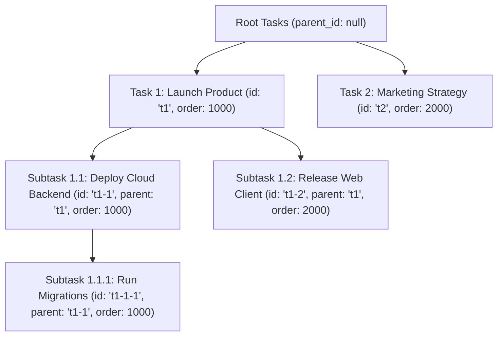
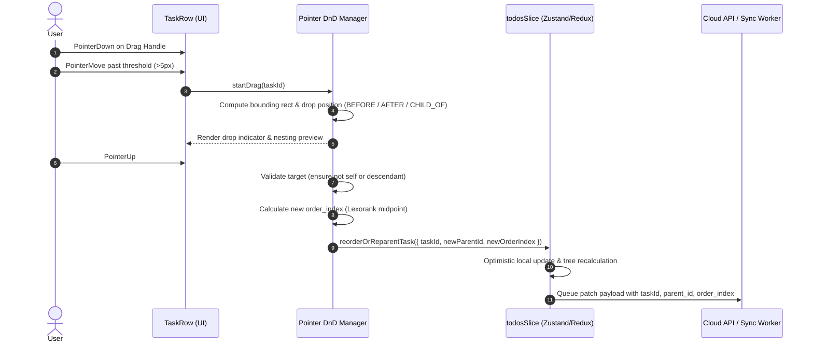

# Task Hierarchy, Nesting, Batch Operations, and State Synchronization

This technical guide documents the architecture, data models, UI interaction patterns, and synchronization workflows for task management within the Tide web application (`web/src/components/Todo/` and `web/src/store/slices/todosSlice.ts`).

---

## 1. Task Model & Tree Structure

Tasks in Tide are represented as hierarchical entities supporting arbitrary nesting, priority categorization, status lifecycle management, tagging, and relative spatial ordering.

### 1.1 Data Schema

The core task interface in the TypeScript frontend is modeled as follows:

```typescript
export type TaskPriority = 'low' | 'medium' | 'high' | 'urgent';
export type TaskStatus = 'todo' | 'in_progress' | 'completed';

export interface TaskItem {
  id: string;                         // Unique UUID v4 identifier
  title: string;                      // Plain text or markdown title
  priority: TaskPriority;             // 'low' | 'medium' | 'high' | 'urgent'
  status: TaskStatus;                 // 'todo' | 'in_progress' | 'completed'
  due_date: string | null;            // ISO 8601 date string or YYYY-MM-DD
  tags: string[];                     // User-defined string tags (e.g., ['work', 'release'])
  parent_id: string | null;           // References parent TaskItem.id, or null for root tasks
  order_index: number | string;       // Fractional index / Lexorank string for zero-reindex sorting
  created_at?: string;                // ISO timestamp
  updated_at?: string;                // ISO timestamp
  is_collapsed?: boolean;             // UI state: whether child subtasks are collapsed
}
```

### 1.2 Recursive Tree Construction

Tasks are stored in a normalized dictionary or flat list in `todosSlice.ts` (`tasks: Record<string, TaskItem>`), avoiding deeply nested immutable updates.

When rendering the hierarchical view:
1. **Adjacency Map Construction:** A lookup dictionary maps each `parent_id` to its child task IDs:
   ```typescript
   function buildTaskTree(tasks: Record<string, TaskItem>): Map<string | null, TaskItem[]> {
     const adjacency = new Map<string | null, TaskItem[]>();
     Object.values(tasks).forEach(task => {
       const pId = task.parent_id ?? null;
       if (!adjacency.has(pId)) {
         adjacency.set(pId, []);
       }
       adjacency.get(pId)!.push(task);
     });
     // Sort children by order_index within each parent level
     adjacency.forEach((children) => {
       children.sort((a, b) => (a.order_index < b.order_index ? -1 : 1));
     });
     return adjacency;
   }
   ```
2. **Recursive Rendering & Indentation:**
   - Tasks with `parent_id === null` render at root depth (`depth = 0`).
   - Children render recursively with progressive horizontal indentation (e.g., `paddingLeft: depth * 20px`).
   - Collapsing state is tracked per parent node (e.g., `collapsedTaskIds: Set<string>`). If `is_collapsed` is true, the recursive descent for that subtree is skipped.



---

## 2. Drag-and-Drop Reordering & Reparenting

Tide provides high-performance pointer-based drag-and-drop operations for reordering tasks at the same hierarchy level or reparenting tasks into nested subtasks.

### 2.1 Pointer Event Drag Handling

Instead of relying on native HTML5 drag-and-drop (which suffers from inconsistent touch support on mobile devices and browser-specific ghosting), Tide utilizes unified pointer events (`onPointerDown`, `onPointerMove`, `onPointerUp`):

1. **Activation Threshold:** A drag operation begins after the pointer moves past a threshold distance (e.g., 5px) to prevent accidental drags during touch scrolling or clicking.
2. **Drop Zone Calculation:** During `onPointerMove`, the bounding client rectangle (`getBoundingClientRect()`) of the hovered task row is evaluated vertically:
   - **Top 25% of Row:** Target drop position is `BEFORE` the hovered task (`parent_id = hovered.parent_id`).
   - **Middle 50% of Row (or indent offset to the right):** Target drop position is `CHILD_OF` the hovered task (`parent_id = hovered.id`), nesting the dragged item.
   - **Bottom 25% of Row:** Target drop position is `AFTER` the hovered task (`parent_id = hovered.parent_id`).

### 2.2 Fractional Index / Lexorank Ordering Algorithm

Traditional integer ordering schemes require reindexing every subsequent sibling upon an insert (`UPDATE tasks SET order_index = order_index + 1 WHERE order_index >= target`). This causes mass database writes and synchronization merge conflicts.

Tide uses **Fractional Indexing** (or string Lexoranks):
- Each position is represented by a fractional number $O \in \mathbb{R}$ (or base-62 lexicographical string).
- To insert between sibling $A$ (index $O_A$) and sibling $B$ (index $O_B$):
  $$O_{\text{new}} = \frac{O_A + O_B}{2}$$
- Edge Cases:
  - If inserted before first sibling $B$: $O_{\text{new}} = O_B - 1000$ (or $O_B / 2$).
  - If inserted after last sibling $A$: $O_{\text{new}} = O_A + 1000$.
- **Reparenting:** When reparenting to a new parent, the task's `parent_id` is updated to the new parent ID, and its `order_index` is calculated based on its new siblings under that parent.
- **Cycle Prevention:** A task cannot be reparented into its own descendant. The drag validation checks `isDescendant(targetParentId, draggedTaskId)` prior to committing the move.

### 2.3 Reparenting Lifecycle Diagram



---

## 3. Batch Operations & Multi-Select

Tide allows fast multi-task modifications via selection primitives and atomic batch actions.

### 3.1 Multi-Selection State Management

The selection state is decoupled from task items and stored as a set of active task IDs:
```typescript
interface TodoUIState {
  selectedTaskIds: Set<string>;
  lastSelectedId: string | null;     // Anchor for Shift-Click range selection
}
```

- **Checkbox Click:** Toggles task selection independently.
- **Row Click (with Meta/Ctrl key):** Adds/removes the clicked task to `selectedTaskIds`.
- **Shift-Click Range Selection:**
  1. Identifies the flat visible list of tasks currently displayed in the tree view.
  2. Locates the indices of `lastSelectedId` and the clicked `taskId`.
  3. Selects all visible items between `min(indexA, indexB)` and `max(indexA, indexB)`.

### 3.2 Batch Actions

When `selectedTaskIds.size > 0`, a floating batch action toolbar is displayed, supporting atomic bulk mutations:

1. **Batch Complete (`batchSetStatus`):**
   - Sets `status: 'completed'` across all selected tasks.
   - Optionally cascades to subtasks if configured by the user.
2. **Batch Reschedule (`batchSetDueDate`):**
   - Applies a selected target `due_date` to all selected tasks.
3. **Batch Priority Change (`batchSetPriority`):**
   - Updates `priority` to `'low' | 'medium' | 'high' | 'urgent'` for all selected tasks.
4. **Batch Delete (`batchDeleteTasks`):**
   - Removes selected tasks and their subtrees.
   - Pushes deleted IDs to the tombstone tracker (`deletedTaskIds`).

---

## 4. Tombstone Tracking & State Synchronization

In offline-first and multi-device collaborative systems, direct hard-deletions risk "resurrection bugs" (where an offline device syncs an older snapshot and recreates deleted tasks). Tide employs **Tombstone Tracking**.

### 4.1 Tombstone Store Integration

`todosSlice.ts` maintains a set of tombstoned IDs:

```typescript
export interface TodosSliceState {
  tasks: Record<string, TaskItem>;
  deletedTaskIds: string[];         // Tombstones awaiting sync confirmation
  lastSyncTimestamp: number;
}
```

- **Soft-Delete on Client:**
  When a task is deleted:
  1. The task is removed from `tasks` locally to update the UI immediately.
  2. Its ID (and all nested subtask IDs) are appended to `deletedTaskIds`.
  3. The deletion is recorded with an updated timestamp.
- **Sync Protocol:**
  When syncing with the cloud backend:
  1. The client sends payload `{ updates: TaskItem[], deleted: string[] }`.
  2. The server applies the deletions using soft-delete flags or tombstone records in SQLite (`tasks.deleted_at IS NOT NULL`).
  3. Once the server confirms deletion, the client clears acknowledged IDs from `deletedTaskIds`.
  4. Incoming remote tasks whose IDs exist in `deletedTaskIds` are rejected locally to prevent resurrection.

---

## 5. Calendar Integration

Tasks with associated dates integrate seamlessly into both Desktop (`CalendarView.tsx`) and Mobile (`MobileLayout.tsx`, `MobileWeekGrid.tsx`) time grids.

### 5.1 Displaying Scheduled Tasks on Calendar Time Grids

- **All-Day vs. Timed Tasks:**
  - Tasks with a `due_date` containing only a date (`YYYY-MM-DD`) render in the **All-Day / Top Header banner** of the corresponding day column.
  - Tasks with an ISO timestamp (`YYYY-MM-DDTHH:mm:ss`) render directly within the **Time Grid** at their designated start slot.
- **Visual Styling & Distinction:**
  - Tasks are distinguished from calendar events via a task icon indicator (`lucide:CheckSquare`) and high-contrast priority chips.
  - Priority colors reflect design tokens:
    - `urgent`: Red tint (`text-red-500`, `bg-red-500/10`, `border-red-500/30`)
    - `high`: Amber tint (`text-amber-500`, `bg-amber-500/10`, `border-amber-500/30`)
    - `medium`: Blue tint (`text-blue-500`, `bg-blue-500/10`, `border-blue-500/30`)
    - `low`: Neutral tint (`text-zinc-500`, `bg-zinc-500/10`, `border-zinc-500/30`)

### 5.2 Completed Task Strikethrough & Filtering

- **Strikethrough Treatment:**
  - When `task.status === 'completed'`, the calendar item is rendered with an opacity reduction (`opacity-50`), muted text (`text-muted-foreground`), and an active line-through style (`line-through`).
- **Interactive Checkbox:**
  - Calendar task chips include an interactive checkbox allowing users to toggle completion directly from the calendar without opening the todo manager.
- **Calendar Filter Controls:**
  - The calendar toolbar includes a visibility toggle:
    - *Show Completed Tasks*: When unchecked, completed tasks are excluded from the grid rendering pipeline, reducing visual noise during busy schedules.
